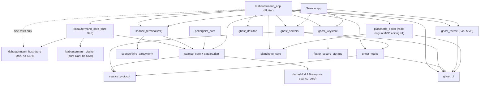

# 03. Architecture

Status: plan with owner decisions of 2026-10-10. Implementation started on
2026-10-13; a passage that cites a merged PR describes built code, and the
rest is plan.

The decision log (section 2) was synthesized from three competing proposals,
A (agentless-first minimalist), B (capability-first with an optional
companion) and C (suite-integration-first), judged by an engineering review
and a product and security review. "A's", "B's" and "C's" in rejected
alternatives refer to these proposals; the proposals are not kept.

The base is proposal A, which both reviews recommended. Grafted from C:
suite integration (`SshLink` in `seance_core`, product-neutral observation
packages, the elevation prelude, "move, switch, prove", the catalog home,
the keystore extraction, suite links, convergence tests). Grafted from B:
host tiers (the T1 design, the footprint manifest, durable detached-operation
results, the coverage card, the T2 prerequisites). Where this plan conflicts
with the feature catalog, it supersedes the catalog rows listed in
section 1.4. The owner's answers of 2026-10-10 to the proposal's open
questions are applied in place; each decision they changed carries an
"Owner decision 2026-10-10" sentence. Owner decisions 21 and 22 of the
same day (alerts while the app is closed, D42) are marked "Owner decision
2026-10-10 (21/22)".

This chapter holds sections 1 to 11. Sections 12 to 15 (suite integration,
milestones, risks, owner decisions) and Appendices A to C continue with the
same numbering in [04-IMPLEMENTATION.md](04-IMPLEMENTATION.md); its Appendix
B maps every review "must address" item to the section that resolves it.
Milestones (M0 to M9) and spikes (S1 to S10) named here are scheduled in its
section 13; the extractions F1a to F7 are listed in 3.5.

Inputs: the feature catalog [02-FEATURES.md](02-FEATURES.md) (IDs such as
STK-06 refer to it), and the research reports r1 to r5 and codebase reports
c1 to c4, condensed in [01-RESEARCH.md](01-RESEARCH.md) and imported as
appendices under [research/](research/README.md). Short markers such as
"r5 §5.4" or "c1 §2.3" point to those reports:
[r1](research/r1-docker-managers.md) Docker managers,
[r2](research/r2-selfhost-platforms.md) self-host platforms,
[r3](research/r3-server-panels-monitoring.md) server panels and monitoring,
[r4](research/r4-native-mobile-clients.md) native and mobile clients,
[r5](research/r5-technical-feasibility.md) technical feasibility,
[c1](research/c1-catalog-sync.md) catalog and sync,
[c2](research/c2-ssh-exec-terminal.md) SSH, exec and terminal,
[c3](research/c3-shared-ui-app-shells.md) shared UI and app shells,
[c4](research/c4-suite-infra.md) suite infrastructure.

Name and identities (owner decision 2026-10-10, D38): the product is
Klabautermann, with display name `Klabautermann` and lowercase ASCII stem
`klabautermann` ([05-NAMES.md](05-NAMES.md#53-klabautermann)); the Windows
`CompanyName` is `ch.lkmc`, as for Séance and Planchette.

Markers: **[V]** verified in the repository at `bf1da58` when this plan was
written (path and line given; claims added for owner decisions 21 and 22
were verified at `e29c095`, those added with D43 to D55 and the
proposals at `7a79e6f1`);
**[L]** verified by a local experiment when
this plan was written (Ubuntu 24.04 container with dash 0.5.12, bash 5.2.21
and sudo 1.9.15p5; Appendix A of 04); **[R]** taken from a research report
or a review without re-verification; **[U]** unverified, settled by the
named spike before the design relies on it; **[E]** estimate or design
value. Path abbreviations: `SC` = `seance/packages/seance_core/lib`, `SP` =
`seance/packages/seance_protocol/lib/src`, `PC` =
`poltergeist/packages/poltergeist_core/lib`, `PA` =
`poltergeist/app/poltergeist_app/lib`, `SA` = `seance/app/seance_app/lib`.

---

## 1. Summary and principles

### 1.1 Summary

1. **Product.** A native Flutter client for Linux, macOS, Windows, Android
   and iOS that monitors and manages servers and their Docker or Podman
   workloads over plain SSH, showing the same end-to-end encrypted server
   list as Séance and Poltergeist. It installs nothing on a host by default
   and opens no ports. Positioning (r2 §7): the control panel that is not
   installed on your server.
2. **Tiers.** T0 (agentless, while the app is open) delivers the MVP and v1.
   T1 (consented host scripts and timers, plus the optional hash-pinned
   `klabautermann-notify` helper for sync-server delivery, with a footprint
   manifest, no daemon, no port) is designed here and committed for v1.x,
   so alerts while closed and scheduled checks exist without a resident
   binary; alerts reach every device through the sync server's command
   inbox (owner decision 2026-10-10 (21/22), D42). T2 (an always-on
   companion written in Rust, an explicit opt-in per server) is planned as
   milestone M9 after v1.x, behind spike S10 and listed prerequisites.
3. **No dartssh2 in the product.** `seance_core` gains `SshLink`, a neutral
   connection handle (headless and streaming exec, stdin, signals, Unix and
   TCP byte streams, SFTP, a session-channel budget, dead-peer detection,
   bounded close). Every dartssh2 workaround lives there, and Séance
   gains dead-peer detection and classified channel errors.
4. **Packages.** `klabautermann_host` (sampler program, parsers, rate maths,
   cron, rules) and `klabautermann_docker` (HTTP/1.1, Engine API, compose
   labels) depend on no SSH package. `klabautermann_core` orchestrates I/O,
   operations and privilege over `SshLink`. The Flutter app sits on top.
5. **Server list.** A catalog and sync library,
   `package:seance_core/catalog.dart`, is extracted from Poltergeist's
   coordinator with Poltergeist switched first and byte-identical files. The
   MVP is a pull-only account member; writes arrive in v1 with the shared
   server editor, and with them publication of first-seen host-key pins,
   because Séance #56 is fixed in F3 before the MVP preview.
6. **Shared before copied.** Every extraction follows "move, switch, prove":
   a design doc, one existing app switched in the same PR, its full suite and
   pixel baselines unchanged. Only the extractions the MVP needs come before
   it (guards, `SshLink` and elevation, credential resolution, catalog with
   the Séance #56 fix, stores and keystore, `ghost_servers` part 1, and
   `ghost_theme` as F4b, so the preview ships theme editing); editor,
   terminal, links and palette land for v1.
7. **Transport.** One SSH connection per server per device; at most 8
   session channels (Poltergeist's headroom rule); Docker traffic on
   `direct-streamlocal` channels, which OpenSSH `MaxSessions` does not count;
   a custom HTTP/1.1 client; never a local listener for the Docker socket.
8. **Sampler.** HWS/1: the probe program and the session nonce go to the
   stdin of `sh -s`, every tick is one shell command line, a READY marker
   precedes the first tick, and every section is length-prefixed and
   nonce-framed. Verified on dash 0.5.12 and bash 5.2 to survive dash's pipe
   read-ahead [L].
9. **Privilege.** Per-server admin mode with C's elevation prelude: the
   builtin `read` takes one password line, `sudo -S -v` validates, and
   `sudo -n -- "$@"` runs as a sibling child of the same shell, followed by
   `exit $?`. Verified working, while A's `exec sudo -n` variant fails [L].
   Password sudo therefore also works for `crontab -`, privileged reads and
   `docker system dial-stdio`. From v1.x a per-server opt-in remembers the
   sudo password, and a second opt-in syncs it in a sealed sub-record
   (D41).
10. **Detached operations.** Long mutations run as transient units with
    `--collect` (or `setsid` without a usable manager), and a small inline
    wrapper writes the exit status and output to an operation directory on
    the host, so results survive unit unloading and phone suspension.
11. **Safety.** Observe-only by default, immutable operation plans whose
    preview is exactly what runs, re-validation before execution, no
    confirmation-free mutation, protected targets with typed confirmation,
    no `--remove-orphans` by default, other managers' stacks read-only, a
    device audit log from the MVP.
12. **Host writes are a tested contract.** Section 8.11 lists every file the
    app can create on a host; an integration test diffs the fixture host's
    filesystem before and after a scripted session.
13. **Sync records.** One new `RecordKind` with typed sub-records under a
    `klabautermann:` prefix, per-type budgets, sealed removal for every type,
    and no unbounded record class. Metrics, logs, inspect output and the audit
    log never sync.
14. **Engine isolate** from the first scaffold, with a plain-data protocol
    enforced by the generalized protocol guard.
15. **Delivery.** Spikes (M0), MVP-path foundations (F1 to F4 and F4b,
    about 23 to 33 engineer-weeks [E]), app milestones M1 to M4 to the MVP
    preview, shipped in suite releases labelled preview (about 44 to 60
    engineer-weeks from the start [E]), then F5 and M5 to M7 to v1 (about 27
    to 38 more [E]), then T1 with the `klabautermann-notify` helper, which
    brings the Rust toolchain (spike S10 first), and the v1.x
    differentiators (M8), then the Rust companion (M9, XL, estimated after
    spike S10).

### 1.2 Principles

1. **Zero footprint by default.** T0 writes to a host only what section 8.11
   lists, each item caused by an explicit user action or a documented
   by-product of one.
2. **No listening ports.** None on the host (NG-17) and none on the device
   for the Docker socket (r5 §1.3). Device port forwards (NET-11, v1) bind
   loopback only, open on demand and close with their view.
3. **SSH is the only transport.** No third-party endpoint by default;
   anything that contacts a registry, forge, notification service or LLM is
   opt-in and labelled (+E in the catalog). The T1 helper (v1.x, D42)
   contacts only the user's own sync server, and only after consent.
4. **Observe first.** New servers start read-only (SAF-01); management needs
   a per-server switch and root needs admin mode (SAF-02).
5. **Host files are the truth.** Compose files, `.env`, crontabs, units and
   T1 state are re-read on open and never mirrored into a shadow database
   (r2 §6.4). Uninstalling the app leaves every workload running.
6. **Honest coverage.** Unknown is drawn as unknown, never as zero; charts
   draw gaps; every alert surface says which tier evaluated it and what it
   cannot catch.
7. **Shared before copied.** Root `AGENTS.md:5` [V]. No third copy of any
   shared implementation; native runner code is the only ledgered exception
   (D32). The Rust companion (M9) is a second implementation of collectors,
   parsers and rules in another language, approved by the owner and held to
   the Dart one by shared fixtures and parity tests (D31).
   `klabautermann-notify` (v1.x, D42) reimplements only the inbox sealing
   in Rust, held to the Dart `InboxCrypto` layout by cross-language test
   vectors (11.1).
8. **Respect other owners.** Stacks and containers managed by another tool,
   by Swarm or by a systemd unit are badged and read-only by default.
9. **No silent wire changes.** The sync "never touch" list (c1 §4.3) holds:
   no crypto, envelope, LWW, blob layout or `kProtocolVersion` change
   (`SP/version.dart:4`, value 1 [V]); no new `ServerConfig` fields.
   Alerts (D42) reuse the inbox blob layout under their own
   associated-data domain, and the sender quota is a server-side limit on
   the inbox endpoints, so neither changes record sync.
10. **Preserve identities.** Application IDs, keychain entry names,
    settings keys, file shapes and `deviceId`s of Séance and Poltergeist are
    preserved byte for byte by every extraction.

### 1.3 Release scope at a glance

| Release | Contents | Execution | Sync |
|---|---|---|---|
| MVP (preview, in suite releases labelled preview from M4) | Catalog §2: fleet list, overview, processes, services, journal and file tails, scheduled jobs, containers, images, logs, stats, compose stacks; single-target guarded actions; a device audit log (SAF-11, 1.4); access check; settings; themes through `ghost_theme` with theme editing and presets | T0 | Pull-only |
| v1 (first public) | Catalog §4 table stakes; in-app server editing; container exec; config edits with diff, backup and validation; volumes, networks, prune; packages read-only; hardware; triage; in-app alerts with local notifications; session history; hand-offs to Séance and Poltergeist (X-03, X-04, X-10) | T0 | Read-write, own record kind (`pref` and `rule` types); first-seen host-key pins published |
| v1.x | T1 host checks with alert delivery through the sync server (`klabautermann-notify` helper, one sender per server, "while you were away" list, D42) and the optional notifier, scheduled update checks, host recorders and "Enable sysstat", desktop tray, Android watch mode, remembered and optionally synced sudo password, volume browsing with a confirmed helper container, tier B hosts, update pipeline, drift detection, log explorer, fleet tables | T0 and T1 | Adds query, layout, window, sudo, registry, sender and alertstatus types; `rule` gains `evalScope: host` |
| Later | M9 after v1.x: the Rust T2 companion (opt-in per server) and the Later rows tagged T2 except ALR-12, ALR-13 and X-09, which wait on further decisions (9.4). Not estimated: backups inside the app on T1, permissive template catalogs, push relay (further decision), Séance metrics strip | T1; T2 on servers where the user enables it | The companion reuses the sender and alertstatus types (D42); further companion records bounded and decided in M9 (9.4) |

### 1.4 Deviations from and corrections to `02-FEATURES.md`

| Item | Catalog says | This plan | Reason |
|---|---|---|---|
| SAF-11 | v1 | MVP | The MVP already mutates; the log is small and builds trust |
| SAF-02 data source | `sudo -S -p '' -v && sudo -n -- <cmd>` in one shell | Elevation prelude with no `exec` and a trailing `exit $?` | bash execs the last command of `-c` implicitly, which breaks the PPID-keyed credential cache [L] (8.3) |
| STK-06, STK-23, IMG-08 | Privilege `docker` | Refused, with the missing sudo right named, when the engine is reachable only through a NOPASSWD rule scoped to `docker`: these detached operations then need root, and such a rule cannot start a root runner (7.17; S4 decides whether a login-user wrapper is added) | sudo checks the runner, not `docker` [R: sudoers(5)] |
| SAF-23 | `systemd-run --collect`, followed with `journalctl -u` | Transient unit plus a host status record and log file; runner chosen per host and by whether the operation needs root (7.17) | Collected units lose `Result`; users without journal access cannot follow root units (D25) |
| STK-12 history location | History file with previous digests and file backups "next to the stack or under `~/.local/state/klabautermann/`" | Deploy history only under `~/.local/state/klabautermann/deploys/`; file backups only in the central backup directories (8.11) | A `.bak` file in a directory read by glob (for example `sites-enabled/*`) is loaded by the service (D27). SAF-12, STK-07 and X-05 leave the backup location open; r2 §6.3, the source behind STK-07, keeps the copy next to the file |
| CN-03 | Nonce-framed sections | Also length-prefixed; nonce delivered on stdin, never in argv | Other local users can read argv; length prefixes defeat forged markers even if a nonce leaks (D22) |
| CN-22 | Classified `SSHChannelOpenError` | Classified by channel type plus open count | sshd refuses a session channel with `SSH2_OPEN_CONNECT_FAILED` "open failed", not "resource shortage" [R: openssh-portable `serverloop.c`, reported by review] |
| §2 prerequisites | `ghost_prompts` and `ghost_theme` before the MVP | Prompts inside `ghost_servers` part 1; `ghost_theme` before the MVP as F4b, as listed | D8; D9 (owner decision 2026-10-10) |
| ALR-11, §6 | Inbox for agent alerts | Command inbox shipped in suite 1.9.0 (`seance/CHANGELOG.md:103,128` [V]); Séance's inbox cursor stops at unknown-app items (`SC/src/inbox/inbox_service.dart:214-222` [V]) and must change first, now before T1 alert delivery in v1.x (owner decision 2026-10-10 (21/22)) | D31, D42 |
| ALR-16 | v1.x | Separate raise and clear thresholds and durations ship in v1 with ALR-01 (rule model in 7.19, `rule` record in 4.8); flap damping and host-side use with T1 (ALR-04) stay v1.x | D29 puts in-app alerts with hysteresis in v1, and the synced v1 `rule` format already carries both thresholds, so its clear fields work from the first release |
| SYN-05 | v1.x | v1, with the first `pref` and `rule` records: every `klabautermann:` type ignores unsealed tombstones and deletes with a sealed `removed` record | A forged tombstone can neither silence a rule nor drop a user-marked protected target (D17, 4.8, 8.6; owner decision 2026-10-10 (9)) |
| VOL-05 export | Later; helper container `tar` | v1.x as "back up this volume now" (7.18): a one-shot tar of one named volume, read directly or through the elevation prelude (8.3), never through a helper container; import stays Later | Owner decision 2026-10-10 (19) promised one-off database dumps and "back up this volume now" until full backups; D27 allows helper containers only for VOL-03 and CTR-21 |

---

## 2. Decision log

This log resolves every open design question once. Later sections elaborate
it and do not reopen it. When a section conflicts with the log, the log
wins; changing a decision means editing this section in the same PR, as
Poltergeist does (`poltergeist/docs/plan/00-OVERVIEW.md:56-59` [V]). The
owner's decisions of 2026-10-10 (04, section 15) are recorded in the
entries they touch; rejected alternatives stay for the record.

Quick index: D1 tiers · D2 scope · D3 move, switch, prove · D4 no dartssh2
in the product · D5 product packages · D6 catalog home · D7 stores and
keystore · D8 `ghost_servers` part 1 · D9 theme · D10 charts and logs ·
D11 terminal · D12 suite links · D13 enrollment · D14 pull-only MVP · D15
host keys · D16 endpoint pins · D17 record kinds · D18 engine isolate · D19
connection budget · D20 Docker transport · D21 API negotiation · D22
sampler · D23 dartssh2 pin · D24 elevation · D25 detached operations · D26
operation plans · D27 host write contract · D28 audit · D29 history and
alerts · D30 T1 · D31 T2 · D32 native runner code · D33 UI composition ·
D34 mobile · D35 localization · D36 integration fixtures · D37 CI · D38
identities · D39 assistant · D40 multi-device · D41 remembered sudo
password · D42 alert delivery through the sync server · D43 rates in the
engine · D44 sample sequence · D45 subscriptions · D46 link vocabulary ·
D47 sampler deadlines · D48 host-side filtering · D49 collector locale ·
D50 LXC values · D51 Access tab · D52 runtime placement · D53 integration
placement · D54 runtime override in M3 · D55 no health overlay in the MVP
· D56 log search through `planchette_core` · D57 timer triggers · D58
cron zone rules · D59 capability cache · D60 threshold announcements ·
D61 host-key pins and re-pin ·
D62 sync state files and the keystore port · D63 pull-only sync in the
engine · D64 a server's confirmation covers its route · D65 spike S3
and admin validation.
Proposals awaiting the owner close the section; they are not decisions.

### Shape and scope

- **D1. Agentless first, with designed host tiers.** T0 delivers the MVP and v1.
  T1 is designed in 9.3 and committed for v1.x, because alerts while closed and
  scheduled update checks are part of the owner's "and so on" and phones cannot
  poll in the background (iOS about 30 s at system-chosen times; Android
  WorkManager every 15 min at most; `dataSync` services limited to 6 h per 24 h
  [R: r5 §5.4]). T2 is planned for M9 after v1.x (D31). Owner decision
  2026-10-10: T2 is planned as a milestone instead of "Later, behind an owner
  decision". *Rejected:* B's companion inside the committed plan (a resident
  root-equivalent binary, its packaging and signing on the MVP path, and a
  changed release graph); A's "no T1 design unless the owner asks" (leaves the
  largest product gap without a plan).
- **D2. The catalog tiers are the scope.** MVP, v1, v1.x and Later follow
  `02-FEATURES.md` §2 to §4 with the deviations in 1.4. Any further
  deviation needs an entry here. *Rejected:* re-cutting scope per architecture.
- **D54. CN-09's manual runtime override arrives with M3.** M2 detects the
  runtime per host (Docker or Podman, rootful or rootless) from the probe's
  tool and socket lines (6.1) and shows it; the manual override arrives
  with the Docker panels in M3, the first code that uses the choice. Both
  milestones precede the MVP preview (M4), so CN-09 stays MVP and 1.4
  needs no row. Changes 04, section 13: M2 carries detection, M3 the
  override. *Rejected:* the override in M2 (a setting nothing reads until
  M3).

### Code sharing

- **D3. Move, switch, prove.** Every extraction (1) starts with a design doc
  in `docs/design/` in the format of `server-appearance-package.md` (scope,
  inventory with `path:line`, public API, strings, staged PRs), approved by
  the owner, including canonical wording where copies differ; (2) moves the
  code and switches at least one shipped app in the same PR, with compat
  `export` shims where call sites are many; (3) runs that app's full suite
  and pixel baselines unchanged. "Pixel baselines" means the app's frozen
  theme tests (`theme_build_test.dart` against `legacy_theme.dart` in
  Poltergeist [V]) and widget suites, which run in CI, plus the real-font
  capture tests run before and after the move with `SEANCE_CAPTURE=1` or
  `POLTERGEIST_CAPTURE=1` and one font directory, whose PNGs must be
  byte-identical; the captures are opt-in and not compared in CI [V], so
  the PR records that comparison. Behaviour changes, including divergence
  resolutions, ride in separate PRs with their own tests and changelog
  lines. Same-PR bookkeeping: release-tool owned pubspecs, CI lines,
  `scripts/test.sh`, localization allowlist entries that go dead,
  `poltergeist/docs/PORTS.md` ledger entries, a Séance pin-audit record when
  `seance/` lineage changes. The rule applies to the extractions the next
  milestone needs, not to every candidate. Cut line: narrow an extraction
  that stalls (move fewer pieces, switch one app), never copy. *Rejected:*
  app-local copies with ledgers (root `AGENTS.md:5`); C's full foundation
  train before the scaffold (puts the v1 extractions F5a and F5c to F5f,
  about 9 to 16 engineer-weeks [E], ahead of the scaffold).
- **D4. No dartssh2 in the product.** `SshLink`, `RemoteProcess`, `ByteDuplex`,
  the channel budget and classification, ping timeout, bounded close and
  late-open cleanup live in `SC/src/ssh/`. `SshSession.runCommand`
  (`SC/src/ssh/ssh_session.dart:524` [V]) delegates to the same exec core. A
  generalized root import guard enforces that no file under `klabautermann/`
  imports or declares dartssh2; its first PR reproduces Poltergeist's current
  verdicts exactly and encodes the existing exceptions (D4 rules in 3.4).
  *Rejected:* A's `klabautermann_core/lib/src/connection/` and B's
  `klabautermann_remote` (a third confinement zone; Séance gains nothing).
- **D5. Four product packages.** `klabautermann_host` and `klabautermann_docker`
  (pure Dart, no SSH, no `seance_*`), `klabautermann_core` (pure Dart
  orchestration over `SshLink`), `klabautermann_app` (Flutter). RemoteGit's
  injected runner (`SC/src/ssh/remote_git.dart`) is the precedent. *Rejected:*
  A's single core (a T1 generator or Séance's metrics strip would force a
  later extraction); B's core shared with a companion (couples the MVP
  to T2 packaging).
- **D6. Catalog library inside `seance_core`.** A secondary library,
  `package:seance_core/catalog.dart`, holds `RecordCoordinator` with
  per-prefix handlers, the persistent record store, the server store,
  enrollment, the catalog writer and `EndpointPinStore`. Poltergeist
  migrates first with byte-identical files and `deviceId`s; the new app
  uses it from its first commit; Séance migrates after v1 (F7) but adopts
  the quarantine handler for pulled pins in F3 (#56, D15). The owner
  approved the recommended resolution of each of the five divergences
  between today's two implementations (c1 §3.3) on 2026-10-10; each lands
  as its own PR after the behaviour-preserving move (4.4). *Rejected:* a new
  `seance_catalog` package (one more owned package, and both Poltergeist
  gates hard-code `{'seance_core', 'seance_protocol'}`:
  `poltergeist/tool/license_gate/lib/license_gate.dart:33`,
  `poltergeist/tool/seance_pin_audit/lib/seance_pin_audit.dart:24` [V]);
  reusing Poltergeist's coordinator (requires a bookmark store and drags
  transfer, archive and ffi dependencies [R: c1 §2.1]); a pull-only applier
  in the app (a third copy of the tombstone, shield and freshness rules).
- **D7. Stores and keystore are extracted.** `ghost_keystore`
  (`MasterKeyManager` parameterized by entry prefix, with the
  `hasExistingVault` contract and its tests) and the pure `FileVaultStore`,
  `VaultRekeyJournal` and `FileHostKeyStore` (into `SC/src/store/`) move
  with Poltergeist switched in the same PRs and Séance in follow-ups.
  `CredentialResolver` moves into `seance_core` with both apps switched.
  *Rejected:* A's "thin app adapter" (a third copy of logic whose
  `hasExistingVault` argument is load-bearing: minting a key over an
  existing vault destroys it, `seance/AGENTS.md` §7 [V]).
- **D8. Prompts, dots and connection views in `ghost_servers` part 1.**
  Neutral view models for the host-key, keyboard-interactive and credential
  prompts and for the connection log and test report, with one adapter per
  app; the status-dot vocabulary; the server sectioning rules (Séance's
  Flutter-free `server_grouping.dart`). Dependencies: `ghost_ui`,
  `ghost_marks`, `seance_protocol` only. *Rejected:* a separate
  `ghost_prompts` (always used with a server); moving `HostKeyDecision`,
  `SshConnectionLog` and `ConnectionTestResult` into `seance_protocol`
  (shared verbatim with the sync server, `seance/AGENTS.md` "Repository
  layout" [V]).
- **D9. `ghost_theme` before the MVP (F4b); theme editing in the preview.**
  `ghost_theme` is extracted from both apps' theme stacks with Séance
  switched (Poltergeist follow-up) as F4b, after or in parallel with F4 and
  preferably before M1, at the latest before M4. The app builds its light
  and dark themes through it from the scaffold on, installs the extensions
  shared widgets need (`SidebarThemeTokens`, `FamilyPalette`, menu theme)
  and ships theme editing and presets in the MVP preview; pasting a theme
  from a sibling app is v1 (X-01). The extension types already live in
  `ghost_ui` (`sidebar_theme_tokens.dart`, `family_hues.dart` [V]) and stay
  there: `ghost_theme` depends on `ghost_ui` and builds them, and `ghost_ui`
  never depends on `ghost_theme` (guard rule, 3.4). Owner decision 2026-10-10: theme editing
  ships in the MVP preview; the proposal had a fixed brand preset in the
  MVP and `ghost_theme` in v1. The cost is an L-sized extraction against
  Séance's real-font PNG baselines on the MVP path. *Rejected:* a fixed
  brand preset in the MVP with `ghost_theme` in v1 (the earlier proposal);
  a third port of the theme stack.
- **D10. Charts and the log viewer start in the app.** Both are new code with
  host-neutral APIs (string bags, theme tokens, no app types) under
  `lib/ui/charts/` and `lib/ui/logs/`, moved to `ghost_ui` or a `ghost_logs`
  package when a second consumer appears (Séance metrics strip X-07, the shared
  connection log view). No chart package resolves in any lockfile today
  [R: c3 §5.1]. Local notifications for v1 alerts use
  `flutter_local_notifications` (BSD-3). Owner decision 2026-10-10: charts stay
  in-house (confirmed) and the notification plugin is approved. *Rejected:*
  `fl_chart` (not needed for sparklines and a 1 to 4 series chart); shared
  packages with no second consumer (speculative layering, root `AGENTS.md` "Code
  design").
- **D11. Terminal.** Container shells (CTX-07, v1) use `XtermTerminalEngine`
  moved into `seance/packages/seance_terminal` (Flutter, outside the
  pure-Dart workspace, Séance switched). Host shells hand off to Séance.
  *Rejected:* a `ghost_terminal` package in `planchette/packages`
  (`SA/services/xterm_engine.dart:5` imports `seance_core` [V], and shared
  ghost packages must not, `docs/design/server-appearance-package.md:64,85`
  [V]); an embedded host terminal (r4 §4.3).
- **D12. Suite links for the v1 hand-offs.** `suite_links` in `seance_core`
  builds and strictly parses `seance://`, `poltergeist://` and
  `klabautermann://`. Séance gains link intake with a trust review and no
  command parameters: today its Android manifest has only the launcher intent
  filter (`seance/app/seance_app/android/app/src/main/AndroidManifest.xml:39-42`
  [V]) and no Apple URL types exist [V]. Poltergeist gains Android and iOS
  registration (macOS `Info.plist:13-20`, the Linux desktop entry and the
  Windows runner already exist [V]). Both land in v1 (F5d): Séance's intake
  opens a known server and asks before connecting, and a link can only pick a
  server and a starting folder, never run a command. Until both land, the app
  does not offer hand-offs on that platform. Owner decision 2026-10-10:
  hand-offs in v1, and the starting-folder parameter is accepted, so X-10 moves
  from v1.x to v1. *Rejected:* promising X-03 and X-04 without intake (the links
  would fail).

### Server list and sync

- **D13. The shared list comes only through shared-account enrollment.** The app
  logs into the user's Séance account like Poltergeist's shared mode; the user
  asserts Séance >= v0.9.0 on every device
  (`PA/services/sync_account_gate.dart:19` [V]). Desktop local-only mode imports
  `~/.ssh/config` into a device-local store. *Rejected:* a separate
  Klabautermann account (cannot see `serverConfig` records); reading another
  app's files (impossible on mobile, bypasses LWW on desktop).
- **D14. Pull-only MVP.** The catalog runs with `pushPolicy: none`: it pulls
  and applies `serverConfig`, `secret:` and `hostkey:` records through the
  shared handlers and never seals a dirty record; a test proves it. Writes
  arrive in v1 with the shared editor and the record kind. Accepted by the
  owner on 2026-10-10. *Rejected:* MVP writes (fleet-corruption risk while
  the extraction matures).
- **D15. Host keys: quarantine; publication once Séance #56 is fixed.**
  `TofuVerifier` never auto-repins. Pulled pins go through the quarantine
  handler. Séance's missing conflict check for pulled pins (#56) is fixed in F3
  (F3d), before the MVP preview, by routing Séance's pulled `hostkey:` records
  through the same quarantine handler. Publication is enabled once that fix has
  shipped: the MVP is pull-only and publishes nothing, and from v1, when catalog
  writes arrive, Klabautermann publishes first-seen pins. Publication also
  requires the enrollment fleet assertion (FL-22) to cover the first Séance
  release with the #56 fix on every device; until the user asserts it,
  learned pins stay device-local. The `host:port` collision behind different
  jump routes stays a documented known limitation until a dedicated
  suite-wide task after v1, together with F7 (4.6). Owner
  decision 2026-10-10: fix #56 first, moved from F7 into F3; the proposal had
  kept publication off until #56 landed after v1, apart from an explicit "share
  this pin" action. The chosen option said Klabautermann would share
  fingerprints "from the start"; with the pull-only MVP (D14, owner
  decision 4) the fix still precedes the preview, but publication starts at
  v1, and the fleet assertion above is a plan addition. The owner has yet
  to confirm both (04, section 15, open item 6). *Rejected:* C's
  first-seen publication while #56 is open (a TOFU accepted on a hostile
  network would reach every Séance device, which applies pulled pins
  without a conflict check [R: c1 §2.3]).
- **D16. Endpoint pins in the catalog library.** `EndpointPinStore`
  (device-local) records the confirmed endpoint tuple per server. Background
  connections require a match; a mismatch pauses polling, asks the user and
  purges that server's caches. Séance and Poltergeist can adopt the same
  store. *Rejected:* an app-local store (Séance and Poltergeist would stay
  exposed to LWW endpoint rewrites).
- **D17. One product `RecordKind`, typed sub-records, sealed removal.** One enum
  value named after the stem; payload `{type, v, ...}`; ids
  `klabautermann:<type>:<id>`; per-type count and size caps; every
  `klabautermann:` type ignores unsealed tombstones and deletes with a sealed
  `removed` record; 1 MiB budget for the prefix (4.8). Confirmed by the owner on
  2026-10-10. *Rejected:* one kind per entity (every new entity touches
  `seance_protocol` and Séance's exhaustive switches again); unsealed tombstones
  (the server can forge them, c1 §4.1).

### Transport and collection

- **D18. Engine isolate from the first scaffold.** All SSH, sampling,
  parsing, Docker, sync and rule evaluation run in one engine isolate,
  following Poltergeist (`PA/services/engine_session.dart`). Requests and
  events are plain data with no function-typed fields, enforced by the
  protocol guard moved to root `tool/`. Spike S5 measures budgets; it does
  not decide placement. *Rejected:* A's spike-decided placement
  (retrofitting an isolate reshapes every API).
- **D19. One connection per host per device, 8 session channels.** The
  budget mirrors `PoolPolicy.maxChannelsPerTransport = 8`
  (`poltergeist/packages/poltergeist_core/lib/src/connection/pool_policy.dart`,
  defaults "frozen" by M0 measurements [V]); Docker streams use forwarding
  channels, which `MaxSessions` does not count [R: sshd_config(5)]. At most
  4 concurrent connection attempts with jitter. Poltergeist's pool stays
  untouched. *Rejected:* extracting `PooledConnectionManager` now (its
  defaults are bound to M0 evidence).
- **D20. Docker over streamlocal with an own HTTP/1.1 client.** Pure Dart
  over `ByteDuplex`: chunked bodies, NDJSON, stdcopy, `Upgrade: tcp`
  hijack. Fallback ladder in 5.9, including elevated `dial-stdio` through
  the prelude. Never a local TCP or Unix listener. *Rejected:* dartssh2's
  `SSHHttpClient` (TCP only, buffered, no upgrade [R: c2]); `dart:io`
  `HttpClient` (101 handling with `detachSocket` unverified [R: r5 §1.3]).
- **D21. Engine API negotiation.** Negotiated version = min(newest version
  in the recorded fixture corpus, server maximum); refuse below the server's
  `MinAPIVersion` or the client floor 1.41; models are written against a
  1.44 baseline with newer fields gated. Fixtures: 1.41, 1.44, 1.52, 1.55
  and Podman compat 1.44. *Rejected:* a fixed 1.44 pin (loses 1.52+ shapes);
  "always the server maximum" (untested shapes).
- **D22. HWS/1 sampler.** Section 6.2. *Rejected:* C's program-plus-`read`
  loop on one stdin (fails on dash, which reads ahead from pipes [L]); B's
  restart-on-change sampler with an argv nonce (channel churn; argv is
  readable by other local users).
- **D23. dartssh2 4.1.0 with the suite proposal.** The plan was written
  against 3.0.2, with workarounds in `SshLink` (5.10). The re-pin touches
  M0 evidence, pin audits and the `redactConnectionTrace` audit [R: c2
  §3.3], so owner decision 2026-10-10 ran it as its own suite-wide PR,
  outside this plan's estimates. It landed the same day (PR #113): Séance
  and Poltergeist propose one shared list, `suiteSshAlgorithms` in
  `seance_core/lib/src/ssh/ssh_algorithms.dart`, which `SshLink` uses too.
  It keeps the SHA-1 key exchanges and CBC ciphers 4.0.0 dropped as a last
  resort and `ssh-rsa` in its 3.0.2 position (owner decisions 2026-10-10),
  but nothing 3.1.0 removed as broken: servers that offer only
  `diffie-hellman-group1-sha1` for key exchange, or only `hmac-md5` or the
  truncated `hmac-sha2-*-96` MACs, connected on 3.0.2 and no longer do
  (5.3). 4.1.0 removes the forward-channel stall, fixes the Android key
  exchange timeouts for curve25519 and NIST ECDH (finite-field DH still
  runs in `Isolate.run` and can still time out, 5.3) and adds
  chacha20-poly1305; the other workarounds stay (5.10).
- **D43. Rates and derived values are computed in the engine.** The engine
  isolate turns counter deltas into rates with `klabautermann_host`'s rate
  maths (the wrap and reset rules of 6.4) and computes every derived value
  (percentages, load per core, the memory breakdown) before an event
  leaves it; the UI paints values and never holds counters. "Client-side"
  in 02 CN-04 means the engine isolate. The v2 `Sample` carried the raw
  counters of an `OverviewSnapshot`
  (`klabautermann_core/lib/src/engine/protocol.dart:293-308` [V]); the
  v3 sampling protocol replaced it (10.1). Why: parsing already runs in
  the engine (6.5), the previous reading and `btime` belong with the
  sampler session that sees restarts and gaps, and the v1 rollups (D29)
  need the same values. *Rejected:* rates in the app's controllers (a
  second owner of the reset and gap rules, and per-tick work on the UI
  isolate).
- **D44. The engine owns `Sample.seq`.** A `Sample`'s `seq` is a per-server
  counter the engine assigns; it rises monotonically for the engine's
  lifetime, across sampler restarts and reconnects. The HWS/1 request
  number (`hw_t <seq>`, 6.2) belongs to one sampler session, restarts with
  it and stays inside the engine. In v2 `Sample.seq` was that number
  (`protocol.dart:293-294` [V]), and the UI drops a sample whose `seq` is
  not above the last one it kept
  (`klabautermann_app/lib/controllers/monitoring_controller.dart:52-54`
  [V]), so every sample after a sampler restart would have been dropped.
  A new engine counts from the start, so the floor lasts one engine run:
  it lives in the monitoring controller, built over one `EngineClient`,
  and a client is one run, since its handshake consumes `EngineReady` and
  the engine's exit closes its events. A restarted engine is a new client
  with new controllers, whose floors start empty. Routes and surfaces keep
  the controllers they were built with, so the app's view remounts its
  tree for new controllers, which reopens and resubscribes every surface
  on the new engine. It shows nothing for one frame in between, since the
  old tree must be gone before the new one mounts: macOS has one native
  menu bar, and the old one clears it as it goes. A server that leaves
  the fleet loses its floor too. *Rejected:* the request number with a
  UI reset on restart (the UI does not see sampler restarts); a reset on
  an `EngineReady` in the event stream (the handshake consumes it, so the
  reset would never run, and a client outliving its engine would also
  have to replay subscriptions, links and the app's activity into the
  next one).
- **D45. Subscriptions are keyed by `(serverId, subscriptionId)`.** Each
  surface that shows a server's data (a fleet row, the overview, a visible
  panel) holds its own subscription with its own collector set. The engine
  runs the union of the collector sets subscribed for a server and stops a
  collector once no subscription names it. Cadence is not a subscription
  field: the cadence profile (the Desktop, Phone and Cellular saver
  columns of 6.4) and the app's activity (foreground or background, D34)
  are requests of their own. One 6.4 cadence depends on the surface:
  `units` runs every 15 s for the Services panel and every 60 s for the
  health card, so the engine has to tell those subscriptions apart: the
  sampling protocol gives the health card a `failedUnits` stream of its
  own (10.1). The M1 engine kept one subscription per server and a second
  `Subscribe` replaced the first
  (`klabautermann_core/lib/src/engine/engine_isolate.dart:45,74-77` [V]),
  so closing a panel would also have stopped the fleet row's sampling.
  *Rejected:* one subscription per server (surfaces overwrite each
  other); cadence per subscription (the profile and the app's activity
  hold for every subscription at once, so each change would resend all
  of them); a surface kind on the subscription (a cadence hint by another
  name, and the health card would still receive the full unit list).
- **D46. Link vocabulary: `SshLinkState` plus `blocked`.** Across the
  isolate boundary a link is in one of the eight states of `seance_core`'s
  `SshLinkState` (`idle`, `connecting`, `authenticating`, `ready`,
  `degraded`, `backoff`, `needsUser`, `closed`;
  `SC/src/ssh/ssh_link.dart:19-103` [V]), mirrored as engine types so that
  no `seance_core` type crosses (3.2), or in `blocked(reason)`: the engine
  does not dial until the user acts, for example after an endpoint change
  (D16) or a host-key mismatch (4.6). Every reason, for `degraded`,
  `closed` and `blocked` alike, is an enum the app words through its ARB
  catalog (D35), never engine text. This replaces v2's four `LinkPhase`
  values and `String` reason (`protocol.dart:283-291,726` [V]).
  *Rejected:* reason text from the engine (untranslatable); `blocked`
  folded into `needsUser` (`needsUser` waits on a prompt the user can
  answer now, `blocked` on a decision outside the connect flow).
- **D47. Sampler deadlines follow the request.** A sampler start has its
  own READY deadline [E], and a fast request keeps 5 s [E]. A slow
  request's deadline is derived from the guarded commands its collectors
  can run, each bounded by `timeout 10` (6.2), plus a margin [E], instead
  of a fixed 30 s: the probe alone can run 17 guarded commands
  (`Collector.guardedCommands` declares each collector's count, and a test
  ties it to the fragment text), up to 170 s when each runs into its
  timeout, and a fixed deadline would keep restarting a slow but working
  sampler. Without `timeout` on the host (6.3) the commands run unguarded,
  and the derived deadline still bounds the request. Supersedes the slow
  figure in 6.2. *Rejected:* one fixed slow deadline (too short for the
  probe, too long for one `df`).
- **D48. Core, overview and procs payloads are trimmed on the host.** The
  `core` and `overview` fragments keep only the rows and fields the
  engine uses before anything crosses the link, with builtins only (6.2,
  fork budget); each change bumps the collector-set version
  (`kCollectorSetVersion`).
  Until version 4 both sent all of `/proc/net/dev` and `core` all of
  `/proc/diskstats`, and spike S2 measured a 4-CPU `core` reply of 2,773 B
  and an `overview` reply of 1,227 B (`klabautermann/docs/evidence/s2/`).
  K15 fixes the rules in version 4. `stat` keeps the aggregate `cpu` line
  whole: CPU-01's shares need its total, which spans every field but the
  two guest fields, so trimming would save only those, and CPU-04 in v1
  uses the breakdown. It sends each `cpuN` line as busy and idle jiffies,
  because CPU-02 shows only busy per core: idle is idle plus iowait, busy
  is user, nice, system, irq, softirq and steal, and the kernel already
  counts guest time in user and nice [V: Linux `kernel/sched/cputime.c`,
  `account_guest_time`]. mksh, and BusyBox on a 32-bit CPU without
  `SH_MATH_64`, do shell arithmetic in 32 bits [V: mksh R59 prints
  -2147483648 for `$((2147483647 + 1))`; BusyBox `shell/math.h`], so a
  core's idle sum would wrap after about 248 days at USER_HZ 100: the fast
  program tests the width once at start, and such a shell sends each
  `cpuN` line's first eight counters instead, about 67 B per core instead
  of 26 B [U], so its `core` reply passes 2.5 KB from 22 CPUs, which 11.4
  exempts. `meminfo` keeps MEM-01's
  nine keys without padding or unit. `netdev` keeps the bytes received and
  sent (NET-01) of each interface with a `device` link in sysfs whose
  master, if it has one, has none: loopback, bridges, bonds, VLANs, veths
  and tunnels have no device and carry traffic a device already counts,
  and Hyper-V's synthetic NIC and the failover master add their enslaved
  VF's counters to their own [V: Linux `drivers/base/core.c`
  (`device_add_class_symlinks`), `drivers/net/hyperv/netvsc_drv.c`
  (`netvsc_get_stats64`), `drivers/net/net_failover.c`]. A Xen netback
  port (`vif<domid>.<handle>` in dom0) has a `device` link too, to its
  xenbus backend device, yet it is a guest's NIC, and the bridge or Open
  vSwitch forwards its traffic across the uplink or another port again,
  so an interface whose device's `nodename` lies under `backend/` counts
  as virtual [V: Linux `drivers/net/xen-netback/interface.c`
  (`xenvif_alloc`), `drivers/xen/xenbus/xenbus_probe.c` (`nodename`),
  `drivers/xen/xenbus/xenbus_probe_backend.c`]; the test reads the
  device, not the name, which a toolstack may change [V: Xen 4.19
  `tools/hotplug/Linux/vif-common.sh` (`rename_vif`)]. Without such an
  interface, inside a container whose `eth0` is a veth peer, the
  interfaces other than `lo` that are neither a bridge (a `bridge/`
  directory) nor enslaved (a `master` link) stay, because a nested Docker
  bridge and its veth ports count forwarded traffic again, in the opposite
  direction to `eth0` [V: Linux `net/bridge/br_device.c` (`br_dev_xmit`),
  `net/bridge/br_input.c` (`br_pass_frame_up`), `drivers/net/veth.c`
  (`veth_get_stats64`)]. When that leaves none, as when `eth0` is itself a
  bridge port, or without sysfs, every interface but `lo` stays, and
  forwarded traffic then counts on the uplink, the bridge and its ports; a
  tunnel inside a container counts again on `eth0` either way. `diskstats`
  keeps reads, sectors read, writes and sectors written (CN-04) of whole
  disks: a partition (a `partition` file in sysfs) or a stacked device
  (entries under `slaves/`, which device-mapper and md create) repeats its
  disks' I/O [V: Linux `block/partitions/core.c`, `block/holder.c`,
  `drivers/md/dm.c`, `drivers/md/md.c`] (without sysfs neither test
  matches, so partitions and stacked devices stay and count again), loop
  devices count again on their backing file's disk, `ram` and `zram` hold
  memory, and ZFS volumes (`zd*` [V: OpenZFS `include/sys/fs/zfs.h`])
  count again on the pool's disks. A hidden NVMe multipath path
  (`nvme<S>c<C>n<N>`) has neither a `partition` file nor `slaves/`, yet
  its head `nvme<S>n<N>` counts the same I/O on kernels that account it
  there [V: Linux `block/genhd.c` (`diskstats_show` lists hidden disks),
  `drivers/nvme/host/core.c` (`nvme_alloc_ns`),
  `drivers/nvme/host/multipath.c` (`nvme_mpath_start_request`)], so a path
  row stays only when its head row shows no I/O, as on kernels before the
  head accounted it. The four counters serve DSK-03's rates; DSK-04's
  latency and utilization fields (ms reading, ms writing, `io_ticks`,
  weighted ms) stay out until v1 brings DSK-04 and bumps the collector-set
  version. A `netdev` or `diskstats` row whose counters are all zero (an
  unused NIC, idle `nbd` devices) is left out; its first non-zero reading
  starts its series. PSI keeps `avg10`, `avg60` and `avg300` (7.1),
  without the cumulative `total`. The cpu file's `full` line stays: the
  kernel reports zero for it at the system level [V: Linux
  `Documentation/accounting/psi.rst`], but an lxcfs `pressure/cpu` (D50)
  is the container's cgroup `cpu.pressure`, copied verbatim, where `full`
  is defined [V: lxcfs `src/proc_fuse.c` (`proc_pressure_read`) at
  v7.0.0]. Where `/proc/spl/kstat/zfs/arcstats` exists, `core` adds the
  ARC's `c_min` and `size` [V: OpenZFS `module/zfs/arc.c`], for MEM-01's
  "ZFS ARC counted as used" and MEM-05's reclaimable part above `c_min`
  (v1.x); a host without the file sends no block, which reads as not
  present, never as zero. Inside a container the file is the host's ARC
  [U], which an lxcfs `meminfo` does not contain, so the engine applies
  MEM-01's note outside containers only (and, while that question is
  open, without an lxcfs mount, D50). On synthetic `/proc` trees [U] a
  `core` reply is 1,151 B at 4 CPUs, 1,880 B at 32 and 2,714 B at 64, 26 B
  for each further CPU, and an `overview` reply 507 B, so 2.5 KB holds to
  about 55 CPUs and 11.4 allows 30 B for each CPU beyond 32; under mksh a
  `core` reply is 1,315 B at 4 CPUs, 2,453 B at 21, 2,520 B at 22 and
  3,192 B at 32. Real hosts remain for S2. Version 5 trims `procs` the
  same way. Each row carries only what PRC-01 and PRC-02 use (pid, state,
  ppid, utime, stime, starttime, uid, RSS and comm, from `stat` and the
  `Uid:` and `VmRSS:` lines of `status`), and both loops join rows in
  chunks of 64, because appending each line to one growing variable copies
  it every time: S2 measured the old loops at 10.3 s under dash for 2,083
  processes and 67.5 s under bash for 2,091, growing with the square of
  the count. Above 500 processes `sort` keeps the union of the 250 with
  the highest CPU share since their start and the 250 with the most
  resident memory, PRC-01's first sort keys, and a `meta` block reports
  the total and how the rows were chosen, so the list can say "showing N
  of M" (`ProcsResult` carries both, 10.1); PRC-01's search and its other
  sort keys then see the kept rows only. The selection forks about nine
  processes per tick (`sort`, `head` and their subshells), which 6.2's
  fork budget allows as execs the collector needs; up to 500 processes a
  tick forks as often as version 4 [U]. Without `sort` or `head`, or when
  the selection fails, the first 500 in glob order stay; mksh runs
  `printf` as an external command, and the kernel refuses an argument
  longer than 32 pages (128 KiB with 4 KiB pages), so there the selection
  fails above about 2,000 processes [U]. The share since start only ranks:
  a long-running process that just turned busy can stay below the cut
  until its share rises, while the CPU shown remains the engine's delta
  (PRC-01). `starttime` counts from the host's boot [V: Linux
  `fs/proc/array.c` (`do_task_stat`)], but an lxcfs `/proc/uptime` (D50)
  counts from the container's init [V: lxcfs `src/proc_fuse.c`
  (`get_reaper_age`) at v7.0.0], so where `/proc/uptime` is an lxcfs mount
  the fragment adds PID 1's start back; otherwise every process inside
  such a container would seem younger than it is. Only the kept rows'
  command lines are read, in the byte order of their pids, which keeps
  7.2's header rules. The row cap does not bound bytes: `head -n 1000`
  limits each command line's lines, so 500 kept rows whose command lines
  average more than about 2 KB, or fewer with longer ones, still pass the
  1 MiB section cap, and the reply is lost as a gap with every collector
  in it (6.2); 300 synthetic processes with 3.8 KB command lines made a
  1,159,835 B section under dash and bash [U]. A per-file byte cap that
  marks the argument vector truncated is a follow-up.
  With linear loops D47 needs no process-count term:
  synthetic trees [U] took about 0.6 s under dash and bash at 2,000
  processes and 2.8 s at 10,000, and a container with 2,080 sleeping
  processes took 0.7 s under dash and 0.8 s under bash per tick and sent
  30 KB, where version 4 took 9.6 s under dash and sent 900 KB [U].
  *Rejected:* filtering only in the engine (the bytes still cross the link
  on every tick, against 11.4's 1 KB/s for 10 hosts); name lists of
  virtual interfaces and partitions (never complete); leaving out every
  interface with a master (that drops bond slaves and bridge ports, the
  only devices under a bond or a bridge); ranking processes by CPU since
  the previous tick (per-pid state kept in the long-lived shell); trimmed
  rows for every process (a host with 10,000 processes and their command
  lines would still reach the 1 MiB section cap [E]).
- **D49. Collector locale.** Collectors that render text for people
  (A11Y-08) run their command under `LC_ALL=C.UTF-8`, or under the
  sampler's `LC_ALL=C` when the host lacks `C.UTF-8`. The program decides
  once at start: it sets `HW_UTF8` from the same `locale -a` check the
  probe reports (6.1; `program.dart:477-487` [V]), so the program text
  stays a constant with no host-specific part (6.2). Supersedes 6.2's
  "when the probe found that locale", which would need the probe's answer
  inside the program. *Rejected:* substituting the probe's answer into
  the program (the text would vary per host and depend on a cached
  profile that may be stale).
- **D50. LXC values show "unknown" with a reason.** Inside an LXC
  container, a system-wide `/proc` file (`meminfo`, `stat`, `loadavg`,
  `uptime`, `diskstats`, `pressure/*`) that is not a `fuse.lxcfs` mount
  shows the host's figures, so its values are shown as "unknown" with a
  typed reason, never as the host's numbers, as 02 SYS-04, FL-07 and
  OV-01 say. Namespaced files show the container's own view and stay as
  measured: `/proc/net` links to `self/net`, the reader's network
  namespace, so `/proc/net/dev` is the container's, as is `/proc/<pid>`.
  6.6 and 7.1 said "virtualized"; the catalog's "unknown" replaces that
  wording. The probe gains an lxcfs line (6.1): which `/proc` files are
  `fuse.lxcfs` mounts, because `systemd-detect-virt -c` tells that the
  host is a container, not which values are its own. K09 refines this:
  an lxcfs mount is not proof for every file. lxcfs passes the host's
  `/proc/loadavg` through unless it runs with `-l`, which its upstream
  systemd unit does not pass. It takes the CPU times in `/proc/stat`
  from the cgroup v1 `cpuacct` controller; without one it copies the
  host's `cpuN` lines for the CPUs in the container's cpuset and writes
  their sum as the `cpu` line. It reads `diskstats` and `pressure/io`
  through a controller named `blkio`, which cgroup v2 calls `io`, and
  passes the host's file through when that lookup fails. For
  `diskstats` it also needs the cgroup v1 `blkio.io_*_recursive` files,
  which only the CFQ scheduler provided and Linux 5.0 removed. So lxcfs
  5.0 and 6.0, which also run on legacy and hybrid cgroup layouts, serve
  the container's own `stat` CPU times only on such a host and its own
  `diskstats` only there on a kernel older than 5.0, serve the host's on
  a cgroup v2 host, and serve no `/proc/pressure`; lxcfs 7.0 and main
  support cgroup v2 only and always serve the host's `stat` CPU times,
  `diskstats` and `pressure/io` [R: lxcfs `src/proc_loadavg.c`,
  `src/proc_fuse.c` (`proc_stat_read`, `proc_diskstats_read`, the
  pressure reader), `src/proc_cpuview.c` (`read_cpuacct_usage_all`),
  `src/cgroups/cgfsng.c` (`cg_init`, `cgfsng_get_io`) and
  `config/init/systemd/lxcfs.service.in`, at lxcfs-5.0.4, v6.0.6,
  v7.0.0 and main `e1c5a7d`; `4e95204` removed cgroup v1 support;
  Linux `block/cfq-iosched.c` at v4.20 and `block/Makefile` at v5.0].
  Neither the flag, the lxcfs version nor, reliably, the host's cgroup
  layout shows inside the container, so these four files count as the
  host's there even as lxcfs mounts; `meminfo`, `uptime`,
  `pressure/cpu` and `pressure/memory` under lxcfs are the container's.
  lxcfs serves the host's `meminfo`, `pressure/cpu` and
  `pressure/memory` too when it cannot use the memory or cpu
  controller, as on a kernel booted with `cgroup_disable=memory`; the
  probe still trusts them there, because that setup is rare and does
  not show reliably inside the container.
  Any lxcfs mount over `/proc` also marks a container when
  `systemd-detect-virt -c` answers `none`. *Rejected:* trusting every
  lxcfs mount (a default lxcfs container would show the host's load,
  CPU times and disk I/O as its own); trusting `stat` and `diskstats`
  when the container sees no cgroup v2 (a container without a cgroup2
  mount on a cgroup v2 host looks the same), at the cost of hiding the
  container's own CPU times that lxcfs 5.0 and 6.0 serve on cgroup v1
  hosts (their `diskstats` there also needs a kernel older than 5.0);
  an unknown answer for those files (unknown already means that the
  container question is open, which it is not here).
  K23 builds it: such a value is null in its `OverviewResult` or
  `CoreResult`, and the result's `withheld` map names the field with
  the typed reason `containerHostFigures`, also on a reading that did
  not carry it, so the app never shows "no previous reading" instead.
  `/proc/net/dev` is namespaced and never withheld. MEM-01's ARC note
  applies outside containers and, while the container question is open,
  where the probe found no lxcfs mount, since the `meminfo` shown is then
  the kernel's own (D48). Where the container
  question is open (no `systemd-detect-virt` and no lxcfs mount, or no
  probe answer yet), values show as measured: withholding them would
  blank every such host, Alpine and BusyBox ones included.
- **D52. Runtime code lives outside `src/engine/`.** In
  `klabautermann_core`, links, sampling, logs and capabilities live in
  `lib/src/links/`, `lib/src/sampling/`, `lib/src/logs/` and
  `lib/src/capabilities/`. `lib/src/engine/` keeps the protocol, the
  client and `engine_isolate.dart`, which stays a dispatcher: it routes
  requests to those services and declares no class with callback fields.
  Requests and events carry no `klabautermann_host` type that has a
  function-typed field: `ServerZone.offsetAt`
  (`klabautermann_host/lib/src/cron/evaluate.dart:30` [V]) stays in the
  engine, and predicted runs cross as plain `CronRun` values. Why: the
  protocol guard rejects every class under `src/engine/` with a
  function-typed field unless `tool/guards.yaml` names it as a callback
  owner, and Klabautermann names none (`tool/guards.yaml:103-104` [V]);
  protocol subtypes must stay in that directory; and the guard checks a
  field's type, its type arguments and record fields, not the fields of a
  class it names (`tool/protocol_guard/lib/protocol_guard.dart:167-183`
  [V]), so a `ServerZone` field would pass it. *Rejected:* callback-owner
  entries in `tool/guards.yaml` (a root-file change for each class).
- **D57. A timer's triggers come from `systemctl show` through `hw_o`.**
  JOB-02's schedule and `RandomizedDelaySec` of one systemd timer are an
  on-demand read on the slow sampler, `hw_o <seq> timer_detail <timer>`,
  which runs `systemctl show -p TimersCalendar -p TimersMonotonic -p
  RandomizedDelayUSec -- <timer>`, guarded by `timeout` where the host
  has it (collector-set version 6). `TimersCalendar` holds each `OnCalendar=` in systemd's
  normalized form, `TimersMonotonic` the monotonic triggers, without
  which a timer that has only those would list none, and
  `RandomizedDelayUSec` the delay as a `format_timespan` span. A tick
  passes no arguments, so it never names `timer_detail`. The next runs
  of each expression come from `HostCommands.onCalendar`, a command of
  its own outside the sampler, as 7.7 describes, with one run below
  systemd 242; `timerCalendarCommands` builds those reads and
  `TimerJobEntry.withDetail` merges their results; a later PR wires
  both into the engine. A read with neither trigger leaves the timer's
  triggers and delay unknown: `systemctl show` prints that for a unit
  no longer loaded, with a default delay, and for a timer with only
  `OnClockChange=` or `OnTimezoneChange=`. *Rejected:* evaluating the expressions inside
  the sampler (one guarded call per trigger would tie the request's
  guarded-command count, and with it D47's deadline, to the timer, and
  the run count would be a program constant); reading the unit files
  (`systemctl cat` leaves drop-ins, specifiers and normalization to the
  client); `TimersCalendar` without `TimersMonotonic`.
- **D58. Cron next runs follow `package:timezone`'s zone rules.**
  `klabautermann_core` depends on `package:timezone` and embeds its
  `latest_all` database (about 0.4 MB, loaded on first use). The engine
  evaluates each `cron` reading's jobs rows at the sample's time. The
  server zone takes the database's rules for the probe's IANA name when
  the database knows the name and gives the offset the server reported
  at the probe's clock reading. Otherwise the runs use the probe's fixed
  offset, and `CronResult` says why: no name, a name the database lacks,
  or an offset mismatch (a stale name or diverging zone data). Without a
  probed offset the server zone is unknown, and its rows say so. A
  reading evaluates the runs of its first 200 lines and marks the rest
  not evaluated, because a line can cost about 2 ms in the shared
  engine isolate and a 1 MiB section holds tens of thousands. A
  `CRON_TZ` resolves through the same database. `ServerZone.offsetAt`
  carries the rules inside the engine, and the rows cross with plain
  `CronRun`s (D52). The database can disagree with the server's own zone
  files, which cron reads, so a run within an hour of a transition is
  marked `nearTransition` beside the gap and overlap marks. Across a
  transition of the server's zone the runs follow cronie and Debian's
  cron [R: `cron.c` `find_jobs`]: a fixed-time job runs a gap's minutes
  at the jump and an overlap's minutes once, and a job whose minute or
  hour field starts with `*` runs by the clock, never in a gap and in
  both passes of an overlap. A `CRON_TZ` line follows cronie's rule for
  it [R: cronie `cron.c` `find_jobs`]: cron converts each of its own
  minutes into the line's zone, matches there and catches up no such
  line, so a fixed-time job misses the minutes its zone's gap skips and
  runs the minutes its zone's overlap repeats twice. An empty `CRON_TZ=`
  stays set [R: cronie `env.c` `load_env`], so its line matches on the
  server's clock and is not caught up either. While the server's zone
  repeats an hour cron runs only wildcard jobs, so a fixed-time
  `CRON_TZ` job runs once when both zones fall back by the same amount
  at the same instant and misses any other match inside that hour. Such
  a run within an hour of either zone's transition is marked; without a
  known server zone, or at the probe's fixed offset, the runs ignore the
  server's repeated hour. Debian's cron ignores `CRON_TZ` [R: Debian cron
  3.0pl1-211 `cron.c`] and BusyBox crond runs every job by the clock,
  which the runs do not model yet. The database's transition tables
  end at the 32-bit time limit, early in 2038; a run after a zone's
  last listed transition keeps the offset in force after it. The cron
  rows' jobs goldens live in `klabautermann_core/test/fixtures/cron_jobs/`,
  because `klabautermann_host` stays on meta and collection (3.1); timer
  rows need no zone and keep host goldens. Why: Dart
  ships no zone database, and a fixed offset puts every run after a DST
  change an hour off. *Rejected:* reading the server's own zone file
  through the probe (exact, but a program change and a TZif parser; a v1
  candidate); the smaller `latest` database (it lacks backward links
  such as `US/Eastern` and `Europe/Kiev`, which older servers report);
  `latest_10y` (it ends five years out, inside the ten-year evaluation
  horizon); the dependency in `klabautermann_host` (3.1); fixed-offset
  goldens labelled as such (every run after the next change stays
  wrong).
- **D59. The capability cache's names, writes and delivery.** Each fleet
  server's last probed `HostProfile` lives in `capabilities/<name>.json`
  under the support directory (4.10), usable for 24 h after its probe
  (6.1). A synced id names `<uuid>.json` once it is validated as a UUID,
  in lowercase. An import id, `ssh-config:<alias>`, names `ssh-config-`
  and the lowercase hex SHA-256 of the alias's UTF-8 bytes through
  `package:crypto`, a new direct dependency of `klabautermann_core` that
  `seance_core` already resolves. Any other id, a jump hop's included,
  names no file. A file holds a format marker, a version, the server id,
  the probe's UTC time and the profile without its clock and session
  fields; a file of another format or server, a newer version or a
  broken field is rejected as such and replaced by the next probe. The
  engine rewrites a server's file after every probe answer and deletes
  it, with a profile not yet sent, when the server leaves the fleet or a
  re-import gives its id another endpoint (each hop's and the host's
  address, port and login name; SYN-08); at start it deletes the
  files of servers outside the fleet and the leftovers of interrupted
  writes. It does all three only when `EngineStart.supportDirectoryAccess`
  says the process holds the directory alone (the desktop instance lock,
  or a phone), and reads either way. It deletes nothing while the import
  store is left as it is (`leftAsIs`, `newerVersion`), since that run's
  fleet is not saved and removes no server. After an import the store
  could not save, it writes no file until an import saves, since the
  next start reads the older fleet, where a server may keep its id
  under its old endpoint; purges go on. The file keeps no endpoint: the
  saved import changes only through the running engine, but synced
  entries (F3) change while it is closed and will need one. At start it reads
  every fleet server's fresh file and sends that profile as a
  `HostProfileChanged` with `cachedAt` when a `Connect` or `Subscribe`
  first names the server before a probe of the run answers: startup
  events reach only the app's first listener (10.1), which is not the
  monitoring controller.
  Sampling still waits for the run's own probe, whose answer is always
  sent. The event carries the profile, not the access check's rows: the
  app evaluates `evaluateAccess` and the panel rules over it (D51), and
  rows in the event would repeat that. Why: 4.10's reasons for the name
  (no separator or `:`, safe under case folding, never a UUID); two
  instances writing one file race (4.10's `instance.lock`). *Rejected:*
  an escaped alias (case folding still collides); seeding the scheduler
  with the cached profile (a stale container answer would withhold or
  show the wrong figures, D50, until the probe); sending cached profiles
  with the startup fleet.
- **D61. Host-key pins persist, and the user's connect re-pins a changed
  key.** The engine keeps one host-key store for its lifetime:
  `seance_core`'s `FileHostKeyStore` over `host_keys.json` in the support
  directory (4.10) when `EngineStart.supportDirectoryAccess` says the
  process holds the directory alone, so a pin outlives the engine.
  Without that, it reads the file's pins once and keeps them and its own
  in memory: it writes, renames and creates nothing there, a damaged file
  included, as the capability cache writes nothing (D59), while another
  instance's pins still block a changed key. Two stores over one file
  would undo each other's pins, since each loads once and then writes its
  whole cache, so catalog sync (K49) installs pulled pins through the same
  store. A changed key still blocks the server (4.6), and an unattended
  connect never asks about it. Only the user's `Connect` to a server a
  changed host key blocked starts an attempt that reviews the key:
  `HostKeyPromptRequest` carries the pinned key's fingerprint and type
  beside the presented key's, the app shows `ghost_servers`' changed-key
  review (both fingerprints under the "HOST KEY CHANGED" warning), and
  trusting it replaces the pin through `TofuVerifier.pin` and connects.
  Declining it, letting it expire or leaving the server before deciding
  blocks the server again. The first `Connect` after a restart blocks
  too, so the user sees the block before any review. A `Connect` to a
  fleet server without a config (no login name, or an address-only
  import; 10.1) gets `ConnectRejected` with the reason, which the app
  shows on the server's view instead of ignoring it. A lane decision
  within the M2 plan's approved scope (its section 2), which owner
  question O8 reopens only if the owner treats host-key policy as
  theirs. Why: `TofuVerifier` "requires the user to explicitly re-pin"
  (`SC/src/hostkey/tofu.dart:36-38, :61-62` [V]) and never auto-repins
  (4.6, 8.12); once pins persist, a rekeyed server would otherwise stay
  blocked for good, where an engine restart used to clear the in-memory
  pins; Séance's changed-key dialog is the suite's precedent.
  *Rejected:* a review on every interactive connect (the first connect
  after a restart would ask before the user saw the block, so a changed
  key would read as routine); re-pinning from an unattended connect (no
  one to ask, 4.5); an empty in-memory store when unguarded (a second
  instance would take every pinned server as first seen, so a
  man-in-the-middle would meet a first-use review instead of a block);
  writing the file without the lock (two instances race, 4.10).
- **D62. Sync state files and the keystore port (K49a, M2).** The
  catalog library's `PinVerdictStore`, `SyncTripwireStore` and
  `SyncEnrollmentState` seams get files of their own under the support
  directory (4.10), built in `klabautermann_core/lib/src/catalog/` for
  the engine, which runs enrollment and rounds (D18):
  `pin_verdicts.json` (`negativePins`, `keptVerdicts`),
  `sync_tripwires.json` (`trippedIds`) and `sync_enrollment.json`
  (`passphraseUnverified`, `notices`, `account`), each with a `version`
  (1). None goes into `settings.json`, which the app isolate owns, or
  the record store, whose quarantine would erase them. The enrollment
  file holds no device id: the store is handed the one `settings.json`
  holds (`klabautermann.sync.deviceId`) and never mints one. The three
  share one rule set: a damaged file is renamed to
  `<name>.corrupt-<UTC time>` and the store starts empty (a damaged
  enrollment file therefore reads as not enrolled, so no round runs
  until the next enrollment, which sets the push hold again); a file
  that cannot be read or renamed, or one from a newer schema, is left as
  it is and no change is saved that session; writes are whole-file and
  atomic through `writeFileAtomically` and queue in call order; a write
  that fails is thrown to the caller and leaves the change in memory
  and `hasUnsavedChanges` true, so the stores save again on the next
  call even when that call changes nothing in memory, and retrying a
  failed change persists it; writes happen only with
  `SupportDirectoryAccess.exclusive`, so an unguarded process reads the
  files, renames nothing and keeps changes in memory, as the capability
  cache does (D59). They hold no secret and keep the process default
  mode, like `host_keys.json`. The `SyncCredentialStore`
  (`KeystoreSyncCredentialStore`) stays engine-side over a pure-Dart
  `SyncKeystore` port named after `ghost_keystore`'s `MasterKeyManager`
  (put, get and delete an API key; read and write the master key), with
  the entry names `klabautermann.vault.masterKey.v1` and
  `klabautermann.apikey.` and the token name `sync.token` (4.5). Its
  enrollment re-key stages both vault generations in the shared
  `FileVaultStore` journal before the keystore write, and reads the
  installed key without minting, before and after a failed write
  (`probeKeystore(hasExistingVault: true)` in the binding): a key minted
  there would open neither generation. Why the port: `ghost_keystore`
  is a Flutter plugin package this pure-Dart package cannot depend on
  (3.2, `tool/guards.yaml` pure packages), and its platform channels
  answer only the app's root isolate, while the engine is a plain
  `Isolate.spawn` with no Flutter binding. So the app binds
  `MasterKeyManager` and answers the port's calls over the engine
  protocol, as Poltergeist's UI isolate answers its engine's trash
  channel (`PA/services/engine_session.dart`); K49b adds that request
  pair and the binding (D63). The app's dependency on `ghost_keystore`
  adds `flutter_secure_storage`, whose Linux plugin needs
  `libsecret-1-dev` and `libjsoncpp-dev` in the `klabautermann_client`
  CI job (a root-shared file, 06), so it lands with K49b too.
  *Rejected:* `BackgroundIsolateBinaryMessenger` in the
  engine (needs a Flutter import and an app-owned engine entry point,
  and every keystore plugin's background-isolate support verified per
  platform); the keys sent to the engine at start (the token and master
  key would sit in engine memory before any sync runs, and an enrollment
  still has to write them back); the state kept in `settings.json`
  (the engine would write the app isolate's file through the protocol).
- **D63. Pull-only sync in the engine (K49b, M2).** The engine handles
  `EnrollSync` and `RunSyncRound` (10.1) with the catalog library's
  `SyncEnrollment` and a shared-mode `RecordCoordinator` under
  `PushPolicy.none` (D14), over its own files in the support directory
  (4.10): `sync_records.json`, `servers.json`, `host_keys.json`,
  `vault.json` and D62's state files. One `FileHostKeyStore` per engine
  serves both the coordinator and the links, since two instances over
  one file would each write back their own cache. The coordinator has
  no vault and no `syncSecrets` switch yet, so it applies no `secret:`
  record (4.5). Operations run one at a time in request order beside
  the request queue, not in it: an enrollment waits on the network, a
  key derivation and the app's keystore answers, while links, sampling
  and imports go on. The keystore answer (`AnswerKeystore`) is taken
  ahead of the queue. Sync runs only with
  `SupportDirectoryAccess.exclusive`: the catalog library's stores write
  their files whenever they change, so a second process over the same
  files would race them, and enrollment reads the device id only after
  the instance lock (4.10) is held, so no other process can have minted
  it; an unguarded or id-less engine refuses with a typed failure. The
  first enrollment of an install without `vault.json` installs the
  account key directly (nothing to re-seal; D62's journal needs an
  installed key to stage from); an existing vault is re-keyed through
  the journal. Synced servers join the fleet ahead of the imports as
  `FleetEntry` values with `origin: synced`, their group, sign-in kind,
  search text and jump route by label, and no connect config, so no link
  dials one before its endpoint is confirmed (4.7, K41). An enrolled
  device signs in again only to the same account; signing out and
  switching accounts come later. The app's sign-in (4.3 steps 1 and 2)
  sends nothing before the fleet assertion is ticked, so no record is
  pulled before it. *Rejected:* sync in the request queue (one sign-in
  would hold every connect and subscription for its network round trips
  and key derivation); sync while unguarded with in-memory stores (an
  enrollment that a restart forgets, and a token in the keystore with no
  account behind it); synced servers as connect targets before K41
  (SAF-09). As built in K41 (D64, 4.7), a synced server gets its
  `ServerConfig` as its connect config once its endpoint is confirmed.
- **D64. A server's confirmation covers its route (K41, M2).** A synced
  server is dialed only while its own endpoint pin and the pin of every
  jump host on its route that the account holds match their current
  values, since a connect through a hop hands that hop a credential too
  (4.7). `ConfirmEndpoints(ids)` pins each named server as it stands and,
  with it, each hop on its route that this device never confirmed, so
  the server the user confirmed connects. A hop confirmed before keeps
  its pin: when a sync changed it, it is listed as changed, and every
  server behind it waits until the user confirms the hop in its own row,
  so confirming a server never accepts a hop's new endpoint unseen. A pin
  is the catalog library's `EndpointPin`, whose route is the hop ids
  first hop first; a route that loops ends with the id closing the loop.
  *Rejected:* pinning only the named ids (a server confirmed behind a
  hop never confirmed would stay unconfirmed with nothing in its row to
  say why); re-pinning every hop with the server (a hop that a sync
  rewrote would be accepted through another server's row, whose route
  shows the hop by label only); gating a server on its own pin alone (a
  rewritten hop would receive the hop's credential in the background).

### Privilege and safety

- **D24. Admin mode with the elevation prelude.** Section 8.3. *Rejected:*
  A's `exec sudo -n` (fails: "a password is required" [L]); validating in
  one exec channel and running in another (the cache does not cross shells
  [L]); C's `2>/dev/null` on sudo (hides the rejection texts the app
  classifies). A remembered sudo password (v1.x, D41) only skips the
  prompt; admin mode still expires.
- **D25. Detached operations with a host status record.** Section 7.17.
  *Rejected:* relying on `systemd-run --collect` unit state (unloaded after
  completion, so the result is lost [R: systemd-run(1)]); `systemd-run
  --user` without linger (the user manager stops after the last session
  [R]); predictable `/tmp` paths (A).
- **D26. Operations are immutable plans; no confirmation-free mutation.**
  One `OperationPlan` produces the preview and the executed steps;
  re-validation before execution; restart and stop need at least a dialog
  naming the target, also from single-key bindings. *Rejected:* C's tier
  with no confirmation on desktop.
- **D27. Host writes are an enumerated, tested contract.** Section 8.11.
  Backups go to central app directories, never next to the edited file.
  Owner decision 2026-10-10: operation records and logs, central backups,
  the audit syslog line and the footprint manifest are accepted. "Enable
  sysstat" (HIS-03) may install sysstat and enable its timer after showing
  the exact commands and an explicit confirmation in admin mode. Helper
  containers for VOL-03 and CTR-21 are allowed as confirmed engine changes,
  removed afterwards; the proposal had listed them as never written,
  pending a decision.
- **D28. Audit log device-local plus a host syslog line.** Device JSONL from the
  MVP; `logger -t klabautermann` per mutation from v1 (default on, per-server
  toggle). Not synced: records are never garbage-collected server-side and
  Séance pulls the whole account every 5 minutes (`SA/app_state.dart:524` [V]).
  Confirmed by the owner on 2026-10-10.
- **D41. Remembered sudo password, optionally synced (v1.x).** A per-server
  opt-in "remember sudo password" stores it in the vault, behind the device
  keystore. A second per-server opt-in syncs it, only while the device's
  suite-wide "sync passwords" switch (`syncSecrets`, the existing
  credential-sync opt-in, SYN-02) is also on; a receiving device applies it only
  while its own switch is on. It travels as the sealed sub-record
  `klabautermann:sudo:<serverConfigId>` of the product record kind (D17, 4.8),
  never as a Séance `secret:` record, so Séance and Poltergeist never apply it
  (they skip the unknown kind or prefix, 4.8). Removal is a sealed `removed`
  record; unsealed tombstones are ignored. The switch subtitle and the threat
  model (8.12) disclose that anyone holding the account key, and every device on
  the account, obtains a password that grants root on that server. Admin mode
  still expires (8.2); a remembered password only skips the prompt. Owner
  decision 2026-10-10: optional and synced; the proposal had recommended
  device-local storage only. *Rejected:* a `secret:` record (Séance would adopt
  an unreferenced secret into its vault as an orphan, c1 §2.4); device-only
  storage (the earlier recommendation).
- **D65. Spike S3 confirms the ladder; admin validation ignores cached
  credentials (M4 E01).** The spike drove seance_core's
  `ElevatedExecutor` as a non-root account with no tty against three
  tools: sudo 1.9.16p2 (Debian 13), sudo-rs 0.2.13 (Ubuntu 26.04) and
  OpenDoas 6.8.2 (Alpine 3.22), in containers (`capture.sh
  --elevation-only`; evidence and table in
  `klabautermann/docs/evidence/s3/`).

  Rungs 2 to 4 hold as 8.3 states them:
  - blanket doas `permit nopass` runs the command in one call;
  - the prelude shares sudo's record under `timestamp_type` `tty` and
    `ppid`;
  - under `timestamp_timeout=0` the rung-4 retry runs the command, with
    sudo and with sudo-rs, and the stdin after the password line reaches
    it.

  Rung 5 is needed: `requiretty` ("sorry, you must have a tty to run
  sudo") and password doas ("doas: a tty is required" on a pipe) both
  refuse, and both classify as `ttyRequired`. sudo-rs's texts are
  recorded and match the classifier. mksh's `printf` is not a builtin, so
  the prelude stays unavailable under mksh.

  The amendment: under `timestamp_type=global`, a record left by any
  session of the account satisfies `sudo -v` without reading the
  password, so a wrong password runs the command while the record lasts.
  This grants nothing, since `sudo -n` works then anyway. But it means a
  validation by the prelude cannot reject a wrong password. Admin mode's
  validation (8.2, E11) therefore runs `sudo -k -S -p '' -v`, which
  ignores cached records [L: sudo 1.9.16p2 refuses the wrong password
  and records the right one]. Commands keep the prelude unchanged.
  sudo-rs checks the password under `-k` too, but records nothing, so its
  first command after validation takes rung 4.

  *Rejected:*
  - `sudo -k` in the prelude itself: every sudo-rs command would cost a
    second round trip, to guard a case that grants no privilege;
  - `sudo -K` before validation: it removes the account's records in
    every session, the user's own terminal included.

### Persistence, alerts and tiers

- **D29. Device-local history and in-app alerts in v1.** Session rings in
  the MVP; on-device rollups and in-app threshold alerts with hysteresis in
  v1, labelled "evaluated on this device while open", with local
  notifications through `flutter_local_notifications` (D10). Owner
  decision 2026-10-10 (21/22): from v1.x, alerts raised on hosts while the
  app is closed arrive through the sync server (D42) and join the same
  alert center and device history, labelled with the tier that evaluated
  them.
- **D30. T1 host checks in v1.x.** Consented POSIX scripts and timer pairs,
  user scope by default and system scope only in admin mode, a footprint
  manifest with checksums, one-action uninstall, a notifier with
  content-free payloads by default, and parity tests between the Dart rule
  evaluator and the scripts (9.3). Approved by the owner on 2026-10-10 with
  this scope. Owner decision 2026-10-10 (21/22): T1 is no longer "plain
  files, no binary" but plain scripts and timers, plus the optional
  hash-pinned `klabautermann-notify` helper and its 0600 credential file
  for sync-server delivery (D42). The notifier becomes an optional
  parallel channel and, with a local alert spool on the host, the fallback
  when the helper is not installed or the sync server is unreachable.
- **D31. T2: an opt-in Rust companion, planned for M9 after v1.x.** The
  only acceptable shape is an inbox producer with no listener, no inbound
  control and no SSH or account keys, installed, updated and removed only
  by the client over SSH, never self-updating, running as a dedicated
  system user with hardening (9.4). Nothing is installed by default; the
  companion is an explicit opt-in per server. It is written in Rust. The
  SHA-256 hashes of its binaries are pinned in the client build of the same
  release through a release `needs:` edge; there is no signing key and no
  new CI secret. It cannot be built from `klabautermann_host` and
  `klabautermann_docker`, so collectors, parsers and rules exist twice
  (Dart in the app, Rust in the companion), and a shared fixture corpus
  with CI parity tests (same inputs, same parsed results and rule
  verdicts) is required. ServerBox's Rust parser crate `sbm_parser` is
  AGPL and is neither used nor copied [R: r4 §4.2]. The repository gains a
  Rust toolchain (rustup, cargo), static musl cross-builds for Linux x86_64
  and aarch64 (glibc builds if needed), cargo-deny or an equivalent licence
  and advisory check, and a companion release job. Spike S10 (Rust
  companion build and parity harness) precedes M9 (XL, estimated after
  S10). Prerequisites: Séance's inbox skips marked Klabautermann apps
  without stalling its cursor; the companion deposits through its
  server's sender (D42); records stay bounded. Owner decision 2026-10-10:
  T2 is planned (it was "only after an owner decision"), in Rust instead
  of the recommended Dart, with hash pinning instead of a signing key.
  Owner decision 2026-10-10 (21/22): the Rust toolchain, the musl
  cross-builds, cargo-deny and the release job with its `needs:` edge
  arrive in v1.x (M8) with `klabautermann-notify` (D42); S10 runs before
  M8 and covers the helper first, then the parity harness; the Séance
  inbox prerequisite (9.4 item 1) ships before T1 delivery; the companion
  reuses the helper's sealing and posting crate, the alert format and the
  per-server senders, which replace first-sight pinning of a
  companion-generated key (9.4 item 3). *Rejected:*
  Dart AOT built from the product packages (the earlier recommendation:
  one implementation of collectors and rules, cross-compilation unproven
  with the pinned SDK); a release signing key (a new CI secret).
- **D42. Alerts while closed through the sync server, one sender per
  server (v1.x).** Owner decision 2026-10-10 (21/22). T1 checks, and from
  M9 the companion, deposit sealed alerts into the existing sync server's
  command inbox (`seance/docs/INBOX.md`): `POST /v1/inbox/{appId}` with a
  deposit-only Bearer token that can only add items to its own app
  (`INBOX.md:176-177` [V]); the app key never reaches the server. The
  inbox shipped in 1.9.0, which stays the server minimum. Checks deposit
  only on state changes (firing, resolved) and send one digest when many
  change at once, so the per-app limits hold (96 KiB per blob, 30 deposits
  per minute, 100 pending items, 7-day retention by `stored_at`; 9.4 item
  2). The payload is Klabautermann alert format v1 (7.19), sealed in the
  inbox blob layout (`nonce(24) || ciphertext || mac(16)`,
  XChaCha20-Poly1305) under Klabautermann's own associated-data domain,
  `klabautermann/v1/alert/` + appId [E], so a blob never opens as a Séance
  proposal (`seance/v1/inbox/` + appId, `SP/inbox/inbox.dart:39,85-97`
  [V]). Every device fetches pending alerts at launch and on every sync
  round while open, shows a "while you were away" list per server, stores
  fetched alerts in its device history, syncs acknowledgement and
  dismissal through one bounded `alertstatus` sub-record per server (4.8;
  a plan design choice beyond the owner's answer, awaiting confirmation)
  and deletes the server item once handled. Plain shell cannot seal
  XChaCha20-Poly1305, so a small single-purpose Rust program,
  `klabautermann-notify`, seals
  and posts: it reads its token and key from a 0600 file (never argv or
  the environment), posts over HTTPS itself, has no daemon and no
  listener, and exits. It is installed only with consent as part of T1,
  pinned by SHA-256 in the client build of the same release (the D31
  scheme, no signing key), listed in the footprint manifest, removed by
  the one-action uninstall, and built from the Rust workspace the
  companion will use, with a shared crate for sealing and posting (3.1).
  Each monitored server gets its own sender (inbox app) with its own
  deposit token and key; the app records the sender's allowed server and
  rejects alerts naming another server. Sender keys are the sealed
  sub-record `klabautermann:sender:<serverConfigId>` (4.8), never Séance
  `inboxApp` records; removing alerting for a server publishes a sealed
  `removed` record, calls `DELETE /v1/apps/{appId}` and uninstalls the
  host files. A small change to the sync server's inbox handlers gives
  marked Klabautermann senders their own per-account quota (for example
  500 [E]) beside the 50 apps shared with Séance
  (`seance/packages/seance_sync_server/lib/src/inbox_handlers.dart:12`
  [V]), with no envelope change and no `kProtocolVersion` bump; older
  servers keep 50 in total, and on `429 too_many_apps` (`:58-66` [V]) the
  app explains the limit and the server version that raises it and lets
  the user choose which servers alert through the sync server. Without
  the helper, or when the host cannot reach the sync server, T1 keeps a
  local alert spool and history file on the host, read on the next
  connect, and the optional ntfy, email or webhook notifier. Optional
  peer checks let server A report "B unreachable from A" through A's
  sender; a host still cannot report its own outage. The Séance changes
  of 9.4 item 1 ship in a Séance release first. Consequences: the Rust
  toolchain, musl cross-builds, cargo-deny and the release job with its
  `needs:` edge move from M9 to M8, and spike S10 runs before M8 (helper
  first, then the companion parity harness). Design in 7.19, 8.11, 8.12
  and 9.3. Why: the sync server is already the user's own, end-to-end
  sealed and reachable by every device, and the inbox already provides
  deposit-only tokens, rate limits, retention and per-device fetching;
  nothing new listens anywhere. *Rejected:* waiting for the M9 companion
  (leaves v1.x without while-closed delivery to every device, and the
  companion needs the same sealing anyway); openssl-based scripts
  (`openssl enc` refuses AEAD ciphers, "enc: AEAD ciphers not supported"
  [L: OpenSSL 3.0.13 on Ubuntu 24.04], and `-K` puts the key in argv,
  readable by other local users); one shared sender for all servers (one
  compromised host could forge or flood alerts for every server, and
  revoking it silences all of them); keeping the 50 cap (shared with
  Séance's own inbox apps, it limits sync-server alerting to fewer than
  50 servers per account).

### Platform, UI and delivery

- **D32. Native runner code policy.** Settings-window runners, URL scheme
  registration and the Android keep-alive service (watch mode, D34) cannot be
  shared through Dart packages. They are copied with a ledger entry in
  `klabautermann/docs/SHARED.md` (source path and commit, divergences, owner)
  and reviewed for a shared plugin before a fourth copy appears.
- **D33. UI composition.** Poltergeist-style composition root with one
  controller per concern and narrow delegate seams; per-series
  `ValueListenable`s; desktop three panes, phone push navigation with
  bottom sheets (section 10).
- **D34. Mobile policy.** No background polling. On background: sampling
  stops at once, admin mode expires, the connection closes after a 30 s
  grace period unless a detached operation is being followed or Android
  watch mode is on. On return: reconnect and a "paused from ... to ..."
  banner. Android watch mode (PLT-11, v1.x) is a time-limited opt-in
  foreground service: off by default, started per session, stopped
  automatically with a notice saying so, within Android's limit of 6 h per
  24 h for `dataSync` services [R: r5 §5.4]. Owner decision 2026-10-10:
  approved for v1.x in this form.
- **D35. Localization and accessibility from day one.** ARB and
  `gen-l10n`; the localization contract scanner moves to root
  `tool/l10n_contract` with Poltergeist switched, instead of a second copy
  of its 2,832-line test
  (`poltergeist/app/poltergeist_app/test/localization_contract_test.dart`
  [V]).
- **D36. Integration fixtures.** An sshd plus `docker:dind` fixture built
  `FROM` Poltergeist's digest-pinned sshd base, with negative sshd variants.
  Live systemd and Podman stay on recorded fixtures and manual VM checks
  until proven in CI (11.3).
- **D37. CI policy.** The new client matrix builds on every PR like the
  siblings, with no path filter; the pure-Dart job runs on Ubuntu only; the
  integration job runs privileged `docker:dind`, pinned by digest with no
  ports beyond loopback, on ephemeral GitHub-hosted Linux runners, and other
  platforms use recorded fixtures; `package-linux.sh` becomes a shared root
  helper instead of a fourth copy. From M8 a Rust job adds the toolchain,
  the musl cross-builds, the licence and advisory check and the
  `klabautermann-notify` tests (owner decision 2026-10-10 (21/22), D42);
  from M9 it adds the companion and the Dart and Rust parity tests
  (11.6). Owner decision 2026-10-10: every PR,
  accepting about 30 to 45 extra runner-minutes per PR and longer macOS
  queues; privileged DinD approved.
- **D38. Identities are fixed before M1.** Name `Klabautermann` (display)
  and `klabautermann` (ASCII stem), Android and Linux id
  `ch.lkmc.klabautermann`, Apple bundle id `ch.lkmc.klabautermannApp`,
  Windows `CompanyName` `ch.lkmc`, keystore prefix `klabautermann.` and the
  host artifact names are permanent once anything ships (04, section 12.3).
  Owner decision 2026-10-10: the name Klabautermann (the second alternate
  in 05) and `CompanyName` `ch.lkmc`, as for Séance and Planchette and
  matching the `ch.lkmc.*` ids, instead of the recommended `L-K-M`;
  Poltergeist stays the outlier.
- **D39. Assistant invariants.** No execution tools in chat
  (`seance/AGENTS.md` §8 [V]). Docker, systemd, cron and firewall danger
  rules go upstream into `DangerLinter` for the MVP (it has 14 rules,
  `SC/src/llm/danger_linter.dart:25-101` [V]: none for Docker, cron, `ufw` or
  `nft`; firewalls only through `iptables -F` (`:96-100`) and systemd only
  through the power-off rule (`:91-95`)). Chat features wait for
  `ChatController` to be parameterized upstream (v1.x).
- **D40. Multi-device behaviour.** Each device polls on its own; the
  monitor set is device-local; connects are capped and jittered; alerts may
  fire on more than one device (documented); edits use hash
  compare-and-swap; a host lock file (SAF-15, v1.x) is an inventory row.
- **D51. The MVP's Access tab is the CN-24 access check.** The server
  workspace's Access tab (10.2;
  `klabautermann_app/lib/ui/server_workspace.dart:33` [V]) shows CN-24's
  rows (sudo NOPASSWD, journal group, Docker socket rights, streamlocal,
  compose plugin, systemd version), each with a copyable fix command that
  is never run implicitly, and every panel hidden for a missing capability
  links to it (10.4). Users, sessions and keys (ACC, 7.9) are v1 and later
  and are not part of the MVP tab. Why: the tab's name also fits ACC's
  access audit, and 10.2 did not say which it holds.
- **D53. Integration test and tool placement.** The fixture's SSH host and
  client keys are generated when the job starts and never committed, so
  neither `.gitleaks.toml` nor `scripts/assert-private-keys-scoped.sh`
  gains an entry (Poltergeist's committed fixture keys are allowlisted in
  both, `.gitleaks.toml:17-19` and `assert-private-keys-scoped.sh:15-17`
  [V]). Compose files and `run.sh` live in
  `klabautermann/test/integration/` (11.3). Engine integration tests live
  in `klabautermann_core/test/integration/`, tagged and skipped when the
  fixture is absent, so the package's ordinary test run needs no Docker.
  The capture tool lives in `klabautermann_core/tool/`, not
  `klabautermann/tool/` (3.1, 6.5): its SSH mode needs `SshLink` through
  `klabautermann_core`, and `klabautermann_host` may not depend on
  `seance_*` (`tool/guards.yaml:92-95` [V]). Supersedes the capture tool
  path in 3.1 and 6.5. *Rejected:* a standalone package under
  `klabautermann/tool/` (neither the guards' `scan: [packages, app]`,
  `tool/guards.yaml:84`, nor `klabautermann_dart`'s package loop,
  `.github/workflows/ci.yml:263-266` [V], would cover it).
- **D55. No `HealthMark` overlay in the MVP.** Fleet rows show staleness
  and threshold state as text and in the pressure bar (grey when stale,
  the warn colour over a threshold, each with text: FL-07, A11Y-01), not
  through the optional `HealthMark` overlay of 10.3. `ghost_servers` part 1
  does not define it (`docs/design/ghost-servers-part1.md` [V]), so adding
  it would be a shared-package change off the MVP path. Its first planned
  use stays 9.3's health overlay for Séance and Poltergeist (v1.x).
  Supersedes 10.3's overlay for the MVP.
- **D56. The app searches logs with `planchette_core`.** The log viewer's
  text search (LOG-05, 7.6) runs `planchette_core`'s `findSearchMatches`
  over each loaded row's visible text, so `klabautermann_app` gains a
  path dependency on `planchette_core` (3.2), as the Séance app has
  (`seance/app/seance_app/pubspec.yaml:13-14` [V]). It is the search
  behind Planchette's find bar, with tests for case folding and match
  windows (`planchette/packages/planchette_core/test/editor_syntax_test.dart`
  [V]). The package is pure Dart; it adds `unorm_dart`, `uuid` and
  `fixnum` to the app's lockfile, at the versions the Séance and
  Planchette apps resolve [V]. `planchette_editor` stays out of the log
  viewer (10.8). *Rejected:* a search of the app's own (a second copy of
  the same rules); `planchette_editor`'s find (an editor for one text
  buffer, 10.8).
- **D60. Threshold-band announcements are a device setting.** A11Y-15's
  switch is `klabautermann.accessibility.announceThresholdBands` in
  `settings.json` (4.10), on by default and never synced, since whether
  a screen reader runs differs per device; it sits on Settings' General
  tab, which the Overview's health card links to. While a server's
  Overview shows and the switch is on, the screen reader hears CPU busy,
  used memory and each listed mount's space and inode use cross into or
  out of the warning or critical band: the fleet rows' 80 % and 90 %
  until OV-11, since `threshold.dart` holds the rule model and no levels.
  A change is heard once it has held for 10 s, through that model's
  hysteresis rules with the hold as `for` on both sides, and only with a
  value inside the new band, since each level's rule settles on its own.
  The value is judged as the whole percent the announcement speaks, so
  79.6 % is never "80%: back to normal"; the first reading only sets
  where a value starts. *Rejected:* a synced preference (one device's
  screen reader would switch another's); a clear level below each level
  as the debounce (a threshold OV-11 has not set).

### Proposals awaiting the owner

These are not decisions: neither binds anything until the owner answers.
An accepted proposal becomes a D row; a rejected one is recorded as
rejected.

- **Imports as confirmed endpoints (proposed, awaiting the owner).** An
  ssh_config import (FL-02) counts as a confirmed endpoint on the device
  that imported it, and `EndpointPinStore` pins (D16, 4.7) apply only to
  synced servers. Why: an import is device-local and never synced (10.1),
  so the LWW rewrite that 4.7 guards against cannot reach it, and
  re-importing is the user's own act on that device. Until the owner
  answers, an import has no confirmed endpoint: it is not probed (FL-04,
  5.12) and cannot join the monitor set (FL-21) before batch confirmation
  (4.3) is built.
- **Encrypted keys and agent order (proposed, awaiting the owner).** An
  encrypted `IdentityFile` asks for its passphrase through a credential
  prompt; the passphrase stays in engine memory for the session, and the
  server stays out of background sampling until it is answered (FL-21).
  Open: when the agent holds the same key, whether its copy is tried
  first, as OpenSSH does (a `seance_core` change: `CredentialResolver`
  resolves one method per server,
  `SC/src/ssh/credential_resolver.dart:115-117,155-170` [V]); and when an
  import names no `IdentityFile` and no agent runs, whether OpenSSH's
  default key files (`~/.ssh/id_*`) are tried.

---

## 3. Package layout and dependency boundaries

### 3.1 Tree

```
seance/packages/
  seance_protocol/       + one RecordKind value (v1); stays free of dart:io
                           + inbox: reserved sender marker, sealing with a
                             caller-chosen associated-data domain (v1.x, D42)
  seance_sync_server/    + separate quota for marked senders (v1.x, D42)
  seance_core/
    lib/seance_core.dart     + exports: ssh_link, remote_process, byte_duplex,
                               channel_budget, elevation, credential_resolver,
                               push_batcher (batchForPush), sequential_cleanup,
                               suite_links (v1)
    lib/catalog.dart         NEW secondary library: catalog and sync layer
    lib/src/ssh/             + ssh_link.dart, remote_process.dart, byte_duplex.dart,
                               channel_budget.dart, elevation.dart,
                               credential_resolver.dart
    lib/src/catalog/         MOVED from PC/src/sync and PC/src/bookmarks, generalized
    lib/src/store/           MOVED FileVaultStore, VaultRekeyJournal, FileHostKeyStore
    lib/src/links/           NEW suite_links (v1)
    lib/src/inbox/           + marked senders: cursor advances, never opened or
                               deleted (v1.x, before T1 delivery, D42)
    lib/src/llm/danger_linter.dart   + Docker, systemd, cron and firewall rules
  seance_terminal/       NEW Flutter package (v1): XtermTerminalEngine and views
planchette/packages/
  ghost_ui/              + IEC and rate formatters (MVP); GhostSplitter,
                           GhostColumnTable, GhostCommandPalette (v1)
  ghost_servers/         NEW: part 1 (MVP) dots, sectioning, prompts, connection
                           log and test report; part 2 (v1) server editor
  ghost_keystore/        NEW (MVP): MasterKeyManager; app lock added in v1
  ghost_theme/           NEW (MVP, F4b)
  ghost_marks/, ghost_desktop/, planchette_core/, planchette_editor/   unchanged
tool/                    root, run per product from one configuration file
  release_version/       + klabautermann registration
  import_guard/          MOVED from poltergeist/tool, generalized
  protocol_guard/        MOVED from poltergeist/tool, generalized
  license_gate/          MOVED from poltergeist/tool, generalized (marker kept)
  l10n_contract/         NEW, the scanner from Poltergeist's contract test
klabautermann/
  AGENTS.md CLAUDE.md README.md CHANGELOG.md LICENSE analysis_options.yaml .gitignore
  pubspec.yaml           _klabautermann_workspace: packages/klabautermann_host, klabautermann_docker, klabautermann_core
  packages/
    klabautermann_host/          pure Dart; dependencies meta, collection
    klabautermann_docker/        pure Dart; dependencies meta, collection; no dart:io in lib/
    klabautermann_core/          pure Dart; dependencies seance_core, klabautermann_host, klabautermann_docker, timezone (D58), crypto (D59)
      lib/src/{links,sampling,logs,capabilities}/   runtime services beside lib/src/engine/ (D52)
      test/integration/          engine tests against the fixture, tagged, skipped without it (D53)
      tool/capture_fixtures.dart                    fixture capture (6.5, D53)
  app/klabautermann_app/         Flutter, not a workspace member; platform folders committed
  rust/                  Cargo workspace (v1.x, D42): rust-toolchain.toml, Cargo.lock,
                         deny.toml; crates/klabautermann-inbox (sealing, alert
                         format v1, HTTPS posting), crates/klabautermann-notify
                         (T1 helper binary), crates/klabautermann-companion (M9:
                         collectors, parsers, rules, inbox producer)
  test/integration/      sshd + docker:dind fixture: Compose files, run.sh (11.3, D53); sync server (v1.x)
  scripts/               build.sh, release.sh (forwarder), package-linux.sh (thin
                         wrapper), build-flatpak.sh, test-macos-keyboard.{sh,mm}
  flatpak/ch.lkmc.klabautermann.yml
  media-sources/klabautermann-icon.png   owner-supplied master, committed with this plan
  docs/plan/ (00-OVERVIEW decision log, 07-MILESTONES), docs/STATUS.md,
  docs/SHARED.md (native-runner ledger), docs/INSTALL.md
```

### 3.2 Dependency graph



`klabautermann_app` reaches `seance_core` types only through
`klabautermann_core`'s curated barrel with explicit `show` lists (precedent
`PC/poltergeist_core.dart:11-14` [R]). As built in M1 (PR #151), the
barrel (`klabautermann/packages/klabautermann_core/lib/klabautermann_core.dart`)
re-exports exactly one `seance_core` name, the home rule the app uses to
find `~/.ssh/config` for the FL-02 import (it also undoes a macOS
sandbox's container `HOME`). The engine imports Séance's ssh_config
tokenizer and host type under its own `show` lists
(`klabautermann/packages/klabautermann_core/lib/src/fleet/`) and maps
its hosts to `FleetEntry` values (10.1), so no `seance_core` type crosses
the isolate boundary (D18). The device settings store (4.10) mints the
device id with `uuidV4` and syncs the directory after each atomic write
with the catalog library's `syncLocalDirectory`. The engine's import store
(4.10) saves through the same writer, so the file's `seance_core` edge
serves both isolates. The barrel exports only the store's own types, so
neither name reaches the app:

```dart
// klabautermann_core.dart: the app's only route to seance_core
export 'package:seance_core/seance_core.dart' show expandHomePath;
// src/fleet/: engine-side only; the ssh_config reader, and the connect
// configs the imports map to
import 'package:seance_core/seance_core.dart'
    show ImportedHost, SshConfigImporter;
import 'package:seance_core/seance_core.dart'
    show AuthMethod, ServerConfig, serverSearchHaystack;
// src/settings/device_settings_store.dart: the app isolate's settings.json
// and the atomic writer the engine's import store shares
import 'package:seance_core/catalog.dart' show syncLocalDirectory;
import 'package:seance_core/seance_core.dart' show uuidV4;
```

The barrel's `klabautermann_host` export shows only the plain-data types
that sampling results and `HostProfileChanged` carry (10.1),
`JournalEntry` (the log viewer's journal rows, 10.8), and the access
check over a `HostProfile` (`evaluateAccess` and its `AccessReport`,
whose journal row drives the Logs panel's LOG-04 notice, 10.8), and the
threshold rule model whose evaluator debounces the Overview's band
announcements (7.19, D60). The Jobs tab (7.7) adds the jobs rows and
schedule descriptions a `CronResult` carries, `TimerJobEntry`, which
the app builds from a `TimersResult`'s timers, and the engine limits
and names its words follow. The barrel's `klabautermann_docker` export
shows only `MaskedValue`, the masked process arguments a `ProcsResult`
carries (8.9). Each list changes only as a milestone wires a type in or
retires one. The app's tests alone also depend on `klabautermann_host`,
to build jobs rows with the engine's `mergeJobs`, since those rows have
no public constructor; `depend_on_referenced_packages` keeps `lib/` from
importing that dev dependency. No `ghost_*` package
depends on `seance_core`; `klabautermann_core` is a product package, and
the curated lines above are its only
`seance_core` edge. Poltergeist's and
Séance's edges to the new shared packages appear as each extraction
switches them (3.5). The Rust workspace
`klabautermann/rust/` (v1.x, D42) has no edge in this graph: it shares no
code with the Dart packages and is held to them by cross-language test
vectors (inbox sealing, alert format v1) and, from M9, the parity corpus.

Inside `klabautermann_core`, the runtime services (links, sampling, logs,
capabilities) sit beside `lib/src/engine/` in directories of their own,
and `engine_isolate.dart` only dispatches to them (D52). They use
`klabautermann_host` types freely; a type that holds a function, such as
`ServerZone`, stays with them and never appears in a request or event.

### 3.3 Package contents

| Package | Contents | Talks to the host through |
|---|---|---|
| `klabautermann_host` | HWS/1 program text and collector fragments; frame parser; one pure parser per collector (`ParseResult<T> parseX(String raw, ParseContext ctx)`, never throws); typed snapshots; counter-to-rate maths with wrap and reboot detection; cron parser and next-run evaluation in the server time zone; command builders with validators for `systemctl`, `journalctl`, `crontab`, `df`, `ss`, package tools; threshold rule evaluator with hysteresis; T1 script templates and health-file schema (v1.x); alert format v1 model and validator, spool record schema (v1.x, D42) | Injected `CommandRunner` and `ShellChannel` interfaces (RemoteGit precedent, `SC/src/ssh/remote_git.dart`) |
| `klabautermann_docker` | HTTP/1.1 client; NDJSON, JSON-seq and JSON Lines scanner; stdcopy demultiplexer; versioned API client with negotiation and feature gates; tolerant models; event refresher logic; compose label model, project grouping, ownership markers, compose command builders and output parsers; image digest comparison | Injected `DuplexOpener` returning a `ByteDuplex` |
| `klabautermann_core` | Host engine: connections over `SshLink`, channel scheduling, sampler runner, followers, Docker endpoint discovery and transport selection, operation plans and runner, detached runner, admin-mode state machine over `seance_core` elevation, protected targets, masking rules, alert scheduling, history rollups and ring files, catalog adapters (monitor set, endpoint pins), audit writer, engine-isolate protocol; alert inbox client (fetch, open, validate, acknowledge, delete) over `seance_core`'s `InboxApi` and sender lifecycle (v1.x, D42); in a library of its own (`replay.dart`), the fixture replay engine of the frame-timing test (11.4) | `SshLink` and the catalog library |
| `klabautermann_app` | Composition root, controllers, UI, ARB catalog, settings window, platform folders | `klabautermann_core` barrel only; its `integration_test/` also imports `replay.dart`, test support that `lib/` never imports (11.4) |
| `klabautermann/rust/` (Cargo, not a Dart package) | `klabautermann-inbox` (sealing under the alert domain, alert format v1, HTTPS posting), `klabautermann-notify` binary (v1.x), companion (M9) | Runs on the host; talks only to the sync server's producer endpoint |

### 3.4 Machine-enforced rules

The guards that protect only `poltergeist/` today (c4 §1.5) move to root
`tool/` in F1 and run per product from one file. A sketch, including the
existing exceptions the first PR must encode:

```yaml
# tool/guards.yaml (sketch)
local_shared_trees: [seance/packages, planchette/packages]
products:
  poltergeist:
    scan: [packages, app]
    pure_packages: [packages/*]
    dartssh2_imports: [packages/poltergeist_core/lib/src/connection, packages/poltergeist_bench]
    dartssh2_dependents: [packages/poltergeist_core, packages/poltergeist_bench]
    seance_core_implementation_imports: [packages/poltergeist_core/lib/src/connection, packages/poltergeist_core/test/connection, packages/poltergeist_bench]
    engine_protocol: packages/poltergeist_core/lib/src/engine
    engine_protocol_callback_owners:
      packages/poltergeist_core/lib/src/engine/progress_coalescer.dart: [ProgressCoalescer]
      packages/poltergeist_core/lib/src/engine/connect_log_coalescer.dart: [ConnectLogCoalescer]
      packages/poltergeist_core/lib/src/engine/engine_probes.dart: [EngineProbes]
  seance:
    scan: [packages, app]
    pure_packages: [packages/seance_protocol, packages/seance_core, packages/seance_sync_server]
    dartssh2_imports: [packages/seance_core/lib/src/ssh, packages/seance_core/test]
    dartssh2_dependents: [packages/seance_core]
    dartssh2_dev_dependents: [app/seance_app]
    import_exemptions: [app/seance_app/test/host_key_blocked_test.dart]
    no_dart_io: [packages/seance_protocol/lib]
  planchette:
    scan: [packages, app]
    pure_packages: [packages/planchette_core]
    dartssh2_imports: []
    # The lists of every matching key apply: ghost_ui gets both.
    forbidden_dependencies: {"ghost_*": [seance_core], ghost_ui: [ghost_theme]}
  klabautermann:
    scan: [packages, app]
    pure_packages: [packages/klabautermann_host, packages/klabautermann_docker, packages/klabautermann_core]
    dartssh2_imports: []
    forbidden_dependencies:
      klabautermann_host: ["seance_*", dartssh2, flutter]
      klabautermann_docker: ["seance_*", dartssh2, flutter]
    no_dart_io: [packages/klabautermann_host/lib, packages/klabautermann_docker/lib]
    engine_protocol: packages/klabautermann_core/lib/src/engine
```

1. dartssh2 is imported today in four `seance_core` library files
   (`SC/src/ssh/ssh_agent.dart`, `remote_file_system.dart`,
   `ssh_session.dart` [V], and `ssh_algorithms.dart` since PR #113), ten
   `seance_core` test files (eight at `bf1da58` [V], for example
   `seance/packages/seance_core/test/ssh_proxy_jump_test.dart`,
   `ssh_keepalive_controls_test.dart`, plus `ssh_algorithms_test.dart` and
   `test/support/ssh_peer.dart` since PR #113) and one Séance app test
   (`seance/app/seance_app/test/host_key_blocked_test.dart`) [V]. It is
   declared by `seance_core` (`pubspec.yaml:18` [V], `:21` since PR #113),
   `poltergeist_core` (`:24`), `poltergeist_bench` (`:14`) and as a dev
   dependency of the Séance app (`seance/app/seance_app/pubspec.yaml:85`)
   [V]. The generalized guard accepts exactly these and nothing under
   `klabautermann/`.
2. The first guard PR reproduces Poltergeist's current verdicts exactly
   (import guard `poltergeist/tool/import_guard/lib/import_guard.dart`, 220
   lines, constants at `:10-11,20` [V]), then adds the other products.
   Today's guard treats every directory under `packages/` as pure Dart
   (`:149-156` [V]); the generalized guard applies the purity rule only to
   `pure_packages`, because Planchette's `packages/` holds Flutter packages
   (`ghost_ui`, `ghost_marks`, `ghost_desktop`, `planchette_editor`) and
   Séance's gains `seance_terminal` (v1). The bench package's dartssh2
   imports (import guard `:199-201`) and the protocol guard's three callback
   owners (`poltergeist/tool/protocol_guard/lib/protocol_guard.dart:21-25`
   [V]) are existing exceptions.
3. `klabautermann_core` uses only the public `seance_core` barrel and
   `catalog.dart`; implementation imports (`package:seance_core/src/...`) are
   forbidden everywhere outside `seance/` except the exceptions listed in the
   guard file. Exporting the sequential-cleanup helpers removes one of
   `poltergeist_core`'s three library `implementation_imports`
   (`connection/ssh_cleanup.dart:3` [V]). The others
   (`connection/ssh_transport.dart:10`, the SFTP adapter the barrel hides
   [V], and `:14`, `suiteSshAlgorithms`, which PR #113 keeps out of the
   barrel), the core test's import of `suiteSshAlgorithms`
   (`poltergeist_core/test/connection/ssh_transport_test.dart:14`, PR #113)
   and the bench package's five (`poltergeist_bench/lib/ssh_driver.dart:7-8`
   and two `test/dependency_contracts` files [V], plus `ssh_driver.dart:9`
   since PR #113) stay as encoded exceptions.
   `batchForPush` is exported for the catalog library's push batching (4.4,
   divergence 3), not to remove an existing import.
4. Engine request and event types carry no function-typed fields
   (protocol guard, `tool/protocol_guard`, moved from `poltergeist/tool`
   in F1a). For Klabautermann the guard checks every class under
   `klabautermann_core/lib/src/engine/` and allows no callback owner, so
   classes that hold callbacks live outside that directory and
   `engine_isolate.dart` only dispatches (D52).
   The guard does not look inside the class of a field, so keeping a
   `klabautermann_host` type with a function-typed field (`ServerZone`)
   out of requests and events rests on review and round-trip tests.
5. Shared suite packages are local path dependencies, never git or hosted
   (generalized license and local-dependency gate; the
   `SEANCE_LICENSE_GATE_V1` release marker stays on Poltergeist's leg).
6. `seance_protocol` gains a `no_dart_io` rule: it is shared verbatim with
   the sync server and imports no `dart:io` today [V].
7. **Rust dependencies (from M8, D42).** The Dart guards do not read Cargo
   manifests, so `klabautermann/rust/deny.toml` carries the equivalent
   policy and `cargo deny check` (licences, advisories, bans, sources) runs
   in the Rust CI job and the release `test` gate: crates.io only, no git
   or path dependencies outside the workspace, AGPL and GPL refused. The
   licence allowlist starts from the root gate's permitted set
   (Unlicense, MIT, Apache-2.0, BSD-2-Clause, BSD-3-Clause, ISC,
   `poltergeist/tool/license_gate/lib/license_gate.dart:17-24` [V]);
   additions that common Rust crates need (for example Unicode-3.0) are
   [U] until S10 and need owner approval in the Rust toolchain policy. The
   generalized license gate asserts that the release `test` job runs
   `cargo deny check` [E], as it checks the release workflow for its own
   invocation today (`license_gate.dart:12,629-690` [V]).

### 3.5 Prerequisite extractions

Each row follows D3. "Switched" names the shipped app moved onto the shared
code in the same PR. There is no F6. F5b moved to F4b (owner decision
2026-10-10, D9); the IEC formatters are part of F4.

| ID | Extraction | From | To | Switched | Needed by | Size [E] |
|---|---|---|---|---|---|---|
| F1a | Import guard, protocol guard, license and local-dependency gate, fixture-key scope list | `poltergeist/tool/*`, `poltergeist/test/integration/assert-private-keys-scoped.sh` | root `tool/`, root script | Poltergeist (identical verdicts) | M1 | M |
| F1b | Localization contract scanner | Poltergeist's `localization_contract_test.dart` (2,832 lines [V]) | root `tool/l10n_contract` with per-app allowlists | Poltergeist | M1 | S to M |
| F2a | `SshLink`, `RemoteProcess`, `ByteDuplex` (`openUnixStream`, `openTcpStream`), channel budget and classification, ping timeout, bounded close, late-open cleanup | new, around `SshSession.runCommand` (`SC/src/ssh/ssh_session.dart:524-622`, collapsed error at `:540` [V]) | `SC/src/ssh/` | Séance (`runCommand` and RemoteGit on the shared exec core) | M2 | M |
| F2b | Elevation (detection, prelude, classification, executor) | new | `SC/src/ssh/elevation.dart` | none (new capability; Séance adopts for snippets later) | M4 | S |
| F2c | `CredentialResolver` | `SA/services/app_services.dart:1075-1150`, `PA/services/server_editor_backend.dart:210-262` [R] | `seance_core` | Séance and Poltergeist | M1 | S |
| F2d | Docker, systemd, cron and firewall danger rules | new | `SC/src/llm/danger_linter.dart` | Séance benefits directly | M4 | S |
| F2e | Exports: `batchForPush`, sequential cleanup | `SC/src/sync/push_batcher.dart`, `SC/src/ssh/sequential_cleanup.dart` | `seance_core` barrel | Poltergeist (drops the `sequential_cleanup.dart` implementation import; the `remote_file_system.dart` and `ssh_algorithms.dart` imports stay listed exceptions) | M1 | S |
| F3a | Catalog library | `PC/src/sync/*`, `PC/src/bookmarks/bookmark_coordinator.dart` (1,543 lines [R]) | `package:seance_core/catalog.dart` | Poltergeist, byte-identical files | M1 | L |
| F3b | Pure stores | `SA/services/file_stores.dart`, `PA/services/file_stores.dart` (both pure Dart [R]) | `SC/src/store/` | Poltergeist (Séance follow-up) | M1 | S to M |
| F3c | `ghost_keystore` | `SA/services/secure_master_key.dart:75`, `PA/services/secure_master_key.dart:45` [V] | `planchette/packages/ghost_keystore` | Poltergeist (Séance follow-up); tests assert literal entry names | M1 | S to M |
| F3d | Séance #56: conflict check for pulled host-key pins (owner decision 2026-10-10, D15) | Séance's `hostkey:` apply path in `SC/src/sync/sync_coordinator.dart` | Séance's coordinator routes pulled pins through the catalog library's quarantine handler | Séance | M4 (before publication in v1) | S to M (1 to 2) |
| F4 | `ghost_servers` part 1; IEC byte and rate formatters | dot vocabulary (`SA/ui/server_status_dot.dart`, `PA/ui/server_state_indicator.dart`), sectioning (`SA/ui/server_grouping.dart`), TOFU, keyboard-interactive and credential dialogs, connection log view and test report [R: c3 §1.8]; Poltergeist's app-local rate formatter [R: c3 §5.4] | `planchette/packages/ghost_servers`; formatters in `ghost_ui` | Séance and Poltergeist (ARB adapters; dead allowlist entries removed); Poltergeist for the formatters | M1 to M2 | M |
| F4b | `ghost_theme` (owner decision 2026-10-10, D9) | both apps' theme stacks (extension types stay in `ghost_ui`, D9) | `planchette/packages/ghost_theme` | Séance (Poltergeist follow-up) | M1 (after or parallel with F4; at the latest M4) | L |
| F5a | `ghost_servers` part 2: server editor and delegate | `PA/ui/server_editor.dart` (delegate seam) and Séance's copy | `ghost_servers` | Poltergeist (Séance follow-up with a delegate over `AppState`) | M5 (v1) | M to L |
| F5c | `seance_terminal` | `SA/services/xterm_engine.dart` and view widgets | `seance/packages/seance_terminal` | Séance | M5 | M |
| F5d | `suite_links`, Séance intake (a server and a starting folder only), Poltergeist mobile registration | `PA/services/seance_links.dart`, `PA/services/deep_links.dart` | `SC/src/links/` | Poltergeist (parser), Séance (intake) | M5 | M |
| F5e | Command palette, splitter, column table | Planchette palette, both splitters, `GhostFileColumnHeader` | `ghost_ui` | Planchette, Séance and Poltergeist respectively | M6 | M |
| F5f | App lock | `SA/services/app_lock.dart` [V] | `ghost_keystore` | Séance | M6 | S |
| F7 | Séance on the catalog library | `SC/src/sync/sync_coordinator.dart` | catalog library | Séance | after v1 | L |

### 3.6 Additions to `seance_core` and why they live there

| Addition | Why `seance_core` |
|---|---|
| `SshLink` and the exec core | One dartssh2 confinement zone for the suite; Séance gets dead-peer detection, which it lacks today (no ping timeout anywhere in its path, c2 R3), plus channel classification and exit signals |
| `ByteDuplex` streams | The only safe place to apply the listen-before-write workaround once |
| Elevation | Pure command wrapping and classification usable by Séance snippets and inbox proposals that need root |
| `CredentialResolver` | Two app copies exist today; Séance's adds a draft identity bookmark guarded by an `ArgumentError` (`SA/services/app_services.dart:1080-1108` [V]), which the shared resolver keeps (Poltergeist passes none) |
| Danger rules | Séance snippet runs and inbox reviews benefit |
| Catalog library and stores | Two coordinator implementations already diverge (c1 §3.3); a third must not appear |
| `suite_links` | Poltergeist already builds `seance://` links app-side; a strict shared parser serves every intake |
| `ChatController` parameters (v1.x) | The system prompt and tool set are Séance constants today [R: c2 §6] |
| Inbox sender marker and sealing domain (v1.x, D42; in `seance_protocol`) | Séance, the sync server and Klabautermann must agree on which app ids are Klabautermann senders, and `seance_protocol` is the one package all three share; `InboxCrypto` hard-codes the `seance/v1/inbox/` domain today (`SP/inbox/inbox.dart:39,97` [V]), so a domain parameter (default unchanged) avoids a copy of the cipher code |

Not in `seance_core`: sampler and parsers (`klabautermann_host`, so Séance does
not compile a product it does not ship, and Séance can still path-depend on it
for X-07); Docker client (`klabautermann_docker`); Poltergeist's pool (frozen by
M0 evidence, D19); `TcpBannerProber` stays where it is, because moving it into
`seance_protocol` would add the first `dart:io` socket code to a package shared
with the sync server; the Rust companion (M9) implements its own probe.

---

## 4. Server catalog and identity

### 4.1 Requirement

There is no shared local server list: each app keeps its own
`servers.json`, vault, host-key file and keystore entries, and mobile
sandboxes rule out cross-app file access (c1 §0, §2.1). The only way to show
the same list is the E2E sync account in shared-account mode: Séance's
`serverConfig` records with bare UUID ids, which Poltergeist already reads
and writes after logging into the user's Séance account.

### 4.2 Account modes

| Mode | What the user gets | Notes |
|---|---|---|
| Shared account (default) | The Séance list, groups, marks and colours | Same account and passphrase as Séance; enrollment in 4.3 |
| Local only (FL-02) | Hosts imported from `~/.ssh/config` | Desktop only; uses `seance_core`'s ssh_config importer; device-local, never pushed in the MVP; from v1 the user may publish selected entries as new `serverConfig` records, deduplicated by host, port and user |
| No account | Empty list with an explanation | Phones without an account see nothing, and the first-run card says why |

A separate Klabautermann-only account (Poltergeist's "Design B") is not offered:
it cannot see `serverConfig` records. `DELETE /v1/account` is never exposed,
because it deletes every app's data (SYN-07).

### 4.3 First-run enrollment and batch onboarding (FL-22)

One flow, built for phones with many servers:

1. **Explain and log in.** The list comes from the Séance sync account; log
   in with the same server URL, account and passphrase. Enrollment uses the
   shared `SyncEnrollment` (prelogin, KDF-downgrade refusal, login, trial
   decrypt) and re-keys the local vault to the passphrase-derived key with
   the re-key journal.
2. **Fleet assertion and disclosures.** The user confirms that every device
   runs Séance v0.9.0 or later (pre-0.9.0 builds decode unknown kinds as
   server configs, c1 §2.4); the sheet discloses that the account key
   decrypts every app's records and that the MVP publishes nothing, and,
   from v1, asks the user to confirm that every device runs a Séance
   release with the #56 fix (F3d) before first-seen pins are published
   (D15).
3. **Batch endpoint confirmation (SAF-09).** A list of servers with host,
   port, user and jump route; "confirm all shown", per-row toggles and
   search. Unconfirmed servers stay visible with reachability only.
4. **Monitor set (FL-21).** Pick servers for fleet metrics; defaults to
   none on phones and to confirmed servers with non-interactive credentials
   on desktops, capped at 10 [E].
5. **Observe-only notice (SAF-01).** Every server starts read-only;
   management is a per-server switch.

As built in M2 (K49b, D63), steps 1 and 2 are one sheet behind the sync
control (the fleet rail's sync chip, the phone's sync button) while the
device is not signed in: step 1 explains and takes the server address,
account name, password and encryption passphrase (Séance accounts may
have both), checked with the suite's `validateSyncEnrollment`; step 2
holds the fleet assertion and the two MVP disclosures, and its "Sign in"
stays disabled until the assertion is ticked, so `EnrollSync` is sent
only then. Once signed in, the control runs a round; it opens the sheet
again while no record has confirmed the passphrase or after the server
refused the session. Step 4 is built outside the sheet (K30, below);
step 5 is built in M4 (E19a, below).

As built in M4 (E19a), step 5 is a notice in the server header while
management is off for that server: it says Klabautermann only reads
the server and points to the header's Safety menu, whose Allow actions
switch turns management on and whose Read-only switch hides the
server's actions. A second notice says when actions are hidden, by the
server's switch or by global read-only. Settings > Safety holds global
read-only, admin mode's expiry and the user's marks, each with a button
that removes it. The app applies the policy to the engine at spawn and
before it saves each change, so the engine never enforces less than
the screen shows.

As built in M4 (E19b), a server whose actions are allowed shows an
admin mode chip beside the Safety menu (8.2). Tapping it sends
`SetAdminMode`; the chip then follows the engine's `AdminModeState`:
"Turning on admin mode" while the engine detects, waits for the
password or checks it, and "Admin mode until <time>" while it is on,
tinted with the error container color, with a header notice that
confirmed actions run as root. Tapping again turns it off, which also
cancels a start. The header words why it failed or ended (D35), the
app going to the background on a phone included. Read-only disables
the chip. The engine's elevation prompt is a password dialog with the
retry line and no "remember" (v1.x). The chip shows when admin mode
ends rather than a ticking countdown, since the expiry moves with
every elevated action.

As built in M2 (K41, D64), step 3 is a notice atop the fleet rows of the
rail and the phone's list, scrolling with them, that counts the synced
servers waiting for confirmation (never confirmed on this device, or
changed since) whenever there are any, so it appears right after the
sign-in's first pull; its "Review" opens the list. Each row shows the
server's label, `user@host:port` and the jump route by label, and says
when the endpoint changed since it was confirmed. A search narrows the
rows by name, user and address, each row has a checkbox toggle, "Confirm
all shown" confirms every row the search leaves, and "Confirm selected"
the toggled ones; either sends `ConfirmEndpoints(ids)`. The list closes
with a toast once the engine's fleet shows them confirmed, and says so
in place when a pin could not be saved or a server still waits for a
changed hop. Imports never appear. Whether they should is an owner
question still open (O6 of the M2 remaining-work plan); until it is
answered, the plan's recommended default applies: ssh_config imports
are device-local and count as confirmed on the device that imported
them, so endpoint pins apply to synced servers only, and an answer the
other way would list imports here too. Unconfirmed servers stay
listed in the fleet; opening one shows why it does not connect.

As built in M2 (K30), step 4 is a choice the user can change at any
time rather than a sheet step: every fleet row's menu offers "Monitor"
or "Stop monitoring", and Settings > Servers lists the fleet with a
switch per server, a server that cannot join saying why, and the count
out of the limit of 10. A server is eligible when its endpoint is
confirmed (imports count as confirmed on the device that imported them)
and the engine signs in to it with an agent or a key file
(`monitorEligibilityOf` in `klabautermann_core`, one rule for both
sides); a password or a key held in the vault asks the user while the
vault does not exist (F3b), and an import from an older store has no
known credentials until the next import. Until the user chooses, the
set is the first 10 eligible servers in fleet order on desktops and
none on phones, worked out from each fleet as it arrives; the first
change saves the set in force as `klabautermann.monitorSet` (4.10), and
each save drops ids that left the fleet or stopped being eligible. An
eleventh server is refused with a message naming the limit. The fleet
controller sends `SetMonitorSet` once the engine has sent a fleet and
whenever the set in force changes; the engine checks the same rule and
the limit again (10.1). The desktop settings window reaches the set
through the `setMonitored` link method. Jump hosts' credentials are not
checked: an unattended connect never prompts, so a hop that needs the
user fails and waits for the user. An encrypted key file counts as
eligible and fails the same way until K45's passphrase flow.

### 4.4 The catalog library

Contents, moved rather than rewritten (F3a): `SyncTuple` (from
`BookmarkSyncTuple`), `PersistentLocalRecordStore`, `FileServerConfigStore`,
the read-only catalog snapshot, `SyncEnrollment`, the host-key mutation gate
and verdict stores, and a `RecordCoordinator` generalized from
`BookmarkCoordinator.runRound` and its prefix dispatch, plus `CatalogWriter`
and `EndpointPinStore`.

```dart
abstract interface class RecordHandler {
  /// First id segment before ':'; null handles bare ids (serverConfig).
  String? get prefix;
  ApplyPhase get phase; // configs, then pins, then secrets last
  Future<ApplyOutcome> applyLive(EncryptedRecord record, ApplyContext c);
  Future<ApplyOutcome> applyTombstone(EncryptedRecord record, ApplyContext c);
}

enum PushPolicy { none, normal } // none: never seal a dirty record (MVP)
```

Behaviours kept from Poltergeist's implementation: an apply cursor that never
advances past a deferred record; dispatch by plaintext prefix before decrypting;
unknown prefixes skipped undecrypted; `hostkey:`, `secret:` and `snippet:`
tombstones never honoured; payload id equals envelope id on apply; the tripwire
store. Built-in handlers: `ServerConfigHandler`, `HostKeyHandler` (quarantine,
negative pins, kept verdicts), `SecretHandler` (shield, strictly-newer freshness
floor, device switch). Poltergeist registers a `BookmarkHandler`; Klabautermann
registers one handler for its prefix from v1.

**Divergences.** The owner approved the recommended resolution of each of
the five differences c1 §3.3 found (2026-10-10); the design doc records
them, and each resolution is its own PR after the behaviour-preserving
move:

| # | Divergence | Approved resolution | Effect |
|---|---|---|---|
| 1 | Séance withholds pins for addresses used only by excluded servers; Poltergeist does not | Adopt Séance's rule in `HostKeyHandler` | Poltergeist gains the privacy rule |
| 2 | Poltergeist's `onHostKeyPinned` has no call site (`bookmark_coordinator.dart:474` [V]) | The writer supports deliberate publication; Klabautermann publishes first-seen pins from v1, after the #56 fix in F3d (D15); Poltergeist keeps its current behaviour | No behaviour change in the move |
| 3 | Poltergeist pushes every dirty record in one request | Batch with `batchForPush` against advertised limits (1000 records, 8 MiB, 1 MiB blob, `SP/sync/dtos.dart:102-108` [V]) | Latent 413 fixed in Poltergeist |
| 4 | Séance pulls everything every round; Poltergeist pulls deltas | Deltas with full-resync fallback | Séance unchanged until F7 |
| 5 | Séance quarantines the whole file on corruption; Poltergeist keeps undecodable rows verbatim | Keep Poltergeist's behaviour | Séance unchanged until F7 |

**Migration order.** Poltergeist first, with `servers.json`
(`{version, servers, syncTuples}`), `sync_records.json`, settings keys and
`deviceId` byte-identical (golden files), its core sync suites and the
`sync_integration` CI job green, and `poltergeist_sync` still building.
Klabautermann from its first commit. Séance last (F7, after v1), with a
migration from its JSON list and `deleted_records.json`, `deviceId`
preserved. Séance #56 is resolved earlier: in F3d its current coordinator
routes pulled `hostkey:` records through the library's quarantine handler
before the MVP preview (owner decision 2026-10-10, D15).

**Pull-only mode (MVP).** `PushPolicy.none` disables sealing, catalog
writes, pin publication and secret publication. Host pins learned on this
device stay local. A test runs a full round against a fake server and
asserts that no record is ever marked dirty and no push request is sent.

**Write semantics (v1).** The shared writer reproduces the rules both apps
already follow (c1 §2.1): re-stamp `updatedAt = max(now, stored + 1)`, seal
with this install's `deviceId`, clear a pending tombstone on save, persist a
delete tombstone before dropping the row, retract an orphaned `secret:`
unless another non-excluded server shares it, and require a strictly later
`updatedAt` for exclusion toggles. The shared editor copies unknown and
unshown fields from the stored config (the `jumpHostId` and
`startDirectory` loss Poltergeist hit, `poltergeist/docs/PORTS.md:1108-1120`
[R]). No new `ServerConfig` fields: older builds drop unknown fields on
re-push (c1 §2.4).

### 4.5 Credentials

- **Vault and keystore.** Own `vault.json` with the re-key journal; own
  keystore entry `klabautermann.vault.masterKey.v1` and sync token
  `klabautermann.apikey.sync.token` (pattern of `seance.vault.masterKey.v1` and
  `poltergeist.vault.masterKey.v1` [V]), loaded through `ghost_keystore`'s
  `hasExistingVault`-aware path. macOS uses the legacy login keychain
  (`MacOsOptions(usesDataProtectionKeychain: false)`), like both siblings.
  As built in M2 (K49a, D62): the engine's `SyncCredentialStore` works
  over a `SyncKeystore` port that the app answers with `ghost_keystore`,
  since the plugin's channels answer only the root isolate. K49b (D63)
  carries the port's calls as `KeystoreRequest` and `AnswerKeystore`
  (10.1) and binds `MasterKeyManager(masterKeyEntry:
  'klabautermann.vault.masterKey.v1', apiKeyPrefix:
  'klabautermann.apikey.')` in the app, reading the master key only
  through `probeKeystore(hasExistingVault: true)`.
- **Synced secrets.** Applied only when the device `syncSecrets` switch is
  on, the server has `syncSecret: true`, it is not excluded, and the record
  passes the freshness floor (c1 §2.2). Otherwise the app prompts and stores
  the credential locally under the same `secretRef` (SYN-02).
- **Resolution.** `CredentialResolver` (vault lookup by `secretRef`,
  identity file through an injected reader, agent through `SshAgentClient`,
  editor drafts including Séance's draft identity bookmark contract, 3.6).
  On mobile, agent auth and `identityFilePath` generally do not work, so the
  prompt offers to import a key into the vault. Inside the Flatpak,
  which shows only the paths it grants, a missing key file counts as
  hidden by the sandbox, since a path it does not grant reads as
  missing; the remedy is a wider grant (04 §12.1), not a new path. A
  refused file stays access denied: the sandbox hides paths rather than
  refusing them. Only a regular file, after symlinks, is read as a key:
  a FIFO waits for a writer and a device such as a tty for input.
- **Background rule (FL-21).** Background sampling uses only servers whose
  credentials resolve without a prompt and whose endpoint is confirmed;
  keyboard-interactive servers connect on explicit open only and get exactly
  one connection (Poltergeist growth rule 2 [R]).
- **sudo password (D41).** Engine-isolate memory for the admin window only in
  the MVP and v1. From v1.x a per-server opt-in "remember sudo password" stores
  it in `vault.json`, behind the device keystore, and the engine loads it when
  admin mode starts. A second per-server opt-in syncs it as the sealed
  sub-record `klabautermann:sudo:<serverConfigId>` (4.8), only while the
  device's `syncSecrets` switch ("sync passwords", SYN-02) is on; a receiving
  device applies it only while its own switch is on and the server is not
  excluded. It is never a `secret:` record, because Séance would adopt an
  unreferenced secret into its vault as an orphan (c1 §2.4); Séance and
  Poltergeist skip the sub-record and never apply it (4.8). Turning sync off
  publishes a sealed `removed` record, which drops the synced copies on other
  devices (unsealed tombstones are ignored); turning "remember" off also deletes
  the local copy. The switch subtitle says that anyone holding the account key,
  and every device on the account, obtains a password that grants root on that
  server (8.12).
- **Alert senders (v1.x, D42).** A sender's key is a vault entry and syncs as
  the sealed `klabautermann:sender:<serverConfigId>` sub-record regardless of
  the "sync passwords" switch, as Séance's inbox app keys do, because without
  the key a device cannot read alerts (`seance/docs/INBOX.md:298-302` [V]).
  The deposit token is written only to the host's 0600 credential file and is
  neither synced nor kept on the device after installation; revocation needs
  only the session (`DELETE /v1/apps/{appId}`).

### 4.6 Host keys

- Verification through `TofuVerifier` (`SC/src/hostkey/tofu.dart`), which
  never auto-repins, with the pin locator `ServerConfig.host` verbatim plus
  port so pins match across apps.
- Pins persist in `host_keys.json` (4.10) through the engine's one
  `FileHostKeyStore` (D61). A changed key blocks the server, and
  background connects never ask about it (4.5). Only the user's next
  connect to the blocked server asks, showing the pinned key beside the
  new one, and trusting it re-pins (`TofuVerifier.pin`).
- Pulled `hostkey:` records go through the quarantine handler: installed only
  without conflict, conflicts parked behind a diff, negative pins and kept
  verdicts honoured.
- Publication (D15): Séance #56 is fixed in F3d, before the MVP preview.
  The MVP is pull-only and publishes nothing; from v1, when catalog writes
  arrive, first-seen pins are published once the user confirms that every
  device runs a Séance release with the fix. Publication waits for that
  assertion (4.3), because older Séance releases apply pulled pins
  unchecked.
- Known limitation: pins are keyed by `host:port`, so identical private
  addresses behind different jump routes collide (c2 R8). The app warns
  when two servers in the list share a locator with different routes. For
  imports the engine lists the others in each entry's `locatorConflict`
  (10.1), comparing routes by each hop's `host:port`, so one jump host
  reached as another user is the same route. Every jump hop's key is
  pinned under its own `host:port` as well, so a hop counts like a
  server: two entries conflict when the server or a hop of one shares a
  locator with the server or a hop of the other behind a different
  route. The fix changes the suite's
  pin locator convention and is a dedicated suite-wide task after v1,
  together with F7 (owner decision 2026-10-10).

### 4.7 Endpoint confirmation (SAF-09)

Any device can rewrite a server's host through LWW, and a background poller
would then hand a credential to the new host (c1 §4.1). `EndpointPinStore`
records `{serverId: host, port, username, jump route ids, confirmedAt}` per
device. Background connections (fleet sampling, probes, Docker events)
require a matching pin; a synced change to any element stops polling for
that server, purges its device caches (SYN-08) and asks again. The store is
in the catalog library so Séance (which probes every configured server) and
Poltergeist (which gates probing on a local connect,
`PA/services/probe_settings_store.dart` [V]) can adopt it.

As built in M2 (K41, D64): the engine opens the catalog library's
`FileEndpointPinStore` over `endpoint_pins.json` only with
`SupportDirectoryAccess.exclusive`; otherwise it keeps pins in memory,
starting empty and reading nothing, since such an engine lists no synced
server (D63). Each fleet entry of a synced server carries
`endpoint` (`confirmed`, `unconfirmed`, `changed`); imports carry none
(O6's default, 4.3). Only a confirmed server has a connect config, the
synced `ServerConfig`, which the link supervisor and the jump-host
resolver both read, so neither the user's `Connect` nor a background
redial, probe or sampler dials any other synced server; the user's
`Connect` gets `ConnectRejected(endpointNotConfirmed)`, which the
server's views show as a banner. A sync round that leaves a confirmed
server unconfirmed (its host, port, user or route changed, or a hop's)
sends `EndpointChanged(serverId)`, closes its log streams and link,
purges its capability cache (SYN-08) and then sends the fleet; the
server's subscriptions stay, so it samples again once the user confirms
it and its view connects. A pin that cannot be read counts as none. At
start the engine purges the cached profiles of synced servers that are
not confirmed. Pins of servers that leave the account are kept, which
is the safe direction: a server that returns with the same endpoint is
confirmed again, any other waits.

### 4.8 Synced record kinds (v1 onward)

Protocol constraints: no envelope, crypto, LWW, blob layout or
`kProtocolVersion` change; kinds travel inside the sealed payload and the
server is kind-agnostic (c1 §1.2); kinds match by name, never index
(`SP/records/record.dart:13-21` [V]).

- **One kind.** One `RecordKind` value named after the stem, added to the enum
  at `SP/records/record.dart:22-32` [V]. The same PR updates Séance's apply
  switch (`SC/src/sync/sync_coordinator.dart:666-855`, which must `continue`)
  and `RefusedRecord` description (`SC/src/sync/sync_engine.dart:41-48`) [V].
  Deployed Séance >= v0.9.0 decodes an unknown kind name as `unknown` and skips
  it (`sync_coordinator.dart:854-855` [V]); Poltergeist skips unknown prefixes
  undecrypted (c1 §2.4). The enum value and switch updates therefore ship no
  later than the release in which Klabautermann first writes the kind; no
  earlier release is needed, and an unknown-kind skip test against the previous
  release's Séance and Poltergeist builds proves it (11.2).
- **Ids.** `klabautermann:<type>:<id>`. Dispatch splits at the first colon, so
  the stem must not equal an existing prefix (`hostkey`, `secret`, `snippet`,
  `bookmark`, `assistant`, `inboxapp`, `inboxstatus`, c1 §1.1). Never a bare id
  (Séance treats a colon-free tombstone as a server delete). No host names,
  paths or query text in ids: they are plaintext on the server.
- **Removal.** Every `klabautermann:` type ignores unsealed tombstones; deletion
  is a sealed record `{type, v, id, removed: true}` (inbox-app precedent). A
  forged tombstone can therefore neither silence a rule nor drop a user-marked
  protected target.

| Type | Id | Sealed content | Blob cap [E] | Count cap [E] | Release |
|---|---|---|---|---|---|
| `pref` | `klabautermann:pref:<serverConfigId>` | read-only flag, cadence preset, pinned units and containers, user-marked protected targets, panel order; tags (FL-13, v1.x) | 8 KiB | one per server | v1 |
| `rule` | `klabautermann:rule:<uuid>` | alert rule: metric, scope, comparison, raise and clear thresholds and durations, severity, `evalScope` (`device`; `host` from v1.x) | 4 KiB | 200 | v1 |
| `query` | `klabautermann:query:<uuid>` | saved log query: name, source kind, filters, optional scope | 4 KiB | 200 | v1.x |
| `layout` | `klabautermann:layout:<uuid>` | overview card and fleet column layout, scope | 8 KiB | 20 | v1.x |
| `window` | `klabautermann:window:<uuid>` | maintenance window: scope, schedule, time zone | 2 KiB | 100 | v1.x |
| `sudo` | `klabautermann:sudo:<serverConfigId>` | remembered sudo password for that server, only behind both opt-ins of D41 | 1 KiB | one per server | v1.x |
| `registry` | `klabautermann:registry:<uuid>` | registry host, user and secret for `X-Registry-Auth` (REG-02), behind an opt-in | 2 KiB | 50 | v1.x |
| `sender` | `klabautermann:sender:<serverConfigId>` | alert sender of that server (D42): inbox app id, key, allowed `serverConfigId`, host scope, created time; never the deposit token | 1 KiB | one per server | v1.x |
| `alertstatus` | `klabautermann:alertstatus:<serverConfigId>` | alerts of that server's sender acknowledged or dismissed in the last 30 days: per alert its id, `acknowledged` or `dismissed` and the time; no alert text; rewritten in place, every write dropping entries older than 30 days (Séance's status retention, `SC/src/inbox/inbox_service.dart:11-14` [V]) and the oldest above the cap | 12 KiB | one per server, at most 100 entries | v1.x |

Rules for every type: payload id equals envelope id on apply; per-server
records are neither published nor applied for `excludeFromSync` servers and
are retracted (sealed `removed`) when a server becomes excluded; "server
absent: pending" is distinct from "server removed"; unknown `type` values
are kept verbatim and skipped; writes are batched with `batchForPush`.
Account budget for the prefix: at most 1 MiB in total, warn at 80 %, shown
in the account size view (SYN-09). There is no record class whose count
grows with time or events without a bound (no audit entries). The sync
server deletes records only with the whole account
(`seance/packages/seance_sync_server/lib/src/sqlite_storage.dart:159,293-299`
[V]), so a per-alert id like Séance's `inboxstatus:<appId>:<proposalId>`
(`SP/inbox/inbox.dart:484-485` [V]) would stay on the server for good and
reach every full pull from sequence 0, such as a new device's first sync
(`sqlite_storage.dart:317-325` [V]).
The one event-driven type, `alertstatus` (D42), is therefore one record
per server, rewritten in place: the record count grows with servers,
never with alerts, each record stays within its cap, and alert ids
travel only inside the sealed payload. Its 100 entries cover a full
inbox of 100 pending items. Several devices write the same record, so
each rewrite merges the last pulled entries with this device's own (the
newest state per alert id wins), and a device writes again when a later
pull lacks one of its live entries, so concurrent acknowledgements
converge under last-writer-wins. Syncing acknowledgement is a plan design
choice serving owner decision 2026-10-10 (21/22), not part of the
owner's answer; it awaits confirmation (04, section 15, new open item
9), and without it acknowledgement stays device-local like TRI-03. When
the prefix budget is full, new statuses stay device-local and the alert
list says so. The `sender` and `alertstatus` records of a server are
removed with sealed `removed` records when alerting is removed for that
server.

### 4.9 What never syncs

Metrics, history, logs, inspect output, `docker compose config` output,
snapshots, the audit log, endpoint pins, the monitor set, Docker endpoint
and binary path overrides, capability caches, admin-mode state, the sudo
password unless both opt-ins of D41 are on, T1 manifests (the host copy is
the truth) and templates (SYN-03, SYN-08), alert payloads and the device
alert history (only `sender` keys and bounded `alertstatus` records sync,
D42), and deposit tokens.

### 4.10 Device-local files

All under the app's `getApplicationSupportDirectory()` (location fixed by the
platform identities in 04, section 12.3):

| File | Content | Owner | Release |
|---|---|---|---|
| `servers.json`, `sync_records.json` | Catalog mirror and materialized list; written by the engine's coordinator (M2, K49b, D63) only with exclusive access | catalog library | MVP |
| `vault.json`, `vault.json.rekey` | Credentials and re-key journal | `SC/src/store/` | MVP |
| `host_keys.json`, `pin_verdicts.json`, `sync_tripwires.json` | Pins and quarantine state. From M2 the engine pins through the catalog library's `FileHostKeyStore`, one instance per engine that its links and, from K49b (D63), its sync coordinator share, and writes `host_keys.json` only while the process holds the directory alone; otherwise it reads the file once and keeps pins in memory (D61). As built in M2 (K49a, D62), the verdict and tripwire files are named `pin_verdicts.json` (negative pins and kept verdicts) and `sync_tripwires.json` (tripped record ids), owned by `klabautermann_core` over the catalog library's seams. A damaged file is renamed to `<name>.corrupt-<UTC time>` and the store starts empty; one it cannot read or rename, or one from a newer schema, is left as it is and no change is saved that run; nothing is written or renamed without exclusive access | catalog library; the verdict and tripwire files `klabautermann_core` [E] | MVP |
| `sync_enrollment.json` [E] | Enrollment state (M2, K49a, D62): the push hold, the raised notices and the enrolled account (server URL, user name, mode); never the token or vault key, which stay in the keystore (4.5), and not the device id, which stays in `settings.json`. Kept like the verdict files; a damaged file reads as not enrolled | `klabautermann_core` [E] | MVP |
| `endpoint_pins.json` | Confirmed endpoints. As built in M2 (K41), written by the engine through the catalog library's `FileEndpointPinStore` only with exclusive access; otherwise pins last for the engine's run (4.7) | catalog library | MVP |
| `ssh_config_imports.json` [E] | D13's device-local store for FL-02 imports from `~/.ssh/config`, replaced whole by each import; never pushed (D14). Schema 3 (M2) holds each host's alias, host, port, user, `IdentityFile` and `ProxyJump` with the values ssh would use (10.1): the effective host (`%h` expanded, lowercased unless an address) and port, the first `IdentityFile` that is not `none`, and the `ProxyJump` as written; under `hops` it holds the same for each other name a stored route gives. An older file holds addresses only: schema 1 (M1) kept no `IdentityFile` or `ProxyJump` and kept `HostName` as written, `%h` included, and schema 2 read each host's values from its first block alone. Its hosts are listed as stored, with no `jumpRoute`, `authKind` or `locatorConflict`, and get no connect config until the next import rewrites the file. Built in M1: the engine isolate loads it at start and saves each import atomically before it answers (10.1). A damaged file is renamed to `ssh_config_imports.json.corrupt-<UTC time>`; a file it cannot read or rename, or one from a newer schema, is left as it is and no import is saved that run | `klabautermann_core` [E] | MVP |
| `settings.json` | Device settings, `klabautermann.sync.deviceId` (minted once, never regenerated), whether the first-run coverage card was dismissed (`klabautermann.coverage.firstRunCardDismissed`, M2, 9.5; anything but `true` shows the card again), whether threshold-band changes are announced (`klabautermann.accessibility.announceThresholdBands`, M2, D60; anything but `false` announces), whether the Docker tab's root-equivalence notice was dismissed (`klabautermann.docker.rootEquivalenceNoticeDismissed`, M3, 8.4; anything but `true` shows it again), the servers pinned to the top of the fleet list (`klabautermann.fleet.pinnedServerIds`, M2, 10.3; a sorted list of server ids, anything else reading as none), FL-21's monitor set as the user chose it (`klabautermann.monitorSet`, M2, K30, 4.3 step 4; a sorted list of server ids, anything else reading as never chosen, so the platform's default applies), the engine socket chosen per server (`klabautermann.docker.endpointOverrides`, M3, CN-09, D54: by server id, the choice, `detected` or `custom`, its absolute socket path and the endpoint it was chosen for; an entry that does not read as one is skipped and kept as written; a server the fleet drops or lists under another endpoint loses its entry, as does one whose entry names no endpoint, SYN-08), the safety preferences the engine enforces (`klabautermann.safety`, M4, E19a: global read-only, admin expiry in minutes, and per server management, read-only and the user's marks; anything unreadable reads as management off, so a damaged file only takes actions away), per-server device preferences | app | MVP |
| `window_state.json` | The desktop main window's last normal frame and its maximized and full-screen flags (10.2), in the shape Séance's file established (`x`, `y`, `width`, `height`, `isMaximized`, `isFullScreen`; physical pixels on Windows); never synced. Added in M1, a deviation from the plan, which listed no window file: kept out of `settings.json`, as Séance and Planchette keep theirs, so debounced drag saves never rewrite the file that holds the device id | app | MVP |
| `instance.lock` [E] | Empty. One desktop instance per support directory (built in M2): the composition root takes an exclusive, non-blocking advisory lock on it after the settings window's branch and before `settings.json` and `window_state.json` open and the engine isolate starts, so one process mints the device id and writes these files, and holds it for the life of the process; the file is never deleted. A second instance opens no other file and only says it is already running, until the user quits it. A lock that fails for another reason (no write access, no lock support) lets the app run unguarded and says so at startup. Phones run one process per app and take none | app, through `klabautermann_core`'s `InstanceLock` | MVP |
| `identity_reads.jsonl` [E] | Audit trail of identity-file reads (M2): one JSON line per attempt to read a server's or jump hop's `IdentityFile`, read or not (UTC time, server id and label, the expanded path, the error), through `seance_core`'s `IdentityAuditLog`, under the name Séance and Poltergeist use. Owner-only on Linux and macOS, also through rotation, which keeps the newest 500 lines once the file passes 1,000; never synced. Recording is best effort and never fails a connect. Added in M2, a deviation from the plan, which listed no such file | `klabautermann_core` | MVP |
| `capabilities/<name>.json` | Cached probe results, 24 h TTL; named, written only by a process that holds the directory alone, and purged as D59 decides | `klabautermann_core` | MVP |
| `audit/<serverId>.jsonl` | Audit log, 90-day retention [E] | `klabautermann_core` | MVP |
| `operations_shown.json` [E] | Detached operations this device remembers (M4, E17b, 7.17): per server and operation id, the operation's directory, whether its result was shown and audited here, and, for one this device launched, the audit record's facts (action, target, redacted steps, tier, start). An entry goes once the operation's files are gone. Kept like the sync state files: written only with exclusive access, a damaged file set aside; losing it costs a result's launch facts and the reminder of a root cleanup, which the 7-day prune covers. Never synced | `klabautermann_core` | MVP |
| `history/<serverId>/<tier>.ring` | Fixed-size binary rollups (`RandomAccessFile`, no rewrite per sample) | `klabautermann_core` | v1 |
| `alerts.jsonl` | In-app alert history, 30 days [E]; from v1.x also host alerts fetched from the inbox or read from a host spool, with source tier, server item ids and status (D42) | `klabautermann_core` | v1 |
| `alert_inbox.json` | Inbox cursor, sender metadata (app id, allowed server), per-sender failure counts, pending item deletions; keys stay in `vault.json` | `klabautermann_core` | v1.x |

Configuration stays in JSON files like both siblings (`seance/AGENTS.md` §9
[V]); the rollup ring is binary because it is append-heavy. Logs, inspect
output and snapshots touch disk only through explicit export. Per-server
caches are purged and polling stops on remote delete, exclusion or endpoint
change (SYN-08).

Per-server files (`capabilities/`, `audit/`, `history/`) are named by
`serverId`. Séance mints synced ids as UUID v4, but a pulled id is
untrusted input: a per-server file name is used only after the id is
validated as a UUID. An import id, `ssh-config:<alias>` (10.1), is unsafe
as a file name: `:` is invalid in Windows file names, and an alias is any
run of non-blank characters, so it can contain path separators, or differ
from another alias only in case and collide on a case-insensitive file
system (the macOS and Windows defaults). The import store keeps every
alias inside one file and needs no such name, so the encoding was decided
with the first per-server file an import gets (the capability cache,
M2, D59): an import's files are named
`ssh-config-` followed by the lowercase hex SHA-256 of the alias's UTF-8
bytes, for example `capabilities/ssh-config-<64 hex digits>.json`. The
name uses only lowercase letters, digits and hyphens, has a fixed length
well under the usual 255-byte limit, survives case folding, and cannot
equal a UUID (`s` is not a hex digit); the alias stays in the import
store, so the name need not decode back to it.

---

## 5. Transport and connection management

### 5.1 `SshLink` (F2a)

```dart
abstract interface class SshLink {
  ServerConfig get config;
  Stream<SshLinkState> get states;   // the eight States below (D46)
  SshLinkLimits get seen;            // learned session limit, forwarding refused, ...
  Future<RemoteCommandResult> run(String command,
      {Duration timeout, int maxOutputBytes, List<int>? stdin});
  Future<RemoteProcess> start(String command, {PtyRequest? pty});
  Future<ByteDuplex> openUnixStream(String socketPath);
  Future<ByteDuplex> openTcpStream(String host, int port); // v1, NET-11
  Future<RemoteFileSystem> openFileSystem();
  Future<void> close();              // bounded; never hangs
}

abstract interface class RemoteProcess {
  Stream<List<int>> get stdout;      // subscribed at creation, bounded, pausable
  Stream<List<int>> get stderr;      // always drained
  StreamSink<List<int>> get stdin;   // close() sends channel EOF
  Future<RemoteExit> get exit;       // exit code or exit signal
  void signal(RemoteSignal signal);  // fire-and-forget
  Future<void> close();              // TERM, close, bounded wait
}
```

- Built on `openAuthenticatedClient` (`SC/src/ssh/ssh_session.dart:730`
  [V]) with `keepAliveInterval: null`, as its documentation asks when a pool
  owns liveness (`:728-729` [V]); TOFU, keyboard-interactive and jump-host
  seams (16 hops, cycle detection [R: c2 §2.1]) are reused unchanged.
- **Liveness (CN-06).** Idle ping every 15 s; a ping not answered within
  30 s marks the link lost and closes it (Poltergeist's pattern [R: c2
  §2.5]). dartssh2's own keepalive never times out, in 4.1.0 too (c2 R3).
  A missed fast-sampler deadline hints at a dead peer sooner (6.4).
- **Reconnect (CN-05).** Backoff with 1 s base, 30 s cap and downward jitter
  (Poltergeist's constants [R]); journal cursors and Docker `since=` resume.
  Background reconnects never prompt; a server that needs a prompt waits
  for the user. The engine's link supervisor redials only after a failure
  to reach the server (unreachable or timed out) or a lost link,
  reporting `closed` (with the failure kind of a failed attempt) and then
  `backoff(until)`; the count resets once a link is up. Every other
  failure, one the engine cannot classify included, waits for the user's
  next connect: a prompt, a rejected or missing credential and a client
  limitation come back on every retry, and repeated sign-in failures get
  the device banned by fail2ban (c2 R11). A server whose last connect needed
  keyboard-interactive answers, on itself or a jump host, is never dialed
  unattended (4.5). A changed host key blocks the server, also across
  engine restarts since pins persist (4.10), and nothing unattended
  dials it; the user's next connect reviews the key and re-pins it if
  the user trusts it (4.6, D61). In the app, the user's connect is the
  `Connect` a server's first open view sends (10.1), and nothing else
  sends one yet: a server that waits for the user while its view stays
  open connects again only after the user leaves it past the 30 s grace
  and opens it again.
- **Attempts.** `SshLink.connect` shows no state before it returns, so
  the supervisor reports `connecting` while an attempt queues and dials,
  `authenticating` once the server's own host key has passed (each jump
  hop's is checked first), `needsUser` while a prompt is out, and after
  an answer `authenticating`, or `connecting` while a jump host asked.
  An attempt is given up as timed out after 60 s [E] of work; the clock
  stops while a prompt waits on the user and starts over once it is
  answered. `SshLink.connect` bounds a socket connect but gives the
  handshake and authentication 5 minutes, and a key file on a stalled
  mount blocks its stat and read without bound. A given-up attempt
  (deadline, `Disconnect`, the background grace) withdraws its prompts
  and, if its route is not resolved yet, never dials. The server's next
  attempt waits for it to return, and that wait counts against the next
  attempt's own deadline; a link the given-up attempt still brings is
  closed, so a server has one dial at a time.
- **States** cross the isolate boundary as plain data: `idle`,
  `connecting`, `authenticating`, `ready(capabilities)`, `degraded(reason)`,
  `backoff(until)`, `needsUser(prompt)`, `closed(reason)`, plus the
  engine's own `blocked(reason)`; every reason is an enum (D46).
- **Mobile.** On background, sampling stops at once and the link closes
  after a 30 s grace period unless a detached operation is being followed.
  No attempt starts while the app is in the background, on any platform:
  queued attempts and redials wait for its return. A desktop keeps its
  links open (sampling pauses, 6.4), and a phone's closed links redial
  unattended on return.
- **Fleet removal.** A server that leaves the fleet is forgotten. The
  supervisor gives up its attempt and backoff and closes its link
  without a `LinkState`, since the app drops a status with its entry
  (10.1), and keeps nothing it learned: a server that comes back is
  dialed as a new one, its block, keyboard-interactive mark and failure
  count gone, while its host-key pins, kept by `host:port` (4.6), still
  hold, so a changed key blocks it again on its first dial. A given-up
  dial still on its way delays its next attempt as above. The engine
  drops the server's subscriptions and ignores a `Subscribe` for a
  server outside the fleet, which only a request that crossed the
  removal sends. The app sends nothing for the server while it is gone
  and drops its pending `Disconnect`; when it comes back, the views and
  surfaces still holding it send `Connect` and `Subscribe` again. An
  entry that keeps its id under a new endpoint keeps its link until it
  closes, as it keeps its readings (10.1, SYN-08's endpoint change).
- `SshSession.runCommand` is re-implemented on the same exec core, so
  Séance's RemoteGit and command flows gain classification and exit signals
  with no other behaviour change; Séance adopting dead-peer detection for
  its terminal sessions is a separate PR with its own changelog line.

### 5.2 Channel budget (CN-01, CN-22)

OpenSSH `MaxSessions` (default 10) counts shell, exec and subsystem sessions
per connection, not forwarding channels [R: sshd_config(5)].

| Consumer | Session channels | Lifetime |
|---|---|---|
| Fast sampler (`sh -s`) | 1 | While any view of the host is visible |
| Slow sampler (`sh -s`) | 1 | Same; idles between requests |
| Followers (`journalctl -f`, `tail -F`, operation log follow) | up to 2 | While their view is open |
| Short actions and one-shot reads (`SshLink.run`) | up to 2, queued | Per call |
| SFTP | 1 | Opened lazily, closed after 60 s idle |
| Compose CLI, `dial-stdio`, elevated exec | 1 | Per operation |
| **Cap** | **8** | Mirrors `PoolPolicy.maxChannelsPerTransport` [V] |

- A semaphore in `SshLink` enforces the cap; waiters show "waiting for a
  free channel" with the reason. Priority when tight: sampler, then
  user-initiated actions, then follows, then SFTP.
- Docker API calls use forwarding channels and cost no session slot: one
  pooled keep-alive duplex for short calls and one duplex per stream, capped
  at 16 per host [E] to protect the daemon and the 2 MiB window per channel.
- **Low-session mode.** sshd refuses a session channel above `MaxSessions`
  with `SSH2_OPEN_CONNECT_FAILED` and the text "open failed", not with
  "resource shortage" [R: openssh-portable `serverloop.c` and `session.c`,
  as read by review; re-confirmed in spike S1]. The link therefore classifies
  by channel type plus open count: a session-type open refused with
  connect-failed while fewer than 8 sessions are open sets the learned limit
  to the current count, and the engine degrades (one follower, polled stats,
  stack logs merged through one `docker compose logs -f`, the mode named in
  the server header).
- Interactive-auth servers get exactly one connection, never a second
  transport. A second connection is opened only for non-interactive auth
  and only when long-lived work exhausts the budget.

As built in M2 (`klabautermann_core/lib/src/links/channel_quota.dart`,
K25b), the engine keeps a `ChannelQuota` per server below the link's own
semaphore: 2 short actions and 2 followers at once. A bounded log read
takes a short-action slot, and one that finds the share full waits in
the engine as `LogStreamWaiting(channel)`, where the app can show it,
rather than on the link. A follower (K26) gets no slot while the link
has learned a session limit below 4 (the two samplers, one follower and
one short action), so it reports waiting for a channel instead of
holding the last free one and leaving short actions none. The link
still opens every session channel at one priority, since
`seance_core`'s `start` and `run` take none yet.

As built in M3 (D09, M9), one `ChannelQuota` per server, from the
engine's `ChannelQuotas`, serves the log router and the Docker session
alike, so their channels on one link count against the same shares; a
slot one gives back wakes the other's waiting reads in a microtask. On
relay ranks each Docker connection is a session channel: the pool holds
one connection, which takes a short-action slot while open and gives it
back at its 30 s idle close [E]; the events stream takes a follower
slot, and a container log follow a follower's and a window a short
action's, as the host's do. The stack checks take short-action slots on
every rank, since each is an exec. Streamlocal costs no session. So on a
relay with no learned limit, a journal follow and a container follow
fill the follower share, and the events stream then gives way to a full
re-list every 15 s [E], trying for a slot again each time. Any learned
session limit is low-session mode: followers are held to one at 4 or
more and none below, short actions and followers together hold no more
than the two samplers leave (at 4, one of each; on a relay the pooled
connection is that short action while a watch keeps it open), the
Docker events stream on a relay is not opened (and one already open
closes) in favour of the 15 s re-lists while a watch holds, stats are
read one at a time on every rank, and `DockerEndpointState.lowSession`
names the mode, on streamlocal too. Below 4 the samplers leave less
than the short-action share, so the cap there is that share's two
slots: short actions keep them, and what the link cannot open yet
queues on it. A new link has learned nothing, so reconnecting ends the
mode. Stack logs merged through one `docker compose logs -f` are not
built yet.

As built in M3 (D22), a real `MaxSessions 2` (the fixture's
`neg-maxsessions2`, 11.3) settles how the mode behaves on streamlocal.
The two samplers fit; the first exec beyond them, a stack check, is
refused, the link learns 2 and `lowSession` goes out with rank 1 kept.
The events stream and a container follow cost no session and carry on
(a `docker run` reached the list in about 0.5 s, not by polling); a
host follow waits for a channel. The samplers hold both sessions for as
long as the host is sampled, so no exec runs meanwhile: the stack
checks wait at the learned limit until the link's 15 s open timeout
and read "check failed". A short action sshd refuses at its
`MaxSessions` now runs again while the refusal tightens the learned
limit, since the link queues at that limit but fails the open that
taught it; `seance_core` counts the opens in flight when it learns, so
two refused together can first teach it one too many. A host whose
limit leaves room beyond the samplers (3 or more) thus verifies its
stacks instead of failing the check that found the limit. Whether
low-session mode should pause the slow sampler for an exec, or tell a
check waiting for a channel from a failed one, is open for M4.

### 5.3 Failure classification

| Symptom | Classification | UI |
|---|---|---|
| Session-type channel refused, connect-failed "open failed", sessions open below the cap | Host `MaxSessions` below the budget | Low-session mode, named in the header |
| Streamlocal open refused (OpenSSH answers every streamlocal refusal with `SSH2_OPEN_CONNECT_FAILED` "open failed", whatever the cause [R: openssh-portable `serverloop.c` `server_input_channel_open`, reported by review]) | One exec probe per path: `test -S p` failing means a missing socket, `test -w p` failing means `EACCES`, both passing means forwarding is disabled (`AllowStreamLocalForwarding no` or `remote`, `AllowTcpForwarding no` or `remote`, a `PermitOpen` restriction, `DisableForwarding yes`, or an `authorized_keys` `restrict`, `no-port-forwarding` or `permitopen=` option [R: r5 §1.1; sshd applies its local TCP forwarding permissions to socket paths too, openssh-portable `session.c` `do_authenticated` and `channels.c` `channel_connect_to_path`, reported and reproduced with OpenSSH 9.6p1 by review]) | Missing: next candidate path; `EACCES`: the access check entry with fix options; disabled: switch to the CLI relay and explain the sshd setting (confirmed with `sshd -T -C` in admin mode, which shows the sshd settings but not `authorized_keys` options) |
| Handshake fails against ML-KEM-only servers | dartssh2 4.1.0 client limitation (c2 R12) | "This server requires an algorithm Klabautermann does not support yet" (CN-23) |
| Handshake fails against servers that offer only `diffie-hellman-group1-sha1` for key exchange, or only `hmac-md5` or the truncated `hmac-sha2-*-96` MACs | Refused by the suite proposal (`suiteSshAlgorithms`, D23), not a dartssh2 gap | "This server offers only algorithms Klabautermann refuses as insecure" |
| On Android, the server closes the connection during key exchange after a finite-field DH method (`diffie-hellman-group-exchange-*`, `diffie-hellman-group14-*`) was negotiated | dartssh2 4.1.0 client limitation: DH still runs in `Isolate.run`, whose spawn delay can outlast the server's timeout on memory-constrained devices (c2 R13) [R: dartssh2-4.1.0 `CHANGELOG.md:47-48`, `lib/src/kex/kex_dh.dart:63,89`] | "Klabautermann could not finish this server's key exchange in time on this device" (CN-23) |
| Exit 127 or "command not found" | Tool missing | Panel hidden with the reason |
| `nologin` shell or `ForceCommand` | Restricted account | Read-only reachability; explanation |
| Link ping timeout | Dead peer | Backoff; stale values turn grey |

As built in M3 (D11,
`klabautermann_core/test/integration/docker_refusal_test.dart`), the
fixture's negative Docker hosts (11.3) confirm the streamlocal row on
the base's OpenSSH 10.6. `AllowStreamLocalForwarding no`,
`DisableForwarding yes`, `AllowTcpForwarding no`, `PermitOpen
127.0.0.1:1` and an `authorized_keys` `restrict` key each refuse
`direct-streamlocal` to a socket the account may write with reason 2
(`SSH2_OPEN_CONNECT_FAILED`) and "open failed", the same answer the
socket's `EACCES` gets, so only the exec probe tells them apart, and
`seance_core` classifies every one as `ChannelRefusal.forwardDisabled`.
`AllowTcpForwarding no` and `PermitOpen` refuse it through the local TCP
permissions sshd applies to socket paths (sshd logs "Received request to
connect to path ..., but the request was denied"), the other three
through its streamlocal check ("refused streamlocal port forward"); no
variant still forwards. `direct-tcpip` refusals carry reason 1
(`SSH2_OPEN_ADMINISTRATIVELY_PROHIBITED`). `MaxSessions 2` refuses the
third session with reason 2 and "open failed", and the link learns a
limit of 2 and reports `SshLinkDegraded(sessionLimitLearned)`.

### 5.4 Docker Engine API over the forwarded socket

- `SshLink.openUnixStream(path)` opens OpenSSH `direct-streamlocal@openssh.com`
  through dartssh2's `forwardLocalUnix` (present in 3.0.2 [R: c2 §3.2] and
  4.1.0 [R: dartssh2-4.1.0 `lib/src/ssh_client.dart:548`]; no call exists
  in the repository today [V]). sshd opens the socket as the authenticated
  user, so normal permissions apply.
- **Listen before write.** `SSHForwardChannel.stream` is a lazy `map` over
  the channel stream, unchanged in 4.1.0 [R: dartssh2-4.1.0
  `lib/src/forward/ssh_forward.dart:62`]. In 3.0.2 a channel sent no
  window adjustments before its first listener, so a peer that filled the
  initial 2 MiB window first could stall the channel for good (c2 R2).
  4.0.1 fixed this in `SSHChannelController`, which now grants window
  credit when the first listener subscribes [R:
  dartssh2-4.1.0 `lib/src/ssh_channel.dart:76-79`, `CHANGELOG.md:8`], so
  the 4.1.0 pin no longer stalls. The wrapper still subscribes at once into
  its own bounded buffer (4 MiB [E]) and pauses the SSH subscription when
  its consumer pauses, which keeps backpressure end to end.
- **Endpoint discovery (CN-07)**, once per session after the probe: a
  per-server override (device-local), `/var/run/docker.sock`,
  `/run/user/<uid>/docker.sock`, `/run/podman/podman.sock`,
  `/run/user/<uid>/podman/podman.sock`. `<uid>` and socket presence come from
  the probe. Several engines may coexist; the user picks a default per
  server. Every `docker` or `docker compose` command the app runs for a
  selected socket names it with the CLI's global `--host unix://<socket>`
  option before the subcommand (`docker --host unix://<socket> compose
  ...`; no SSH `env` request, 5.10), so a context or `DOCKER_HOST` in the
  login user's or root's environment never picks another engine (7.17).
  For a command sudo runs directly (the rank 3 relay of 5.9), the command
  sudo checks stays `docker`, so a NOPASSWD rule scoped to `docker` still
  matches; an `env DOCKER_HOST=` prefix would make sudo check `env`
  and fail [R: sudoers(5)]. Command templates elsewhere in this plan omit
  the option for brevity.
- The socket is never exposed on a local TCP port or local Unix socket: it
  is root-equivalent (r5 §1.3).

### 5.5 HTTP/1.1 client (`klabautermann_docker`)

- Pure Dart over `ByteDuplex`, about 600 to 900 lines [E]: request writer
  (method, versioned path, `Host: docker`, `Content-Length` bodies); status
  and header parser; `Content-Length`, chunked (with trailers) and
  connection-close bodies; robust to every chunk boundary (tests split input
  at every byte).
- Body modes: `buffered(maxBytes)`, `bytes`, `lines` (NDJSON,
  `application/json-seq`, `application/jsonl`), `jsonValues` (concatenated
  objects), `hijack` (after `101 UPGRADED` or `200` on exec start or attach,
  the raw duplex goes to the caller).
- Connection reuse: requests on the pooled duplex are serialized (no
  pipelining); `Connection: close` retires it. Per-request timeouts for
  short calls; cancellation closes the duplex.
- Errors: 400 (version), 404 (object gone, refresh), 409 (conflict, show the
  daemon message), 500 map to typed failures.

### 5.6 Streams

| Stream | Endpoint | Framing | Cancel | Resume |
|---|---|---|---|---|
| Container logs | `GET /containers/{id}/logs?follow=1&tail=N&timestamps=1&stdout=1&stderr=1` | stdcopy 8-byte frames unless `Config.Tty` (from inspect; Docker sets `Content-Type: application/vnd.docker.multiplexed-stream` or `application/vnd.docker.raw-stream` from API 1.42; from 1.42 the header is used when present and cross-checked with `Config.Tty`; below 1.42 a current daemon labels every logs response raw-stream, and older daemons and Podman's compat layer omit it [R: moby `container_routes.go` `getContainersLogs`, reported by review; recorded from Docker 20.10 and Podman 5.8 in D01]); split on `\n` after demultiplexing | Close the duplex | `since=<unix seconds>.<9-digit nanoseconds>` converted from the last delivered line's RFC3339Nano timestamp (the API rejects RFC3339 with 400); `since` is inclusive, so drop re-sent lines up to and including the last delivered one [R: moby `getContainersLogs`, `loggerutils/logfile.go`, reported by review] |
| Stats, list | `GET /containers/{id}/stats?stream=false&one-shot=true` | One JSON object | n/a | Deltas between polls client-side (one-shot `precpu_stats` is zeroed, with a zero `preread`, on every daemon of the recorded corpus and on Docker 29.9 in D21, so not meaningful) |
| Stats, detail | `GET /containers/{id}/stats?stream=1` | JSON lines | Close | n/a |
| Events | `GET /events?since=&filters=` | JSON lines; `Type`, `Action`, `Actor` only (1.52 removed the legacy fields), legacy shape accepted below 1.52 | Close | `since=` last event time; full re-list after a gap over 60 s |
| Pull progress | `POST /images/create?fromImage=&tag=` | JSON values keyed by layer `id`; `progressDetail`, `errorDetail` | Close, which cancels the pull on the daemon unless another client is pulling the same image [R: moby `image_routes.go` request context, `xfer/transfer.go` `release`, reported by review]; a pull that must outlive its view runs detached (7.14) | n/a |

Every stream feeds a bounded ring (lines and bytes, a line-length cap); when
the consumer falls behind, the subscription pauses and the view shows
"dropped N lines" (c2 R17).

### 5.7 Exec and attach upgrade (v1, CTX-07)

1. `POST /containers/{id}/exec` with `AttachStdin/Stdout/Stderr`, `Tty`,
   `ConsoleSize [rows, cols]`, `Cmd`, optional `User` and `WorkingDir`.
2. `POST /exec/{id}/start` with `Connection: Upgrade` and `Upgrade: tcp`; on
   `101` or `200` the hijacked duplex becomes a `SessionTransport` for the
   shared terminal engine (raw bytes with `Tty`, stdcopy otherwise).
3. Resize with `POST /exec/{id}/resize?h=<rows>&w=<cols>` on the pooled
   duplex. `TerminalSize` is columns first while Docker and the local PTY API
   are rows first; every boundary has a test (c2 R15; Séance's PTY test
   precedent, `seance/AGENTS.md` §4 [V]).
4. Stdin EOF is a channel half-close; `GET /exec/{id}/json` reads the exit
   code after the stream ends.
5. Attach (CTX-09, v1.x) uses the same path and never sends the detach keys
   (Ctrl-P Ctrl-Q) by accident.

### 5.8 Version negotiation (CN-08, D21)

- `HEAD /_ping` (fallback `GET`) gives `Api-Version` and, on Podman,
  `Libpod-API-Version`; `GET /version` gives `ApiVersion` and
  `MinAPIVersion`. All paths are versioned (`/v1.xx/...`).
- `negotiated = min(clientMaxTested, serverMax)`, where `clientMaxTested` is
  the newest version in the recorded fixture corpus (1.55 today; the moby
  master spec is 1.56 [R: r5 §1.4]). Refuse with a clear message when the
  result is below the server's `MinAPIVersion` or below the client floor
  1.41. Docker 29.0 to 29.2 rejected clients below 1.44; 29.3 lowered the
  floor to 1.40; Podman's compat layer reports max 1.44, min 1.24 [R: r5
  §1.4].
- Models target 1.44. Feature gates from the negotiated version: event shape
  (1.52), `/system/df` shape (1.52, 1.53), `/images/json` `Containers` count
  (1.51), attestations (1.55). Models ignore unknown fields.

### 5.9 Transport ladder and fallbacks

| Rank | Route | When | Session cost | Header label |
|---|---|---|---|---|
| 1 | Streamlocal to the engine socket | Forwarding allowed, socket writable | 0 | "Engine API via SSH socket forward" |
| 2 | `docker system dial-stdio` (or `podman system dial-stdio`) over `SshLink.start` | Forwarding refused or socket unreachable, CLI can reach the daemon | 1 per HTTP connection; low-session mode | "via docker CLI relay (limited streams)" |
| 3 | Elevated relay: `sudo -n docker --host unix://<socket> system dial-stdio` with NOPASSWD, or the elevation prelude in front of it with the password line first and HTTP bytes after (8.3) | User cannot reach the socket; admin mode on | Same | "via sudo relay (root-equivalent)" |
| 4 | `socat STDIO UNIX-CONNECT:<path>` or `nc -U` | No CLI, relay present (rare [U]) | Same | "via socat relay" |
| none | | Nothing works | | Docker panels hidden with the exact reason and the CN-24 access check |

TCP 2375 and 2376 are never offered. A Dropbear host older than 2024.84
has no Unix stream forwarding and uses rank 2; 2024.84 to 2025.88 get a
CVE-2025-14282 warning [R: r5 §1.1].

As built in M3 (D22, `klabautermann_core/test/integration/
docker_fallback_test.dart`), every fixture variant that refuses
streamlocal (5.3) lands on rank 2 with `DockerRouteLabel.cliRelay`,
the "via docker CLI relay (limited streams)" label (E4), rootful and
root-equivalent, negotiated as on rank 1. Over the relay the container
list, a log follow with no line lost, list stats with CPU % from the
second round and the events stream (a `docker run` listed in about
0.1 s) all work; no variant left rank 2. An account in the `docker`
group with no CLI, socat or `nc -U` on its `PATH` lands on none with
`noRelay`. The exec probe now takes `nc` only when the usage `nc -h`
prints lists `-U`: BusyBox's `nc`, the one an Alpine host has, and
netcat-traditional's have none, and the ladder used to offer `nc -U`
through them, which failed at the first request, left the endpoint
"unreachable" and was looked for again while a watch held. OpenBSD's
`nc` and
ncat list it. Rank 4 itself stays [U] on a real host: the fixture has
no socat and no `nc` with `-U`.

As built in M4 (E16, plan M7), rank 3 is `DockerRank.sudoRelay`: a
socket the exec probe finds the user cannot write, on a host with sudo,
takes it while admin mode is on, with the engine CLI the probe saw
(`docker --host` or `podman --url`, as rank 2). Each pooled connection
starts through `ElevatedExecutor.start` with `nopasswdFirst`: `sudo -n
--` first, which a NOPASSWD rule scoped to `docker` allows, and the
password prelude after a refusal that wants a password. A connection
asks for the admin session as it opens, so one opened after admin mode
ended fails. Admin mode ending drops a sudo relay endpoint, which
resolves again and reads `needsAdminMode`; admin mode starting resolves
a failed endpoint again. The route's root equivalence is `sudoRelay`,
whatever the engine. Without admin mode the ladder never offers it; a
host with no engine CLI has no sudo relay (`noRelay`). The app's server
header names it with SAF-08's badge ("Sudo relay: root-equivalent"). An
admin mode change while the route is being looked for drops that attempt
and looks again, so a relay never outlives admin mode. Over the relay a
Docker action needs admin: its plan names root, and a redeploy's CLI
steps go to a root runner row, since the socket refuses the login user.

### 5.10 dartssh2 defects and mitigations (D23)

c2 found these defects in 3.0.2. The last column gives their state on the
4.1.0 pin, checked against its source and changelog.

| Defect (c2) | Mitigation | Where | On 4.1.0 |
|---|---|---|---|
| Data before the first listener stalls a forward channel (R2) | Subscribe at creation, bounded buffer, pause propagation | `ByteDuplex` | Stall fixed; the buffer and pausing stay for backpressure |
| Keepalive pings never time out (R3) | Own idle ping with a 30 s timeout | `SshLink` | Unchanged |
| A refused `env` request closes the channel (R9) | Never send `env` requests; prefix variables in the command | exec core | Unchanged unless `pipelineChannelRequests` is set, which the suite does not set |
| `SSHClient.close()` can hang (R14) | Bounded close; late channel opens closed after their timeout | `SshLink` | Still no public destroy; keep the bound |
| Unread stderr buffers without limit (R17) | Always drain both streams | `RemoteProcess` | Unchanged |
| One window adjust per data packet (R2) | Accepted; measured in S1 for 1,000 lines/s follows | n/a | Fixed: granted back at half the window |
| No chacha20-poly1305, no ML-KEM; SHA-1 KEX and CBC still proposed; Android KEX isolate timeouts (R12, R13) | Classified as client limitations (CN-23) | connect classification | chacha20-poly1305 added; Android timeouts fixed for curve25519 and NIST ECDH, but finite-field DH still runs in `Isolate.run` [R: dartssh2-4.1.0 `CHANGELOG.md:47-48`, `lib/src/kex/kex_dh.dart:63,89`] and `suiteSshAlgorithms` proposes four DH exchanges, so a host that negotiates one can still time out on low-memory Android (5.3, CN-23); SHA-1 KEX and CBC only as a last resort; `diffie-hellman-group1-sha1`, `hmac-md5` and the truncated MACs refused (5.3); ML-KEM still missing (CN-23) |
| Rows and columns order (R15) | Boundary tests | `seance_terminal`, exec | Unchanged |

### 5.11 Other streams

- **Port access (NET-11, DKE-09, v1).** `openTcpStream(host, port)` feeds an
  in-app web view without a loopback listener where spike S7 shows that
  works [U]; otherwise a random `127.0.0.1` port on explicit action, closed
  with its view. Needs `AllowTcpForwarding` (default yes).
- **Privileged files (SAF-12, v1).** SFTP runs as the login user. Root-owned
  files use the elevation prelude in front of commands (`cat`, temp file plus
  `tee` in the same directory, `chown --reference`, `chmod --reference`,
  `restorecon` when SELinux enforces, hash re-check, `mv`), or an elevated
  `sftp-server` on an exec channel if spike S6 proves it [U].

### 5.12 Connection etiquette

One long-lived connection per host per device keeps login records and
`MaxStartups` pressure low (r5 §3.2). Fleet connects are capped at 4
concurrent with jitter: every connection attempt takes one of 4 slots
(D19), the user's ahead of the queue and dialing as soon as it has one,
an unattended one after a random wait of up to 1 s [E] in its slot. A
given-up attempt frees its slot at once only while its route is
unresolved; a dial past that point cannot be stopped, so it keeps the
slot until `SshLink.connect` returns. Reachability probes reuse
`ProbeService` (`SC/src/probe/probe_service.dart:64`, 45 s jittered
sweeps, at most 6 concurrent [V]) and run only for confirmed endpoints.

As built in M2 (K20, `klabautermann_core` `fleet/reachability_service.dart`):
the engine probes the fleet entries that have a connect config and a
confirmed endpoint, imports included under O6's default (4.3), and so
never an unconfirmed or changed synced server (4.7). A server routed
through a jump host is not probed and is reported `unknown`, and one
holding a link is answered online without a probe, as `ProbeService`
does. Probing starts once `Hello` has had its fleet; a new or moved
target sweeps at once, a removed one is dropped before the fleet or
`EndpointChanged` that removes it goes out, and every sweep reports
every target, always on a later event-loop turn than the fleet that
lists it. `SetAppActivity` pauses the sweeps in the background, dropping
answers in flight, and the foreground sweeps at once.
`EngineStart.probesEnabled` gates probing apart from links; it is off
unless given, and `main.dart` turns it on (the contract test holds it).

---

## 6. Host data collection

### 6.1 Capability probe (CN-02, CN-24)

The first request on the slow sampler after connect returns a `HostProfile`,
cached for the session and on the device for 24 h so panels render before
the probe returns (D59: the app gets the device copy when a request first
names the server):

| Section | Source |
|---|---|
| Kernel, architecture | `uname -s -r -m` |
| Distribution | `/etc/os-release` (`ID`, `ID_LIKE`, `VERSION_ID`, `PRETTY_NAME`) |
| Init and systemd | `/proc/1/comm`, `/run/systemd/system`, `systemctl --version` first line |
| Virtualization | `systemd-detect-virt`, `systemd-detect-virt -c` (SYS-04); the `fuse.lxcfs` mounts in `/proc/mounts`. An lxcfs mount shows the container's own `meminfo` and `uptime`, and from lxcfs 7.0, the first to serve `/proc/pressure`, its own `pressure/cpu` and `pressure/memory`; `stat`, `loadavg`, `diskstats` and `pressure/io` count as the host's even as mounts (D50) |
| Identity | `id -u`, `id -un`, `id -nG` (journal and docker groups) |
| Elevation | `sudo -V` first line (sudo or sudo-rs), `sudo -n true` result, `command -v doas run0`, `doas -n true` result when doas exists, `run0 --no-ask-password true` result when run0 exists (8.3 rung 6), `command -V printf` (builtin or not, 8.3); the Identity row's `id -u` decides the root-login rung |
| Tools | `command -v` for about 30 tools: `journalctl`, `crontab`, `ss`, `ip`, `lsblk`, `findmnt`, `smartctl`, `sensors`, `docker`, `podman`, `socat`, `timeout`, `setsid`, `ncdu`, `gdu`, `sadf`, `logger`, `systemd-run`, `apt-get`, `dnf`, `dnf5`, `apk`, `pacman`, `zypper`, `nvidia-smi`, ... |
| Kernel features | `/proc/pressure/cpu` readable; `/sys/fs/cgroup/cgroup.controllers` (cgroup v2) |
| Locale | `locale -a` contains `C.UTF-8` |
| Engine sockets | `test -S` and `test -w` per candidate path (5.4) |
| Session | `$SSH_CONNECTION`, the sshd parent of the session (protected targets) |
| Clock | `date +%s`; `(unset TZ; date +%z)`, because the samplers run under `TZ=UTC` (6.2); `timedatectl show -p Timezone`, `/etc/timezone` or `readlink /etc/localtime` |
| Detached-operation support | `loginctl show-user "$(id -un)" -p Linger`, logind `KillUserProcesses` [U: readable unprivileged], `XDG_RUNTIME_DIR` |

Each panel declares the capabilities it needs; a panel that cannot work is
hidden with its reason and, where one exists, a copyable fix command that
the app never runs implicitly (Cockpit degradation, r3 §6.9). Unknown is
shown as unknown, never as zero.

### 6.2 Sampler protocol HWS/1 (CN-03, D22)

- **Start.** A non-PTY exec of
  `exec env LC_ALL=C TZ=UTC SYSTEMD_PAGER= NO_COLOR=1 sh -s`. The login shell
  (sh, bash, zsh, fish, tcsh) only parses this constant line; SSH `env`
  requests are never used. The sampler shell runs under `LC_ALL=C` so that
  `${#var}` counts bytes; collectors that need UTF-8 rendering prefix
  `LC_ALL=C.UTF-8` on their own command when the host has that locale,
  which the program checks once at start and records in `HW_UTF8`, so its
  text stays a constant (A11Y-08, D49). Under `TZ=UTC`, `date +%z` prints
  `+0000` and `systemd-analyze calendar` evaluates in UTC [L] (04,
  Appendix A, E12), while cron and PID 1 use the system zone. The clock
  read of 6.1 and the `OnCalendar` evaluation of 7.7 therefore run as
  `(unset TZ; ...)`; everything else keeps `TZ=UTC`.
- **Program.** The client writes the program (function definitions only) to
  stdin. Its first line sets the per-session 128-bit random nonce, so the nonce
  never appears in argv, where other local users could read it through `ps` or
  `/proc/<pid>/cmdline`. The program is a constant assembled in
  `klabautermann_host` from collector fragments and contains no user-supplied
  text. It ends by printing a READY marker. The client sends nothing else until
  it has read READY. As built in M4 (E07, collector-set version 8), the
  line before READY is `\036<nonce> SELF <pid> <ppid>`, the sampler
  shell's `$$` and `$PPID`: the start command execs `env`, which execs
  `sh -s`, so these are the channel's process and the sshd process
  serving the session, two of 8.6's protected targets. A READY of this
  version without SELF before it ends the session; one of another
  version is a version mismatch first, as an older program prints no
  SELF.
- **Requests.** Each request is one shell command line:
  `hw_t <seq> <collector>...` for a tick, `hw_o <seq> <collector> <arg>...`
  for an on-demand read (for example one unit's `systemctl show`). Collector
  names come from a fixed enum (`^[a-z][a-z0-9_]*$`); arguments pass a
  type-specific validator and then `quoteShellWord`
  (`SC/src/terminal/shell_command.dart:63`, safe for sh, bash, zsh and fish
  [V]). Nothing else is ever written to the sampler's stdin. At most one
  request is outstanding per sampler; a tick that would overlap is skipped
  and counted, and an on-demand read that would overlap is skipped
  without being counted, since the user started it. `<seq>` numbers one
  sampler session's requests and restarts with it; the engine's
  `Sample.seq` is a separate counter (D44).
- **Why command lines.** dash, the `/bin/sh` of Debian and Ubuntu, reads
  ahead from a pipe: a `read` loop inside a program sent on the same stdin
  loses request lines that arrive in the same write, while command lines are
  simply parsed in order [L] (04, Appendix A, E1 and E2). Collectors run with
  stdin from `/dev/null`, so none can consume the request stream.
- **Replies.** Framed by the nonce and length-prefixed:
  `\036<nonce> B <seq> <uptime>`, then per collector
  `\036<nonce> S <collector> <status> <bytes>`, a newline, exactly
  `<bytes>` bytes of payload and a newline, then `\036<nonce> E <seq>`.
  `<status>` is `ok`, `missing` (tool absent), `denied`, `timeout` or
  `error`; collectors capture their stderr in the payload so the UI can say
  why a value is missing. The parser reads exactly `<bytes>` bytes and then
  expects a marker; any mismatch is a framing error that resynchronizes on
  the next `E` marker. A forged marker inside a payload is consumed as
  payload, so forgery fails even if a nonce leaks. Control characters other
  than newline and tab are stripped before display.
  The login shell's startup files may print before the start command runs,
  so before READY the reader skips up to 64 KiB of output that starts no
  marker for the nonce; more output, a malformed READY or another
  collector-set version fails the start. An empty `<uptime>` (unreadable
  `/proc/uptime`) is unknown, not a framing error. A reply lost to a
  framing error is a gap. A well-framed marker out of order, or a reply of
  more than 32 sections (which bounds one reply's memory), cannot come
  from the constant program and ends the session.
- **Fork budget.** Builtin collectors append to a shell variable while
  reading `/proc` and `/sys` with `read`, so the fast path forks nothing.
  Collectors that run an external program capture it with command
  substitution; that subshell fork accompanies an exec the collector needs
  anyway. Spike S2 measures CPU per tick against the 11.4 budget.
- **Two samplers.** The fast sampler runs only builtin collectors over
  `/proc` and `/sys` counters that cannot block. The slow sampler runs
  forking and potentially blocking tools (`df` on a stale NFS mount,
  `systemctl`, `docker compose version`, the process list, whose
  `/proc/<pid>/cmdline` reads can block on a stuck process) under
  `timeout 10` when available. A hung slow collector cannot stall CPU
  graphs.
- **Timeouts.** A request without its `E` marker within its deadline
  (fast 5 s [E]; slow derived from the guarded commands the request can
  run, D47), or a start without READY within its own deadline [E], makes
  the client send `TERM` (OpenSSH 7.9 and later signal the process group
  [R: r5 §1.2]), close the channel and restart the sampler with backoff.
  A missed tick is visible on the client as a gap, not as a stale value.
  The READY deadline is 15 s from the opened channel, which covers the
  login shell's startup files, and a slow request's margin is 5 s [E].
  The backoff takes the link's figures (5.1). Its failure count resets
  on a reply, a lost one included, and not on READY, so a sampler that
  reaches READY and then fails every request still backs off. A closed
  link stops the sampler instead of restarting it; the next link starts
  a new one.

### 6.3 Program sketch

Verified on dash 0.5.12 and bash 5.2.21 with the program and two ticks in
one write, including a correct byte count for a UTF-8 payload [L]
(04, Appendix A, E7):

```sh
# Written once to the sampler's stdin; the client substitutes the nonce.
N=0123456789abcdef0123456789abcdef
NL='
'
hw_sec() { printf '\036%s S %s %s %s\n%s\n' "$N" "$1" "$2" "${#3}" "$3"; }
c_load() { st=ok; o=''; read -r o </proc/loadavg || st=error; }
c_cpu() {
  st=ok; o=''
  while IFS= read -r l; do
    case $l in cpu*) o="$o$l$NL" ;; *) break ;; esac
  done </proc/stat
}
c_df() {
  if ! command -v df >/dev/null 2>&1; then st=missing; o=''; return 0; fi
  o=$(timeout 10 df -PT -B1 </dev/null 2>&1)
  case $? in 0) st=ok ;; 124) st=timeout ;; *) st=error ;; esac
}
hw_t() {
  s=$1; shift
  read -r up _ </proc/uptime
  printf '\036%s B %s %s\n' "$N" "$s" "$up"
  for c in "$@"; do st=error; o=''; c_$c </dev/null; hw_sec "$c" "$st" "$o"; done
  printf '\036%s E %s\n' "$N" "$s"
}
printf '\036%s READY HWS/1\n' "$N"
```

The production program adds `timeout` absence handling (BusyBox and
Alpine), `denied` detection, the collectors in 6.4 and a protocol version
check. Where `timeout` exists, a guarded command it stopped is `timeout`
whether the guard exited 124 (GNU) or with the command's own 143 after
its SIGTERM (BusyBox 1.38 on the Alpine fixture, 11.3 [L]). The program
text is versioned (`HWS/1` plus a collector-set version) and is the single
source for every runner, including the T1 scripts (9.3).

### 6.4 Collectors and cadence

| Collector | Sampler | Source | Desktop | Phone | Cellular saver |
|---|---|---|---|---|---|
| `overview` (fleet rows) | fast | `cpu` lines of `/proc/stat`, filtered `/proc/meminfo`, `/proc/loadavg`, `/proc/net/dev` | 5 s | 10 s | 30 s |
| `core` (focused server) | fast | the above plus per-core lines, `/proc/diskstats`, `/proc/pressure/*`, `/proc/uptime`, `btime`, the ZFS `arcstats` subset (D48) | 2 s | 3 s | 10 s |
| `fs` | slow | `df -PT -B1`, `df -Pi` under `timeout 10` | 30 s | 60 s | 120 s |
| `procs` | slow | `/proc/<pid>/stat` and `status` with builtins, at most 500 trimmed rows (D48); the kept rows' `/proc/<pid>/cmdline` through one `head` piped into `tr '\000' '\037'` (7.2); `ps -eo ...` or BusyBox `ps w` fallback | 3 s while visible | 5 s while visible | 10 s |
| `units` | slow | `systemctl list-units --all --output=json` (systemd 246+), else `--plain --no-legend`; `systemctl --failed` | 15 s while visible; 60 s for the health card | same | same |
| `timers`, `cron` | slow | `systemctl list-timers --all --output=json`; `crontab -l`; `/etc/crontab`; `/etc/cron.d/*`; `cron.{hourly,...}` | 60 s while visible | same | on demand |
| `timer_detail` | slow | `systemctl show -p TimersCalendar -p TimersMonotonic -p RandomizedDelayUSec -- <timer>` (D57) | on demand | same | same |
| `ops` | slow | the `<id>.json` records of both operation directories of 7.17, at most 50 per directory, each cut at 4 KiB [E] | on connect (E17) | same | same |
| `identity` | slow | `/etc/os-release`, `uname`, `hostnamectl --json=short` (systemd 249+) | once per session | same | same |
| `temps`, `gpu`, `smart` (v1) | slow | hwmon and thermal sysfs, `nvidia-smi --query-gpu=...`, `smartctl -n standby -j` | 10 s, 30 s, 10 min | same | on demand |
| `packages` (v1) | slow | `apt-get -s upgrade`, `dnf check-update`, ... (7.8) | on demand, 60 min | on demand | on demand |
| Docker summary | n/a | `/events` driven | event-driven | event-driven | event-driven |

Everything pauses when its view is hidden or the app is backgrounded; the
polling budget (SAF-19, v1) caps per-server cadence. A collector runs
while at least one subscription for the server names it; the Desktop,
Phone and Cellular saver columns are cadence profiles, chosen by a request
of their own rather than per subscription, and the health card's failed
units are a stream of their own, apart from the Services panel's `units`
(D45, 10.1). Rates
are computed in the engine isolate (D43) from counter deltas over the
host's uptime between two replies that carry them, with wrap detection
and reset detection: a changed `btime`, an uptime that went back or a
decreasing counter starts a new series (a slow reply's uptime is not
compared, since its request may start before the latest fast one), and
so do sampling that stopped for the
background or a lost link and a stream no longer subscribed, so no rate
averages over a pause. A lost reading keeps the series, and the next
rate spans it. Per-process CPU shares are timed by the uptime too,
which the host reads before a request's first collector, so `procs`
leads its request; a `procs` reading behind another collector, and
the one after it, have no shares. Disk throughput uses 512-byte
sectors (CN-04). A reply
with a `core` section and no `overview` one also serves the `overview`
stream, since `core` reads every counter `overview` does. A
filtered core sample is about 1.5 to 2.5 KB and an overview sample about
600 B [R: r5 §3.3]; the filtering happens on the host, in the collector
fragments (D48).

**Scheduling (K22).** The engine's sampling scheduler
(`klabautermann_core/lib/src/sampling/sampling_scheduler.dart`) runs a
server's two samplers while a stream is subscribed, its link is ready
and the app is in the foreground, and closes both, with their timers, as
soon as one of those ends: the background (D34) and a lost or forgotten
link stop sampling at once, also on a desktop whose link stays open.
Each stream is due at its period in the table, aligned to when sampling
started, so streams whose periods divide one another share a request;
the due streams of one sampler go out as one tick, `procs` first. While
`core` is subscribed, `overview` rides on its ticks, and `failedUnits`
rides on those of `units`, since one reply serves both. A stream newly
subscribed is read at once, and a new profile takes over at each
stream's next aligned tick (one not read yet stays due at once).
`identity` is read once per link, and a
stream the profile reads on demand once per `Subscribe` naming it
(10.1); such a read that brings no reply is tried again after 15 s [E].
Due times follow a monotonic clock, so a changed wall clock cannot stall
sampling. A sampler ticks only while it is ready, so its restarts (6.2)
cost no skipped ticks: a cadence reading due while its sampler
restarts, or while the probe holds it, is lost (a gap, 10.1), and the
sampler reads its streams as soon as it can tick again. A tick
that would overlap its outstanding request is skipped and counted,
never queued. A first or owed reading
due meanwhile waits for that request to settle instead, since a skipped
tick would lose it, and the streams of a skipped tick join the next tick
the sampler sends, so a period that keeps landing on skipped ticks
cannot starve its stream. The slow sampler's first request on a link is
the probe (6.1), until one is answered on that link: a probe that brings
no reply goes out again after 15 s [E], as an owed read does, each
later one after twice the last wait, up to 15 min [E], and on a later
run on the same link. A probe that hangs holds the slow sampler for its
whole deadline, so the cap bounds the readings it loses to about 16 %
of the time. Until it settles the slow sampler sends
nothing else and, for a server whose profile the engine does not know
yet, the fast sampler waits too, so the first readings already withhold
what a container host's `/proc` would supply (D50); a slow sampler that
fails to start releases the fast one, and probes once it is ready. That
wait lasts at most the probe's deadline, 175 s for its 17 guarded
commands (6.2, D47), and holds only while the engine knows no profile
for the server. There D50, which never shows the host's figures as the
container's, takes precedence over 6.2's rule that a hung slow collector
cannot stall CPU graphs, until the device's profile cache (6.1) makes
the wait rare. A missed fast deadline makes the restarted fast sampler's
start a dead-peer hint to the link supervisor: the fast collectors read
`/proc` with builtins only, so a reply later than 5 s means a stalled
sampler or a silent peer, and the restart tells which. The supervisor
closes a hinted link that shows no sign of life (a reply, a reply lost
to framing, or a sampler's READY) within 20 s [E], the READY deadline
from the opened channel and 5 s for the open, reports it
`closed(pingTimeout)` (CN-06) and redials as after a lost link. A
sampler that only stalled answers in time, and a run that stops
withdraws its hint, which leaves liveness to the link's ping (5.1).
*Rejected:* a hint from the missed deadline itself (the restart delay
before the start grows with each failure without a reply, past 20 s from
the sixth, so a live but overloaded host would be redialed about once a
minute); closing the link on the hint (a stalled sampler would cost a
reconnect); a liveness command over the link on the hint (one more
channel and process on a link that may be dead, bounded only by the
channel-open timeout); holding the fast sampler for the probe without
the release (a slow sampler that cannot start, from a refused or
timed-out channel or no READY, would hold the fast one until it does).

### 6.5 Parsing and fixtures

- One pure parser per collector in `klabautermann_host`, tolerant of truncation,
  extra fields (the aggregate `cpu` line gains fields with the kernel; rows
  the host trims have the fixed shape of D48), wrapped `df` lines and
  non-UTF-8 bytes; it returns a value plus warnings and never throws.
  Parsing runs in the engine isolate; UI code never parses.
- Fixtures: `klabautermann_host/test/fixtures/<platform-id>/<collector>.txt`
  with a JSON golden per fixture, captured by
  `klabautermann_core/tool/capture_fixtures.dart` (D53; runs the real
  program once per collector) during spike S2 and refreshed from the
  fixture images. Raw captures are redacted and reviewed for host names
  before commit.
- Hostile-input tests: markers and the nonce inside process names, unit
  descriptions and log lines; embedded newlines and NULs; forged
  `==> <pid>/cmdline <==` lines inside arguments (7.2); 64 KiB lines;
  wrapped `df` lines; Swarm task names (ServerBox #1226 [R]).
- The diagnostic bundle (CN-18, v1) exports the same raw format, redacted
  by `SecretRedactor`, so a user report becomes a fixture.
- Capture redaction: the host's names (kernel, `/etc/hostname`,
  hostnamectl) that are no address and each FQDN's first label, the
  domains of those names and of resolv.conf's search list (each suffix
  of two labels or more), the names and home directories of personal
  accounts (any uid from login.defs' UID_MIN, 1000 without one, but
  `nobody`'s, as directory-service and systemd-homed accounts lie
  above UID_MAX; no passwd account whose home is `/nonexistent`) and
  `--redact` values become fixed placeholders, names as whole words in
  any case, a `-` in them also as device-mapper's `--` and systemd's
  `\x2d`, a non-ASCII byte also as its `\xNN`; `localhost`, the
  os-release `ID` and `ID_LIKE` words and the words the probe and
  hostnamectl print from fixed sets (probe keys, kernel name and
  machine, PID 1, virtualization, tools, time zone words, chassis)
  stay, as fixtures need them. Every `/home/<name>` path and home mount
  unit, udisks2's `/media/<name>/` and `/run/media/<name>/` and their
  mount units, logind's `Session <id> of User <name>` and the `ps`
  fallback's USER column name no account but root. IPv4 and IPv6
  addresses other than loopback and `0.0.0.0` (also between host name
  labels and in EC2's `ip-`/`ec2-` and Kubernetes pods' hyphenated
  names), MAC addresses (also hyphenated, dotted and in
  `enx`/`wlx`/`wwx` names), UUIDs, hex ids of 32 or more digits
  (machine and boot ids), the names in `/dev/<subsystem>/by-*/` links
  (disk serials, WWNs, SAS addresses, labels, USB serial numbers) and
  in their device units, UUIDs too in systemd's `\x2d` escaping,
  network mount servers and logins in `fs` (NFS, sshfs, Ceph, CIFS and
  URL sources), hostnamectl's serial, asset-tag, pretty-name and
  location fields (also as machine-info's `PRETTY_HOSTNAME`, `LOCATION`
  and `TAGS`), email addresses, URL credentials, private-key headers,
  what `SecretRedactor` masks and the credentials it misses (values of
  assignments and options whose names hold PASS, PWD, SECRET, TOKEN,
  KEY, AUTH or CRED, HTTP basic auth, `-u`/`-U user:password`, Samba's
  `-U user%password`, the password options of the MySQL, MongoDB and
  OpenLDAP clients, sshpass, redis-cli, zip and 7-Zip) become
  placeholders too (documentation addresses where an address is
  expected). Distinct ids, UUIDs and accounts keep distinct numbered
  placeholders (`user2`), as parsers join tables on mount points. In
  `procs` every command line keeps argv[0] up to its first space and
  the rest reads `[redacted]`: arguments carry secrets, process titles
  user names. In `cron`, for the same reason, each job keeps a schedule
  that parses, a `root` user field (others read `user`, as a missing
  user field shifts the program into it), the first word of a command
  run as root or from a user crontab, and the words `mergeJobs` reads
  (`run-parts`, the periodic directories, anacron); the rest,
  comments, environment values but `CRON_TZ` and lines `parseCron`
  reads as no job read `[redacted]`. A unit description that is a
  systemd-run command line (its tag, an absolute program, a `run-u<n>`
  name) keeps its first word, and a device unit's reads `[redacted]`,
  as it holds the filesystem label; a `timers_text` table is padded
  again where a placeholder widens a cell. A review then reads every
  file; a line that still holds a literal outside a placeholder, a
  secret, a private-key mention or 40 or more mixed base64 characters
  stops the tool before it writes anything, and so does a payload, the
  probe or the job list that parses differently from the capture in
  anything but text. A `.txt` fixture holds the payload only, so
  `SOURCE.md` records each section's status.

### 6.6 Portability matrix (CN-11 to CN-14)

| Host class | Tier | Metrics | Services | Logs | Jobs | Docker |
|---|---|---|---|---|---|---|
| Debian 12/13, Ubuntu 22.04 to 26.04, RHEL 9/10, Fedora, Arch (glibc, systemd >= 246) | A, MVP | full | JSON | journald JSON | cron and timers | full |
| RHEL/Alma/Rocky 8 (systemd 239 [U]), Ubuntu 20.04 (245 [U]) | A, MVP | full | text fallback (CN-10) | journald | cron and timers | full |
| LXC and containers | A, marked | system-wide `/proc` files show the host's figures unless lxcfs serves the container's own: those values show "unknown" with a reason; namespaced ones (`/proc/net/dev`, `/proc/<pid>`) are the container's (SYS-04, D50) | as host | as host | as host | needs nesting |
| Alpine, BusyBox, OpenRC | B, v1.x | reduced (`ps w`, `df -k`, builtins) | `rc-status`, `rc-service` | `/var/log/messages` | `/etc/crontabs/<user>` | full if a socket exists |
| Non-systemd glibc (Devuan, Void, Gentoo with OpenRC) | B, v1.x | full | per init | syslog files | cron | full |
| OpenWrt (procd, Dropbear) | B, v1.x | reduced | `/etc/init.d`, `ubus` | `logread` | BusyBox crond | rare |
| NAS (Synology, QNAP, Unraid, TrueNAS) | B, v1.x | custom `df`, restricted shells | mostly hidden | partial | partial | Docker off the non-login `PATH`: per-server binary overrides (CN-16) |
| macOS, FreeBSD | Later (CN-14) | separate collector set (`sysctl`, `vm_stat`, `netstat -ibn`) | `launchctl`, `service -e` | `log show` [U] | cron | rare |
| Windows | Non-goal (CN-21) | | | | | |

sudo-rs is the default on Ubuntu 25.10 and later (Ubuntu 26.04 ships 0.2.13)
[R: r5 §4]; its rejection texts are classified alongside sudo's (8.3).
Spike S2 runs the sampler with dash, bash, BusyBox ash, mksh and zsh as
`/bin/sh` and with bash, zsh, fish and tcsh as login shells.

---

## 7. Feature subsystem designs

Each subsystem is a command builder plus parser in `klabautermann_host` (or an
API call in `klabautermann_docker`), a planner or service in
`klabautermann_core`, and screens in the app. Every mutation goes through the
operation pipeline (8.5). Release tiers are the catalog's; reads never use sudo
unless the user enables admin mode for that panel.

### 7.1 Metrics and overview (OV, CPU, MEM, NET-01, SYS, BOOT, FL-07)

- **MVP.** Live overview (OV-01) from the `core` collector: CPU total and
  per core from `/proc/stat` deltas, load with core context, memory
  breakdown from `MemAvailable` (used is `MemTotal` less `MemAvailable`;
  cache is `Cached` plus `SReclaimable`, as procps' `free` counts it
  [R: free(1)]; with "ZFS ARC counted as used" when
  `/proc/spl/kstat/zfs/arcstats` exists), swap, root and other mounts from
  `fs`, network throughput, uptime and last boot, OS and kernel (SYS-01).
  Health card (OV-02): failed units, mounts over threshold, unhealthy
  containers. Session sparklines and gauges (OV-03) from in-memory rings.
  Staleness text and grey values (OV-04). Docker summary card (OV-05) from
  the event-driven container cache plus `/system/df` on demand (slow on
  large hosts). Fleet rows (FL-07) show a three-segment pressure bar for
  monitored servers only, fixed row height, grey when stale. Inside LXC,
  values from files that show the host's figures show "unknown" with a
  reason (SYS-04, D50).
- **v1.** CPU breakdown with plain-language hints (iowait called unreliable,
  steal explained), PSI (absence is normal), model and topology, OOM kills
  linked to journal entries, configurable cards, top lists, quick actions,
  threshold bands, bottom dock.
- **v1.x.** Frequency, per-cgroup CPU (paths per cgroup driver [U]), ZFS
  ARC as cache, zram and zswap [U].

### 7.2 Processes (PRC)

- **MVP.** The `procs` collector (slow sampler, only while visible) reads
  `/proc/<pid>/stat` and `status` with builtins; current CPU from utime
  plus stime deltas, not lifetime `pcpu`. Above 500 processes it sends at
  most 500 rows, and the list says "showing N of M" (D48). Argument
  vectors cannot use `read`: `/proc/<pid>/cmdline` separates arguments
  with NUL bytes, which shell variables cannot hold, and dash and bash
  drop them, so `sleep 30` reads as `sleep30` [L] (04, Appendix A, E11).
  Instead one
  `cd /proc && head -n 1000 <pid>/cmdline... | tr '\000' '\037'` per tick
  over the kept rows (POSIX `tr`, and GNU and BusyBox `head`: POSIX
  defines `head -n` only for text files, which hold no NUL bytes; the line
  cap is [E]) turns every separator into `\037` before the output reaches
  a shell variable. `head`
  precedes each file with a `==> <pid>/cmdline <==` line, which an argument
  containing newlines can forge. Real headers appear once each and in the
  byte order in which the `LC_ALL=C` glob sorts them; a header that repeats
  a PID or breaks that order marks the PID it names and the entry it
  interrupts "command line unavailable" instead of guessing. `head` gets
  the kept rows' paths in that order, and headers for PIDs missing from
  the rows are skipped. A command line can also forge a `== meta ==`
  line, so only the first `total=` and `selection=` count: the `meta`
  block precedes every command line. Command lines are masked per
  argument (8.9);
  the `ps` fallback joins arguments with spaces, so masking there works on
  whitespace tokens, and the `[comm]` it prints for an empty command line
  (`[comm] <defunct>` for a GNU zombie) reads as none where it matches
  the row's `comm`. The engine dates each
  start as the reading's time
  less the reply's uptime plus the start ticks at USER_HZ 100, as the CPU
  shares assume; the start is unknown until the probe reports its lxcfs
  mounts and where lxcfs serves the container's own age as
  `/proc/uptime` (D50), since start ticks count from the kernel's boot.
  Kill and signal
  (PRC-02): the plan records the PID and its start
  time (field 22 of `/proc/<pid>/stat`: fields resume at 3, `state`,
  after the last `)`, because `comm` may contain spaces and `)`, so
  `starttime` is the 20th whitespace-separated field after that `)`
  [R: proc(5)], as in the `procs` deltas); the executed `sh -c` re-reads the
  start time and runs `kill -s <SIG> <pid>` only if it matches (ServerBox's
  PID-reuse guard [R]). Elevation only for other users' processes. PID 1,
  sshd, dockerd and the sampler's own PIDs are protected targets.
- **v1.** Tree, detail with masked environment (`environ` is
  NUL-separated like `cmdline` and goes through `tr` the same way), unit
  and container attribution from `/proc/<pid>/cgroup`, state highlighting.
- **v1.x.** Renice and ionice, per-process I/O (sudo).

As built in M4 (E08, `klabautermann_host/lib/src/commands/commands.dart`),
`HostCommands.guardedKill(pid, startTicks, KillSignal)` is that `sh -c`:
a constant script that takes the PID, ticks and signal as positional
parameters and checks them again. It exits 0 once signalled, 3 when
`/proc/<pid>` is gone, 4 when the ticks differ (the PID was reused, and
nothing is signalled), 5 when the stat line has fewer than 20 fields
after its last `) ` (a comm holding a newline), 6 when `kill` fails
and 7 when it refuses a parameter (`GuardedKillOutcome`). The codes
avoid 1 and 2, which sudo and the shell use, and 126 and 127.

As built in M4 (E14,
`klabautermann_core/lib/src/operations/plans/host_plans.dart`),
planning a kill reads the process over the link first: its start
ticks, which must still match the intent's, then
`HostCommands.processFacts`, the owner of its `/proc` entry and its
`comm`. The plan elevates only when the owner differs from the probe's
login uid (a non-dumpable process, such as `ssh-agent`, is owned by
root there, so killing one's own elevates too), names the target
by its `comm` for a typed confirmation, and drops the session when the
PID is on its path. The runner reads the guarded kill's exits 3 and 4
as re-validation failures (process gone, PID reused), not as a failed
step.

As built in M4 (E21a), where actions are allowed the Processes table's
row menu offers Terminate and Kill, then every other signal under Send
signal, and a process's details offer the same as buttons, which phones
reach by tapping a row. A row without its start time offers none, since
the guarded kill needs it.

### 7.3 Disks and storage (DSK)

- **MVP.** Usage per mount from `df -PT -B1` with pseudo filesystems filtered
  by type (tmpfs, devtmpfs, overlay, squashfs, erofs), not by device name;
  inodes from `df -Pi`; both under `timeout 10` because stale NFS mounts hang
  `df`.
- **v1.** I/O rates and latency from `/proc/diskstats` deltas (devices
  filtered on the host by D48; the `core` rows gain DSK-04's latency fields
  with a collector-set version bump); mount details from `findmnt -J -b`
  (util-linux 2.27+); swap devices; the disk space explorer (DSK-07), which
  streams `ncdu -x -o -` or `gdu -o-` when installed, else incremental `du -x
  -B1 -d1` per opened directory, read-only, sudo for a complete tree.
- **v1.x.** "Open in Poltergeist" for deletion (DSK-08), layout (`lsblk -J
  -b`, LVM JSON reports with sudo), ZFS, mdraid, network mounts with
  stale-mount detection, cleanup suggestions with sizes and previews, fill
  forecasts once history exists.

### 7.4 Network (NET)

- **MVP.** Throughput from `/proc/net/dev`.
- **v1.** Interfaces (`ip -j addr`, `ip -j -s link`); socket counts;
  listening-ports map from `ss -Htulpn` (no JSON, strict whitespace parser)
  joined with `/proc/<pid>/cgroup` and container port bindings (owners of
  other users' sockets need admin mode; published ports may have no
  listening socket with `userland-proxy: false` [U]); firewall view (`ufw
  status verbose`, `nft -j list ruleset`, `firewall-cmd --list-all-zones`,
  `iptables-save`; admin mode); local port forward (5.11).
- **v1.x.** Exposure map (the device probe is the ground truth and is
  labelled with its vantage point; Docker-published ports bypass ufw INPUT
  rules unless `DOCKER-USER` restricts them [U: current wording]); routes and
  DNS; probes from the server; WireGuard and Tailscale status; conntrack
  fill.
- **Later.** Firewall edits with an automatic revert scheduled as a
  transient unit (`systemd-run --on-active=60`) unless confirmed.

### 7.5 Services (SVC)

- **MVP.** Unit list and failed units from the `units` collector (JSON from
  systemd 246, text fallback below). Actions (SVC-03) run
  `systemctl --no-ask-password <verb> -- <unit>` through elevation, or
  without it when a polkit rule grants the verb (there is no polkit agent
  over SSH, so the flag makes it fail fast [R: r5 §4]). Unit names are
  validated against the systemd unit-name grammar before quoting (the
  Cockpit CVE-2026-4631 lesson [R]). Protected targets apply. Unit logs
  inline (SVC-04): `journalctl -u <unit> -o json -n 50`.
- **v1.** Enable, disable, mask, unmask, reset-failed; unit file view
  (`systemctl cat`); per-unit resources (`systemctl show -p ...`, which has
  no JSON [R: systemd issue #39081]); user units through `systemctl --user`,
  never under sudo (that would address root's manager), with
  `XDG_RUNTIME_DIR` set in the command where needed [U]; timer, socket, mount
  and path tabs.
- **v1.x.** Override editor (SAF-12 path, `systemd-analyze verify`,
  `daemon-reload`), "make resilient" (`Restart=on-failure` drop-in),
  dependencies, OpenRC and procd adapters.

As built in M2 (`app/klabautermann_app/lib/ui/services_panel.dart`), the
Services tab lists the `units` stream's units in the sortable table with
their load, active and sub states, filtered by unit type (services by
default) and by active state; a filter keeps its choice when a refresh
no longer holds that value.

- A state shows as systemd's own word, never translated (10.10), only
  when systemd uses it in that column: a load or active state from
  systemd's tables, or a sub state spelled as systemd spells them.
  Anything else reads "unknown", and so do every state and the
  description of a row whose name ends in no unit type, as a text row
  the host read by position after a status bullet would (CN-10). Such
  a row opens no page, since its name is not a unit's. A notice names
  the text fallback.
- SVC-02's summary (`failed_units_summary.dart`, which the health card
  is to share over `failedUnits`) counts `UnitsSnapshot.failed` and
  names up to five, each with its sub state: systemd's `Result` property
  needs `systemctl show` (SVC-08, v1).
- A unit's page opens under the table, or in its place below a 600 px
  panel width that grows with the text scale (Back returns), where it
  takes the focus the hidden list held to its close button and gives it
  back on closing (10.10). It reads SVC-04's lines as one 50-record
  journal window through the monitoring controller and says what the
  read does until lines arrive: waiting for an answer, the link, a
  channel or the foreground, reading, no lines, or the end's reason with
  the host's error text. A read still running when its tab hides stops
  and starts over once shown. On a phone the page opens the lines in a
  bottom sheet instead, which reads them while it is open (10.5). The read opens through the controller's
  one owner of log streams, which the Logs panel shares and which gives
  each rejection of `OpenLogStream` to the oldest open without an answer
  (10.1). When the engine rejects the open, as an engine with links off
  rejects every one, the page says unit logs are not available in this
  version; a read the engine can no longer answer, because it stopped,
  says so and asks for a restart of the app.

As built in M4 (E14), SVC-03 offers start, stop, restart and reload; the
other verbs are refused as invalid targets. In admin mode the step runs
through the elevation executor. Outside it the step runs unelevated, and
a polkit refusal (`Interactive authentication required` or
`Access denied` on stderr) ends the run as needing admin mode rather
than as a failed step. Every unit action re-validates that the unit
still loads, and only start reports no impact.

As built in M4 (E21a), where actions are allowed the Services table's
row menu and a unit's page offer Start, Stop, Restart and Reload; the
table keeps no action slot otherwise, so its layout does not change.

### 7.6 Logs (LOG)

- **MVP.** Journal viewer (LOG-01): `journalctl -o json --no-pager` with
  unit, identifier, priority, boot and time filters (times as
  `@<epoch seconds>`, so the session's zone plays no part), newest
  first, windows of 500 entries, older pages addressed by `__CURSOR`
  [U: exact paging flags, spike S2]. Byte-array values (non-UTF-8) and
  `null` over-threshold fields are handled. Follow (LOG-02): `journalctl -f -o json --after-cursor=<c>` on
  its own `RemoteProcess`; stop with `TERM`, then close; resume from the last
  cursor after a reconnect; a per-view ring by lines and bytes with a
  line-length cap; a Live, Connecting, Paused or Disconnected chip. Kernel
  log (LOG-03): `journalctl -k -b`, `dmesg --json --decode` only as a
  fallback; `--decode` names facility and level, because the single
  `pri` number util-linux prints without it is `facility | level` in
  2.38 and 2.39 and `(facility << 3) | level` from 2.40.
  Access notice (LOG-04): without `systemd-journal`, `adm` or `wheel`,
  `journalctl` silently returns only the user's own entries; the probe's
  `id -nG` drives a notice with the least-privileged fix. Text search
  (LOG-05) over the loaded window with `planchette_core`'s search functions.
  File tail (LOG-22): `tail -n N -F -- '<path>'` with a validated, quoted
  path; admin mode for files that need `adm` or root. As built in M4
  (E16b), the app asks for that with `FileLogSource(elevated: true)`
  after a read ended denied: the same command line runs through the
  admin session's `ElevatedExecutor.start` under `sh -c`, a window on the
  service's link and a follow on its follower slot. Without admin mode
  it ends denied with the detail "admin mode is off"; when admin mode
  ends, an elevated follow and an elevated read still waiting end so
  too, while a window under way finishes.
- **v1.** Regex search with server-side `journalctl -g`; highlighting (SGR
  colours only); `/var/log` browser with rotated archives through `zcat`;
  boot picker; export redacted by default.
- **v1.x.** Faceted explorer, unified host plus container stream merged by
  timestamp, structured fields, saved queries (`query` records), journal
  size and vacuum, log rate view, syslog-only hosts, split panes.

As built in M2 (`klabautermann_core/lib/src/logs/log_service.dart`,
K25a; `log_stream_router.dart`, K25b, routes `OpenLogStream` to it),
`LogService` serves the windows (`follow: false`) of one server's link,
one host command at a time through `HostCommands.commandLine`, and
answers each open with a `LogStreamState` before it returns, and
`LogFollower` (`log_follower.dart`, K26) serves each follow.

- A window holds 1 to 500 records, LOG-01's page. Any other size, a
  file with a cursor and what 8.8's validators refuse end as an invalid
  spec before anything runs. The journal reads
  `journalctl -o json --no-pager -r -n <window>` with the source's
  filters and `--after-cursor`. SVC-04's unit logs are that read with
  `-u` and 50 records, newest first like every window; the unit page
  lists them oldest first itself. A file reads `tail -n <window> --`.
- Each command keeps at most 4 MiB of stdout and runs for at most 30 s
  once its channel is open, `SshLink.run`'s one-shot deadline (the link
  bounds the open). The 256 KiB default cap would cut a 500-entry window
  of 1 to 2 KiB `-o json` entries short; 4 MiB is 8 KiB per entry, the
  `dmesg --json` of a ring up to about 1.5 MiB, and an eighth of the
  viewer's 32 MiB cap (10.8, 11.4). A cut keeps the newest bytes and
  ends as window filled with fewer records: a journal window stops
  reading at the cap and keeps its complete entries, so its last cursor
  reads on; `tail` and `dmesg`, which print oldest first, keep their
  last complete lines or records. Journal lines that are not JSON
  objects count as dropped, as does an entry longer than the cap, and a
  cut `tail` or `dmesg` output that keeps no whole line or record counts
  its newest as dropped instead of ending with nothing to show. A
  full journal window left without a record ends as failed: it has no
  cursor to read on from, and journalctl prints an entry's keys in hash
  order, so a cut entry's cursor may lie past the cap.
- The kernel log reads `journalctl -k -b` and falls back to
  `dmesg --json --decode` when that exited without a kernel record,
  whatever its exit code. That is what an account outside
  `systemd-journal`, `adm` and `wheel` sees, since kernel entries are
  never its own (K04's `kPanelNeeds`), and what a host without
  journalctl or without kernel entries in its journal gives, so the
  fallback needs neither the profile nor another probe. It never
  follows a cursor (an empty older page is the oldest record), a cut, a
  signal, a timeout or a lost link, which end the read as failed.
  `LogStreamRunning` names the reader (`LogReader.fallback`), so the view
  can say where even an empty read came from; a failed fallback ends
  with `dmesg`'s reason and output.
- Exit 0 ends as window filled when the window is full, otherwise as
  oldest record reached, which a window after a cursor also reaches at
  its first entry older than `since` (10.1). Exit 127 (the shell's
  `exec` found no command), `No such file or directory` and an unknown
  option (`dmesg --json` needs util-linux 2.38; BusyBox has none) are
  source missing. Exit 126, `Permission denied`, `Operation not
  permitted` and journalctl's "insufficient permissions" are read
  denied. Any other status, a signal, a timeout, a refused channel or a
  lost link is failed. Commands run in the C locale, so the texts
  match; the detail is the last 4 KiB of stderr through
  `stripControlChars`.
- `CloseStream` ends a read as closed, and closing the service (its link
  closed, or its server left the fleet) ends the others as failed. Both
  close the process (TERM, then the channel), one whose channel opens
  late included.
- `LogStreamRouter` (K25b) owns the engine's streams while links are on;
  with links off the engine rejects every `OpenLogStream`. It rejects an
  id an earlier open named (it keeps each id for the engine's lifetime),
  a server outside the fleet and a server's 17th open stream [E], and
  ends a spec 8.8 refuses as invalid at once.
  Otherwise it answers the open with the read's `LogStreamRunning`, or
  with `LogStreamWaiting` naming the link (none ready), the foreground
  (the app is in the background) or a channel (5.2's share is full),
  and starts the read on its own, oldest first, once that clears.
- Every stream ends exactly once. A window running on a link that
  closes or is replaced ends as failed, a follow waits and resumes
  (below), and waiting reads wait for the next link.
  `Disconnect`, the server leaving the fleet and `Shutdown` end every
  stream of the server as failed, waiting ones included, since nothing
  would bring a link back for them. The background closes the running
  reads' processes without ending them, reports every read as waiting
  for the foreground and queues the paused ones ahead of the others,
  and the foreground runs a window again from the start, since it sends
  its records as it ends, and resumes a follow.
- A follow runs `journalctl -f -o json`, with `-k -b` for the kernel
  log (`dmesg` serves only windows), or `tail -n <window> -F --` on its
  own process in a follower slot (5.2), stopped as a window's command
  is. Its first run delivers up to `window` (0 to 500) earlier records
  oldest first, or every record after the spec's `afterCursor`
  (`--after-cursor` with `--no-tail`: up to systemd 253, the 10 lines
  `-f` implies end the first pass and hold the rest back until the
  journal next changes). journalctl gets no `--since`, which up to
  systemd 253 it seeks before `-n`, printing the range's oldest records;
  the engine drops records older than `since` itself. A follow with
  `until` ends as invalid.
- Output is split into lines as it arrives, each cut at 256 KiB, and
  held in a ring of at most 5,000 lines and 4 MiB [E], oldest dropped
  first. A batch takes every line held, parsed only then, at most every
  50 ms, so a stream sends at most 20 `LogBatch` a second [E], each
  counting the lines dropped since the last: ring overflow, cut journal
  entries and lines that are not JSON objects (a cut file line keeps its
  first bytes). At 1,000 lines/s a batch holds about 50 lines.
- When its link closes or is replaced, or the app leaves the
  foreground, a follow's process closes and the follow keeps the lines
  it holds and waits; a replaced link needs no wait. The next run
  resumes a journal follow after the newest valid cursor received, or
  the spec's `afterCursor`, so nothing repeats or goes missing. Once it
  has received a line, a file follow, or a journal follow with no valid
  cursor, starts again with new lines only (`-n 0`), and its
  `LogStreamRunning` says records may be missing (`LogContinuity.gap`);
  before any line arrives, a follow reads its window again. The router
  sends a state only when it changes, so on a replaced link a journal
  follow that resumes after a cursor sends none, while one that starts
  again with a gap sends `LogStreamRunning` once. A process lost on a
  live link (no exit status) runs again once, and a second loss before
  any line ends the follow as failed.
- A follow runs until it is closed, so any exit ends it once the lines
  it holds are sent: as a window's exit would (missing, denied), and as
  failed otherwise, exit 0 included. `tail -F` retries a file it cannot
  open instead of exiting, so a file follow whose open fails with a
  refusal before its process's first line (GNU's `cannot open`,
  BusyBox's `can't open`), a resumed run's included, ends as denied or
  missing; a rotation's `has become inaccessible` does not end it. `CloseStream` ends a follow as closed
  and drops what it holds.

### 7.7 Scheduled jobs (JOB)

- **MVP.** Unified list (JOB-01): own `crontab -l` (exit 1 with "no crontab"
  means empty), `/etc/crontab` and `/etc/cron.d/*` (with the user field,
  which follows an `@` macro too; a line that ends before its command is
  no job [R: cronie `entry.c` `load_entry`]),
  `cron.{hourly,daily,weekly,monthly}` names, and
  `systemctl list-timers --all --output=json`. Schedules in words and next runs
  (JOB-02): a Dart cron parser in `klabautermann_host` (5 fields, ranges, steps,
  names, macros, `CRON_TZ`) evaluated in the engine in the server's time
  zone: the zone database's rules for the probe's zone name, else the
  probe's offset with the reason (D58), with DST transitions, runs within
  an hour of one and `RandomizedDelaySec` annotated;
  `OnCalendar` expressions, which a timer's `timer_detail` read gives
  with its `RandomizedDelaySec` (D57), use `(unset TZ; systemd-analyze
  calendar --iterations=N -- '<expr>')` on the host instead of a
  reimplementation (`--` keeps an expression the host sent an operand;
  `--iterations` from systemd 242 [R: systemd NEWS]; below that, one next
  run without `--iterations`, so RHEL 8 shows one run),
  because PID 1 evaluates zone-less expressions in the system zone [R:
  systemd.time(7)] (6.2); phrases come from ARB templates, worded from
  the cron fields as written (`*/15` and `0,15,30,45` read differently).
  A `cron.<period>` script takes the schedules and merged next runs of
  every `run-parts` line for its directory that does not defer to anacron.
  When the payload shows anacron installed (a `0anacron` hook or
  `/etc/cron.d/anacron`), Debian's `test -x /usr/sbin/anacron ||` lines
  defer to it, and daily, weekly and monthly scripts with no line run
  under cronie-anacron; their runs show as unknown with that reason
  until JOB-04 (v1). Without that evidence a guarded line runs the
  directory itself, and a script with no line has no driver. A
  `CRON_TZ` the client cannot resolve keeps the schedule without next
  runs, also with a reason. Other
  users' crontabs (JOB-03): `crontab -l -u <user>` through elevation, read-only.
  Run timer now (JOB-08): `systemctl start <service>` with SVC-03's guards,
  output followed from the journal.
- **v1.** anacron; last run and result (timer `LastTriggerUSec` plus service
  `Result`; cron from `journalctl -t CRON` or `_COMM=cron`, noting that cron
  records no exit status by default); safe crontab edit (JOB-06: parse with
  comment and environment-line preservation, diff, backup, write with
  `crontab -` on stdin under `sh` with `LC_ALL=C`, through the elevation
  prelude for other users, whose stdin handling 8.3 verifies); pause with a
  marker comment; managed-crontab detection; run a cron command now (JOB-19:
  `sh -c` as the job user, danger-linted, detached when long).
- **v1.x.** Timer creator, output capture, dead-man pings (T1, +E), missed
  runs, fleet jobs overview.

As built in M2 (`app/klabautermann_app/lib/ui/jobs_panel.dart`,
`jobs_view.dart`), the Jobs tab lists the `cron` stream's jobs rows and
a row per `timers` entry in the sortable table, next run first, with
each row's source and the user its line names:

- Schedules come from ARB templates: a cron schedule field by field as
  written, where a `*/n` that does not divide its field's cycle (`*/45`
  minutes runs at :00 and :45) and any day-of-month step name their
  bounds, as clock times when the minute and hour fields hold single
  values only, a stepped hour beside a repeating minute as the hours it
  spans, its day fields joined by crontab(5)'s either or both rule; a
  macro by name; a `CRON_TZ` zone after the schedule; an `OnCalendar=`
  expression verbatim; a monotonic trigger as its span after its base.
- A cron run shows on its zone's clock with that zone's offset, and its
  gap, overlap or near-transition note beside it (the table marks it
  with an icon). The tab names the server zone whose rules the engine
  used, or why the runs use the probe's offset (D58); a `CRON_TZ` run
  names its zone in the table, and a run of a periodic script whose
  lines follow different zones names its offset. A row without runs
  gives the engine's reason in short in its next-run cell, which the
  phone keeps, and in full in its details.
- A timer's next run is the `list-timers` instant at the probe's offset,
  which its cell names, and the tab says a DST change before it does not
  show: `TimersResult` carries no offset per elapse. Without a probed
  offset it shows in UTC. A timer without a next elapse (systemd's
  `n/a`) reads as unknown, as `SystemdTimer` folds it into no instant
  like an unreadable cell.
  The engine does not yet read a timer's triggers, `RandomizedDelaySec`
  or calendar elapses (D57), so the row says they are not read; a row
  that carries them shows the elapses as `systemd-analyze` printed
  them, the random delay as a note and, below systemd 242, that only
  the next run is listed. Without calendar elapses, a timer's details
  note that its one run is all systemd's timer list gives.
- A row opens everything the table cuts short in a sheet. A touch row
  wraps its next run onto a second line, so the offset or zone after the
  time is not cut at phone width; a dense desktop row holds one, and the
  next-run column widens to the longest time, scrolling sideways where
  the panel is too narrow. A run the clock has passed since the reading
  drops out of both, and a timer's passed elapse reads as unknown until
  the next reading; the table follows the clock only at such a run or
  when it turns stale. Times
  turn grey once the older stream's reading is past 120 s, twice the 6.4
  desktop and phone period (the cellular saver's single read waits for
  the cadence profile's wiring), beside the freshness line; a failed
  reading's reason stands above the last rows; an unclear `crontab -l`
  says the user's own jobs may be missing unless the probe found no
  `crontab` command, and an empty list names only the sources read,
  never other users' crontabs (JOB-03). Where the
  probe finds systemd not running, the tab says the server has no timers
  instead of a failed timers reading. The phone reaches the tab
  through More (10.5).

As built in M4 (E08, the same `commands.dart`), `HostCommands.timerStart`
starts a timer's `Unit=` (any unit but a timer) with SVC-03's
`systemctl --no-ask-password start --`, and JOB-08's follow uses the
existing `journalctl` builder with `unit`, `since` and a follow.
`HostCommands.crontabSpoolList()` is JOB-03's elevated listing: a
constant script over `/var/spool/cron/crontabs`, then `/var/spool/cron`,
that prints the first existing directory and then each regular,
non-symlink file name in it. It exits 0, 3 when neither exists, and 4
when the directory cannot be listed, so an unreadable spool never reads
as empty. `parseCrontabSpool` keeps only names that pass the user-name
check for `crontab -l -u`.

As built in M4 (E14), run timer now reads the timer's `Unit=` with
`HostCommands.timerActivates`, refuses a timer with none or one that
activates a timer, and plans `timerStart` on that unit with SVC-03's
elevation rule and re-validation. The preview names the unit as
`followUnit`, whose journal the app follows from the run's start.

As built in M4 (E21b), where actions are allowed a timer's row menu and
its details offer Run now. Once the run is confirmed, a sheet follows
the started service's journal live through the Logs panel's reading,
from the last 15 minutes so the run's start is in it, and closing the
sheet closes the follow.

As built in M4 (E14b,
`klabautermann_core/lib/src/admin/user_crontabs.dart`),
`ReadUserCrontabs` runs JOB-03 in admin mode only: the spool listing, then `crontab -l -u` for at most 64 [E] of its
valid names, each through the elevation executor. `parseUserCrontab`
reads each as a user table whose jobs name their user, with the source
`crontab -u <user>`. A crontab removed since the listing ("no crontab
for") is left out, any other failure names the user as unreadable, and
the jobs rows carry next runs as the `cron` stream's do. Nothing is
cached.

As built in M4 (E21c), the Jobs tab shows a source switch while admin
mode is on: "Yours and the system's" lists the streams' rows, and
"Other users" reads every other user's crontab through
`ReadUserCrontabs` and lists their lines read-only, each named as that
user's crontab, with any unreadable user, the users past the read's
limit and the masking said above the table, and a button that reads
them again. Admin mode that ends returns the tab to the streams' rows.

### 7.8 Packages and updates (PKG)

- **v1 (read-only).** `apt-get -s upgrade` (`Inst` lines; not `apt`, whose
  CLI is unstable for scripts), `dnf check-update` (exit 100 means updates),
  `dnf5 check-upgrade --json`, `checkupdates`, `apk version -l '<'`,
  `zypper -q lu`; unprivileged checks use cached metadata only and show the
  cache age [U: unprivileged dnf cache]. Security flags, reboot required
  (`/var/run/reboot-required`, `needs-restarting -r`), services needing
  restart (`needrestart -b`, `needs-restarting -s`), refresh as an admin
  action, fleet update center from cached results.
- **v1.x.** Apply updates (PKG-07) only as a detached operation with a typed
  confirmation and `DEBIAN_FRONTEND=noninteractive`, never in a client-held
  channel; holds; automatic-update status; old kernels; scheduled checks
  through T1 (PKG-11).
- **Later.** Install, remove and search; livepatch; Snap and Flatpak.

### 7.9 Users, SSH keys and access (ACC)

- **v1.** Users and groups (`getent`), with sudo, wheel and docker members
  flagged as root-equivalent; logged-in sessions (`who`, `loginctl
  list-sessions --output=json`, JSON from systemd 240 [R: systemd NEWS],
  so RHEL 8 (239) shows `who` alone; `-j` from 256).
- **v1.x.** Terminate a session; login history (`last`, `lastb`, sshd journal
  entries; wtmpdb and lastlog2 migrations [U]); `authorized_keys` inventory
  (sudo); "where is this key" across the fleet; sudoers overview.
- **Later.** Fleet key rotation, designed and led by Séance because it
  changes credentials Séance owns; user management; stale accounts.

### 7.10 Security, hardening and certificates (SEC, CRT)

- **v1.** sshd posture from `sshd -T -C user=<u>,host=<h>,addr=<addr>` with
  the address from `$SSH_CONNECTION` (without `-C`, `Match` blocks are
  ignored [U]); it also explains whether `AllowStreamLocalForwarding`,
  `AllowTcpForwarding`, `PermitOpen` or `DisableForwarding` blocks the
  Docker transport (all four apply to socket forwarding, 5.3). Endpoint TLS
  expiry from the device (CRT-01, Dart `SecureSocket`).
- **v1.x.** Lynis audit and fleet hardening table, fail2ban, SELinux and
  AppArmor, `systemd-analyze security --json=short` (systemd 250+), CPU
  vulnerability status, the root-equivalent access summary, host-key
  cross-check (labelled as not independent: it arrives over the same
  connection), local certificate inventory and renewal status, TLS checks
  from the server.
- **Later.** CrowdSec, domain expiry through RDAP from the device (+E,
  opt-in).

### 7.11 Hardware, system, boot and triage (HW, SYS, BOOT, TRI)

- **v1.** Temperatures (hidden in VMs and LXC), GPU (forking tools on the
  slow cadence), SMART summary (`smartctl -n standby -j`, minutes-scale
  cadence so spun-down disks are never woken; sudo only when the device node
  is unreadable); time and NTP; reboot and shutdown with typed confirmation
  and reboot-and-wait; boot timeline with unclean shutdowns; running against
  installed kernel; doctor checklist; "why is it slow"; attention queue
  (acknowledgements device-local); container diagnose without an LLM.
- **v1.x.** Fans, battery, inventory, crash markers, boot performance,
  incident snapshot (redacted by default), deploy pre-flight checks.

### 7.12 Docker engine, containers, logs and stats (DKE, CTR, CTX, CST)

- **MVP.** Engine info (`/version`, `/info`: versions, storage, cgroup and
  logging drivers, rootless flag, warnings). Event-driven refresh (DKE-02):
  one `/events` stream per host while any Docker view or the overview card
  is visible, filtered to container, image, volume and network events; an
  event triggers a targeted re-inspect or a debounced re-list; a reconnect
  gap over 60 s forces a full re-list. Container list (CTR-01):
  `/containers/json?all=1`, sizes loaded lazily (`size=1` is expensive),
  grouped by compose project, Swarm task names parsed defensively.
  Lifecycle (CTR-02, CTR-05, CTR-06): start, stop, restart, pause, unpause,
  kill with a signal, remove, always by full ID after the ownership (8.7)
  and protected-target checks; typed confirmation when `v=1`. Inspect
  (CTR-03): masked values with reveal; never synced, persisted or sent to an
  LLM without consent. Health (CTR-04). Logs (CTX-01, CTX-02): 5.6; when the
  logging driver keeps no readable logs, the view names the driver. List
  stats (CST-01): one-shot stats for visible rows, at most 4 in flight, CPU
  % from the spec formula, memory as usage minus `inactive_file` on cgroup v2
  (minus `cache` on v1) [R: r5 §1.7]. Managed-by badges (DKE-10): 8.7.
- **As built (M4 E15).** `operations/plans/docker_plans.dart` plans
  CTR-02's verbs, CTR-06's removal, IMG-02 and STK-03 (7.14, 7.16) over
  the server's Docker endpoint (`DockerRouter.useEndpoint`).
  - Every step is an API request addressed by the full id the planner
    read, and the runner re-validates the target by inspect first: a
    container or image by its name or reference, a stack by the ids of
    its containers.
  - A managed target raises the tier to the typed act-anyway step naming
    its owner (8.7), and a container publishing the session's SSH or a
    VPN port is protected.
  - Removing with `v=1` needs the typed confirmation.
  - An image in use is refused unless forced, and forcing it needs the
    typed confirmation. The count is the image list's from API 1.51, and
    the container list's before.
  - A stack acts on its containers service by service in
    `com.docker.compose.depends_on` order (dependencies first; stop
    reverses it), leaves one-off containers alone, and a cycle refuses
    the plan.
  - Docker's 304 for an already started or stopped container counts as
    done.
  - The event watch (5.7) refreshes the lists afterwards. Rank 3 relays
    and their elevation arrive with E16.
- **v1.** Events timeline with gap markers; disk usage on demand; prune
  with preview (list what the same filters match, with sizes and exemption
  labels, then call `/prune`; typed confirmation for volumes and `-a`);
  security review; log rotation lint (`json-file` without `max-size`);
  apps and ports view; unexposed port access (NET-11 path); rootless linger
  warning; other tools on the host (Portainer, Dockhand, Dozzle, Uptime
  Kuma, ...); bulk actions; column chooser; restart-loop flags; processes
  tab; label links; time ranges; stack logs (one stream per service, merged
  through one `docker compose logs -f` in low-session mode); JSON and level
  parsing; redacted log export; stats detail charts, sorting, memory limit
  risk, top table.
- **v1.x.** Daemon config view, topology graph, interop labels, copy as
  `docker run`, generate compose service, rename, in-place limit updates,
  create from form, filesystem changes, container file browser, cgroup
  sampler for all containers (paths per driver [U]), per-stack totals.
- **Later.** Swarm read-only, Podman pods and quadlets, engine restart
  (typed, never implicit), recreate with changes, debug shell (CTR-21: a
  helper container sharing the target's PID and network namespaces, under
  the helper-container rules of 7.15), app icons (licence [U]).

### 7.13 Container exec and attach (CTX-07 to CTX-09)

- **v1.** Exec shell over the API upgrade (5.7) feeding `seance_terminal`'s
  engine through a new `SessionTransport`; shell picker (`/bin/bash`, then
  `/bin/sh`) and user field; pastes pass `seance_core`'s paste sanitizer and
  the danger linter, as in Séance shells. One-off commands without a TTY
  show output and exit code. On streamlocal, exec costs no session channel.
- **v1.x.** Attach to PID 1 without ever forwarding the detach keys by
  accident.

### 7.14 Images, update checks and registries (IMG, REG)

- **MVP.** Image list with in-use, unused and dangling flags (`Containers` is
  a real count from API 1.51; below that, computed from the container list);
  remove with a typed confirmation when forcing.
- **v1.** Pull with per-layer progress (`POST /images/create`); private
  registries default to `docker pull` over exec, which uses the host's own
  credential helpers, because the daemon does not read
  `~/.docker/config.json` (REG-01, r5 §1.10). Both are foreground pulls:
  closing the connection cancels the pull on the daemon (5.6), and a
  `docker pull` over exec ends with its channel, which ends the pull [R:
  Docker `docker image pull` reference, reported by review]. The progress
  view therefore says that leaving it stops the pull and, when the host
  has the `docker` CLI, offers to run it detached instead: a `docker pull`
  operation (7.17) that survives a closed view or a backgrounded phone
  (D34) and is followed through its log. History and layers with
  `CreatedBy` masked. Digest update detection (IMG-05): local `RepoDigests`
  against the registry digest from a manifest `HEAD`
  (`Docker-Content-Digest`), which does not count against Docker Hub pull
  limits while `GET` does [R: r5 §1.10]; the default runner is `curl -sI` on
  the host after the anonymous token flow (host network and proxy; nothing
  about the device is disclosed); a device-side `HEAD` is opt-in (+E);
  `GET /distribution/{name}/json` is the last resort with a quota warning;
  results cached 6 h per repository and tag; index digests compared on the
  containerd image store [U]; private registries through the host CLI [U:
  spike S8]. Prune unused images through the DKE-05 preview.
- **v1.x.** Update shelf; safe update (pull first, record previous digests,
  recreate, wait for health, roll back automatically, all run host-side as a
  detached operation, with host-side deploy history); semver advisories;
  release notes from `org.opencontainers.image.source` (+E); minimum-age
  cooldown; scheduled checks through T1 (IMG-12); vault-held registry
  credentials sent per request as `X-Registry-Auth` (REG-02, a new type
  inside the Klabautermann kind whose sealed payload holds the secret behind an
  opt-in); Docker Hub rate-limit display.
- **Later.** Tag and push, scanning in an ephemeral container pinned by
  digest, never a tag (Trivy v0.69.4 and the Docker Hub images 0.69.5 and
  0.69.6 were backdoored, CVE-2026-33634, GHSA-69fq-xp46-6x23 [R]), SBOM and
  attestations, signature policy, image moves, builds, auto-update (T1).

### 7.15 Volumes and networks (VOL, DNW)

- **v1.** Lists, create and remove; built-in networks protected; typed
  confirmation on volume removal; prune through the DKE-05 preview.
- **v1.x.** Volume browsing over SFTP or a privileged read of a readable
  `Mountpoint`, with "open in Poltergeist", or else a helper container
  (Dockhand's method) with the volume mounted read-only while in use.
  Helper containers (VOL-03 here, CTR-21 in 7.12) need explicit
  confirmation on each use: the dialog shows what will start and whether
  an image must be downloaded; the image is pinned by digest and one
  already present is preferred; the helper is removed afterwards; an
  air-gapped host fails with a clear message. They are engine changes, not
  host file writes (8.11). Owner decision 2026-10-10: allowed with this
  confirmation. Network create with IPAM, connect and disconnect.
- **Later.** Volume clone and import; export beyond the one-shot archive
  of 7.18.

### 7.16 Compose stacks (STK)

- **Discovery (STK-01, MVP).** Containers grouped by
  `com.docker.compose.project`; labels `.project.working_dir`,
  `.project.config_files`, `.project.environment_file`, `.config-hash`,
  `.service`, `.oneoff`, `.depends_on`, `.image` [R: compose
  `pkg/api/labels.go`]. A file counts as the stack's source only if it exists
  and `docker compose -p <p> --project-directory <d> -f <files> config
  --hash '*'` matches the containers' `config-hash` labels (Compose v5.6
  prints a hash per service in that form; D21); otherwise the stack shows
  "unverified source", or "source not on host (deployed by X)" when
  missing. Containerized managers record paths inside their own container
  (Dockge's rule [R]).
- **Overview and files (STK-02, STK-04, MVP).** Services, containers, state,
  health, ports, images; compose and `.env` read over SFTP when the login
  user can read them, elevated `cat` in admin mode otherwise, shown in
  `planchette_editor` with editing locked (an existing shared package,
  `EditorController.setEditingLocked` [R]); `.env` values masked. As
  built in M4 (E16b), a read SFTP refuses for permissions runs as root
  through the admin session while admin mode is on: one elevated exec
  checks the path is a regular file and not a link (exit 3, as the SFTP
  stat without following refuses it; exit 4 when missing), prints its
  size, then at most the cap plus one byte with `head -c`; the same 1 MiB
  cap, complete-line cut and masking apply, and the process is let go
  past the cap.
- **Start, stop, restart (STK-03, MVP).** Per-container API calls on
  existing containers in `depends_on` order (reverse for stop), one-off
  containers skipped.
- **CLI detection (STK-05, MVP).** `docker compose version`; legacy
  `docker-compose` (unmaintained since 2023) is read-only.
- **Pull and redeploy (STK-06, MVP).** Unmanaged, verified stacks only.
  Commands are rebuilt from labels:
  `docker compose -p <p> --project-directory <d> -f <f1> [-f <f2>]
  [--env-file <e>] pull`, then `up -d`, with `--progress plain` and
  `--ansi never` [U: Compose v5 spellings]. **No `--remove-orphans` by
  default**: orphans are listed in the preview, and removing them is an
  explicit option with typed confirmation. The preview warns when running
  services may be profile-gated (active profiles are not recorded in labels
  [U]). `config -q` runs first; its interpolated output contains secrets and
  is never logged, cached or synced. The operation runs detached (7.17),
  as the login user unless it needs root, against the selected engine, and
  uses the registry credentials of the identity it runs as (7.17).
- **As built (M4 E18).** `operations/plans/redeploy_plan.dart` plans
  `RedeployStack` over the endpoint (`DockerRouter.useStacks`).
  - A project without containers is no target; a manager's labels
    refuse it (`stackManaged`, no act anyway); a verdict other than
    verified refuses it (`stackUnverified`), and the standalone
    `docker-compose` alone `legacyComposeOnly`.
  - `config --services` and `--profile '*' config --services` list the
    services; both print names only. A running service only the second
    names is left as it is, with the `profileGatedServices` warning. A
    container whose service neither names is an orphan, listed in the
    preview. Without the second list an orphan may be such a service,
    and the preview warns `profilesUnknown`.
  - The steps are `config -q` with its output on `/dev/null`, `pull`
    and `up -d` (`--remove-orphans` only on request, typed), each with
    `--host` and every recorded `-f` and `--env-file`. The runner row
    comes from 7.17's table at planning (the login user's, or root's
    over the sudo relay, rank 3), with its host writes and the `setsid`
    logout warning.
  - Right before the launch the runner re-validates the containers' ids
    and runs `config --hash '*'` again, which must print the hash each
    named service's containers carry. Then it launches one operation,
    `/bin/sh -c '<step> && <step> && <step>'`, and answers
    `ActionFinished` with the operation's id; a failed launch is
    `launchFailed` with the launcher's status. The result is audited
    once the app has shown it (E17b), not at the launch.
- **Ownership (STK-10, MVP).** 8.7.
- **v1.** Edit compose and `.env` (STK-07) through the edit pipeline (8.5):
  `planchette_editor`, `boundedUnifiedDiff`, `validateText` YAML checks plus
  `config -q`, backup, atomic replace through
  `RemoteFileSystem.upload(expectedTarget: ...)` (temp file plus rename with
  a conflict check [R: `SC/src/ssh/remote_file_system.dart:136-152`]); text
  edits preserve comments, order and unknown keys by construction. Folder
  scan for stacks without containers; overrides and profiles; per-service
  actions and `down` (STK-23, typed confirmation, never `-v` by default,
  detached).
- **v1.x.** Drift detection (config hash and image label against the file
  and the tag), host-side deploy history and rollback, deploy preview
  (`up --dry-run` where supported [U]), lint, required variables, dependency
  graph, create stack.
- **Later.** Start order across stacks (T1), Git pull-and-redeploy button,
  migrate a stack, vault secrets written to `.env`, Podman compose,
  health-gated cutover. Template catalogs (TPL-02, TPL-04) are fetched only
  from permissively licensed sources (Apache-2.0 and MIT: CapRover, CasaOS,
  Coolify, Dokploy, and Portainer JSON catalogs where their licence
  permits); GPL catalogs (Runtipi, 1Panel) and unlicensed ones
  (umbrel-apps) are never fetched, so no legal review is needed (owner
  decision 2026-10-10).

### 7.17 Detached operations (SAF-23, D25)

State-changing operations that can outlast a phone's foreground time (MVP:
STK-06; later STK-23, PKG-07, IMG-08 and detached IMG-03 pulls (7.14);
SYS-03 returns at once and is not one) run host-side and are re-attached
after reconnect.

**Runner selection** (from the probe, admin mode and the plan's
`requiredLevel`, 8.5; admin mode alone never makes an operation run as
root). Only an operation that needs root
runs as root: PKG-07, a Docker operation whose engine is reachable only
through the sudo relay (5.9, rank 3), or a stack operation whose compose
or `.env` files only root can read. Every other operation runs as the
login user, also in admin mode, where elevation only asks the system
manager to start it so that it survives logout without linger. The first
matching row applies:

| Condition | Runner | Operation directory |
|---|---|---|
| Needs root (admin mode on), systemd system manager | `systemd-run --unit=klabautermann-op-<id> --collect --quiet -- /bin/sh -c '<wrapper>' klabautermann-op <dir> <id> <uid> -- <cmd...>` through the elevation prelude | `/var/lib/klabautermann/ops/` (directory root-owned 0755; files 0600 owned by the login user) |
| Needs root (admin mode on), no systemd system manager | `setsid -f /bin/sh -c '<wrapper>' klabautermann-op <dir> <id> <uid> -- <cmd...>` through the elevation prelude, with all standard streams on `/dev/null` (util-linux `setsid -f`; the BusyBox applet has no `-f`, so a backgrounded `setsid` or `nohup ... &` [U], spike S4) | `/var/lib/klabautermann/ops/` as above |
| Needs no root, admin mode on, systemd system manager | `systemd-run --uid=<login user> --unit=klabautermann-op-<id> --collect --quiet -- /bin/sh -c '<wrapper>' ...` through the elevation prelude; the service runs as the login user [R: systemd-run(1)] | user directory as below |
| Needs no root, admin mode off, user manager reachable and `Linger=yes` | `systemd-run --user --unit=klabautermann-op-<id> --collect --quiet -- /bin/sh -c '<wrapper>' ...` | `${XDG_STATE_HOME:-~/.local/state}/klabautermann/ops/` (0700, files 0600) |
| Otherwise (no systemd, or no linger) | `setsid -f /bin/sh -c '<wrapper>' ...` with all standard streams on `/dev/null` (util-linux `setsid -f`; the BusyBox applet has no `-f`, so a backgrounded `setsid` or `nohup ... &` [U], spike S4) | user directory as above |

- A user manager stops shortly after the user's last session ends unless
  linger is enabled, which would kill a `--user` unit when the phone
  disconnects [R: review; logind behaviour]; hence the `Linger=yes`
  condition. With logind `KillUserProcesses=yes`, a `setsid` process in the
  session scope may also be killed at logout [U]; the preview then says so
  and suggests admin mode (not on a host whose sudo rights cannot start the
  system runners, see Docker-scoped sudo rules below), enabling linger or
  keeping the app open.
- `--collect` unloads the unit after completion even on failure, and a
  successful transient unit is unloaded anyway [R: systemd-run(1), per
  review], so the unit's `Result` is not the record of truth. The inline
  wrapper is: write a "running" record (PID, start time, unit name)
  atomically (temp file plus `mv`), run the command with output appended to
  `<id>.log`, write a "done" record with the exit code and end time, exit
  with the command's code. It holds no secret, so it can sit in argv.
  Verified with `setsid` on dash [L] (04, Appendix A, E9).
- **Docker-scoped sudo rules.** The root rows start `systemd-run` or
  `setsid` through the prelude, so sudo checks the runner, not `docker`,
  and a NOPASSWD rule scoped to `docker` does not cover them [R:
  sudoers(5)]; neither does the row that elevates `systemd-run --uid`.
  On a host with only such a rule, a detached operation that needs root
  does not start and the preview names the missing sudo right; one that
  needs no root is placed as with admin mode off, and the rank 3 relay
  (5.9) still works. Spike S4 settles how the app
  tells this refusal from the `timestamp_timeout=0` case of 8.3 (for
  example with `sudo -n -l`, which needs no password while any of the
  user's entries is NOPASSWD [R: sudoers(5)]) and whether a login-user
  wrapper that elevates each Docker step is worth adding [U].
- Root-run operations never write into a user-writable directory (a symlink
  swap there would let a non-root process redirect root's writes); they use
  the root-owned directory and `chown` each new file to the login user so it
  can be read without sudo.
- **Engine and credentials.** Each Docker CLI step carries the
  `--host unix://<selected socket>` option of 5.4 in its own argument
  vector, which survives sudo's `env_reset` and a transient unit's clean
  environment [R: sudoers(5), systemd-run(1)]; neither root's nor the
  shell's default context decides the engine. The CLI uses the registry
  credentials of the identity it runs as: the login user's
  `~/.docker/config.json` and credential helpers, or root's for a root-run
  operation, never the user's files read as root. The preview names the
  identity, the engine and whose credentials apply. The config-hash
  re-validation of 8.5 runs as the same identity, with the same
  `--host`, as the operation itself.
- **Re-attach.** On connect, the slow sampler lists both operation
  directories; a running record is checked with `systemctl [--user]
  is-active` or by PID plus start time, and followed with `tail -n +1 -F` on
  a follower channel; a done record shows the result. Any device logged in
  as the same user can re-attach. Each server shows a list of running
  operations.
- **Cleanup.** The client deletes an operation's files after the result has
  been shown and audited. It deletes files in the user directory directly.
  The login user cannot unlink files in the root-owned 0755
  `/var/lib/klabautermann/ops/` even though it owns them [R: unlink(2)],
  so the client deletes those through the elevation prelude: at once while
  admin mode is on, otherwise the next time admin mode is on for that
  server (the device remembers which results it has shown). Leftovers
  older than 7 days [E] are pruned on connect, those in the root directory
  by the next root-run wrapper or in admin mode. Never `/tmp`. Both
  directories are rows in the host write inventory (8.11).

As built in M4 (E08, `klabautermann_host/lib/src/commands/operations.dart`),
`OperationCommands.detachedLaunch` builds each `DetachedRunner` row's
argv; nothing runs it before E17. Decisions:

- The wrapper takes one more parameter than the table shows:
  `klabautermann-op <dir> <id> <uid> <unit|-> -- <cmd...>`, the unit
  `klabautermann-op-<id>.service` on the systemd rows (also passed as
  `--unit=`), so the record names it.
- Both `setsid` rows use one launcher, `setsid "$@" </dev/null
  >/dev/null 2>&1 &`, then print `$!`. A background child of a
  non-interactive shell leads no process group, so util-linux and
  BusyBox `setsid` both call setsid(2) in place, and `$!` is the
  record's PID. Spike S4 still has to confirm that it survives logout.
- The wrapper checks its parameters again. As root it writes only to
  `/var/lib/klabautermann/ops` (parents 0755) and `chown`s each file to
  the uid; otherwise it writes only as that uid (0700). It refuses a
  symlinked directory or one it does not own. As root it prunes first.
  It creates `<id>.log` exclusively, writes each record to `.<id>.tmp`
  and `mv`s it over `<id>.json`, and runs the command from `/` with
  `command`, stdin on `/dev/null`. It exits with the command's status,
  or 125 when it refused to start, which leaves no record.
- A record is one JSON line holding every key, `null` where a value is
  unknown: `v` (1), `id`, `state` (`running` or `done`), `pid` (the
  wrapper's `$$`), `startTicks` (field 22 of its stat), `unit`, `exit`,
  `startedAt` and `endedAt` (epoch seconds from `date +%s`).
- `opCleanup(dir, ids)` removes the record, the log and any temp file.
  `opPrune(dir, days)` removes the operation files older than `days`
  whole days, matched by name (`find -mtime +<days-1>`). Both validate
  the directory: an absolute path ending in `/klabautermann/ops`, never
  under `/tmp`, and the root directory only on the root rows.

Real-shell tests run under dash and bash. The root path and its
`chown` were checked by hand only (E30 covers them on the runner VM).

As built in M4 (E07, `klabautermann_host/lib/src/parse/ops.dart`), the
slow `ops` collector lists
`${XDG_STATE_HOME:-$HOME/.local/state}/klabautermann/ops` (a relative
`XDG_STATE_HOME` is ignored) and `/var/lib/klabautermann/ops`, each as
one guarded `sh -c` of a constant
listing script. It reads regular files named `<16 hex>.json`, not
symlinks, temp files or logs, at most 50 per directory through
`head -c 4097`, and frames each as `rec <kind> <id> <status> <bytes>`
plus exactly that many bytes, so record text cannot forge another; a
`dir <kind> ok|absent|denied <count> <path>` line ends each listing and
reports the resolved path and the full count. A record is the one-line
JSON object E08's wrapper writes, every key present:
`{"v":1,"id","state":"running"|"done","pid","startTicks","unit","exit",
"startedAt","endedAt"}`, with `pid` the wrapper's `$$`, `startTicks`
field 22 of its `/proc/<pid>/stat`, `unit`
`klabautermann-op-<id>.service` or null, `exit` and `endedAt` null while
running, and null times where `date` has no `%s`. The parser rejects,
never reads as an operation, a record cut at 4 KiB, one of another
version, a malformed one, and a forged one: its `id` differs from its
file name or its `unit` names another unit. Re-attach itself is E17's.

As built in M4 (E17a, `klabautermann_core/lib/src/operations/
detached_runner.dart`), the engine picks and launches a runner; nothing
calls it before E17b. Decisions:

- `selectDetachedRunner` applies the table to the host profile, the
  plan's `requiredLevel` and admin mode. Unknown probe facts enable no
  row: an unknown systemd directory reads as none and an unknown linger
  as off. The `--user` row also needs `XDG_RUNTIME_DIR`, without which
  the user manager cannot be reached. A root login never gets
  `systemd-run --uid=0` and takes the `setsid` row. Under a sudo rule
  that does not cover the runners, work that needs root is refused with
  the missing right named, and other work is placed as with admin mode
  off; the selection takes that fact, but nothing derives it from the
  probe yet, so every sudo rule counts as covering them (follow-up).
  `mayDieAtLogout` is the preview's warning for the `setsid` row
  under `KillUserProcesses=yes`.
- Operation ids are 16 lowercase hex digits from a secure random
  source.
- On the login rows, the launch first resolves the user directory in the
  login shell with `OperationCommands.userOpsDir`, the same rule as the
  `ops` collector, since a transient unit has no `XDG_STATE_HOME`. A
  relative or missing answer refuses the launch. The root rows record in
  `/var/lib/klabautermann/ops` and run through the admin session's
  elevation executor; without a session nothing runs.
- A launch reports started once the launcher returns 0, with the
  wrapper's PID from the `setsid` rows. The wrapper runs in the
  background or in the unit, so its exit 125 never reaches the launcher.
  A refused wrapper therefore shows as a launched id with no record,
  which re-attach reports (E17b).

As built in M4 (E17b, `klabautermann_core/lib/src/operations/
operation_tracker.dart` and `operations_shown.dart`), the engine follows
each server's operations. Decisions:

- The slow sampler reads `ops` once on each link, right after the probe,
  and again when the engine asks: after a launch, and every 15 s [E]
  while an operation runs. Each read becomes an `OperationsChanged` with
  the server's full list and how far each directory was read, or the
  collector's failure.
- A running record is checked by its wrapper's PID and start ticks with
  the re-validation reader of 8.5, for every runner: a unit's wrapper
  runs inside it, so no `systemctl` query is needed, and the system and
  user managers need not be told apart. A PID that is gone or shows other
  start ticks is `lost`: the wrapper was killed before it recorded a
  result. A record without start ticks runs while its PID exists. A
  check the link failed is `unknown`.
- `AcknowledgeOperation` takes a `done` or `lost` result. The engine
  appends its audit record (8.10): the launch's action, target, steps and
  tier when this device launched it, otherwise the action
  `DetachedOperation` with the id as target. A `lost` result fails as
  `interrupted`. It then deletes the files: the user directory's over
  the link, the root directory's through the admin session. Without one
  the operation stays listed as acknowledged until admin mode turns on,
  which also prunes the root directory once per admin session. A cleanup
  that fails is retried by the next listing.
- The user directory is pruned once per link. E18's redeploy plan is
  the first caller of the launch and of the tracker's `launched`, which
  keeps the launch facts, their steps redacted as the audit log stores
  them.
- [U] A record older than 7 days is pruned even while its operation
  runs; the operation then drops from the list.

As built in M4 (E17c), the app follows an operation's output with an
`OpenLogStream` whose source is `OperationLogSource(<id>)`. The engine
reads it as a `FileLogSource` of `<id>.log` in the directory the latest
`ops` read listed the operation in, marked `redacted`, so each line passes
the secret redactor before it crosses. Root's files are owned by the
login user, so no elevation is needed. The follow is the file follow of
7.6 (`tail -n <window> -F` on a follower slot) rather than `tail -n +1`:
the window bounds what the first batch holds, as for any file. An
operation the engine does not list ends the stream as `invalid`.

As built in M4 (E23, first half), the app shows a server's detached
operations from `OperationsChanged`:
- The server header's chip counts the running ones, or else the results
  not yet acknowledged, and opens a sheet that lists each operation:
  - its action and target, or its id when another device started it;
  - its state;
  - its output, followed live through `OperationLogSource`;
  - for an ended result, a Clear button that sends
    `AcknowledgeOperation`.
- An acknowledged root operation says its files wait for admin mode.
- A directory that was denied or cut short says operations may be
  missing.
- Each list replaces the one before, so a reconnect re-attaches.

In its second half (E23b) the preview words a detached plan: it says
the operation continues on the server if the user leaves or the
connection drops, and on iOS that the result shows on return. A
redeploy lists its orphans with a switch that plans it again with
`removeOrphans`, whose preview then asks for the typed name, and each
`PlanWarning` is worded. A started operation toasts that it started;
its result comes through the chip. The stacks view's redeploy entry
arrives with E22's Docker actions.

### 7.18 Backups (BAK)

- **v1.x.** One-shot database dumps from a container using its own
  environment credentials, never displayed (`pg_dump`, `mysqldump`,
  `mongodump`, `sqlite3 .backup`), kept in the state directory (manifest
  row) or handed to Poltergeist for download; status of existing restic,
  borg or kopia timers. "Back up this volume now" (owner decision
  2026-10-10 (19): one-off dumps and this action until full backups; the
  export half of VOL-05, moved from Later, 1.4): a one-shot tar of one
  named volume's `Mountpoint`, read directly when the login user can and
  otherwise through the elevation prelude in admin mode (8.3), streamed
  into a file the login user owns; never a helper container, which D27
  allows only for VOL-03 and CTR-21. The dialog shows the volume size and
  the free space first and offers to stop the containers that use the
  volume for a consistent copy, explaining the trade-off; the archive is
  kept and handed off like the dumps.
- **Later: inside Klabautermann, after v1.x, built on T1** (owner
  decision 2026-10-10). restic snapshots of volumes and bind mounts,
  coverage report, scheduled backups with retention (T1), integrity checks,
  test restores, pre-update backups, backup targets including another
  server in the list over SFTP. Until then the one-shot dumps and volume
  archives above and the catalog's existing tiers apply.

### 7.19 Alerts and notifications (ALR)

- **Rule model** (`klabautermann_host`): `{metric, scope (server, group, all),
  op, raise {value, for}, clear {value, for}, severity, evalScope}`, a pure
  state machine `ok -> pending -> firing -> resolving -> ok`. The grammar is
  deliberately small (comparisons, durations, hysteresis) so T1 can compile a
  subset to POSIX `sh` (9.3). Rules sync as `rule` records (4.8).
- **v1.** In-app threshold alerts (ALR-01) with separate raise and clear
  thresholds and durations (hysteresis, D29; this part of ALR-16 moves to
  v1, 1.4), evaluated in the engine on live samples; attention badges
  (ALR-02). Sinks: an in-app alert center on the
  pattern of Poltergeist's sealed `AppAlert` and `AlertSeverity`
  (`PA/services/alert_center.dart` [V]; pattern, not copied code) and local
  notifications through `flutter_local_notifications` (BSD-3, approved by the
  owner on 2026-10-10, D10; no notification plugin resolves in any lockfile
  today [R: c3 §5.4]). Every rule row and the notification permission prompt say
  "evaluated on this device while Klabautermann is open".
- **v1.x.** Flap damping (the rest of ALR-16), desktop tray monitoring
  (ALR-03, PLT-10), Android watch mode for a session (PLT-11, D34), Android
  credential-free reachability checks every 15 minutes or more (PLT-15), and T1
  host checks with sync-server delivery, the optional notifier, maintenance
  windows and peer checks (ALR-04 to ALR-09, ALR-17 to ALR-19, 9.3).
- **v1.x delivery while closed (D42).** Owner decision 2026-10-10 (21/22).
  - *Deposits.* A T1 check deposits only on a state change of a rule
    (`firing`, `resolved`), after hysteresis (ALR-16). One timer run sends at
    most 5 deposits [E]; when more checks change at once it sends one digest
    instead. With the inbox limits (30 deposits per minute and 100 pending
    items per sender, 9.4 item 2) a server cannot exhaust its own sender in
    normal operation; on `429 inbox_full` or `rate_limited` the transitions
    stay in the host spool and the next accepted deposit is a digest of
    them.
  - *Alert format v1* (model and validator in `klabautermann_host`, encoder
    in the Rust `klabautermann-inbox` crate, both checked against one set of
    test vectors): a JSON object `{format: "klabautermann.alert", v: 1, id,
    check, server, state, severity, summary, observed, details?}`. `id` is
    16 to 64 characters `[A-Za-z0-9._-]`, random, minted on the host when the
    transition is spooled and stable across retries; `check` is the check id;
    `server` the `serverConfigId`; `state` is `firing`, `resolved` or
    `digest`; `severity` is `info`, `warning` or `critical`; `observed`
    Unix seconds; `summary` one line of at most 200 bytes and `details` at
    most 2,000 bytes, both counted in UTF-8 after JSON encoding [E]. A
    digest lists its transitions in `details`, one `check state severity`
    line each. The encoded plaintext is capped at 4,056 bytes [E], so the
    sealed blob (plaintext plus the 24-byte nonce and 16-byte tag,
    `SP/inbox/inbox.dart:35-36,86` [V]) stays within 4 KiB, far below the
    inbox's 96 KiB, so every device's unpaginated
    `GET /v1/inbox` stays small (the handler returns every item since the
    cursor, `inbox_handlers.dart:104-111` [V]).
  - *Fetching.* Every device calls `GET /v1/inbox?since=<cursor>` at launch
    and on every sync round while open (also while the desktop tray keeps
    the app open). Items of unmarked apps belong to Séance and are skipped
    without opening, and the cursor advances past them. For a marked app
    with a known sender the device opens the blob under the alert domain and
    validates it: strict types and caps; `server` must equal the sender's
    allowed server; `observed` no older than the 7-day retention (an older
    one is treated as a replay). An alert more than 10 minutes ahead (the
    clock skew Séance allows, `SP/inbox/inbox.dart:30` [V]) is kept and
    flagged "server clock ahead" rather than refused, so a skewed host
    clock cannot silence alerts [E]. A valid item whose `check` is `test`
    (9.3) is never listed or announced: the device that started the test
    reports it passed and deletes it; other devices open and validate it
    like any item (a failure counts against its sender) and then skip it
    without deleting it. Like Séance, an item of a known sender
    that fails to open or validate is deleted and counted against its
    sender, shown in its settings row; an item with a higher `v` is left on
    the server and shown as "alert in a newer format, update
    Klabautermann"; the cursor stops before such an item (as for an
    unknown sender), so an updated app fetches it again; it expires with
    the 7-day retention. An item of a marked
    sender this device does not know yet stops the cursor before it,
    because the `sender` record may not have synced (Séance's rule,
    `SC/src/inbox/inbox_service.dart:214-222` [V]); an item of a removed
    sender is deleted.
  - *Storage and display.* Fetched alerts go into the device history
    (`alerts.jsonl`, 4.10), because items vanish from the server after 7 days
    or once handled. The "while you were away" list groups unhandled alerts
    per server, newest first; a `resolved` alert marks the matching earlier
    `firing` alert as resolved; "acknowledge all" handles a server's list in
    one action. Every field is rendered as untrusted plain text (no markup,
    no links opened, control characters shown escaped); the summary is
    labelled with the server and "evaluated on the server" (9.5). Each
    history entry records the server item ids that carried its alert id.
    An item whose alert id has a status (handled, or a replay of a handled
    alert) is deleted unannounced. Otherwise an item id already in the
    history was fetched again behind a stopped cursor and is skipped, as
    Séance skips it (`SC/src/inbox/inbox_service.dart:223` [V]); a new
    item id carrying an alert id already in the history is not announced
    again, and its item id joins that entry, so handling the alert deletes
    every copy (replay filter). Within the 7-day window no device deletes
    an item of a valid, unhandled alert.
  - *Acknowledgement and deletion.* Acknowledging or dismissing adds an
    entry to the server's sealed `alertstatus` record (4.8), then calls
    `DELETE /v1/inbox/{appId}/{itemId}` for each item id of that alert; a
    404 with error code `not_found` means another device handled it first
    and is not an error; any other 404 is a failure
    (`seance/docs/INBOX.md:190-192` [V]). Devices that fetched the alert
    earlier apply the status to their history. Every write of the record
    drops entries older than 30 days. Unhandled items stay on the server
    for other devices until the 7-day retention drops them.
  - *Peer checks.* A T1 check on server A probes server B (TCP connect to
    B's SSH port, or an HTTP check) and deposits "B unreachable from A"
    through A's own sender, with A as `server` and B named in `details` as
    a target configured for A's peer check, so the sender scope holds. A
    host still cannot report its own outage (9.3, host-down detection).
  - *Fallbacks.* Without the helper, or while the host cannot reach the
    sync server, transitions stay in the host's alert spool and history
    file, which the app reads on the next connect and merges into the device
    history (deduplicated by alert id), and go to the optional ntfy, email
    or webhook notifier (ALR-05). The notifier is also the only channel that
    reaches a phone while the app is closed, because the inbox does not wake
    an app.
- **Later.** External monitor integration, T2 companion alerts through the
  same senders and format (M9), heartbeat dead-man, native push (ALR-10 to
  ALR-15; ALR-12 and ALR-13 need further decisions, 9.4).

### 7.20 History and trends (HIS)

- **MVP.** In-memory rings per server and series for the session (for
  example 30 minutes at 2 s, 900 points [E]).
- **v1 (HIS-01).** On-device rollups: 1-minute buckets for 48 h and
  10-minute buckets for 30 days (min, max, mean, sample count), roughly
  0.6 MB per server [E]. Raw samples never touch disk. Every point carries
  provenance (`liveSampler`, `sessionRollup`; later `hostRecorder`,
  `hostRing`, `companion`) and gaps are explicit records, so charts can draw
  "app closed" bands. Purged on removal, exclusion or endpoint change.
- **v1.x.** Existing recorders read over SSH (sysstat `sadf -j`,
  node_exporter on `localhost:9100`, Netdata, Glances), the T1 ring file,
  forecasts. When sysstat is missing, an "Enable sysstat" action (HIS-03)
  shows the exact commands (the package install and enabling its timer
  [U: unit names per distribution]) and runs them only after explicit
  confirmation in admin mode, consistent with "nothing installed without
  your consent" (owner decision 2026-10-10; inventory row in 8.11).
- **Later.** Companion history (M9), compare and overlay, CSV export.

### 7.21 Automation, snippets and assistant (AUT, AI)

- **MVP.** Docker, systemd, cron and firewall danger rules in `DangerLinter`
  (AI-01): `system prune -a --volumes`, `volume rm`, `compose down -v`,
  stopping or masking sshd, `crontab -r`, `ufw reset`, `nft flush ruleset`,
  `userdel`, `kill -9 1`. They annotate previews and feed protected-target
  checks; Séance snippet runs gain them too.
- **v1.** Run Séance snippets with placeholders, preview and danger lint
  (AUT-01; existing `snippet` records, no new kind); "copy as commands" on
  every action (AUT-02).
- **v1.x.** Custom probes, run on many with a concurrency cap; assistant
  features (explain a log excerpt, suggest a fix, diagnostics the user
  chooses to attach, explain a container) after `ChatController` is
  parameterized upstream; every excerpt passes `SecretRedactor` and is
  wrapped as untrusted context; the model never runs commands; Séance's
  `assistant:settings` record is reused read-only.

### 7.22 Cross-app integration (X)

| Feature | Release | Mechanism |
|---|---|---|
| X-01 shared marks and theme | MVP marks and themes with editing and presets; v1 paste from a sibling | `ghost_marks`; `ghost_theme` (F4b, D9) |
| X-02 shared host keys | MVP pull only; first-seen pins published from v1 | Catalog quarantine handler; Séance #56 fixed in F3d; publication once the FL-22 fleet assertion covers the fix on every device (D15) |
| X-03 open terminal | v1 | `seance://connect?serverId=<uuid>` after Séance intake (D12) |
| X-04 open files | v1 (desktop first) | `poltergeist://browse?serverId=<uuid>&path=<abs>` (`PA/services/deep_links.dart` [R]); mobile after Poltergeist registration |
| X-10 terminal in a directory | v1 | `seance://connect?serverId=<uuid>&cwd=<abs>` after Séance intake, applied through `buildChangeDirectoryCommand`; never a command parameter (owner decision 2026-10-10, D12) |
| X-05 edit in the editor | v1 | `planchette_editor` in place with the remote-document flow (8.5). Séance's `managed_remote_file*.dart` and Poltergeist's `checkout/` are built around local temporary files and external editors [R: C], so this flow is new code; it moves to `seance_core` if a sibling adopts in-place remote edits |
| X-06 open in Klabautermann | v1.x | `klabautermann://server?serverId=<uuid>[&view=...]`; scheme registration on five platforms (native runner copies, D32) |
| X-07 metrics strip in Séance | Later | Séance path-depends on `klabautermann_host` |

Every intake: strict parsing in `suite_links`, UUID-validated ids, path
validation, a visible trust review before any connect, no parameter that
runs a command, and a bounded queue of pending links (Poltergeist's model).
Séance's intake (v1, F5d) opens only a server it knows and asks before
connecting; a link picks a server and a starting folder, nothing else.

---

## 8. Privilege and safety model

### 8.1 Privilege levels

| Level | Reached by | Used for |
|---|---|---|
| user | The SSH account | `/proc`, `/sys`, `df`, `ps`, own crontab, own journal, `systemctl` status |
| journal | `systemd-journal` (least privilege), `adm` or `wheel`, or root | The whole journal; without it entries are silently limited |
| docker | Rootful socket access (docker group: root-equivalent), rootless socket (user-equivalent), or a sudo relay | Engine API |
| polkit | A rule granting specific `systemctl` verbs | Unit actions with `--no-ask-password`, narrower than sudo |
| admin | Admin mode: root login, NOPASSWD sudo, password sudo or sudo-rs, doas or run0 without a password | Root actions, other users' crontabs, root-only files, elevated Docker relay |

A panel that needs more than it has shows a lock with the least-privileged
fix and "enable admin mode"; it never elevates silently (ServerBox rule
[R]).

The access check's sudo NOPASSWD row (CN-24) offers no fix command until
SAF-17 generates narrow, validated rules (v1.x): a blanket rule equals root
(8.4), and password sudo already reaches admin mode through the prelude
(8.3 rung 3), so the row points to admin mode instead.

### 8.2 Admin mode (SAF-02)

- Per server, explicit, off by default. Turning it on runs detection, asks
  for a password only when needed, and shows a header chip with a countdown
  and tinted chrome. Default expiry: 15 minutes of inactivity [E],
  configurable. Immediate expiry on app background (mobile), server switch,
  app lock and link loss. Read-only mode hides it.
- The password lives in engine-isolate memory for the admin window only and
  never appears in argv, the environment, SSH `env` requests, logs or the
  connection transcript. Dart strings are immutable, so "cleared" means all
  references are dropped, not that memory is zeroed; the documentation says
  so.
- **Remembered password (v1.x, D41).** With the per-server opt-in, the
  password rests in the vault (and, behind the second opt-in and the
  device's "sync passwords" switch, in a sealed `klabautermann:sudo:` record)
  and is loaded into engine memory when admin mode starts. It only skips
  the prompt: admin mode still starts explicitly, shows its chip and
  expires as above. A remembered password that sudo rejects is not
  retried; the prompt returns and offers to replace it.
- **As built (M4 E11).** `KC/lib/src/admin/` holds admin mode and the
  safety policy.
  - `AdminModeController` runs the M5 state machine per server: off,
    detecting, awaiting password, validating, on (with `expiresAt`), then
    expired or failed.
  - It reads the elevation facts from the probe's `HostProfile` and asks
    for the password through the prompt broker only for the prelude rung.
    A password is asked for at most three times: a wrong one gets two
    retries.
  - Validation runs `true` through `ElevatedExecutor`, so rung 4 and the
    refusal classifier apply. Password doas fails `ttyRequired` without a
    prompt. E04's validation, which ignores cached records (D65), replaces
    this check.
  - Admin mode ends:
    - after the expiry (5, 15, 30 or 60 minutes) without elevated work,
      which resets the clock;
    - when the app goes to the background;
    - when the link leaves ready or degraded;
    - when the server leaves the fleet or changes endpoint;
    - on `SetAdminMode(enabled: false)`.
  - The password is held only in the controller's session and never in
    an event, argv or `toString`.
  - The engine keeps the app's `SetSafetyPolicy` and, until the first
    one, treats every server as observe-only. It refuses `PlanAction`
    and `SetAdminMode` with `observeOnly` or `readOnly` for a server it
    may not change. A new policy that forbids a server ends that server's
    admin mode.

### 8.3 The elevation prelude (D24)

```sh
# sh -c '<prelude>' klabautermann-elev <command> <args...>
# stdin: one password line, then the command's own stdin bytes
IFS= read -r p
printf '%s\n' "$p" | sudo -S -p '' -v || exit 125
p=
sudo -n -- "$@"
exit $?
```

- The builtin `read` consumes exactly one line, so the rest of stdin reaches
  the command: `crontab -`, an elevated `docker system dial-stdio` (the
  client writes the password line, then HTTP bytes), a privileged `tee`.
- Both sudo invocations are children of the same shell. With no terminal,
  sudo's default `timestamp_type` (tty) falls back to per-parent-PID records
  [R: sudoers(5), per review; spike S3], so `exec sudo -n` (whose parent
  becomes the shell's parent) and a validation in another exec channel both
  miss the cached credential. The trailing `exit $?` is load-bearing:
  bash execs the last command of a `-c` string implicitly, which has the
  same effect.
- **Verified locally [L]** (04, Appendix A, E6 and E8), sudo 1.9.15p5
  without a tty: the prelude works under dash and bash and passes the
  remaining stdin to the command; the `exec` variant fails with "sudo: a
  password is required"; the variant without `exit $?` fails the same way
  under bash; a validation in one shell does not help a `sudo -n` in
  another; a wrong password exits 125 with "Sorry, try again.", "sudo: no
  password was provided" and "sudo: 1 incorrect password attempt" on
  stderr.
- sudo's stderr is kept (never `2>/dev/null`) and classified: wrong
  password, not in sudoers, "a password is required" after a successful
  validation, "you must have a tty" [R], sudo-rs texts (recorded by spike
  S3, D65).
- `printf` must be a shell builtin so the password never appears in a
  process argument list (dash, bash, BusyBox ash and zsh provide one; mksh's
  is a tracked alias for `/usr/bin/printf`, spike S3); the probe's
  `command -V printf` checks it. Here-documents are not used (older
  bash versions write them to temporary files).

Fallback ladder:

1. Root login: no elevation.
2. NOPASSWD (`sudo -n true` succeeded in the probe): `sudo -n -- <cmd>`, no
   prelude. When sudo is not installed and `doas -n true` succeeded (a
   blanket `permit nopass`): `doas -n -- <cmd>`, no prelude (doas cannot
   read a password from a pipe). Where password sudo and blanket doas
   NOPASSWD both exist, sudo's rungs apply. Rules scoped to one command
   (`NOPASSWD: /usr/bin/docker`, `permit nopass cmd docker`) fail the
   global probe; the Docker relay (5.9 rank 3) tries `sudo -n docker`
   directly, which is what the CI user with a docker-scoped rule covers
   (11.3).
3. Password sudo or sudo-rs: the prelude.
4. Prelude reports "a password is required" after a successful validation
   (for example `timestamp_timeout=0`, verified [L]): retry once with
   `sudo -S -p '' -- <cmd>` and the password as the first stdin line; sudo
   1.9.15p5 reads exactly one line and passes the rest to the command [L];
   so do sudo 1.9.16p2 and sudo-rs 0.2.13 (spike S3, D65).
5. "you must have a tty" (`requiretty`) or doas with a password: a PTY
   channel with prompt detection, once it is shown to be safe; until then
   the access check explains the limitation. Spike S3 recorded both
   refusals (D65).
6. run0: only when the probe shows it works without a password (it cannot
   read a password from a pipe [U]).
7. polkit-granted `systemctl` verbs: no elevation, `--no-ask-password`.

### 8.4 Docker socket root-equivalence (SAF-08)

Each server header carries a badge: "rootful socket: root-equivalent",
"rootless engine: equals user `<u>`" or "sudo relay: root-equivalent".
Onboarding of a Docker-capable server explains that rootful socket access
and broad NOPASSWD rules equal root, that rootless engines equal their user,
and that a NOPASSWD rule for `dial-stdio` is root-equivalent too; a rule
that pins arguments must include the `--host` option of 5.4, and the
access check shows the exact command line. The app
never suggests docker-group membership without that notice and offers the
rootless or admin-mode alternatives.

### 8.5 Operation model

Every mutation is an immutable plan built in `klabautermann_core`:

```
OperationPlan {
  server, target (typed: UnitName | ContainerId | PidWithStart | FilePath | StackRef | ImageRef),
  kind, requiredLevel, steps: [exact shell command | exact API request],
  hostWrites: [inventory rows from 8.11], detached: bool,
  risk: {dangerFindings, protectedTarget, ownership, impactLine},
  confirmation: dialog | typed, expectedState (for re-validation)
}
```

- The preview (SAF-04) renders `steps` and `hostWrites`; execution runs the
  same `steps`. No second code path builds commands.
- **As built (M4 E09).** `KC/lib/src/operations/` holds the model.
  - `OperationPlan` is immutable, and its `preview` hands `ActionPlanned`
    the same step, host-write and finding lists, never copies.
  - Steps are `ShellStep` (an argv quoted under the C locale into its
    exact command line, `elevated` through 8.3) and `ApiStep` (method,
    versioned path and query). `HostWriteRow` names 8.11's MVP rows.
  - `DangerLinter` reads each shell step's argv words: the exact line
    quotes every word behind its locale wrapper, which the linter's
    patterns cannot see through.
  - `confirmationTier` is 8.6's table as a pure function, raised to typed
    for a protected target, an owned one (8.7's act-anyway) or a
    fleet-wide action.
  - `PlanRegistry` holds a previewed plan for 5 minutes [E] with the
    server's link generation. A plan runs once; an expired or stale one
    is refused.
  - `ActionIntent` is sealed, one variant per MVP action:
    - `KillProcess` (pid, start ticks, signal);
    - `UnitAction`;
    - `StartTimer`;
    - `ContainerAction`;
    - `RemoveContainer`;
    - `RemoveImage`;
    - `StackAction` (act anyway);
    - `RedeployStack` (remove orphans).
  - `ActionPreview` carries the typed facts the app words (D35): steps,
    host writes, required level, runner (identity, Docker route,
    credentials), danger findings, impact, ownership, protection reason
    and tier.
  - Until a planner lands (E14 host, E15 Docker, E18 redeploy), the
    engine answers its `PlanAction` with `ActionRefused(notImplemented)`
    and `RunAction` with `unknownPlan`.
  - The admin-mode, audit, crontab and detached-operation messages of
    M4 join v3 with the PRs that implement them (E11, E12, E14, E17),
    rather than all at once here.
- **As built (M4 E12a).** `operation_runner.dart` runs a confirmed plan.
  - `RunAction` takes the plan from the registry once. The engine then
    checks the safety policy, the confirmation (a typed phrase must equal
    the target name) and, for an admin plan, admin mode, each a typed
    `ActionRefused`. A refused run needs a new preview.
  - The runner re-validates each `Revalidation` the planner listed:
    `UnitLoaded` reads `systemctl show --property=LoadState`;
    `ProcessStarted` reads field 22 of `/proc/<pid>/stat`;
    `DockerTargetUnchanged` goes to the Docker planners' checker (E15).
  - It runs the plan's own steps in order: shell steps over the link, or
    through the admin session's executor when `elevated`, and API steps
    through the Docker runner (E15). It stops at the first failure.
  - It reports `ActionProgress` per step, then one `ActionFinished` with
    typed facts: the failure, the step, its exit or HTTP status, and what
    re-validation found.
  - Each server's link generation counts the times its link became
    ready, so a plan previewed before a reconnect is stale. An admin run
    resets the inactivity clock before and after.
- Re-validation immediately before execution: the unit still exists, the
  container ID is unchanged, the PID start time matches, the file hash
  matches (compare-and-swap for edits), the stack's config hash still
  matches its verified source.
- Execution yields a stream of output, progress and a final status, then
  one audit record (8.10).
- **Edit pipeline (v1, SAF-12).** Read content and hash (SFTP for files the
  login user can read, elevated `cat` otherwise); edit in
  `planchette_editor`; validate locally (`planchette_core` validators) and
  on the host (`docker compose config -q`, the cron parser,
  `systemd-analyze verify`, `visudo -c`); show the diff and the host writes;
  back up into the central backup directory (8.11); write a temp file in the
  same directory, re-check the target hash, rename (user-owned files over
  SFTP `posix-rename`; root-owned files through the prelude with
  `chown --reference`, `chmod --reference`, `restorecon` when SELinux
  enforces [U: ACL and label details, spike S6]).

As built in M4 (E20, `app/klabautermann_app/lib/ui/actions/`), the app
asks for one preview at a time through `OperationsController`: the
engine's answer to `PlanAction` carries no request id, and planning
reads the host, so answers can come out of order; the preview is modal,
so the app never needs two. The preview is a dialog on wide windows and
a bottom sheet below 600 dp. It shows the target, each step's exact
command line or API request in the monospace stack with a root badge on
elevated steps (SAF-03), the danger findings, protection, impact and
ownership, who runs it with which credentials, and what it leaves on
the server, all worded from the engine's typed facts (D35). Tier 1
names the target; tier 2 enables Run and Enter only once the target's
name is typed exactly; Escape and Cancel close it. A toast says when a
run starts and how it ended. `ActionEntry` wraps every action control
by its `ActionEntryPoint`, hiding it unless the server's actions are
allowed and nothing is read-only, which one test checks for every
point.

### 8.6 Confirmation tiers and protected targets (SAF-05, SAF-22)

| Tier | Examples | Confirmation |
|---|---|---|
| 0 | Refresh, open logs, inspect, follow, view files | None |
| 1 | Start, stop, restart, reload, pause, kill or signal a non-protected target; run a timer now; stack start, stop, restart; pull and redeploy without orphan removal; remove a container without volumes; remove an unused image | Dialog naming the target and the impact; on touch a confirmation sheet; single-key bindings open the dialog and never act directly |
| 2 | Remove with volumes; force-remove an image in use; prune; `compose down`; orphan removal; crontab overwrite; reboot; package upgrade; "act anyway" on an owned target; any protected target; any fleet-wide action | Typed name of the target, plus the dry-run list where one exists |

Protected targets: a built-in list (`ssh.service`, `sshd.service`,
`ssh.socket`, network managers, firewall units, `tailscaled`, `wg-quick@*`,
`docker`, `containerd` and `podman` units, PID 1, the sampler's own PIDs),
the session's own path (from `$SSH_CONNECTION` and the sshd parent of the
session), containers publishing the SSH port or a VPN port, and user-marked
targets (synced in `pref`, sealed removal). The impact line names the
consequence ("drops your session", "stops 23 running containers").

As built in M4 (E10, `KC/lib/src/operations/`):

- `protected_targets.dart` holds the built-in unit list (with `*` globs
  such as `wg-quick@*.service`), PID 1 and `sshd` (with OpenSSH 9.8's
  `sshd-session` and 10.0's `sshd-auth`), `dockerd` and `containerd` by
  `comm`. It reads the session's path from three PIDs:
  - the sampler shells and their sshd parents, from E07's `SELF`,
    which `SamplerSession.self` keeps and the scheduler's `samplerPids`
    reads;
  - the probe's `sessionParentPid`;
  - and the SSH port from `$SSH_CONNECTION`.
- A container is protected when it publishes that port, port 22, or a
  VPN port (51820/udp, 1194, 41641/udp [guess list]).
- User marks are `ServerSafety.marks` in `SetSafetyPolicy`, which stay on
  the device until v1's `pref` records (M4 plan Q1).
- Any protection reason raises the tier to typed. A target another
  manager owns does the same: `ownership.dart` reads 8.7's markers
  through `detectOwnership`.
- `danger.dart` lints each shell step's words, and each API step as the
  Docker CLI command that does the same, so `DELETE /volumes/x` is
  flagged like `docker volume rm x`.
- `impact.dart` gives the typed impact facts the app words:
  `dropsSession`, `stopsContainers(n)`, `removesVolumes`,
  `forcesImageInUse(n)` and `interruptsTarget`.

### 8.7 Ownership markers of other managers (DKE-10, STK-10, JOB-09)

Owned when any of these hold: labels `coolify.managed`, `runtipi.managed`,
`com.docker.stack.namespace` or `com.docker.swarm.*`; Dockhand or Portainer
stack markers; Umbrel, CasaOS and TrueNAS conventions [U]; containers owned
by a systemd unit (Podman quadlets through their unit label [U: label name],
`docker run` units); crontab blocks of Dokku, Coolify, Dokploy or Runtipi
(v1). Owned stacks and containers are badged "managed by X" and read-only;
acting needs an explicit tier-2 "act anyway" step that names the owner and
warns that the other manager may overwrite or desynchronize the change.
Ownership markers can only make a target more read-only, never less.

### 8.8 Input quoting and validation (SAF-10)

One quoting function, `quoteShellWord`, for every interpolated value, after
a type-specific validator: systemd unit-name grammar, container IDs (64 hex)
and names, image references, user names (`^[a-z_][a-z0-9_-]*[$]?$`), signal
names (enum), absolute normalized paths without NUL, collector names (enum),
cron expressions (parsed before writing). Every remote command is wrapped as
`sh -c <quoted>` with `LC_ALL=C TZ=UTC` inside, so the login shell's syntax
never matters; only the clock and calendar reads of 6.2 unset `TZ` in a
subshell. `HostCommands.commandLine` does it with a constant script,
`export LC_ALL=C TZ=UTC SYSTEMD_PAGER= NO_COLOR=1; exec "$@"` (6.2's
sampler variables), followed by the command's words as positional
parameters, so each word is quoted once, for the login shell. A command
that renders text for people exports `LC_ALL=C.UTF-8` instead when the
probe found that locale (A11Y-08; the sampler decides on the host,
D49). Property tests run quoted output through a real `sh` on Linux
CI.

### 8.9 Secret masking and redaction (SAF-07, SYN-03)

- Masked with reveal on tap: env and label values whose keys match
  `PASS|PASSWORD|SECRET|TOKEN|KEY|PRIVATE|CREDENTIAL|AUTH|DSN|DATABASE_URL`
  (case-insensitive), `.env` values, process arguments split at the
  boundaries 7.2 preserves (`-p<secret>`, `--password=`), URL credentials
  (`scheme://user:pass@`), image history `CreatedBy`. From M2 the engine
  masks every process argument before its row crosses, reading
  whitespace tokens, so also inside a shell's `-c` line: an attached
  `-p` value, read first so that a password holding a key word and `=`
  stays whole, the value of `name=value` whose name matches the pattern,
  also a name that runs through an earlier `=` (`--env=DB_PASSWORD=`),
  the token after an option whose name matches it (unless that token
  starts with `-` or the option is a `--no-` flag) and URL credentials.
  A value that starts an argument is masked to that argument's end,
  spaces included, and one inside an argument (a `-c` line's word) ends
  where the shell ends that word, so quoted and escaped spaces stay in
  it. A `ps` fallback row has lost the boundaries, so it masks
  a value holding spaces up to its first space only. The program is
  never read as an option; over-masking such as `-print` is the safe
  direction. One procs reading reads at most 65,536 tokens: a 1 MiB
  section can hold half a million one-letter arguments, each costing up
  to a microsecond in the shared engine isolate, so past that budget the
  rest of the argument and every later one are masked whole. Not masked yet: a short option's separate value
  (`docker login -p`, `sshpass -p`, `redis-cli -a`), `curl -u user:pass`
  and header values (`Authorization: Bearer`). Masking the argument after
  any `-p`, `-a` or `-u` would also hide `ssh -p 22`, `mkdir -p` and
  `sudo -u`, so the trade-off is left to a follow-up after K33. From
  M3 (D05) the engine masks an inspected container's `Path` and `Args`,
  and its `Entrypoint` and `Cmd`, by the same rules, each pair read as
  one command line, and each health check's output as one argument;
  the container list drops its command line. From M4 (E14b) every cron
  line's command and raw text cross masked by the same rules, each read
  as one command line, both the `cron` stream's and JOB-03's; the jobs
  merge reads `run-parts` lines from the real commands first. Cron lines
  have no reveal yet.
- Reveal (M2, the Processes tab): a tap on a masked argument in a
  process's details shows it there for 30 s, and it is masked again
  sooner when the details close or the app turns inactive, as it loses
  focus or before it is hidden, so an app switcher's snapshot keeps the
  mask. The revealed text lives in that sheet's state only: it is never
  sent, stored or logged, and the table, its filter and its command sort
  read display text only. A screen reader hears "(masked)" where the
  screen shows the mask.
- Every export, share and diagnostic bundle passes `SecretRedactor`
  (`SC/src/llm/redaction.dart`) by default, with an explicit include-secrets
  toggle.
- Never synced and never persisted: inspect output, `compose config` output,
  logs and snapshots (disk only through explicit export). Nothing goes to an
  LLM provider without consent. Copied secrets are marked sensitive on the
  clipboard where the platform supports it [U].

### 8.10 Audit log (SAF-11, SAF-13)

- **Device (MVP).** Append-only JSONL per server with device ID, server,
  target, plan steps (secrets redacted), tier, result (exit code or HTTP
  status) and timestamps; 90-day retention [E]; viewable and exportable.
- **Host (v1).**
  `logger -t klabautermann -- '<action> <target> by <device label>'` after
  each mutation, default on, per-server toggle, an inventory row. Docker
  events and sudo logs corroborate it, and every device and admin sees the
  same trail on the host.
- **Not synced** (D28).
- **As built (M4 E12b).** `KC/lib/src/audit/audit_log.dart` appends one
  JSON line per finished run to `audit/<stem>.jsonl`. The fields:
  - the device id, the server, the intent's kind and the target;
  - the steps as the preview showed them, through `SecretRedactor`;
  - the tier and the outcome, with the typed failure, the step and its
    exit or HTTP status;
  - the start and end times.

  The file name follows 4.10's rule, now shared with the capability cache
  as `serverFileStem`. An id that names no file keeps its records in
  memory.
  - Records older than 90 days [E] are pruned at engine start.
  - A line that does not decode marks the file damaged: it is copied
    aside as `.corrupt-<time>` and rewritten with the lines that do.
  - Without exclusive access to the support directory the log lives in
    memory, and `EngineReady.auditInMemory` tells the app.
  - `AuditQuery(serverId, before, limit)` answers newest first with
    `AuditRecords(records, more)`.
  - The log stores redacted steps only, so E24's export has nothing
    secret to include.

As built in M4 (E24), the server header's Safety menu opens Activity: a
sortable table of each record's time, target, action, confirmation and
result, newest first, whose rows open the run's redacted steps and how
it ended; Show older reads the next page. The table has no device
column, since the log is this device's own (D28). Copy puts the records
on the clipboard as JSON lines, as stored; the include-secrets toggle
of SAF-07 is not offered, because the log holds no secret to include,
and saving to a file waits for a file plugin. When the engine keeps the
log in memory, the page says it lasts only for this run.

### 8.11 Host write inventory (D27)

Anything not in this table is a defect. The M4 integration test diffs the
fixture host's filesystem (excluding `/proc`, `/sys`, journals and engine
state) before and after a scripted MVP session; only MVP rows may appear.

| Write | Trigger | Location | Lifetime and cleanup | Release |
|---|---|---|---|---|
| Detached-operation records and logs (user) | Detached operation | `${XDG_STATE_HOME:-~/.local/state}/klabautermann/ops/<id>.{json,log}`, 0700 and 0600 | Deleted after the result is shown; pruned after 7 days | MVP |
| Detached-operation records and logs (root) | Detached operation that needs root (7.17) | `/var/lib/klabautermann/ops/`, directory root 0755, files 0600 owned by the login user | Deleted through the elevation prelude after the result is shown, at once in admin mode or the next time admin mode is on (the login user cannot unlink there); pruned after 7 days by the next root-run wrapper or in admin mode | MVP |
| Transient unit `klabautermann-op-<id>` | Detached operation | systemd runtime state | `--collect` | MVP |
| Engine state changes | Docker actions the user takes | Engine | User-owned | MVP |
| Login records | Every SSH connection | wtmp, lastlog, auth log, journal | Host retention; one long-lived connection keeps it low | MVP |
| The edit itself | Explicit edit with diff | Target file | User-owned | v1 |
| Atomic-replace temp file | During a write | Same directory, `.<name>.klabautermann-tmp-<rand>` | Renamed over the target or removed in a `finally` path | v1 |
| Backups (files the user owns, crontabs) | Every edit | `~/.local/state/klabautermann/backups/` with an index (original path, hash, time), 0700 | "Keep last N" in the footprint view | v1 |
| Backups (root-owned files) | Every privileged edit | `/var/lib/klabautermann/backups/`, root 0700, with an index | Same, in admin mode | v1 |
| Audit syslog line | Each mutation | journald or syslog through `logger -t klabautermann` | Host retention | v1 |
| Footprint manifest | First persistent host write | `~/.config/klabautermann/manifest.json`, `/etc/klabautermann/manifest.json` | Lists every persistent row above with path, sha256, owner, mode, kind, template version | v1 |
| Database dumps and volume archives | BAK-01; "back up this volume now" (VOL-05 export, 1.4) | `~/.local/state/klabautermann/dumps/` | Manifest row; user deletes | v1.x |
| Multi-device lock | Deploys and edits | `~/.local/state/klabautermann/locks/` | TTL | v1.x |
| Deploy history | Safe update, redeploy | `~/.local/state/klabautermann/deploys/<project>.jsonl`, capped | Manifest row | v1.x |
| Helper container (VOL-03, CTR-21) | Explicit confirmation on each use, naming what will start and whether an image must be downloaded | Engine: one container from a digest-pinned image (an image already present preferred) | Removed afterwards; a pulled image is named in the confirmation | v1.x (VOL-03), Later (CTR-21) |
| Sudoers drop-in | SAF-17, explicit admin action after `visudo -cf` | `/etc/sudoers.d/klabautermann-readonly` | Manifest row; one-action removal | v1.x |
| sysstat package and its enabled timer | "Enable sysstat" (HIS-03): the exact commands shown, run only after explicit confirmation in admin mode | Package manager state and the sysstat unit or timer | Recorded in the manifest as installed on request; the package then belongs to the user, and removal is the user's choice | v1.x |
| T1 files | Consent per check | 9.3 | Manifest rows; one-action uninstall | v1.x |
| `klabautermann-notify` helper binary (D42) | Consent to sync-server delivery for the server, part of the T1 install plan | User scope `~/.local/share/klabautermann/bin/klabautermann-notify` 0700; system scope `/usr/local/lib/klabautermann/bin/klabautermann-notify`, root 0755 | Manifest row with the SHA-256 pinned in the client build, verified on every connect; replaced only by a binary matching the pin; removed by the one-action uninstall and when alerting is removed for the server | v1.x |
| Sender credential file (D42) | Same | User scope `~/.config/klabautermann/sender.conf` 0600; system scope `/etc/klabautermann/sender.conf`, root 0600 (sync server URL, app id, deposit token, key, optional TLS pin) | Manifest row (path, owner, mode); written through stdin, never argv; replaced when the sender is rotated; removed with the helper | v1.x |
| Local alert spool and history (D42) | T1 state changes | User scope `~/.local/state/klabautermann/alerts/` (`spool/` 0700, `history.jsonl` 0600); system scope `/var/lib/klabautermann/alerts/`, root 0700 | Delivered spool entries removed; spool capped at 200 entries and history at 30 days [E]; manifest rows; uninstall optionally keeps state | v1.x |
| Companion binary, unit and system user | Explicit opt-in per server | 9.4 | Manifest rows; removed only by the client | M9 |

Never written: the app's own probe scripts, or binaries other than the
consented `klabautermann-notify` helper (v1.x, D42; owner decision
2026-10-10 (21/22)) and the opt-in companion (M9) (third-party packages
only through the confirmed "Enable sysstat" row above), SSH keys or
`authorized_keys` changes (ACC-07 is Later and Séance-led),
`~/.docker/config.json`, anything under `/tmp`. Helper
containers are not host file writes: they are confirmed engine changes,
removed afterwards (row above, 7.15; owner decision 2026-10-10).

### 8.12 Threat model

| Adversary or failure | Could | Mitigation |
|---|---|---|
| Breached sync server | Forge unsealed tombstones, replay, withhold; drop, delay or replay alerts (v1.x) | Cannot read or forge sealed records; `klabautermann:` types ignore unsealed tombstones; `secret:` and `hostkey:` tombstones are no-ops; bare-id server deletes stay possible (existing semantics: servers disappear, no data loss); endpoint pins stop redirection; the MVP pushes nothing. Alerts are AEAD-sealed under a sender key the server never sees, so it can neither read nor forge them, only drop or delay them (availability); replays are filtered by alert id and the 7-day `observed` window (7.19); ntfy, email or webhook notifiers stay optional parallel channels for that reason (D42) |
| Compromised device on the account | Read every record (unscoped account key), rewrite hosts, mint pins, edit rules; replace a server's sender and forge alerts for it (v1.x) | Disclosed at enrollment; endpoint pins before background connects; pin quarantine; rules are visible and audited per device; a changed `sender` record is shown with its device and time [E] |
| Compromised monitored host with sync-server delivery (v1.x) | Forge or flood alerts for its own server; read its sender token and key | One sender per server (D42): its deposit-only token can only add items to its own app and cannot list, read or delete (`seance/docs/INBOX.md:176-177` [V]); 30 deposits per minute and 100 pending items per sender (`inbox_handlers.dart:5,14-15` [V]); the app rejects alerts naming another server; the host holds no account key, session or other sender's key, so it learns nothing about the account; the user revokes that sender alone |
| Malicious alert content (v1.x) | Spoof the UI or mislead the user through alert text | Validated after decryption against format v1 with length caps; rendered as untrusted plain text; no links opened; a sender's alerts name only its own server (7.19) |
| Holder of the account key, or any device on the account, when a sudo password is synced (v1.x) | Obtain a password that grants root on that server | Off by default; two per-server opt-ins plus the device's "sync passwords" switch; sealed `klabautermann:sudo:` sub-record, never a `secret:` record, so Séance and Poltergeist never apply it; sealed removal, unsealed tombstones ignored; the risk is stated in the switch subtitle (D41) |
| Network attacker | MITM a first connection | TOFU with explicit first-seen confirmation; no auto-repin; jump hosts verified per hop [R] |
| Malicious or compromised host | Fake sections, oversized output, escapes, crafted labels and names | Nonce plus length framing, byte caps per section and stream, parsers that fail closed to "unknown", plain-text rendering, quoting of every value read back |
| Other local user on a managed host | Read the nonce, the password, T1 sender, notifier or ping secrets (v1.x) or operation output; hijack root writes | Nonce and password only on stdin; `printf` builtin; T1 secrets only in 0600 files, read by the helper or by curl through `-K`, never in argv or the environment (9.3); operation files 0600; root never writes into user-writable directories |
| Malicious log or container content | Spoof UI, inject into the assistant, mislead links | SGR colours only, no OSC 52; links open after showing the URL; untrusted-context wrapping; no execution tools in chat |
| Malicious deep link (v1) | Trigger a connect | Strict parsing, trust review, no command parameters, bounded queue |
| Local malware on the device | Reach the root-equivalent socket | No local listener for the socket, ever; port forwards loopback-only and explicit; vault behind the OS keystore; app lock (v1) |
| Operator error | Stop sshd, prune volumes, overwrite a crontab | Observe-only start, tiers, previews, protected targets, backups, read-only mode |
| Supply chain on hosts | Malicious scanner, helper image or package | No tool installed implicitly; digest-based checks; helper images pinned by digest and confirmed per use (7.15); sysstat installed only after confirmation in admin mode; scanners Later and pinned |
| Supply chain of `klabautermann-notify` (v1.x) and the companion (M9) | Ship a tampered or vulnerable helper or companion binary | SHA-256 hashes of the binaries pinned in the client build of the same release through a release `needs:` edge and checked before every install and update; no self-update; cargo-deny or an equivalent licence and advisory check in CI; per-server opt-in. Without a signing key the hashes prove that a binary matches what the same release built, not who built it, so the release pipeline is the trust root (D31, D42). The helper is installed only with consent, verified on every connect, and does nothing but seal and post one alert |
| Lost device | Credentials, including remembered sudo passwords (v1.x) | OS keystore vault; app lock (v1); no logs at rest |

Out of scope: enforced RBAC and tamper-proof audit; a client cannot restrict
the holder of a root-equivalent socket (NG-08).

---

## 9. Execution tiers T0, T1 and T2

### 9.1 What runs where

| Capability | Client only | T0 (SSH while open) | T1 (host scripts and timers plus the optional helper, v1.x) | T2 (opt-in Rust companion, M9) |
|---|---|---|---|---|
| Server list, editing, sync | yes | | | |
| Live metrics, processes, services, logs, jobs, Docker | | yes | | companion `follow` could replace the sampler |
| Actions and edits | | yes; long ones detached on the host | | none (no remote control by design) |
| History | session rings (MVP), rollups (v1) | host recorders read over SSH (v1.x) | 1-minute ring file | 10 s tiers for months |
| Alerts while open | yes | | | |
| Alerts while closed | desktop tray only (v1.x); fetches pending inbox alerts at launch and on every sync round (v1.x, D42) | | host checks deposit through `klabautermann-notify` and the server's own sender into the sync server's inbox; local spool and optional notifier as fallback | rule engine, deposits through the same sender and format, push (further decision) |
| Alert history and acknowledgement | device history; acknowledgement synced through one bounded `alertstatus` record per server (v1.x) | spool and history file read on connect (fallback) | spool and history file on the host | same as T1 |
| Host down while closed | | | peer check on server A deposits "B unreachable from A" through A's sender | peer companions with a self-health quorum |
| Scheduled update checks | | "check now" | daily timer writes a state file | companion |
| Docker events and log-pattern alerts | | while open | coarse polling of container state | real time (with grants) |
| Push to phones | none | | through the user's ntfy or Gotify app (the inbox does not wake a closed app) | inbox plus a push relay (further decision) |

### 9.2 T0

Installs nothing persistent beyond the inventory rows of 8.11 (operation
records, backups, the syslog line, the manifest from v1, and sysstat from
v1.x when the user enables it), each caused by an explicit action and
listed in the preview of that action. Helper containers are removed after
use (7.15). Trust boundary:
the SSH account and the privileges the user grants per action. Uninstalling
the app leaves every workload running; the footprint view (v1) lists and
removes the app's leftovers.

### 9.3 T1: host checks without a daemon (v1.x, D30)

**Definition.** Plain scripts and timers, plus the optional hash-pinned
`klabautermann-notify` helper for sync-server delivery (owner decision
2026-10-10 (21/22), D42); before that decision T1 was "plain files, no
binary". Nothing in T1 is resident or listens.

**Consent.** Per server and per check (approved by the owner on 2026-10-10:
user scope by default, system scope only in admin mode). The install plan
lists every file, unit or crontab block, the scope, the privileges, the
notifier channel and privacy mode, and the exact commands. With
sync-server delivery it also lists the helper with its SHA-256, the
credential file and the sync server URL the host will contact. Read-only
mode hides the installer.

**Components** (rendered on the client from `klabautermann_host` templates,
every value quoted by the client):

| Component | Purpose | Features |
|---|---|---|
| `lib.sh` | POSIX helpers: atomic state writes (temp plus `mv`), JSON string escaping, `mkdir`-based locking (`flock` may be absent on BusyBox [U]), a strict `key=value` config reader (no `. file`) | all |
| `check-<name>.sh` | One script per check: disk and inodes, failed units, dead or restart-looping containers, certificate expiry, pending security updates, reboot required, backup freshness | ALR-04 |
| `update-check.sh` | Package and image update checks writing `updates.json` and `images.json` (image digests through `docker image inspect` plus registry `curl -sI`) | PKG-11, IMG-12 |
| `ring.sh` | 1-minute sample of about 20 values into a capped ring file (14 days, about 6 MB [E]), built from the same HWS/1 collector functions | HIS-05 |
| `peer-watch.sh` | TCP connect to a peer's SSH port, SSH banner or an HTTP check of chosen servers with consecutive-failure counting; reports through this server's own sender | ALR-08 |
| `deliver.sh` | Spools each transition with a fresh alert id, hands pending spool entries to `klabautermann-notify` on stdin oldest first, builds the digest, and falls back to the spool and `notify.sh` (D42) | ALR-17 |
| `klabautermann-notify` | The Rust helper: reads one alert on stdin and its credentials from `sender.conf`, seals and posts it, exits (below) | ALR-17 |
| `sender.conf` | 0600 `key=value` credential file: sync server URL, app id, deposit token, key, optional TLS certificate pin | ALR-17, ALR-19 |
| `notify.sh` | Transitions to ntfy, Gotify, Telegram, Discord, Slack, Pushover or a generic webhook with `curl --max-time 10`, channel secrets passed through `curl -K`, never in argv (Notifier below); an optional parallel channel next to sync-server delivery and the fallback without it (owner decision 2026-10-10 (21/22)) | ALR-05 |
| `pingwrap.sh` | Start, success and fail pings to Healthchecks, or up and down pushes to Uptime Kuma, around a job; the ping URL reaches curl through `curl -K`, never argv (Notifier below) | JOB-12 |
| Units or crontab block | `Type=oneshot` services with timers (`OnCalendar`, `RandomizedDelaySec`, `Persistent=true`), or a crontab block with begin and end markers | all |
| `manifest.json` | Every file, unit, crontab block and account with sha256, owner, mode, kind, check id and template version | SAF-14 |

Each script stays under about 150 lines, carries a header naming its
template version and the app, never evaluates data as code, and reads its
roots through a `KLABAUTERMANN_ROOT` prefix (default empty) so tests can
point it at fixture trees. The helper is the only binary; the client
never renders it from a template.

**Scopes.**

- *User scope (default, no sudo):* scheduled through a marked block in the
  user's crontab (works wherever cron runs, including BusyBox crond) or user
  timers when linger is already enabled; scripts in
  `~/.local/share/klabautermann/`, config, manifest and notifier secrets (0600)
  in `~/.config/klabautermann/`, state in `~/.local/state/klabautermann/`.
  Checks see what the user sees.
- *System scope (admin mode):* root-owned scripts in root-owned directories
  (`/usr/local/lib/klabautermann/`, 0755), config and manifest in
  `/etc/klabautermann/`, notifier secrets 0600 root, detailed state 0600 root in
  `/var/lib/klabautermann/` (read in admin mode), and a summary `health.json`
  (statuses and counts, no names or values) at 0644. Units set
  `NoNewPrivileges=yes`, `ProtectSystem=strict`,
  `ReadWritePaths=/var/lib/klabautermann`, `PrivateTmp=yes` [U: per systemd
  version]; checks that need Docker say they run with a root-equivalent grant.
- *Helper placement (D42):* the helper and `sender.conf` sit in the scope
  of the checks that use them (paths in 8.11). When checks run in both
  scopes, each scope holds its own copy of the helper and of `sender.conf`
  for the same sender, because root never reads files from user-writable
  directories. System-scope units also need network access for the helper;
  `ProtectSystem=strict` makes the file system read-only, not unreadable,
  so `/etc/klabautermann/` stays readable [R: systemd.exec(5)].

**Rules.** The `rule` records whose `evalScope` is `host` compile to a
`key=value` file read by the check scripts (threshold and state rules only).
Parity tests run the same fixtures through the Dart evaluator and through the
POSIX scripts under dash and BusyBox ash and require identical transitions.

**Notifier.** Privacy modes: `content-free` (default: "Alert on <neutral
label>, open Klabautermann"), `minimal` (label and severity), `full` (summary).
Channel secrets live on the host and the UI says so. They reach curl only
as curl configuration, never in argv, which other local users read
through `/proc/<pid>/cmdline`; curl blanks a few credential options there
but not URLs or headers [R: curl(1), proc(5)]. Webhook URLs, bot tokens,
access tokens and auth headers sit in a 0600 curl config file per
channel, written like `sender.conf` (through stdin, never argv) and
passed with `curl -K <file>`; the message body goes on stdin
(`--data-binary @-`). `pingwrap.sh` reads its ping URL and service kind
from its 0600 config with the strict reader and pipes the URL from the
`printf` builtin into `curl -K -`. For Healthchecks it sends the bare URL
for success and the URL plus `/start` or `/fail` otherwise. Uptime Kuma
has no start ping and takes the result from the query string: a suffix
lands in the query of the URL its UI shows, which already says
`status=up`, or misses the push route of a bare URL, so a failure would
be reported as up or not at all [R: uptime-kuma
`server/routers/api-router.js`]. For it the script drops the stored query
and sends `?status=up&msg=<duration>` or `?status=down&msg=<exit status>`
(URL-encoded; `msg` otherwise defaults to `OK`) once the job ends. ntfy
and Gotify have their own mobile apps, which avoids APNs for the unsigned
IPA [R: r5 §5.3].
A test send is part of the install. Owner decision 2026-10-10 (21/22): the
notifier is optional next to sync-server delivery, which is the primary
while-closed path, and remains the fallback without the helper; it is
also the only channel that reaches a phone while the app is closed and
the only one that does not depend on the sync server.

**Sync-server delivery (D42).** `deliver.sh` runs after each check run:

1. A state change (after hysteresis) is appended to the spool as one file
   holding a complete alert format v1 object (7.19) with a fresh random id,
   so a retry after a lost response deposits the same id; devices do not
   announce the duplicate and delete every copy when the alert is handled
   (7.19).
2. Pending entries go to `klabautermann-notify` on stdin, oldest first, at
   most 5 per run [E]; when more are pending, one digest replaces them.
3. Exit status 0 (deposited) removes the entry and appends it to
   `history.jsonl`. Exit status 1 (retryable: network error, timeout, 5xx,
   `429 rate_limited` or `inbox_full`) keeps it for the next run. Exit
   status 2 (permanent: 401, meaning the sender was revoked or the token
   is wrong) stops deposits, marks the sender as revoked in `health.json`
   and leaves entries in the spool. Exit status 3 (rejected input) moves
   the entry aside and reports it [E].
4. A configured notifier (`notify.sh`) sends in parallel, as its channel
   and event matrix says (ALR-06), whether or not the deposit succeeded.
   Undeposited entries stay in the spool (capped at 200 entries [E]),
   which the app reads on the next connect (fallback).

**The helper `klabautermann-notify`.** One static musl binary per
architecture (Linux x86_64 and aarch64), built from
`klabautermann/rust/` (3.1). It reads one alert from stdin (at most the
4,056-byte plaintext cap of format v1 [E]) and validates it against
format v1; reads `sender.conf` and refuses
to run unless the file is a regular file owned by the invoking user with
mode 0600 or stricter; seals the alert in the inbox blob layout under the
`klabautermann/v1/alert/` + appId domain [E] with a fresh 24-byte nonce;
posts it to `POST /v1/inbox/{appId}` over HTTPS with a 10-second timeout,
using the host's trust store or the pinned certificate in `sender.conf`
(plain HTTP is refused); maps the response to the exit statuses above;
and exits. It never takes a secret in argv or the environment, writes no
file, opens no listener, forks nothing and does not update itself. Binary
size and memory are [U] until S10.

**Senders (D42).** One sender (inbox app) per monitored server:

- *Enable.* The client mints a marked app id (9.4 item 1), a token and a
  key, stores the key in the vault and publishes the sealed
  `klabautermann:sender:<serverConfigId>` record first, so other devices
  can open the first alert; then calls `POST /v1/apps` with a neutral
  name ("Klabautermann alerts" plus a short random tag), because the
  server stores the name in plaintext and lists it through `GET /v1/apps`
  (`seance/docs/INBOX.md:183-184,194-195` [V]), and publishes a sealed `removed`
  record if registration fails; then writes `sender.conf` over the
  SSH-authenticated connection through stdin with `umask 077`, installs
  the helper after checking its hash and runs a test deposit (check id
  `test`), which the installing device fetches and deletes and other
  devices never list (7.19). Before the first sender, the user
  confirms that every device runs a Séance release with the inbox change
  of 9.4 item 1, in the style of the enrollment assertion (4.3) [E].
- *Quota.* On a sync server with the sender quota change, marked senders
  count against their own per-account limit (for example 500 [E]); on an
  older server they share 50 apps with Séance's inbox apps. On
  `429 too_many_apps` the client explains the limit, names the server
  version that raises it and lets the user choose which servers alert
  through the sync server; the others keep the spool and notifier.
- *Rotate or repair.* A lost or modified `sender.conf` or a suspected leak
  mints a new sender (marked app id, token, key) and registers it with
  `POST /v1/apps`. It then overwrites the same
  `klabautermann:sender:<serverConfigId>` record with the new app id and
  key (newer `updatedAt`, so no `removed` record is published), rewrites
  `sender.conf` over SSH, and finally calls `DELETE /v1/apps/{oldAppId}`.
  The helper and delivery scripts stay installed.
- *Remove.* `DELETE /v1/apps/{appId}` first, which drops the token and
  every pending item and stops the host at once (Séance's order,
  `SC/src/inbox/inbox_service.dart:172-186` [V]); then sealed `removed`
  records for its `sender` and `alertstatus` records; then the helper,
  `sender.conf` and the delivery scripts are uninstalled over SSH. If the
  host is unreachable, the token is already revoked; the files are listed
  as an orphaned footprint on the next connect.

**Host-down detection.** A host cannot report its own death. The peer
watcher on another server checks chosen targets (`nc -z -w 5` or an
equivalent [U]; a TCP connect to the target's SSH port, or an HTTP check);
a target is down after 3 consecutive failures, and only while the watcher
itself reaches at least half of its other targets (a partitioned watcher
stays silent). The watcher needs network reach only, no credentials. It
reports "B unreachable from A" through its own server's sender (A), with
B named only in `details`, so the sender scope holds (owner decision
2026-10-10 (21/22)). Users with one server are pointed to an external
monitor they already run (detected by DKE-17).

**Health file (flow-back).** `health.json`
(`{schema, generatedAt, checks: [{id, status}]}`, from v1.x also the
sender state and the count of undelivered spool entries, D42), model and
parser in `klabautermann_host`. Séance and Poltergeist can read it with
one `cat` on connect and show a health overlay on their server dot
(`ghost_servers` `HealthMark`, optional), without sync and without a
protocol change.

**Install, update, uninstall.** Install shows the file list and diffs,
writes through the edit pipeline, writes the manifest last, runs each check
once and shows the result. Update compares template versions and offers a
diffed update. Checksums are verified on every connect ("modified on
host"). Uninstall stops and disables units, removes the crontab block,
removes files in reverse order, optionally keeps state, and removes the
manifest last. Files without a manifest are listed as an orphaned footprint
with a cleanup offer. With sync-server delivery (D42): install checks the
helper's SHA-256 against the value pinned in the client build before
copying it and again on the host; every connect re-verifies it; an update
replaces it only with a binary matching the new client's pin; the
one-action uninstall also removes the helper and `sender.conf` and, when
the user removes alerting for the server, the sender (above).

**Offline fallback.** When the helper is not installed, the sender was
revoked, or the host cannot reach the sync server, alerts are not lost:
the spool and `history.jsonl` keep them on the host, the app reads both on
the next connect and merges them into the device history (deduplicated by
alert id), and the optional notifier still sends. The coverage card says
which path a server uses (9.5).

### 9.4 T2: optional Rust companion (M9, D31)

Planned as milestone M9 after v1.x (owner decision 2026-10-10): spike S10
(Rust companion build and parity harness) runs first, and M9 (XL) is
estimated after it. The stance that the app never installs a program on
a server becomes: nothing by default; the companion is an explicit opt-in
per server.

Owner decision 2026-10-10 (21/22): S10 now runs before M8 and covers
`klabautermann-notify` first, then the companion parity harness. The Rust
workspace, toolchain, cross-builds, cargo-deny and release job arrive in
M8 with the helper (D42); M9 adds the companion crate to that workspace
and reuses the shared sealing and posting crate, alert format v1 and the
per-server senders. Item 1 now ships before T1 delivery in v1.x.

Only one shape is acceptable: an inbox producer with no listener, no
inbound control, no SSH keys and no account key, written in Rust,
installed, updated and removed only by the client over SSH, never
self-updating. It cannot be built from `klabautermann_host` and
`klabautermann_docker`: its collectors, parsers and rules are a second
implementation, held to the Dart one by item 6. Prerequisites and
constraints:

1. **Séance inbox changes, before T1 delivery (v1.x).** Owner decision
   2026-10-10 (21/22): listed before only as a companion prerequisite,
   these ship in a Séance release before T1 alert delivery; the companion
   inherits them.
   - (a) Séance's `InboxService.refresh` stops advancing its cursor at the
      first item whose app it does not know (`blocked` at
      `SC/src/inbox/inbox_service.dart:214-222` [V]), so every
      Klabautermann alert would be re-fetched on every refresh until it
      expires. Klabautermann sender ids carry a reserved marker; Séance
      treats a marked unknown app as handled elsewhere (advances the
      cursor, never decrypts, never deletes). The marker must fit inside
      the 128-bit id, because Séance and the sync server accept only 22
      base64url characters (`SP/inbox/inbox.dart:66-67,78`,
      `inbox_handlers.dart:44` [V]): a fixed leading bit pattern [E],
      defined once in `seance_protocol` (3.6), with Séance's
      `newInboxAppId` (`SP/inbox/inbox.dart:70` [V]) never minting a
      marked id. Séance devices on older releases stall their cursor at
      Klabautermann items (re-fetching only; nothing is opened or
      deleted), hence the fleet confirmation in 9.3 (Senders).
   - (b) Sender keys are never stored as Séance `inboxApp` records: Séance
      deletes items of a known app that fail to open or validate (the
      `catch` branch calling `_deleteQuietly`,
      `inbox_service.dart:238-249` [V]), so it would delete every
      Klabautermann alert. Keys live in the `sender` sub-record of
      Klabautermann's own kind (4.8).
   - (c) Séance's Settings > Inbox lists only its own synced `inboxApp`
      records (`SA/app_state.dart:2633-2638`,
      `SA/services/local_settings_backend.dart:465-472`,
      `SA/ui/inbox_settings.dart:34,177` [V]); the `GET /v1/apps` client
      (`SC/src/inbox/inbox_api.dart:10`,
      `SC/src/sync/http_sync_client.dart:187-198` [V]) has no caller in
      `seance_core` or app library code [V]. Marked senders therefore do
      not appear there today and need no change; a regression test keeps
      any future server-side app list filtering them.
2. **Server floor and limits.** The command inbox shipped in suite 1.9.0
   (`seance/CHANGELOG.md:103,128` [V]), so 1.9.0 is the minimum sync server.
   Limits: 96 KiB per blob (`SP/inbox/inbox.dart:14`), 7-day retention
   (`:26`), 30 deposits per minute and 100 pending items per app, 50 apps
   per account shared with Séance's inbox apps
   (`seance/packages/seance_sync_server/lib/src/inbox_handlers.dart:12`,
   `seance/docs/INBOX.md:173-183`) [V]. Owner decision 2026-10-10 (21/22):
   a small change to these handlers gives marked senders their own
   per-account quota (for example 500 [E]) next to the 50, enforced at
   the existing check (`inbox_handlers.dart:58-66` [V]); no envelope
   change and no `kProtocolVersion` bump. Because the marker is visible in
   the id, any account can register marked apps up to that quota; both
   limits stay bounded. The sync server returns every item since the
   cursor in one response (`inbox_handlers.dart:104-111` [V]), so the
   raised quota also raises the worst case of one `GET /v1/inbox`; the
   4 KiB alert cap and state-change deposits keep the real volume small
   [E].
3. **Sender keys.** Owner decision 2026-10-10 (21/22): the companion
   deposits through its server's sender (D42) instead of a key it
   generates and devices pin on first sight. The key is minted on a
   device, installed over the SSH-authenticated channel and synced only
   as the sealed `sender` sub-record; a changed `sender` record is shown
   with its device and time, because any device on the account could
   rewrite it (8.12).
4. **Framing.** CLI output framing uses a nonce delivered on stdin, never in
   argv.
5. **Integrity.** The SHA-256 hashes of the companion binaries are pinned
   in the client build of the same release through a release `needs:`
   edge; the client checks the hash before every install and update and
   refuses a mismatch. There is no signing key and no new CI secret (no
   signing secrets exist today, `.github/workflows/release.yml:18-23`
   [R: c4 W9]), so a hash proves that a binary matches what the same
   release built, not who built it: the release pipeline is the trust
   root (8.12). The same scheme pins `klabautermann-notify` from M8 (D42).
6. **Build and parity.** Owner decision 2026-10-10 (21/22): the toolchain,
   cross-builds and checks below arrive in M8 with `klabautermann-notify`
   in `klabautermann/rust/`; M9 adds the companion crate and the parity
   tests. The repository gains a Rust toolchain (rustup and
   cargo), static cross-compiled binaries for Linux x86_64 and aarch64
   against musl (glibc builds only if a target needs them), and cargo-deny
   or an equivalent licence and advisory check. The release workflow states
   "there is no cross-compilation" (`.github/workflows/release.yml:349-351`
   [V]) for today's server job, so this is new release machinery; binary
   size and memory budgets are [U] until S10. Collectors, parsers and rules
   exist in Dart (app) and in Rust (companion): a shared fixture corpus
   (the raw captures of 6.5 and the rule fixtures of 9.3) drives CI parity
   tests that require the same parsed results and rule verdicts for the
   same inputs. ServerBox's Rust parser crate `sbm_parser` is AGPL and is
   neither used nor copied [R: r4 §4.2].
7. **Bounded records.** No unbounded synced per-incident records.
   Acknowledgement and dismissal sync through one `alertstatus` record per
   server, rewritten in place with the last 30 days (4.8; a plan design
   choice serving owner decision 2026-10-10 (21/22), awaiting
   confirmation); alert payloads stay on the sync server until handled or
   expired and in each device's history.
8. **Hardening.** A dedicated system user, no capabilities, read-only
   system, memory and CPU limits [U: directive availability per systemd
   version]; the Docker grant is disclosed as root-equivalent.
9. **Release graph.** One Rust job builds the musl binaries and their
   SHA-256 list; every `client_klabautermann` leg consumes that list
   through a `needs:` edge and embeds it, and `sums.needs` gains the
   Rust job. Owner decision 2026-10-10 (21/22): the job and edge exist
   from M8 for `klabautermann-notify` (two manifest assets), and M9 adds
   the companion's two (x86_64 and aarch64 each; more if glibc builds are
   needed); no GHCR image, so the single `packages: write` job stays
   untouched (`scripts/check-workflows.sh` [R: c4 §5.2]). Whether the
   client downloads the helper from its own release's assets or bundles
   it is settled by S10 (offline install against app size) [U].

Not part of M9 and still behind a further decision: the push relay
(ALR-13, conflicts with the unsigned IPA), a heartbeat dead-man on the
sync server (ALR-12, needs a server change), agent proposals in Séance's
inbox (X-09).

### 9.5 Coverage UI

One coverage model per server, shown in several places, written to the
localization catalog from the first build:

1. **First-run card:** "Klabautermann connects over SSH only while it is
   open. It installs nothing on your servers unless you ask it to. Charts
   and alerts cover only the time this device was connected."
2. **Fleet header chip:** "Watching 4 of 12 servers on this device, alerts
   only while open"; it opens the coverage sheet.
3. **Coverage card per server** with a T0, T1 or T2 badge: active sources,
   what is not covered (alerts while closed, host down, history gaps), and
   the options that exist (T1 checks from v1.x; the opt-in companion from
   M9; an external monitor detected on the host). No control advertises a
   tier that does not exist yet.
4. **Freshness on rows and cards:** "updated 4 s ago", "paused: app in
   background", "not watched on this device", "disconnected 3 min ago";
   stale values turn grey with an icon and text.
5. **Chart gaps:** hatched bands labelled "app closed", "in background" or
   "disconnected"; never interpolated; the legend names the source.
6. **Mobile return banner:** "Paused 12:01 to 12:14 while in background. No
   data for that period."
7. **Alerts header and every rule:** "Evaluated on this device while
   Klabautermann is open" (T0) or "Evaluated on the server every 5 minutes"
   (T1), followed by the delivery path: "delivered through your sync
   server" or "kept on the server until you connect" (D42).
8. **Docker events timeline:** gap markers at reconnect points; "the engine
   keeps only a limited buffer".
9. **Action previews** list every host write the action causes (8.11).

As built in M2 (`app/klabautermann_app/lib/ui/charts/`), the
time-series chart (10.7) reads a `TimeSeriesRing` whose lanes share each
tick's time. The caller opens a gap with its reason when sampling stops;
the next sample closes it and is never joined to the sample before it,
nor is any sample joined across an unknown one. A band is at least 3 px
wide and carries its label where the label fits; the legend names every
reason in view, each series and the source, which the caller words. The
hatching's strokes are 2 px wide, so that drawn at one pixel per point
each still holds 3:1 against the band on the chart surfaces. Time ticks
fall on round local times, and the chart never animates: it moves when a
sample arrives or a rebuild moves its right edge later. The lanes differ
by hue alone, short of 10.10's "never colour alone" for two to four
series: the colour-blind check (10.7) and the per-series summaries are
no second visual cue, and a dash pattern would read as missed samples,
so that cue is still open.

As built in M2 for items 1, 2 and 4 (`app/klabautermann_app/lib/ui/`
`coverage.dart` and `freshness.dart`), the card and the chip leave out
alerts, which arrive with ALR-01 (v1): the card's last sentence is
"Charts cover only the time this device was connected", and the chip
reads "Watching 4 of 12 servers on this device, only while open". The
card heads the desktop workspace and the phone's fleet list, taking at
most half of that column, its words scrolling above buttons that stay in
view, until "Got it", which `settings.json` keeps (4.10); a dismissal
that cannot be saved hides it for the session and says it returns. The
chip heads the rail, above its section header, and the phone's list,
under the card; it shows nothing for an empty fleet and counts the
fleet's servers in FL-21's monitor set, none until the app stores one.
It opens the coverage sheet, a bottom sheet under 600 dp and a dialog
above: the T0 badge with its meaning, what is covered (the open servers'
live readings) and what is not (continuous watching while no server is
watched, anything while the app is closed, a server going down, history
from before this device connected, and on iOS and Android the
background pause), with no control. One formatter words freshness for
the rows and cards, which adopt it as they land: the background pause
first; "not watched on this device" for a server outside the monitor set
that nothing samples, where a reading before any `SamplingState` counts
as sampled (the engine sends none yet); "disconnected 3 min ago" from
the start of a `waitingForLink` phase entered from `sampling`, once
readings have arrived; otherwise the latest reading's age in its largest
whole unit (s, min, h, d), "stale" once it reaches the caller's limit
for that stream; "no data yet" before the first reading. A link already
down when a view or the return from the background subscribes again
reads the reading's age, since its phase began only then. The monitoring
controller keeps each server's latest `SamplingState` and the phase
before it.

As built in M2 for items 3, 5 and 6
(`app/klabautermann_app/lib/ui/server_coverage.dart`), the coverage card
follows the Overview's cards on desktops and phones: the T0 badge with
the tier's meaning and what live reading is doing (from `SamplingState`,
or the tier's rule before the engine says anything), a chart of the last
10 minutes of CPU busy from the `core` stream, the external-monitor
finding, and what is not covered in the coverage sheet's words, with no
control for T1 or T2. K04's rule recognises node_exporter, Netdata, the
Zabbix agent, Telegraf, collectd, Prometheus and Grafana's agents
(Agent, Agent Flow, Alloy) by their packaged systemd units in a complete
`units` list; a monitor outside systemd is not seen, and the card names
the units as the server lists them. The card subscribes `units` under an
id of its own while it shows, until the first `units` sample of the
engine run, so the Overview reads the list once rather than at the
Services tab's cadence; a list that tab reads later replaces it. The
desktop inspector's body shows the selected server's coverage: the
badge, the `core` stream's freshness, the external-monitor finding, the
recent gaps with a known cause in words ("No data yet" before any
reading, so an empty record never reads as a complete one; a break while
no view read `core` has none), the newest five with a count of the rest,
and what is not covered with each reason; it reads what the panels
sample and subscribes nothing. Beside the session rings, the monitoring
controller keeps a time-series ring per series of `core`: a background
pause, a link lost while sampling, or a return from the background to a
link still down opens a labelled gap when `SamplingState` says so,
ending an open "reading failed" one, which it outranks; a `Gap`, or a
`CollectorUnavailable` reading, opens one only if none is open, labelled
"reading failed" for a lost or failed reading; the next reading closes
it. A `Gap` also breaks the sparklines' session rings, so no line joins
across it, and a stream no subscription names ends its open gap with an
unknown reading, which breaks the line without a label. On a phone's
server screen, and in the workspace of an iOS or Android tablet wide
enough for the desktop layout, the return banner sits under the header,
scrolling past a fifth of the screen's height, after a return from the
background that paused that server: the engine had it in `sampling` as
the app left, or said it paused it while away; a subscription alone, as
before its link is ready, reads nothing to pause. It gives this device's
times of leaving and returning (to the second when both fall in one
minute) until dismissed, until that screen is left or until the next
pause; a desktop platform never reports the background, so it never
shows there.

---

## 10. UI shell

### 10.1 Composition and state

- Poltergeist-style composition root in `main.dart` (settings-window
  branch, macOS titlebar, stores, vault, catalog, engine isolate start,
  `runApp`), one `ChangeNotifier` controller per concern passed by
  constructor, and narrow delegate seams per surface so widget tests need no
  full app. Not Séance's monolithic `AppState` (3,027 lines [R: c3 §0]).
- Per-server and per-series `ValueListenable`s keep sample updates local;
  `MaterialApp` rebuilds only on appearance changes.
- Engine protocol (plain data, D18), version 3 (`kEngineProtocolVersion`):

| Requests (UI to engine) | Events (engine to UI) |
|---|---|
| `EnrollSync(baseUrl, username, password, encryptionPassphrase)`, `RunSyncRound` | `CatalogReplaced(entries)`, `SyncStatus(phase, operation, account, failure, passphraseUnverified)` |
| `AnswerKeystore(requestId, result)` (D62) | `KeystoreRequest(requestId, operation)`: the engine asks the app for the OS keystore |
| `ImportSshConfig(text)` (FL-02, desktop) | `CatalogReplaced(entries)` with the imports, then `SshConfigImported(importedCount, skippedCount, saved)` |
| `ConfirmEndpoints(ids)` (K41, 4.7) | `CatalogReplaced(entries)` with each synced entry's `endpoint`, after `RequestRejected` when a pin could not be saved; `EndpointChanged(serverId)` when a sync changes a confirmed endpoint |
| `SetMonitorSet(ids)` (FL-21, K30) | no event: it changes what samples; `RequestRejected` naming the ids it skipped (outside the fleet or not eligible), or for more than 10 ids, which leaves the last set |
| `Connect(serverId)`, `Disconnect(serverId)` | `LinkState(serverId, status)` (D46's states plus `blocked`; typed reasons inside the status), `ConnectRejected(serverId, reason)` (no config to dial with, D61, or an endpoint not confirmed, 4.7) |
| `Subscribe(serverId, subscriptionId, streams)`, `Unsubscribe(serverId, subscriptionId)`, `RefreshSubscription(serverId, subscriptionId)` (a phone's pull to refresh, PLT-02), `SetCadenceProfile(profile)`; app activity is a separate request too (D45) | `Sample(serverId, stream, seq, at, result)` (engine-owned `seq`, D44; rates and derived values, D43), `SamplingState(serverId, phase, since)`, `Gap(serverId, streams, from, until, cause)` |
| none: the engine probes after connecting (6.1) | `HostProfileChanged(serverId, profile, cachedAt)` (`cachedAt` only on the device cache's copy, D59) |
| `OpenLogStream(streamId, spec)`, `CloseStream(streamId)` | `LogBatch(streamId, records, dropped)` (at most 20 per second per stream [E]), `LogStreamState(streamId, status)` |
| `DockerQuery(serverId, queryId, query)`, `DockerWatch(serverId, watchId, lists, statsFor)`, `DockerUnwatch(serverId, watchId)`, `SetDockerEndpoint(serverId, choice)` (M3 below) | `DockerResult(serverId, queryId, payload, warnings)`, `DockerEndpointState(serverId, phase, route, negotiatedApi, lowSession, failure, noRouteReason, choice)`, `DockerListChanged(serverId, list, payload, at, fullRelist)` |
| `PlanAction(intent)`, `RunAction(planId, confirmation)` | `ActionPlanned(planId, preview)`, `ActionProgress`, `ActionFinished`, `ActionRefused(reason, intent or planId)` |
| `AuditQuery(serverId, before, limit)` (8.10, M4) | `AuditRecords(serverId, records, more)` |
| `SetSafetyPolicy(policy)`, `SetAdminMode(serverId, enabled)` (8.2, M4) | `AdminModeState(serverId, phase, expiresAt, retry, failure, ended)`; a refused plan's `ActionRefused` names `observeOnly` or `readOnly` |
| `AnswerPrompt(promptId, answer)` (trust, responses or cancel, secret) | `Prompt(promptId, serverId, host, port, request)` (host key, keyboard-interactive, credential, elevation), `PromptWithdrawn(promptId, reason)` |
| `SetAppActivity(activity)` (foreground or background; D34, D45) | no event: it changes what runs |
| none: the engine's probe sweeps (5.12) | `Reachability(serverId, status)` (FL-04) |
| `HandleAlert(alertRef, acknowledge or dismiss)` (v1.x; inbox fetch runs inside `RunSyncRound`) | `AlertsArrived(serverId, alerts)`, `AlertStatusChanged` (D42) |
| `OpenTerminal(serverId, containerId, shell)` (v1) | `TerminalBytes`, `TerminalClosed` |

The `LinkState`, `Subscribe` and `Sample` rows carry what D43 to D46
decide, in their version 3 shapes (below).

The protocol as built in M1 (PR #151; types in
`klabautermann/packages/klabautermann_core/lib/src/engine/protocol.dart`,
the engine in `engine_isolate.dart` beside it):

- **Version.** `Hello` carries `kEngineProtocolVersion`; the engine
  answers `EngineReady` with its own version, or `RequestRejected` on a
  mismatch, so an app and engine built apart fail before any feature
  traffic. These lifecycle messages, `Shutdown`, and `RequestRejected`
  (also the answer to rows whose milestone has not landed) are not table
  rows. Version 2 replaced v1's opaque record map in `CatalogReplaced`
  with typed entries and added the import row.
- **Start.** The app spawns the engine with
  `IsolateEngineClient.spawn(supportDirectory:)`, its support directory,
  where the engine keeps its own files (4.10), and from M2
  `supportDirectoryAccess`, whether the process holds it alone (D59,
  D61).
  `EngineReady` carries
  `importStoreIssue`, what was wrong with `ssh_config_imports.json` at
  start, or none, and the engine follows it at once with a
  `CatalogReplaced` holding the imports an earlier run saved. The client
  holds events that arrive before its first listener, so that fleet
  waits for the controllers; only the first listener gets it, so the
  composition root subscribes the fleet controller first.
  `importStoreIssue` and `SshConfigImported.saved` joined version 2
  without a bump, since the app and the engine compile together.
- **`CatalogReplaced(entries)`** carries the whole fleet in display order
  as a read-only list of immutable `FleetEntry` values: `serverId`,
  `label`, `host`, `port`, `origin` (`synced` or `sshConfig`) and the
  optional `user` and `group`. Synced entries come first (from M2, K49b:
  the catalog's order, by label), then imports in file order; the catalog's
  record types stay engine-side. A synced entry's `serverId` is the
  record's bare UUID; an import's is `ssh-config:<alias>`, device-local
  and never sent to the sync server. Imports carry no group.
- **`ImportSshConfig(text)`** carries the config's text: the UI reads
  `~/.ssh/config` and decides whether the platform has one, and the
  engine opens no file for it. The engine reads the text off the UI
  isolate (CN-19), splitting its lines as `readconf.c` does (below) and
  taking a host for each name a `Host` line gives, as `seance_core`'s
  `SshConfigImporter.hostAliases` does
  (`klabautermann/packages/klabautermann_core/lib/src/fleet/ssh_config_entries.dart`), replaces
  every entry an earlier import produced, and sends `CatalogReplaced`
  before `SshConfigImported`, so the fleet already shows the imports when
  the counts arrive. `skippedCount` counts the hosts left out because
  the engine cannot dial them as ssh would (below); wildcard-only blocks
  such as `Host *` name no host and are not counted.
  An import is not a catalog write (D14). The engine saves the new set to
  D13's device-local store (4.10) before it answers; `saved` is false when
  the write failed or the store was left as it is at start, and the fleet
  then shows the import only until the engine stops.
- **Imports as connect targets (M2).** The engine maps each import to a
  `ServerConfig` with Séance's `ImportedHost.toServerConfig` (an
  `IdentityFile` is a key read from its path, otherwise the agent signs)
  and fills the import's `jumpRoute`, `authKind`, `searchText` and
  `locatorConflict`. A host or hop without `User` signs in as `USER`, or
  `USERNAME` on Windows; with neither set it gets no config, and nor
  does a host from a store of an older schema (4.10). The engine never
  dials a route ssh would not take, so the import reads each host as
  ssh does (`readconf.c`; `ssh_config_settings.dart` beside the import):
  - Lines split as `readconf.c` splits them: only space, tab, CR, LF and
    form feed are stripped from a line's end, and only space and tab
    separate arguments, so U+00A0, U+FEFF, `\v` and other whitespace are
    part of a value. A `ProxyJump` value ends sooner: `parse_jump()`
    cuts it at the first C whitespace character after its first, `\v`
    and `\f` among them, so the import drops those from its end and
    refuses a hop that still holds one, while U+00A0 and U+FEFF stay
    part of the hop. ssh reads a byte-order mark at the top of the file
    as part of the first keyword and rejects the whole config, so such a
    file imports no host and counts every one; the app keeps the mark,
    which Dart's UTF-8 decoder drops.
  - Every block that applies to the name sets each value it names unless
    an earlier line set it, so the first value wins within a block and
    across blocks, and a later block for an alias adds only what earlier
    ones left unset. Lines before the first `Host` or `Match` apply to
    every name. A `Host` block applies when one of its patterns matches
    the name (`*` and `?` as `match_pattern()` reads them, on UTF-8
    bytes, so `?` is one byte) and no negated one does. A `Match` block
    applies when all its criteria hold: `all`, `host` (the `HostName`
    read so far) and `originalhost` are evaluated as ssh does, and
    `canonical` and `final` hold only on the final pass.
  - A `Match final` makes ssh read its config again, the final pass
    (`ssh.c`): `HostName` is fixed by then, `Host` and `Match host`
    match the host ssh dials (lowercased, or an address as
    `getnameinfo()` writes it unless only its case differs), and blocks
    that apply set what is still unset. `/etc/ssh/ssh_config` can ask
    for that pass too (Fedora and RHEL ship `Match final all` in
    `ssh_config.d`), so the import reads the user's file a second time
    for every host and hop: with a `Match final` in it, what that pass
    sets applies; without one, a host whose `Port`, `User`, first
    `IdentityFile` or route that pass would set is left out, because the
    outcome depends on a system file the engine cannot see. One
    exception: where that pass would give the host a route ssh refuses
    (a jumphost loop, below, or a route that leads back through the host
    itself, as `Host * !bastion` with `ProxyJump bastion` does for a
    bastion whose `HostName` is `bastion.example.com`), ssh cannot be
    taking that pass for it, so the host keeps its first pass's
    settings. Only loops that are certain count: a jump with its own
    user, to a host without `User`, or to an address whose final form
    the import cannot know, does not. A route that reaches such a host
    as a hop keeps its first pass only where the final pass would loop
    there too: as a later hop, which ssh hands the hops before it with
    `-J`, both passes must give the same `HostName`, `Port`, `User` and
    `IdentityFile`, the hop's own port and user first; as a first hop,
    the final pass's route must still loop on the hop's own port and as
    its own user, else that pass's. Otherwise the host behind it is left
    out and counted. The import skips this check where ssh's final pass
    already fails before the hop: for the hops of a host that keeps its
    first pass, and behind a first hop that holds only by looping,
    directly or through its own first hops. ssh reaches such a hop only
    where no final pass is asked for, and every name then takes its
    first pass. This assumes a system config asks for the final pass
    for every name or for none, as `Match final all` does; one that asks
    for it for some names only, such as a `CanonicalizeHostname` in a
    `Host` block, falls outside what the import models, like any other
    value that file sets. A first hop's own route is checked as if ssh
    dialed that hop directly, whichever pass the host behind it keeps.
    So a host behind a first hop whose own route fails the check is left
    out and counted, although ssh may reach it: that is conservative,
    not what ssh does. With
    `Host *.example.com` / `User ops` / `ProxyJump bastion.example.com`,
    `Host bastion` / `HostName bastion.example.com`, `Host bastion2` /
    `HostName b2.example.com` and `Host web` / `HostName 10.0.0.5` /
    `ProxyJump bastion,bastion2`, web imports through bastion and
    bastion2, as plain ssh reaches it: the final pass fails at bastion
    with a jumphost loop, so bastion2's final pass, which as a later hop
    gives `User ops`, never applies. A host whose two passes give two
    routes ssh would take is left out and counted. For a
    `HostName` whose final form the import cannot know (an address with
    a scope, or one the system resolver may read where Dart does not), a
    block whose pattern may match it counts as a `Match` that may apply.
  - The engine keeps `HostName` as ssh dials it (`%h` is the name and
    `%%` is `%`, ssh_config(5), TOKENS; lowercased unless it is an
    address), `Port`, `User`, the first `IdentityFile` that is not
    `none` (ssh tries the files in order; the engine signs in with that
    one alone; `IdentityFile2`, an obsolete name ssh still reads, adds a
    file too) and the route, whichever of `ProxyJump` and
    `ProxyCommand` comes first. So an `IdentityFile` that a `Host *`
    block or a line at the top of the file gives is the only key for
    every host it reaches, though ssh would offer the host's own key
    next: a server that accepts only that one rejects the engine's
    sign-in (credentials rejected) where ssh gets in. Storing the
    ordered list waits for a connector that can offer several keys.
  - A host is left out and counted when ssh would take a route the
    engine cannot know or follow: its route is a `ProxyCommand` other
    than `none`, which the engine cannot run; a `Match` block that may
    apply could set a value first, because it has an `exec`, `user`,
    `localuser`, `localnetwork` or `tagged` criterion and none that
    fails, or ssh rejects it; an `Include`, which the engine does not
    follow, applies to it, since the included file could set any value;
    the config has an `Include` anywhere, since an included file could
    ask for the final pass and set any value then, and the host's
    `Port`, `User`, `IdentityFile` or route is still unset after the
    first pass; the final pass above would set one of those;
    `CanonicalizeHostname` is other than `no`; its `HostName` holds
    another token, on which ssh exits, or its first `IdentityFile` holds
    a `%` token or a `${VAR}`, which ssh fills in from the connection
    and the environment; its name holds U+FFFD, which the app decodes in
    place of bytes that are not UTF-8 (ssh compares the bytes, and
    distinct names decode alike), or so does its `HostName`, `User` or
    first `IdentityFile`, or a hop's user (ssh dials and signs in with
    the bytes), or a wildcard pattern holding U+FFFD
    may apply and could set a value first; or a block that applies holds
    a line ssh rejects (a `Port` other than a decimal 1 to 65535 or
    `ssh`, `http` or `https`, a value missing or doubled, a quote left
    open, or a `Host` line with an empty pattern). ssh rejects the whole
    config over such a line wherever it stands; the import checks only
    the blocks that apply to a host, except for `ProxyJump` and
    `CanonicalizeHostname`, which ssh checks in every block: a
    `ProxyJump` whose syntax `parse_jump()` rejects (an empty hop, a
    port it cannot read, an ssh URI with a path, and so on; a service
    name other than `ssh`, `http` or `https` counts as one it cannot
    read), or a `CanonicalizeHostname` other than `yes`, `no`, `true`,
    `false` or `always`, anywhere in the file leaves out every host.
    Other lines count only where they apply to a host, so a malformed
    `Match` whose block sets nothing the import reads, a `Match exec`
    command with a token ssh cannot expand, and a directive the engine
    does not map are not checked. It does not read the system-wide
    `/etc/ssh/ssh_config`, which ssh reads after the user's file and
    which can set what that file leaves unset. A host whose name ssh
    refuses as a host name is left out and counted too
    (`valid_hostname()`: a leading `-`, whitespace or a control
    character as the C locale reads them, which a `Host` pattern can
    hold since only spaces and tabs split it, or one of
    `` '`"$\;&<>|(){} ``), and so is a host whose name holds `@` or
    starts with `ssh://` (lowercase only, as `parse_uri()` compares):
    `ssh.c` splits such a name at its last `@` into a user and a host,
    or reads it as an ssh URI, before it reads the config, so no block
    applies to such a name.
  - `ProxyJump` follows ssh (`parse_jump()` and `ssh.c`): `a,b` dials
    `a`, then `b` through `a`; `none` is direct. ssh reaches each hop
    with a nested ssh that reads the config for the hop's name, so a hop
    takes the settings its name resolves to, its own user and port
    first: an alias's (exactly, as `Host` patterns match), or for any
    other name a hop record resolved the same way and stored with the
    hosts. Only the first hop's own `ProxyJump` applies, since ssh hands
    every later hop the earlier ones with `-J`. A host is also left out
    when its `ProxyJump` is one ssh rejects, gives a port other than a
    decimal 1 to 65535, holds a `%` token, has a hop that the shell
    running the route would read otherwise (whitespace, a quote, a glob
    character or another shell character in its user or host, or in a
    hop before the last as written, such as the brackets of
    `[2001:db8::1]`, which the shell globs into the names of matching
    files, a leading `~`, which it expands to a home directory, or a
    leading `-`), has a hop whose host in brackets starts with `ssh://`
    (ssh drops the brackets, and the nested ssh reads it as an ssh URI),
    has a `#` comment holding a comma (ssh cuts the hops it hands on
    with `-J` from the value as written, at its last comma, so the
    comment reaches the shell), has `none` as the first of several hops
    (a nested ssh then gets `-J none`, which means no jump, and dials
    the next hop without its own route), loops through first hops, makes
    a route of more than 16 hops (the first hop's own included; Séance's
    connector refuses a longer one), has a hop that as written is the
    host or hop it leads to as ssh dials it (an address as
    `getnameinfo()` writes it, unless only its case differs; any address
    where the import cannot tell that form), on that one's port and as
    its user (ssh's "jumphost loop"), or names a host or hop left out
    (whose settings the engine would lack). That last rule also covers a
    later hop left out only for its own route (a `ProxyCommand`, a
    `ProxyJump` the engine cannot follow, or a `Match` that could set
    the route), which ssh ignores: the import is conservative there and
    leaves out every host behind such a hop, although ssh would reach
    them.
  - Each hop is a `ServerConfig` with the id `ssh-config-hop:` plus the
    route's names up to that hop, joined by commas, so the same config
    yields the same ids and routes that begin alike share hops; each
    hop's `jumpHostId` names the hop before it, and the engine hands its
    lookup to `CredentialResolver.jumpHostResolver`.
- **Version 3 (M2 links).** `LinkState(serverId, status)` carries a
  sealed `LinkStatus`: D46's eight states plus `blocked`, each with its
  own typed values: `degraded(reason)`, `backoff(until)`,
  `needsUser(promptId, kind)`, `blocked(reason)` (endpoint changed, host
  key changed) and `closed(reason, failure)`, whose optional failure kind
  names this version's connect failures (unreachable, timed out,
  credentials rejected or unavailable, host key declined) and 5.3's
  three client limitations (unsupported or only insecure algorithms, key
  exchange timed out). `ready` carries no
  values, because a learned session limit is `degraded` and what the host
  can do arrives with the sampling protocol; `needsUser` names its prompt
  by id instead of carrying it (5.1's `needsUser(prompt)`), because the
  prompt is its own event. Statuses compare by value. `Prompt` replaces
  v2's engine text with a sealed request per kind: a first-seen host
  key's type and SHA-256 fingerprint (a changed key blocks the link
  instead, 4.6, until the user's connect reviews it, M2 pins below), the
  server's keyboard-interactive name, instruction and
  questions (without echo flags, which `seance_core`'s challenge does not
  carry, so every answer is masked), and the login or sudo password of a
  user with a retry flag. `host` and `port` name the machine that asks,
  a jump host while the engine connects through it. `PromptWithdrawn`
  (expired, or the attempt ended) closes a prompt the engine no longer
  waits on. A prompt expires 2 minutes after it is sent [E], OpenSSH's
  default `LoginGraceTime` (sshd_config(5)), after which such a server
  has dropped the unauthenticated connection anyway. Its `promptId` is a
  UUID, so an answer meant for an earlier engine's prompt matches
  nothing. A keyboard-interactive round without questions never becomes
  a prompt: the engine answers it, as OpenSSH's client does.
  `FleetEntry` gains the nullable `jumpRoute` (hop names in
  dial order), `authKind` (agent, identity file, stored key, password),
  `searchText` (built in the engine with `serverSearchHaystack`, which
  the app may not import, 3.2) and `locatorConflict` (the ids of entries
  that pin a key at one of this entry's `host:port` pin locators, the
  server's or a jump hop's, behind another route, 4.6). The
  app keeps statuses and probe answers only for servers its fleet lists.
  A closed link reads as failed (10.3's `failed` dot, and
  `ghost_servers`' `GhostSessionState.failed`) unless the engine closed
  it on purpose with no failure kind: the kinds name only what the
  engine classified, and a lost link is a failure its reason explains.
- **Links in the engine (M2).** The engine hands `Connect`,
  `Disconnect` and `SetAppActivity` to its link supervisor (5.1, 5.12)
  and `AnswerPrompt` to its prompt broker. `Connect` is the user's
  connect, since the app sends it when a view opens, so it may prompt.
  `RequestRejected` answers a `Connect` for an id outside the fleet, a
  jump hop's id included, and an `AnswerPrompt` for a prompt that is not
  open or with an answer that does not fit it; a fleet server without a
  config gets `ConnectRejected` (M2 pins, below).
  `IsolateEngineClient.spawn(linksEnabled:)` (`EngineStart.linksEnabled`,
  off unless given) turns links on. Off, the engine has no supervisor,
  so `Connect` gets `RequestRejected` and nothing dials, while
  `Disconnect` and `SetAppActivity` change nothing. The composition root
  turns them on (K44b, held by the app's architecture contract test),
  since pins outlive the engine (M2 pins, below) and the app shows
  prompts (M2 prompts, below). A server signs in with the import's
  first `IdentityFile` alone, or else through the agent (above), and an
  encrypted key fails the attempt until a passphrase prompt exists (the
  encrypted-key proposal awaiting the owner, 2).
- **Version 3 (M2 sampling).** Sampling joined version 3 without a bump,
  as the import store's fields joined version 2, before any version 3
  build shipped. `Subscribe` names the surface's `SampleStream`s: the 6.4
  collectors as surfaces see them, with `units` split into the Services
  panel's `units` and the health card's `failedUnits` (D45), and without
  the probe, which the engine runs itself after connecting and reports as
  `HostProfileChanged` when it first knows a server's profile in a run or
  a later probe finds a different one, ignoring the clock and session
  fields that change with every probe; a profile the device cache kept
  comes first, with `cachedAt` (D59). The same ids again replace a
  subscription's streams, and an empty set drops it. `SetCadenceProfile`
  picks the 6.4 column (Desktop until the app sends one); a stream the
  column reads on demand is read once per `Subscribe` naming it, a
  repeat included, so a surface refreshes it by resending. While the
  server is `waitingForLink` or `pausedInBackground`, that reading waits
  until the link is ready and the app is in the foreground, and resends
  in the meantime add no further reading. `RefreshSubscription` (K40)
  reads one subscription's streams at once in any column, for a phone's
  pull to refresh (PLT-02): each is read once more as soon as its
  sampler is free, a busy, restarting or probing sampler holding the
  reading as it holds a first one rather than losing it, a stream that
  rides on another's collector through that collector, and `identity`,
  otherwise read once per link, too. While the server waits for its
  link or the foreground nothing is read, and sampling resumes with
  every stream the subscription names. No event answers it but the
  readings; with links off, or for a subscription the engine does not
  hold, it reads nothing. The engine
  sends one `Sample` per subscribed stream and reading: `seq` counts per
  server across its streams (D44), `at` is the engine's own clock in UTC,
  since a host's clock may be off, and `result` is a sealed value per
  stream holding derived values (D43): for `overview` and `core`, CPU
  percentages, memory in bytes with `MemAvailable` semantics and whether
  a ZFS ARC counts as used (7.1), load per core and byte rates per
  interface (`core` adds each core's busy share, disk rates, the pressure
  averages without the kernel's cumulative stall counter, and uptime; the
  host sends no per-core breakdown, D48), each rate
  map null until a previous reading exists, so unknown never sums to
  zero, and a `withheld` map naming each value left null because a
  container host's `/proc` would supply it (D50); for `procs`,
  per-process CPU shares with the start time PRC-02 checks and its
  wall-clock time (7.2), each argument as a `MaskedValue` (8.9), plus the
  host's process count and how it chose the rows it sent (D48); for
  `identity`, the strings SYS-01 shows, resolved in the engine so the
  host's JSON never crosses (6.5); the parsed tables for `fs`,
  `units`, `failedUnits`, `timers` and `cron`; and for `cron` also the
  jobs rows of its lines and `cron.<period>` scripts, with next runs from
  the sample's time in the server zone, and that zone's name, why the
  runs use the probe's fixed offset, or that no server zone is known
  (7.7, D58). A stream whose collector
  reports a section status other than `ok` (6.2) gets
  `CollectorUnavailable` with that status as an enum and the end of the
  collector's error output (at most 4,096 characters), control
  characters stripped. Requests and
  events name streams instead of `klabautermann_host`'s `Collector`,
  whose argument validators are functions (D52). `SamplingState` says
  per server whether no subscription names it, the link is not ready,
  the samplers run or the app's background pauses them, and since when
  (9.5 item 4); "not watched on this device" follows the app's monitor
  set (FL-21), since a monitored server's surfaces may all be hidden.
  `Gap` arrives once readings resume, before their samples, from the
  streams' last reading (a stream without one has no gap) to the
  resuming one, with its cause (background, disconnected, or a reading
  lost to a deadline, a framing error or a sampler restart, 6.2), so a
  chart labels the band (9.5 item 5; a lost reading reads "reading
  failed"). While a gap is open,
  a background or disconnected one shows in `SamplingState`; a lost
  reading leaves the phase at sampling and shows only as an ageing
  `Sample.at`. A lost link or the background outranks a lost reading
  as the cause of a gap already open. The sample pipeline
  (`klabautermann_core/lib/src/sampling/sample_pipeline.dart`, K23)
  builds these events from sampler outcomes, and the sampling scheduler
  (6.4, K22) runs it over each server's ready link. With links off the
  engine records subscriptions and the profile and sends none of them.
- **Version 3 (M2 logs).** Log streams joined version 3 the same way.
  The app picks the `streamId` of `OpenLogStream(streamId, spec)`, so it
  can close a stream before any answer arrives. Unlike a subscription
  id, it is never reused for the engine's lifetime (a counter will do):
  stream events carry no generation, so a closed stream's last batch or
  end can arrive after the next open, and an open the engine rejects
  outright gets a `RequestRejected`, which names no stream. The engine
  rejects an open whose id an earlier open used. The spec names the
  server, a sealed source with its filters, a `window`, `follow` and
  `afterCursor`. The sources are the
  journal with LOG-01's unit, identifier, priority, current-boot and
  time-range filters (SVC-04's unit logs are a 50-record window of one
  unit), the current boot's kernel log (LOG-03: `journalctl -k`, with
  `dmesg --json` only as a fallback), and one file by absolute path
  (LOG-22). There is no text filter: LOG-05 searches the records the
  view holds, and `journalctl -g` waits for LOG-06 (v1). Container logs
  (CTX-01) joined with M3 as their own typed source (below), so the M1
  scaffold's `docker` source and untyped `target` are gone. A window reads the newest `window` records and
  ends; they arrive newest first, so `afterCursor`, a journal record's
  cursor, reads on to older records, as `journalctl --reverse
  --after-cursor` does. journalctl refuses `--since` with a cursor, so
  with one the engine applies the `since` filter itself: a window stops
  at the first record older than it and ends as oldest record reached,
  and a follow skips such records, as it does without one (7.6). A
  follow delivers up to `window` earlier records oldest first, then each
  new one as the host writes it, and `afterCursor` resumes it after a
  record the app holds instead: it delivers every record after that one,
  so a reconnect leaves no gap, and `window` does not apply.
  `LogBatch(streamId, records, dropped)` carries sealed records, which
  the engine resolves so the app parses nothing (6.5): a journal entry's
  cursor, time, priority as a syslog severity, unit, identifier, PID,
  message and every field as parsed, where a value its column cannot
  hold (a time beyond `DateTime`'s range, a priority outside 0 to 7)
  arrives as unknown instead of throwing; a `dmesg` record's message,
  time since boot and level; or a file's line. `dropped` counts the
  records discarded since the stream's previous batch.
  `LogStreamState(streamId, status)` carries a sealed status that
  compares by value: waiting (for the link, a free channel under 5.2's
  budget, or the foreground), running (with the source's own reader or
  the kernel log's `dmesg` fallback, 7.6, and whether a follow that ran
  again after waiting, with no cursor to resume after, may lack records
  written meanwhile), or ended with a reason (window
  filled, oldest record reached, closed, spec refused, source missing,
  read denied, or failed) and the host's error output. With links off,
  the engine's default, which the app overrides (K44b), the engine
  rejects `OpenLogStream` and ignores `CloseStream`, since no stream is
  open; with links on, the log stream router serves both (7.6).
  On the app side (M2), `MonitoringController.logs` owns every stream
  of the run, the Logs panel's and the bounded reads `openLogRead`
  opens through it (SVC-04's unit logs, 7.5): it mints `log-N` ids,
  routes each stream's events to the surface that opened it, and stops
  routing once that surface closes the stream. It gives a rejection of
  `OpenLogStream` to the oldest open with no event yet, a closed one
  included, so a late rejection cannot land on a later open, and takes
  any stream's first event as answering every open sent before it.
  That is only sound if the log service answers each open it accepts
  with a `LogStreamState` before it handles the next request, which it
  must therefore do, and if nothing else in the app sends
  `OpenLogStream`: a second sender with its own queue would take each
  rejection as its own as well.
- **Version 3 (M2 failure kinds).** Two failure kinds joined version 3
  the same way. `keyPassphraseRequired` names an encrypted private key,
  the server's or a jump host's, that no passphrase the engine holds
  opens, whether none was given or a wrong one; nothing reached the
  server. `keyFileHiddenBySandbox` names a key file that reads as
  missing inside the Flatpak sandbox (4.5). The connector reads
  `seance_core`'s typed `SshConnectException.kind`, never its English
  summary: unreachable and timed out keep their names, a missing or
  wrong passphrase is `keyPassphraseRequired` (one remedy, so one kind),
  a key the client cannot read and an agent with no keys are credentials
  unavailable, and a refused sign-in is credentials rejected. A route
  the engine cannot follow and a host-key refusal without a declined
  prompt (a key-exchange signature that did not verify) stay
  unclassified; `other` falls back to the error behind it, so a jump
  hop's key file keeps its kind. 5.3's three client limitations arrive
  typed from `seance_core` (X5b), which reads the server's cleartext
  KEXINIT, and keep their names: `unsupportedAlgorithm`,
  `insecureAlgorithmsOnly` and `keyExchangeTimedOut`. No prompt asks
  for a passphrase until the owner decides (2, "Encrypted keys and agent
  order"), so the supervisor does not hand such a failure to the
  user's request, and the app's copy for both kinds says to load the key
  into ssh-agent and drop the `IdentityFile` line that names it, since
  an import that names a key file offers only that file.
- **Version 3 (M2 prompts).** The app's prompts joined version 3 the same
  way. `KeyboardInteractivePromptRequest` gained `user`, the account the
  asking machine signs in as (the challenge's `server.username`), so the
  dialog names the account as the siblings' do. `PromptCancelAnswer`
  declines a keyboard-interactive prompt's questions: a
  `PromptResponsesAnswer` must hold one response per question, so an
  empty one cannot decline, and a declined prompt would otherwise wait
  out its expiry. The broker closes the prompt at once, the engine sends
  the server no responses, which dartssh2 refuses by closing the
  connection, and the attempt fails with its own failure kind,
  keyboard-interactive cancelled, as a declined host key fails with
  host key declined, then waits for the user's next connect (5.1). Only
  that kind takes a cancel: a host key is declined with
  `PromptTrustAnswer(false)` and a password prompt dismissed with
  `PromptSecretAnswer(null)`. A keyboard-interactive prompt that expires
  or is withdrawn is no cancel, and the failure that follows is
  classified as any other.
  On the app side, the prompt controller queues the engine's prompts in
  arrival order, and the app shows one at a time through
  `ghost_servers`' dialogs (D8): a first-seen host key as the first-use
  review, answered with `PromptTrustAnswer`, and keyboard-interactive
  questions, answered with `PromptResponsesAnswer` or, on Cancel,
  `PromptCancelAnswer`. `PromptWithdrawn` closes its prompt's dialog
  without an answer, or drops the prompt from the queue, and an engine
  that stops closes them all; what a closed dialog returns is never
  sent: the app checks after each await that the prompt is still open.
  Each dialog is keyed, so a close removes its own route, even under
  another. Credential and elevation prompts have
  no producer and no dialog yet; the app dismisses one with
  `PromptSecretAnswer(null)` rather than leave the attempt waiting out
  the expiry. With links off, the engine's default, which the app
  overrides (K44b), no prompt arrives.
- **Version 3 (M2 pins).** Persistent pins and the re-pin joined version
  3 the same way (D61). `HostKeyPromptRequest` gained
  `pinnedFingerprintSha256` and `pinnedKeyType`, set only when the
  presented key differs from the pinned one, which only the user's
  `Connect` to a server blocked by `hostKeyChanged` asks about. The app
  maps them onto `GhostHostKeyPrompt`'s pinned fields, so `ghost_servers`
  shows its changed-key review, and answers with `PromptTrustAnswer`.
  `ConnectRejected(serverId, reason)` answers a `Connect` to a fleet
  server the engine has no config for: `noLoginName` when neither the
  import nor `USER` or `USERNAME` names a login name for the server or a
  jump host on its route, and `addressOnlyImport` for a schema 1 or 2
  import store (4.10). Nothing about the link changes. The monitoring
  controller keeps the reason while a view holds the server, and the
  server's workspace and phone screen show it as a banner until the
  server's next `Connect`. A new fleet sends that `Connect` for each
  rejected server it still lists, so an import that fixes the config
  connects the open view. With links off, the engine answers `Connect`
  with `RequestRejected` before it looks for a config.
- **Version 3 (M2 sync).** Pull-only sync joined version 3 the same way
  (K49b, D63). `IsolateEngineClient.spawn(deviceId:)` hands the engine
  the id `settings.json` holds, read after the instance lock.
  `EnrollSync` carries the account; `SyncStatus` reports each operation
  (`enroll` or `round`) as `running`, then `succeeded` or `failed` with
  a typed `SyncFailure` (support directory shared, no device id, not
  enrolled, another account, a field the suite rule refuses, KDF
  downgrade, credentials or session rejected, unreachable, server error,
  keystore or state file unavailable, other), the account as the
  operation leaves it and whether the passphrase is still unverified
  (4.5). A success first sends `CatalogReplaced` with the synced
  entries. `EngineReady` gains `syncAccount` and `syncStoreIssues`, what
  was wrong with each of D62's files at start. `KeystoreRequest` names
  one call of D62's port (put, get or delete an API key, read the master
  key without minting, write it) and `AnswerKeystore` carries its
  result (done, a value, or refused with a diagnostic); a write the app
  refuses throws in the engine, and a read reads as none.
- **Version 3 (M2 endpoints).** Endpoint confirmation joined version 3
  the same way (K41, D64, 4.7). `FleetEntry` gained `endpoint`, null for
  an import; `ConnectRejectedReason` gained `endpointNotConfirmed`;
  `ConfirmEndpoints(ids)` skips ids that are no synced server and is
  answered by the fleet, after `RequestRejected` naming
  `endpoint_pins.json` when a pin was not saved, so the fleet ends the
  request either way; `EndpointChanged(serverId)` precedes the fleet of
  the round that changed a confirmed endpoint. The fleet controller
  keeps the waiting entries for the confirmation list, and the
  monitoring controller sends `Connect` again for a server a view holds
  when its endpoint changed, so its banner says why.
- **Version 3 (M3 Docker reads).** Docker queries joined version 3 the
  same way (D05). Within it the protocol shape is decided here rather
  than in a numbered row: `DockerQuery` carries the app's `queryId`,
  which the result echoes and the engine does not check for reuse, and
  a sealed spec in place of an endpoint kind and API arguments: the
  engine panel (`/info` with the `/version` negotiated over), the
  container list, one container's inspect and the image list.
  `/system/df` and stack files join with their PRs. `DockerResult`
  carries a sealed payload of `klabautermann_docker`'s plain-data
  models instead of decoded JSON: the list drops each container's
  command line, and one container crosses as `ContainerDetails`, whose
  `Args` (read as the words after the program `Path`, which crosses as
  it is), `Entrypoint` and `Cmd` (read as one command line) and
  health-check output the engine masks with the process-argument rules
  of 8.9. A query that reads nothing is answered
  with a typed failure (not in the fleet, no link, no probe answer yet,
  endpoint failed, too many waiting, no container named, gone, daemon
  error, connection failed, cancelled), so every query gets one result;
  with links off the engine rejects it as before. `DockerEndpointState`
  goes out once a query names the server and on each change: waiting
  (no ready link or probe answer), resolving, ready with the route
  (rank, socket, runtime, mode, SAF-08 root equivalence) and the
  negotiated version, or failed with a typed reason (no route with the
  ladder's reason, unreachable, below the client floor, below the
  server minimum, version unknown, link error). The runtime is the
  API's: `Libpod-API-Version` on `_ping`, or a Podman component in
  `/version`, names Podman behind a Docker path. `lowSession` names
  5.2's low-session mode (D09): any session limit the link learned,
  sent again when the live link learns one. The
  engine runs one session per queried server over its ready link, once
  that link's probe has answered (the device cache's copy is not
  used); a route over which `_ping` or `/version` fails is passed
  over and the ladder runs again without it. A new link, a
  probe answer with other sockets, tools or sudo, or a connection that
  drops resolves again; a failure stands until the next query, or,
  while a watch holds and the engine did not answer or the link failed
  under the ladder, until a retry after 5 s doubling to 2 min [E]. On
  relay ranks the pool holds one connection, in a short-action slot
  (5.2), and closes it after 30 s without a query or a watch's read
  [E], so a watch keeps it open. The endpoint override joined later
  (below).
- **Monitor set (M2, K30).** `SetMonitorSet(ids)` replaces FL-21's set
  without a shape change. The engine keeps only the fleet servers that
  `monitorEligibilityOf` allows (4.3 step 4) and it can dial, subscribes
  each one's `overview` under a subscription id of its own
  (`engine:monitorSet`, which the app's surface ids never take) and asks
  the link supervisor for an unattended connect, so the scheduler samples
  it while the app is in the foreground (6.4) and 5.12's cap and jitter
  apply. A server that leaves the set loses that subscription, and its
  link unless a view holds one (a `Connect` without its `Disconnect`); a
  view's `Disconnect` leaves a monitored server's ready link open, and
  of one with no link yet it gives up the view's attempt, with any
  prompt, and dials unattended again. A server that leaves the fleet or
  stops being eligible (a sync changed its endpoint) leaves the set, and
  the app's next set follows the fleet it hears.
- **Version 3 (M3 Docker watches).** Watches joined version 3 the same
  way (D06), and the opaque `DockerEvent` row is gone. `DockerWatch`
  names the lists a view shows (containers, images, stacks, stats) and,
  for stats, the container ids on screen (at most 64 [E]); a watch with
  an id the server holds replaces it, and a server holds at most 16
  [E]. A watch opens the endpoint as a query does, and one the engine
  cannot hold (not in the fleet, too many ids, too many watches) is
  answered with a failed list. `DockerListChanged` carries the whole
  list each time as a typed payload: the containers without command
  lines, the images, `groupComposeProjects`' grouping of the same
  containers, or a stats round (per container CPU %, memory less
  `inactive_file` or the cache, the limit, and the engine's time), or a
  typed failure. `fullRelist` marks a list read from nothing: a
  watch's first read, or one after the stream was lost for over 60 s
  or could not resume. As built, the engine opens one `/events` stream
  per server while any watch holds, on a connection of its own (on a
  relay in a follower slot; on a relay without one, or in low-session
  mode, a full re-list marked `fullRelist` every 15 s [E] instead,
  while streamlocal always opens it), filtered to
  container, image, volume and network events, and lists only once its
  head has arrived. Container actions that change no list (`exec_*`,
  `attach`, `resize`, `top`, archive and export) are skipped. Each
  other event goes through `planEventRefresh`: events within 250 ms
  [E] of the first are refreshed together, the containers they name
  (up to 16 [E]) read with an `id` filter and merged in, more of them,
  or an event without an id, re-listing them all, and image events
  re-listing the images. A stream that ends opens again over the same
  endpoint after 1 s, doubling to 30 s [E]; one whose endpoint drops
  resumes over the next. Either resumes with `since` at the last
  event's second when the stream was lost 60 s ago or less on the same
  socket, and re-lists in full otherwise. A resumed stream re-lists
  too, though not as a fresh list: the daemon replays from memory,
  which a daemon restarted meanwhile has lost along with the
  containers it stopped. Stats are one-shot reads of the ids on screen
  that the list does not know as stopped, every 5 s [E] after the last
  round, at most 4 at once on streamlocal and one at a time on a
  relay or in low-session mode, the CPU % taken against the previous
  read, so a container's first read has none, nor the first after a
  failed read or a gap over 60 s. The last unwatch, Disconnect,
  fleet removal and an endpoint change end it all.
- **Version 3 (M3 container logs).** Container logs joined version 3
  the same way (D07), as a log source rather than Docker rows (M7):
  `ContainerLogSource(containerId)` opens through `OpenLogStream`, its
  lines arrive in `LogBatch` as `ContainerRecord(stream, at, text)`
  (stdout or stderr; a TTY container's one stream as stdout; `at` the
  daemon's timestamp to the microsecond), and `LogStreamState` reports
  it with the journal's statuses. It takes no cursor. A follow waits
  for the Docker endpoint as waiting for the link, and a failed
  endpoint ends it as failed. `LogStreamEndReason` gained
  `logDriverUnreadable`, whose detail names the driver: `none`, a
  remote driver whose dual-logging cache the container turns off
  (`cache-disabled`), or on Podman, which keeps no such cache, any
  driver but `k8s-file`, `json-file` and `journald`; a cache turned
  off daemon-wide, which inspect does not show, reads so from the
  logs request's 501. A gone container ends as missing. As built, the
  engine inspects the container for `Config.Tty` and the log driver,
  then asks for the last `window` lines with `follow` and
  `timestamps=1`, on a connection of its own. The framing follows
  `resolveLogFraming`, so `Config.Tty` decides when no `Content-Type`
  came, as from Docker 20.10 and Podman. A multiplexed frame without a
  trailing newline leaves its line open, and the next frame of that
  stream continues it without its own timestamp, which joins the
  lines Podman splits over two frames; a raw stream splits on
  newlines only. Lines are cut at 256 KiB, and the journal follow's
  ring (5,000 lines, 4 MiB) and pace (a batch per 50 ms at most) apply,
  with lines the ring drops counted in `dropped`. When the endpoint
  drops, a follow pauses with its ring kept and resumes over the next
  one with `since` at the newest line received and no tail, dropping
  re-sent lines up to that timestamp (`dropInclusiveSince`), so it
  reports `complete`; lines at that very nanosecond that never arrived
  are dropped too. A response that ends, as when the container
  stops, reads again over the same endpoint after 1 s, doubling to
  30 s [E], since the newest line, so a follow outlasts a restart; a
  window ends once its response does. On relay ranks a running follow
  holds a follower slot and a window a short-action slot (2 each, with
  the learned-limit rule), from the quota the host log reads take from
  (5.2), and others wait for a channel; streamlocal costs none.
  Container log streams count apart from the host's, up to 16 per
  server, and ids stay unique across both. The background does not
  pause them yet. CloseStream, Disconnect, fleet removal and an
  endpoint change end them.
- **Version 3 (M3 stack sources).** Stack verification and files joined
  version 3 the same way (D08; 7.16, M11). `DockerStacksPayload` gained
  `verdicts`, a `StackVerdict` per project: `StackVerifying`,
  `StackVerified`, `StackUnverified(reason)` or
  `StackSourceNotOnHost(deployedBy?)`, `deployedBy` being the manager
  the project's labels mark (8.7), since a manager running compose in
  its own container records paths inside it. It also gained
  `composeCli`, the plugin's and the standalone binary's versions, the
  standalone v1 read-only. `DockerStackFileQuery(project, path)` reads
  a config file, a recorded environment file or the working
  directory's `.env`, answered by `DockerStackFilePayload(project,
  path, text, size, truncated)`, whose `text` is `MaskedValue` spans,
  or `DockerStackFileFailed(failure)`. As built, a project's labels
  decide at once when they name no config files, an unsafe name or
  path (8.8), or a service container without `config-hash`; otherwise
  one exec runs `test -f` on every config file, and a missing one reads
  source not on host. Then the endpoint looks once for `docker compose
  version` and `docker-compose version` in one exec; without the plugin
  the project is unverified (no compose CLI, or the standalone binary
  only, which does not verify). Then `docker --host unix://<socket>
  compose -p <p> --project-directory <d> -f <f>... --env-file <e>...
  config --hash '*'` prints a hash per service, each compared with the
  label of that service's containers, one-off containers aside: equal
  is verified; a different hash, or no service printed at all, is
  `hashMismatch`; a service the run does not print (one the files no
  longer name, or one only a profile enables) says nothing about the
  files, and STK-06 lists it (M4 E18); a
  refused flag or other output is `cliCouldNotHash`; another failure is
  `configFailed`, its error text dropped unread. The docker CLI checks
  a Podman engine too, through `--host`. Each exec takes a short-action
  slot of the server's quota on every rank, so two run at once, each
  within 30 s [E], sharing them with the host's log reads and a relay's
  pooled connection. A verdict holds while the project's labels stay
  the same, until a watch asks for the stacks again; the stacks list
  goes out with `StackVerifying` for the rest and again once they are
  checked. A file read lists the project's containers, so the verdict
  is current, and refuses an unknown stack, a path that is none of its
  files and an unverified stack before SFTP; then it stats the path
  without following links (a link or other non-regular file is
  refused, as the download is) and reads at most 1 MiB [E], cancelling
  the transfer past it and keeping the complete lines before it, with
  `truncated` set. Masking (8.9) covers every environment file value
  (a quoted value to its closing quote), compose `KEY: value` and `-
  KEY=value` lines whose key matches the pattern, a block scalar under
  such a key, and URL credentials in both; a secret plain scalar
  continued on later lines and flow mappings are not masked. The text
  is neither cached nor logged.
- **Version 3 (M3 endpoint choice).** CN-09's manual override joined
  version 3 the same way (D20, D54). `SetDockerEndpoint(serverId,
  choice)` carries a sealed choice: automatic, one of the sockets the
  probe found (`detected(path)`), or a path the user typed
  (`custom(path)`). The app keeps it per server in `settings.json`
  (4.10) with the endpoint it was chosen for, sends it as the user
  changes it and again ahead of the endpoint query each time the
  server's link comes up, and drops it when the fleet drops the server
  or lists it under another endpoint, as the engine does (SYN-08). The
  engine keeps the choice apart from the session, so it holds across
  links, until another arrives or the server is forgotten (it leaves
  the fleet or its endpoint now names another machine, SYN-08); the
  same choice again changes nothing, and one for a server outside the
  fleet is ignored. A session lets its endpoint go and resolves again with
  it. A socket choice is the ladder's first candidate, ahead of 5.4's
  detected sockets, so one that answers on no rung gives way to them
  (a default, as 5.4 words it, rather than a pin); the path is checked
  first as `validateSocketPath` checks the CLI's `--host` (absolute,
  no NUL or line break), and one that fails ends the endpoint as
  failed with `invalidChoice`, without running the ladder.
  `DockerEndpointState` gained `choice`, the one it was found with, so
  the app tells a chosen socket in use (the route reaches it) from one
  that gave way. `DockerComposeQuery`, answered by
  `DockerComposePayload(composeCli)` or a failed command, reads the
  compose CLIs once per endpoint in the stack checks' exec, for the
  Access tab's compose row without a stacks watch. The Access rows
  (CN-24) come from `DockerEndpointState` as `klabautermann_host`'s
  `DockerAccessFacts` (`evaluateAccess(profile, docker:)`): streamlocal
  is allowed on a rank 1 route and disabled on a relay or with no relay
  (sshd refused a socket the user can write), denied when the socket
  refuses the user, untested on any other failure, and unknown until
  the ladder has run; compose is the plugin's version, the standalone
  binary only (v2, or the read-only v1), none, unknown until checked,
  or a failed check; the runtime row says "chosen manually" while the
  chosen socket is in use or the endpoint looks, and that it is not in
  use otherwise. The picker sits in the Docker tab's engine strip and,
  so a failing endpoint can be changed, under the failed tab's reason.
- **Version 3 (M3 disk use).** OV-05's reclaimable space joined
  version 3 the same way (7.1): `DockerSystemDfQuery` reads
  `/system/df` without `verbose`, answered by
  `DockerSystemDfPayload(df)`, `klabautermann_docker`'s `SystemDf` of
  per-type totals (images, containers, volumes, build cache; a type the
  daemon did not cover is null) read in the shape the negotiated
  version gates (5.8), or by a typed failure as any query. The engine
  reads it only when asked, since the daemon walks every layer and
  volume to compute it, within the client's 30 s request timeout like
  every buffered read, so on a relay it holds the one pooled
  connection no longer than any other query.
- **`SetAppActivity(activity)`** is a request of its own and applies to
  every subscription, link and probe at once: 6.4 pauses everything while
  the app is in the background, and D34 adds the phones' grace period
  before links close. Subscriptions stay registered while the app is in
  the background, so they resume without the app resending them, and the
  engine knows which pauses are the background's, as 9.5's freshness and
  gap copy names them ("paused: app in background", "in background").
  *Rejected:* unsubscribing everything on background (every subscription
  resent on return, and a background pause indistinguishable from
  surfaces that closed); a field on `Subscribe` (D45). The engine hands
  it to the link supervisor (5.1).
- **Visibility and lifecycle (M2, app side).** The monitoring controller
  sends `Connect` when the first view of a server opens (the desktop
  workspace's selection, the phone's pushed screen) and `Disconnect` 30 s
  after the last one closes, as long as 5.1's background grace, so
  stepping between servers keeps one connection (5.12). A panel
  subscribes its 6.4 streams, under an id minted per mounted surface,
  while its tab or destination is selected: Overview `core`, `fs`,
  `identity` and `failedUnits`; Processes `procs`; Services `units`; Jobs
  `timers` and `cron`; System `identity`, `fs` and `core`; Logs, Docker
  and Access none. The Overview's coverage card also reads `units`
  once (9.5). Hidden pages stay built, so visibility comes from the
  tab controller's index. The app sends `SetAppActivity` only on a change,
  and the engine starts with the app in the foreground. Phones report the
  background while hidden, paused or detached. A desktop app stays in the
  foreground while it runs, minimized (hidden) too: 02 pauses in the
  background on phones only (FL-04, FL-21, D34), and the background
  pause, which stops every subscription, link and probe, would stop the
  alerts 9.5 item 7 promises while the app is open.
  Samples feed a ring of 300 readings per server, stream and series (CPU
  busy, used memory, used swap and one-minute load, from `overview` and
  `core`). A clock ticking each second while shown turns the `Sample.at`
  of a stream's latest sample into an age (9.5 item 4); freshness is per
  stream, since a slow stream's newer reading would hide a stalled fast
  one. The engine reports no `Gap` for a stream no subscription names, so
  the controller puts a null in that stream's rings before its next
  reading once no subscription named it at the end of a turn; a tab
  switch that hands `core` from one panel to another in one turn leaves
  no hole. A `CatalogReplaced` without
  a server drops these and its seq floor (SYN-08). SYN-08's endpoint
  change is deferred: an entry that keeps its id under a new endpoint (a
  re-import that points an alias at another host) keeps them, since the
  client hands the startup fleet to the fleet controller alone, so the
  monitoring controller has no endpoint to compare on the first import
  after launch; that purge needs the engine to report the change
  (`EndpointChanged`) or the startup entries. From K41 the engine
  reports it for synced servers, and purges its own device cache, but
  the monitoring controller still keeps the session readings across it:
  the views and fleet rows hold their notifiers, so dropping them needs
  a reset of each ring and box, which is left for later. The engine's
  `RequestRejected` of `Connect` (an id outside the fleet, or links off)
  shows nothing; a `ConnectRejected` shows on the server's views (M2
  pins, above). A server that leaves the fleet is sent nothing until it
  comes back, when the views and surfaces still holding it connect and
  subscribe again (5.1).
- **`Reachability(serverId, status)`** reports one server's latest probe
  answer, `online`, `offline` or `unknown` as `seance_core`'s
  `ProbeStatus` gives it, apart from `LinkState`: a probe is a TCP
  connect to the SSH port that needs no link (`ProbeService`, 5.12), and
  `unknown` is not `offline` (a host behind a firewall or a jump host may
  be up). A server never probed has no answer at all, not `unknown`.
  *Rejected:* probe answers as link statuses (a status would claim a link
  that does not exist, and `ghost_servers`' indicator takes session and
  probe truth as separate inputs).

### 10.2 Desktop (width of 960 px or more)

```
+------------------+------------------------------------------------+-------------+
| Fleet rail       | Server workspace                               | Inspector   |
| (ghost_servers   | [Overview|Processes|Services|Logs|Jobs|        | Details     |
|  over ghost_ui   |  Docker|System|Access]                         | Alerts (v1) |
|  sidebar kit)    | Docker: Containers, Images, Stacks,            | Operations  |
|  PINNED          |  Volumes (v1), Networks (v1)                   | Coverage    |
|  groups          | System: Disks, Network, Packages (v1)          | Audit       |
|  o web-1  [##-]  +------------------------------------------------+             |
| [+] [sync] [cfg] | Bottom dock (v1): logs, operation output, shell|             |
+------------------+------------------------------------------------+-------------+
```

- The rail uses `ghost_servers`' section and row builders over the
  `ghost_ui` sidebar kit (`SidebarRow`, `SidebarSectionHeader`,
  `SidebarBottomBar`), so rows, density, filter and sync chip match the
  siblings. Rows: mark, status dot, three-segment pressure bar for monitored
  servers, freshness text.
- Server header: connection state, runtime and transport label (5.9),
  privilege badges (8.4), admin-mode toggle with countdown, read-only and
  low-session indicators, coverage chip.
- macOS integrated titlebar through `ghost_desktop`; menus from one
  `GhostCommandSpec` registry (`PlatformMenuBar` on macOS, a menu bar
  elsewhere). Settings in a second window on desktop through
  `GhostSettingsWindowHost` with a typed `SettingsLinkMethod` enum (tabs:
  General, Appearance, Sync, Servers, Docker, Safety, Alerts), a route on
  mobile. The three native settings-window runners are copied and renamed
  with a ledger entry (D32).
- As built in M4 (E26, owner question Q3): About Klabautermann is a
  registry command on every desktop, first in the macOS application menu
  in place of AppKit's About panel, which shows `CFBundleName` (an
  identity, 04 §12.3), and in a Help menu on Linux and Windows. It opens
  Material's About dialog with the title "Klabautermann (preview)", the
  version and the Unlicense line; Settings > General has an about row
  that opens it on every platform. The version comes from
  `package_info_plus`, read once in `main`; the settings window's engine
  has no plugins, so the link's snapshot carries it. Tests tie the title
  and the `.deb` description to `kPreviewLabel`
  (`app/klabautermann_app/lib/app_identity.dart`), and M7 drops the label
  in one change (11.7).

### 10.3 Fleet view

Fixed-height rows so unreachable hosts do not reflow the list; reachability
dots from `ProbeService` for confirmed endpoints; pressure bars only for the
monitor set; the shared dot vocabulary (`connected`, `connecting`, `failed`,
`blocked`, `reachable`, `unknown`); staleness and threshold state as text
and in the pressure bar. The optional `HealthMark` overlay (`ok`,
`attention`, `critical`, `stale`, drawn with an icon and text) is not in
the MVP (D55). v1 adds density modes, the summary strip, attention-first
sort and the faults-only filter.

As built in M2 (`app/klabautermann_app/lib/ui/fleet_rows.dart`,
`fleet_row_state.dart`), the desktop rail and the phone list share one
row over the kit's `SidebarRow`, resolved through `ghost_servers`'
indicator under its rail rule. The app's adapter maps a degraded link to
connected, a backoff to connecting, waiting on the user or a block to
blocked, and a close to failed unless the engine closed it on purpose
with no failure; session states take the link's own word, probe answers
read "Online", "Offline" and "Reachability unknown". A state with a dot
also shows its word on the second line and an icon at the row's end, a
connected mark is framed, and nothing known shows no dot and no word. The
row is one screen-reader node naming everything it shows. A change of the
link's word is announced once, connecting, authenticating and waiting to
reconnect counting as one attempt; samples and probe answers are not.
Where the platform takes no announcements (Android), the latest change is
the label of a live region around the list, as in Flutter's date picker.
A row shows the bar while the app holds an `overview` or `core`
reading for its server in this engine run, and rows subscribe nothing
themselves: as built in M2 (K30), the engine samples `overview` for the
monitor set (FL-21, 4.3 step 4), so a monitored server's row fills
without a view, and a server a view has open shows its readings too
until they go stale. With links off, rows show reachability only. The bar reads CPU busy, used out of total memory, and
the root file system's `df` capacity, warns at 80 % and turns critical at
90 % until OV-11's thresholds, and is stale once the link is down or the
reading is older than twice its stream's slowest 6.4 cadence (60 s for
`overview`, 20 s for `core`); an `fs` reading past 240 s leaves the disk
unknown. The reading's age sits under the bar whatever the link says,
and in full ("Updated 4 s ago") in the tooltip and the label; stale
values add a history icon, and "Stale" before the age unless the state
word already says the link is down. The bar, its age and the locator
warning (4.6) sit beside the kit's row, which takes no trailing widget,
so the selection pill, hover fill and focus ring stop short of them
until `SidebarRow` gains a trailing slot (a `ghost_ui` follow-up), and
the app mirrors the kit's private row metrics to measure the room left.
The bar and age show only where the row still fits the name and state
word in full and the age fits beside it, each measured as drawn at the
current text scale; elsewhere they give way, staying in the tooltip and
the label. The warning always shows, and a touch on it shows its
words. A closed link's failure kind takes a sentence, as under the
server header (10.4), which only the tooltip and the label carry. A
collapsed or filtered section or group that hides a live server does
not yet say so in its header (`ghostHiddenLiveIndicator`).
The filter (FL-05) is the kit's `SidebarFilterField`
over `FleetEntry.searchText`, name and address standing in without it:
every term must occur, Enter opens the first match and Esc clears.

Sections (FL-06, K42): the rail and the phone list share one sectioned
list, `ghost_servers`' sectioning over its neutral input
(`groupServerEntries` with each row's id and `FleetEntry.group`), as
Séance's rail draws it. PINNED lists the synced servers pinned on this
device, in the fleet's order; a pinned server leaves its group, whose
count drops. SERVERS follows with the other synced servers, ungrouped
first, then one nested disclosure row per group, sorted and
case-folded. Groups come only with synced records, so imports, which
are never pinned, list after these under IMPORTED. Pins are
device-local, as Séance's are: `settings.json` keeps them under
`klabautermann.fleet.pinnedServerIds` (4.10), and a pin outlives a
sync that drops its server and brings it back. A synced row's menu
pins and unpins it (right-click, Shift+F10, the Menu key or a
long-press); the row draws no "⋮", whose room the bar's measure does
not count. Each section and group folds under its header while the
list lives, not across launches; a live query shows every match in
folded ones, and Enter opens the first row as the list orders it. A
grouped row's indent counts in the room the bar measures.

### 10.4 Server view and panels

Each panel declares the capabilities it needs; missing ones hide the panel
with the reason and a link to the access check (CN-24), the MVP's Access
tab (10.2, D51), which lists sudo NOPASSWD, journal group, Docker socket
rights, streamlocal, compose plugin and systemd version, each with a
copyable fix command that is never run implicitly. Unknown values show
"unknown", never zero. As built in M2
(`app/klabautermann_app/lib/ui/access/`), the app evaluates K04's access
check and panel declarations over the probe's latest `HostProfile`
(`MonitoringController.profileFor`); the engine runs no command for the
tab:
- A tab hides only when every host panel behind it lacks a capability
  the probe answered; Logs stands for the journal, the kernel log and
  the file tail and stays while any one works. Before the probe
  answers, or when it did not report a capability, the tab shows and
  its values read "unknown". A hidden tab is not built, so it samples
  nothing; it names what is missing and links to the Access tab, which
  the desktop strip selects, moving keyboard focus into it, and a phone
  pushes. The phone's More destination lists it too (10.5).
- Each row shows its state as an icon and a word, its reason, SAF-08's
  badge on a root-equivalent right, and its fix as one line: the
  elevation prefix, then each word, quoted (8.8) only where a shell
  would split or expand it. Copying writes the clipboard and sends the
  engine nothing, and the tab says the app never runs a fix. SAF-08's
  notice heads the tab whatever the rows say; docker-group advice adds
  its own warning naming the rootless alternative, and 8.4's admin-mode
  alternative joins it once admin mode exists.
- The Docker tab follows its server's Docker endpoint instead of the
  probe (as built in M3, D12, `app/klabautermann_app/lib/ui/docker/`):
  "waiting for the connection" or "looking for the Docker engine" while
  the endpoint waits or resolves, 5.9's exact reason with the Access
  link and a retry once it failed, and the tab itself once it is ready.
  The engine reports an endpoint only after a `DockerQuery` names the
  server, so the app's Docker controller sends one engine query each
  time a server's link comes up; the engine follows the link from
  there. The tab heads with 8.4's notice until it is dismissed once on
  the device (`settings.json`), then the engine strip (DKE-01: the
  engine as the API names it, the negotiated API version, the product
  and version, and the host's OS and architecture, read while the tab
  shows), over the Containers, Images and Stacks sub-tabs, whose bodies
  land with their panels. As built in D13
  (`ui/docker/containers_panel.dart`), the Containers sub-tab holds one
  container and stats watch per server while it shows, replaced under
  its id as the running rows on screen change (CST-01) and ended when
  it hides; it groups by the compose project label rather than the
  stacks list, whose source checks would run compose on the host, and
  greys stats older than 20 s. The list carries no sizes until a query
  asks for `size=1`. As built in D14
  (`ui/docker/container_details.dart`), a container row opens its
  details (CTR-03, CTR-04, DKE-10) in the desktop inspector in place of
  the server's coverage, or on a phone's pushed page: one inspect per
  container a view shows, read again as its list row changes, with
  8.9's reveal and a raw JSON view drawn from the masked model. Ports
  come from the list row, as the inspect model carries none. As built
  in D15 (`ui/docker/container_logs.dart`), the details and a table
  row's menu open a container's logs (CTX-01, CTX-02): on the desktop
  in a pane under the sub-tabs, where 10.2's bottom dock (v1) will
  hold them, since the 300 px inspector is too narrow for log lines;
  on a phone in a bottom sheet like SVC-04's. The pane reads through
  the Logs panel's controller only while the tab shows, and 10.8's
  viewer starts each row with the line's local time and stream. As
  built in D16 (`ui/docker/images_panel.dart`), the Images sub-tab
  holds one image watch per server while it shows, which carries the
  containers too: 7.14's in-use flag is counted from the container
  list whenever one was read, at any API version, because a container
  event re-lists the containers but not the images, so the image
  list's `Containers` count (1.51) lags a container created or removed
  and stands in only until the containers arrive. As built in D17
  (`ui/docker/stacks_panel.dart`), the Stacks sub-tab holds one watch
  of the stacks alone per server while it shows, as asking for them
  runs 7.16's compose checks on the host; each project shows its
  verdict chip, a "managed by X: read-only" badge (8.7) and its counts,
  with the CLI line of STK-05, and the selected project's overview
  (STK-02) beside the list from a 640 px panel, or on a pushed page.
  As built in D18 (`ui/docker/stack_file_view.dart`), a verified
  stack's overview opens its files (STK-04) in a dialog on the desktop
  or on a pushed page: a picker of its compose files, environment files
  and working directory's `.env`, each read by one `DockerStackFileQuery`
  into `planchette_editor` with editing locked, the engine's masks shown
  until 8.9's 30 s "Reveal values", and the 1 MiB cut and each refusal
  in words; no other stack offers them.

As built in M2 (`app/klabautermann_app/lib/ui/system_panel.dart`), the
System tab shows SYS-01's identity, BOOT-01's uptime and boot time,
NET-01's total receive and transmit rates over every reported interface,
and DSK-01's and DSK-02's mounts in the sortable table, in IEC units:

- A figure whose `/proc` file `HostProfile.showsHostFigures` reports as
  the container host's (uptime from `uptime`, boot time from `stat`)
  reads "unknown" with that reason whatever the reading holds (SYS-04,
  D50); while the probe cannot tell, figures stay as measured. Network
  rates and mounts come from the container's own namespaces and stay.
- Pseudo filesystems (`FsMount.isPseudo`) sit behind a filter, off by
  default. In a panel narrower than 600 px, a width that grows with the
  text scale, the table keeps the mount, use and inode columns, so
  larger text does not scroll the wide table sideways. Any row opens
  its full mount point, device, type and figures in a sheet, since the
  mount column can cut a long mount point short (A11Y-09).
- When `df` times out, the reply cannot tell which mount hung, so the
  mounts of the last complete reading stay listed with that reading's
  time, each with its usage unknown instead of old figures. The
  monitoring controller keeps each server's latest reading per stream
  (`lastReadingFor`) beside its latest sample, so a reading taken
  while only Overview sampled `fs`, or before a switch to another
  server, still counts; it leaves with the server (SYN-08). A host
  without `timeout` is told that a stale mount can stall disk readings.
- The usage bars carry no thresholds until OV-11 (v1) sets them.

As built in M2 (`app/klabautermann_app/lib/ui/server_header.dart`), the
server header shows the name (the phone's app bar carries it instead),
the link state, the coverage chip, the detected runtime and, under
them, why a closed link failed when the engine classified it: each
failure kind of 10.1 in a sentence that says what to do, 5.3's client
limitations in their own words, and PLT-04's background line on an iOS
or Android phone's screen (10.5). As built in M3 (D12), it also names
the Docker transport in every mode (5.9, E4): waiting, looking for a
route, the rank's label once ready, or no route with its reason; it
carries 8.4's badge for the engine the route reaches (a socket the
probe cannot classify reads as root-equivalent) and the low-session
indicator while the endpoint reports it. Once a route is found, the
runtime is the engine the API names there (M13), without the Docker
path caveat. Admin mode, the sudo relay's badge and the read-only
indicator come with their subsystems.
The state resolves through `ghost_servers`' indicator under the rail
rule, as the server's row does, as a dot, an icon and a word, with
the link's own word where the indicator shows none; the kit keeps its
dot painter private, so the header draws the indicator's dot itself.
The chip reads "T0: sampled only while open", and opens the coverage
sheet; K30's monitor set left it as it is, since a monitored server too
is read only while the app is open, though not only while its view is; it avoids "read only", which the
header's read-only indicator means. The runtime is the access
check's engines over the probe's profile, as the Access tab lists
them, with its caveat that Podman can also answer on Docker's socket
path whenever a Docker engine is named. On phones the header heads the
body under the app bar, whose fixed-height bottom would clip it at
large text. On both surfaces it scrolls past 40 % of the height it
heads, as on a landscape phone or a narrow desktop window at 200 %
text, so the panel, with the desktop's tab strip, keeps the rest.

As built in M2 for OV-01, OV-03 and OV-04
(`app/klabautermann_app/lib/ui/overview_panel.dart`), the Overview tab
shows CPU, load, memory and swap cards from the `core` stream's last
reading, in two columns from the System tab's 600 px panel width:
- One freshness line heads the panel in 9.5 item 4's words, stale at
  the fleet rows' 20 s `core` limit (10.3). Stale values, bars and
  sparkline lines turn grey beside its history icon. A failed reading
  says why above the last values rather than clearing them.
- CPU: a busy gauge and session sparkline, then user, system and idle,
  then a bar per core in the host's numeric order, wrapping into as
  many columns as fit, until `CoreHeatmap` (10.7) exists to compact
  many cores on phones. Load: the 1, 5 and 15 minute averages and the
  load per core, to two decimals, without a sparkline, since the charts
  have no unitless scale yet. Memory: used on a bar out of the total,
  the total, available, buffers, cache and shared beside it, and
  MEM-01's "ZFS ARC counted as used" note. MEM-01 asks for a stacked
  bar, but used is the total less `MemAvailable` (7.1), which never
  counts shared memory and keeps part of the cache back, while the
  cache counts `Cached` with its shared memory: stacked, the parts
  overlap and would fill the bar while memory is still available, so
  only used is drawn. Swap: used on a bar out of the total, the total
  beside it, or "No swap is set up."
- The CPU and memory gauges and the CPU sparkline warn at the fleet
  rows' 80 % and 90 % until OV-11, so a server's row and Overview
  agree; swap, load and the per-core figures carry no thresholds.
- Every figure goes through the chart formatters' IEC units, and a
  test keeps the decimal `ghostFormatFileSize` and `ghostFormatByteRate`
  out of `lib/`. A figure the container withholds (D50) reads unknown
  with SYS-04's reason, once per card. With only the load per core
  withheld, the container's own load averages show and the note says
  the core count would be the host's.
- No radial `Gauge` exists yet; the stacked bar is the gauge.

As built in M2 for the rest of OV-01 and OV-02 (the same file), the
health card follows the freshness line: the failed units through the
Services tab's summary over the `failedUnits` stream, then every listed
mount whose space or inode use reaches the fleet rows' 80 % or 90 %,
critical and fullest first, each with an icon and its level in words
(pseudo filesystems stay out: a squashfs image is always full). After
the four cards, Disks lists the first eight mounts the System tab lists
by default, each with a bar that warns at the same levels, its use,
size and inodes, after a `df` timeout the last reading's mounts with
their use unknown, and after another failure only why, as the System
tab does; Network gives NET-01's total rates; Host gives the OS and
kernel from `identity` and the uptime and boot time from `core`,
unknown with D50's reason in a container, and waits for or says why it
lacks an `identity` reading, as the System tab does; read once per
session, the OS and kernel grey with the panel's line. The health and
Disks cards give their own age, stale at the fleet rows' 240 s `fs`
limit, which also judges `failedUnits` (60 s); the health card takes
the oldest reading it shows, so after a failed `df`, when it names no
mount, the listing's age drops out. The Overview's subscription already
named every stream these read (network rates come with `core`), so
K21's mapping is unchanged.
`threshold.dart` holds the rule model and no levels, so the fleet rows'
levels stand in until OV-11.
The health card ends with a link to D60's switch, which reaches the
Overview, and its announcer in `threshold_announcer.dart`, through an
inherited scope above the navigator, as the macOS toolbar band does,
since a phone pushes the server screen as a route of its own.

As built in M3 for OV-05 and the rest of OV-02 (the same file), an
Overview that shows a server whose Docker endpoint is ready has the
Docker controller watch its containers and images under a watch of its
own, apart from the Containers sub-tab's, which carries stats and is
replaced as rows scroll; the engine serves both from one `/events`
stream and answers a list it already holds at once. The watch goes out
only once the endpoint is ready, so a server without Docker is never
watched, and ends when the Overview hides. The health card then lists
the unhealthy containers after the failed units, in the failed units
summary's shape (a count, then up to five names with the engine's
status text, and "and N more"), as plain text: the Docker tab has no
route to one container yet. The Docker card follows the Host card
(in its column when wide) with `dockerSummary`'s running, paused and
stopped containers, as `docker info` splits them, the unhealthy ones
from the container list's health, and the images, those in use and
the dangling ones; the reclaimable space
reads "not measured" until the reader asks for `/system/df`, which
shows its progress, the time of the last measurement, or why it
failed above the one before, and is dropped when the endpoint's socket
changes. A server shows neither the card nor the unhealthy list
before its endpoint was ready; once lists are held and the endpoint is
not ready, they grey under the time they were read and measuring waits
for the endpoint.

As built in M2 (`app/klabautermann_app/lib/ui/processes_panel.dart`), the
Processes tab lists PRC-01's processes from the `procs` stream it
subscribes while it shows:

- The sortable table orders by CPU (the first sort, busiest on top),
  memory in IEC units, user, start time and command, with the PID
  beside them. In a panel narrower than 600 px, a width that grows with
  the text scale, the rows become two-line entries with a sort menu
  rather than a squeezed table. The row-action slot stays empty until
  PRC-02 (M4). A row opens the process's details in a sheet: its figures,
  parent PID, state and each argument (8.9's reveal), as read, under
  that reading's freshness line and grey once it is stale.
- A user reads as a name only where the host gives one: a `ps`
  fallback's column, unless GNU `ps` cut it to 7 characters and a `+`,
  or the probe's login user for that uid; otherwise "UID n". A start
  shows its time on the day of the reading, else its date, and
  "unknown" where the engine could not date it (7.2). A row with no
  command line shows the kernel's name and "command line unavailable".
- The filter needs every term in the PID, name, user or shown command
  line. It draws and searches at most 4,096 characters of a command
  line or argument, which can fill the 1 MiB section.
- Through a failed reading the last good list stays, under the
  freshness line (9.5 item 4) and the failure's reason; it turns grey
  once older than 20 s, twice the stream's slowest cadence. A cut list
  says "Showing N of M processes" (D48). The phone's server screen
  reaches the tab through More (10.5).

### 10.5 Phone (under 600 dp) and tablet

The fleet list is home; a server opens a pushed screen with a bottom bar
(Overview, Docker, Logs, More); details push further; logs, operation output
and action menus are bottom sheets; pull to refresh. Swipe only for
non-destructive actions, long-press for menus, confirmation sheets for every
mutation (PLT-03). The first-run flow (4.3) is a sequence of full-screen
steps with "confirm all shown". iOS and Android say plainly that sampling
stops in the background (PLT-04) and show the return banner. Tablets use a
two-pane layout (PLT-05, v1).

As built in M2 (`app/klabautermann_app/lib/ui/server_detail_page.dart`,
`phone_shell.dart`), the pushed screen's More destination lists
Processes, Services, Jobs, System and Access in the desktop strip's
order. Each opens full-screen under an app bar naming the panel and the
server, in the layout the panel takes at that width, on a phone its
narrow one (Processes' two-line entries, System's three columns, a
unit's page in the list's place), with the return banner the screen
under it shows. That screen holds the server
open, and with More selected none of its destinations samples, so the
pushed panel's subscription is the only one. Access is the page a
hidden panel's link already pushed, and a panel the probe hides links
there from its own page too.

- Logs: the Logs destination stays the Logs panel, whose source and
  filters already open sheets on phones (10.8); a log that a detail
  opens is a sheet. In M2 that is SVC-04's lines: a unit's page on the
  phone offers them behind a button and reads them in a modal bottom
  sheet that opens at 60 % of the screen and drags from a quarter to
  the full height, following this section over SVC-04's lines on the
  page itself. The sheet opens its read as it opens, and closing it by
  its button, a drag or Back closes a read still running. The desktop
  keeps the lines on the page.
- Pull to refresh: the Overview and every pushed panel that samples
  pull to refresh. A pull sends `RefreshSubscription` for the surface's
  own subscription (10.1), and the indicator waits until each of its
  streams has a newer sample, failed readings included, until the
  server stops sampling, or for 10 s [E]; with nothing sampling, as
  while links are off (K44), it ends at once. It takes vertical scrolls
  at any depth, so a panel's own list pulls from its top, and an
  always-scrollable view of the panel's size pulls a panel whose content
  fits. Logs and Access sample nothing and do not pull, and the desktop
  has no pull. Screen readers and keyboards have no refresh action yet;
  sampling goes on at its cadence meanwhile.
- PLT-04: on iOS and Android the server header's limitation slot (10.4)
  says "Reading stops while Klabautermann is in the background and
  resumes when you return.", the coverage sheet's words, under every
  destination. That is what the app does: it reports the background
  (10.1), and the engine pauses every subscription, probe and log read
  at once, closes the links after 30 s (D34) and resumes them all on
  return. A desktop window narrow enough for this screen stays in the
  foreground and does not say so, and a tablet in the desktop layout
  has it in the inspector's coverage (9.5).
- SYN-08 (task #50): a server that leaves the fleet, removed by a sync
  or left out of a new import, closes its screen with everything the
  screen opened (More's panels, the Access page, sheets and dialogs),
  back to the fleet list, as the desktop workspace's selection clears.
  The list then says "web-1 is no longer in your fleet, so its screen
  closed." in a live region styled as the return banner, until the user
  dismisses it or opens a server. The desktop shows no such notice yet.
  Reads close as their sheets go, and the monitoring controller already
  sends the server nothing (10.1).

### 10.6 Command palette and keyboard model (v1)

- `GhostCommandPalette` in `ghost_ui`, extracted from Planchette's palette
  with Planchette switched (F5e); providers for servers, containers, units,
  stacks and actions; `Cmd/Ctrl-K` opens it and `:` jumps to a resource type.
- Keyboard: `/` filters the focused list; `j` and `k` move; `Enter` opens;
  `l` logs, `s` shell, `r` restart (opens the confirmation dialog); `?` shows
  the contextual map; `Cmd/Ctrl-1..9` switch tabs; `Esc` goes back; bindings
  through `GhostChordScope`.
- MVP: every list and confirmation is keyboard-operable with visible focus.

### 10.7 Charts

In-house painters (D10): `Sparkline` (fixed-capacity ring, threshold band),
`Gauge`, `StackedBar` (memory, disk), `PressureBar`, `TimeSeriesChart` (1 to
4 series, shared time axis, crosshair, gap bands, provenance legend),
`CoreHeatmap` (many cores on phones). `RepaintBoundary` plus `CustomPainter`
repainting on a version counter; min-max downsampling to the pixel width;
colours from the theme and `FamilyPalette`, checked with `contrastRatio`;
a semantics summary per series (current, min, max, trend); no animation
under reduced motion.

As built in M2 (`app/klabautermann_app/lib/ui/charts/`): series take the
family's blue, orange, teal and brown; warning is its yellow and critical
its red, deepened to `#A31515` in the light theme, where the family red
parts too little from the amber under deuteranopia. Lines and threshold
rules draw these at full strength (band washes are decoration), and a test
holds each to 3:1 on the chart surfaces and each pair in a set to a CIE76
distance of 10 under simulated protanopia, deuteranopia and tritanopia.
The trend compares the means of the oldest and newest quarters; a change
under 5 % of the scale is steady. The goldens draw with the pinned Flutter
SDK's Roboto and compare on Linux only.

`StackedBar` and `PressureBar` do not animate, and they take values
rather than a ring, so their painter repaints when its runs change
instead of on a version counter. A value the host did not
report is hatched over the track, never left empty; in a stacked bar an
unknown segment hatches everything past the known ones, since it cannot be
told from free space. A stacked bar's thresholds judge its first
segment's share of the total (used memory, used disk). Past a threshold
the fill takes the severity colour with a 2 px stripe of the track
through it, an icon beside the bar tells warning (triangle) from critical
(circle) by shape, and the stacked bar's legend, the pressure bar's hover
tooltip and both summaries name the severity (A11Y-01). The stripe, not
the colour, shows which segment or cell crossed: the palette test keeps
pairs apart only within the series and within the severities, and the
light amber and orange measure a CIE76 distance of 2.0 under
deuteranopia. Stale values turn every fill the family's graphite and drop
the severity, since an old reading may no longer hold. Every fill holds
3:1 on the track (`surfaceContainerHighest`).

### 10.8 Log viewer

A ring buffer capped by lines (50,000) and bytes (32 MiB) with a 16 KiB line
cap and a truncation marker [E]; `ListView.builder` with a fixed line extent
when wrap is off and a measured extent cache when on; follow-tail with pause
on scroll; a "dropped N lines" marker; an SGR-only ANSI parser into spans
(none exists outside the vendored xterm [R]); level colouring; structured
journal rows (priority, unit, PID, message, expandable fields); search with
match stepping; font size 10 to 18 px and line-by-line screen-reader
navigation in v1. `planchette_editor` is unsuitable for live logs (one text
buffer, highlighting off above 200,000 characters [R: c3 §1.5]).

As built in M2 (`klabautermann/packages/klabautermann_core/lib/src/logs/`):
`LogBuffer` counts a line's bytes as the Dart VM stores it: one byte a
UTF-16 code unit when every unit is Latin-1 (so all ASCII), two otherwise.
The VM picks that form whether a string is decoded, split or cut, and a
heap test checks both kinds, so the caps bound the text's memory. The
16 KiB line cap keeps 16,384 Latin-1 or 8,192 other code units, never half
a surrogate pair. A cut line keeps its full length for the marker, which
the app words. A `LogBatch`'s drops become one "dropped N lines" entry
ahead of its records, merged into an adjacent one; it counts against the
50,000-entry cap and holds no bytes, while eviction past a cap leaves no
entry. Lines are stored as received and styled for display by `parseSgr`,
each from the plain style, so no style carries from one line to the next.
It keeps colours, bold, faint, italic, underline, inverse and
strikethrough, ignores blink and conceal, and drops every other escape and
control but tab. An unterminated OSC, DCS, SOS, PM or APC string hides the
rest of its own line. The parser does not keep text visible: matching
colours (`30;40`, or equal RGB values) still hide it, so the viewer must
hold each span's foreground and background to a minimum contrast
(`contrastRatio`, A11Y-04), RGB included. Full at the caps with either
kind of text, the buffer holds about 35 MiB of the 64 MiB budget (11.4).

The viewer (`app/klabautermann_app/lib/ui/logs/`) forces a strut, so
every row is a whole number of lines. Without wrap a line takes one row,
and a journal row one more for each field it shows; a long line ends in
an ellipsis until sideways scrolling lands, which also keeps a cut
line's note out of sight, though screen readers read it. The row counts
sit in a Fenwick tree and a sliver of the viewer's own finds offsets and
indexes in O(log n), where `SliverVariedExtentList` sums every extent
before an index. It lays out both modes, so a journal row keeps its
element, and with it keyboard and accessibility focus, when its fields
open (M2; K06b used a fixed-extent list without wrap). Each mode keeps
its own counts in step, so turning wrap off and on keeps the wrapped
ones. With wrap, only the lines a layout shows, and as many rows above
its offset so a page up lands on measured lines, are measured, once per
width, font and locale: one row without a layout when the line is all
Latin-1 and fits at a monospace advance per code unit (two per tab),
allowing for the rounding of the engine's single-precision sum,
otherwise laid out, since a fallback font can draw any other glyph
wider than a fixed count of advances and a line or paragraph separator
breaks the row. Other lines keep an earlier count or, once the viewer
has a width, an estimate from their length, and a measurement above the
view moves the offset by the difference while the offset, moving by
whole rows, keeps its share of the line it is in to within a row, so a
line that starts at the offset still does; the lines in sight hold still
and a resize lays out only the lines near them. Tabs
are not expanded to stops yet. Any scroll that leaves the
newest line pauses following, and reaching it again, End or Follow resumes
it; the scroll position holds the end during layout, and while paused it
drops the extent of evicted lines from its offset and converts the
offset when the line height or wrap changes, keeping the line at the top
and, to within a row, its share above the edge. Content that no longer
fills the view below the offset ends the view at the newest line
instead, still paused. Every span keeps 4.5:1
on its background, moved toward black or white as little as needed. SGR
colours 1 to 6 and 9 to 14 take the family's glyph hues, 8 its graphite;
0, 7 and 15 stay black, light grey and white. The caller supplies a line's
level; journal priorities 0 to 3 are errors, 4 warnings, 5 and 6 plain, 7
debug, each with a spoken gutter icon. Levels are never guessed from text
(CTX-05, v1). Its goldens draw with flutter_test's font rather than the
bundled font of 11.1 until they share K05a's approach.

Journal rows and search (LOG-01, LOG-05, as built in M2): `LogBuffer`
keeps a journal entry's MESSAGE as the line's text under the same cut,
and its unit (else its syslog identifier), priority and PID typed beside
it. Every other field is kept in the order received, encoded once as
UTF-8 JSON in a byte list, so an entry costs a few objects however many
fields it has, and those bytes count against the 32 MiB cap. With the
unit they get up to one 16 KiB line cap beside the text, within what the
text leaves of the byte cap; fields past it are left out and counted. A
buffer full of typical service entries (15 fields, 671 bytes each) holds
about 42 MiB of the 64 MiB budget (11.4) in the heap test: retained heap,
the bytes the 32 MiB cap counts plus each entry's objects. A row reads
`unit[PID]: message`, its level from `PRIORITY`. A MESSAGE's newline
shows as a
return mark (⏎) and a line separator: without wrap the row ends at its
first line, where the text engine draws no ellipsis, and with wrap each
line takes its own rows. A tap or Enter pauses following and shows the
fields beneath the row, `NAME=value` on one row each without wrap, and a
JSON null, which `journalctl -o json` sends for a field over 4,096 bytes
unless run with `--all`, reads as not sent. In a paused view, fields that
open or close above the top edge move no line in sight, and a row in
sight keeps its place while its fields open. Search (D56) reads a row's
visible text, unit and PID included, and ignores case unless told not
to. It keeps a match count for each matching line and searches only new
lines as they arrive; stepping wraps around, pauses following and scrolls
the match's row into sight. Without wrap, a match past a row's ellipsis
stays hidden until sideways scrolling lands, and one after a journal
row's first line until wrap is on. Only the current match is underlined,
whatever the line's SGR underline, so it differs by more than colour.
Matches in a line are found again when it is drawn.

The Logs panel (LOG-01 to LOG-05, LOG-22, as built in M2;
`app/klabautermann_app/lib/ui/logs/logs_panel.dart`) puts a filter bar
over the viewer. The bar holds the source (journal, kernel or file),
the journal's unit, identifier, priority, current-boot and time-range
filters, a Live chip and the search. The time range offers spans back
from when the stream opens (15 minutes to 7 days), since a follow takes
no end; a range with both ends waits for a date and time picker. The
file field accepts only what the engine's `ArgValidators.absolutePath`
accepts, a rule the app mirrors (its test repeats the engine rule's
cases) so it can say what is wrong before sending, and it offers the
common paths: syslog and auth on Debian and Red Hat, nginx, and Apache
as `apache2` and `httpd`. Below 600 px at 100 % text, a width that grows
with the text, the source and filters open bottom sheets. A stream is
open only while the panel shows (6.4). With Live on it follows,
delivering the newest 500 records first, and a return resumes after the
newest journal cursor held, so nothing is missed; a file or `dmesg`
follow has no cursor and starts over. With Live off the panel reads a
500-record window, whose newest-first records it shows oldest first
once the window ends, and keeps it while hidden. Turning Live off keeps
what the follow showed. The chip names the stream's state by word and
icon, never by colour alone: Live, Connecting (opening, or waiting for
a session channel), Disconnected (waiting for the link), Paused (Live
off, or the app in the background), Stopped (ended, or a file without
a valid path) or Unavailable (refused). A status line, a live region
for screen readers, says the same in a sentence with any host error
output, says that lines may be missing while a follow without a cursor
runs again after it waited (K26), and offers Retry after a refusal or a
failed read. LOG-04's
notice shows above the journal when the access check's journal row
says the account sees only its own entries (K04), from the probe's
profile, and above the kernel log, of which the journal then shows it
nothing; an empty read says no entries are visible to the account.
Rows from `dmesg`, which has no journal fields, carry no
level yet, and LOG-01's "load older" waits for a buffer that can add
entries before its oldest.

### 10.9 Theme

MVP: `ghost_theme` (F4b, D9) builds the light and dark themes, installs
the shared theme extensions and provides theme editing (the editable
palette) and presets in the preview. v1: paste from Séance and Poltergeist
(same JSON keys).

As built in M4 (E25), the Appearance tab hosts `ghost_theme`'s
`GhostAppearanceSection` (F4b PR 3, E05) with Klabautermann's style and
an ARB adapter (`KlabautermannAppearanceStrings`): presets, the mode,
every colour slot, the interface font, the corners, copy and paste of the
theme JSON, and reset. It shows no terminal section and no installed-font
picker. Each edit goes through `AppearanceSettings.setAppearance`: the
app's controller applies it, repaints and saves the palette and mode
under `klabautermann.appearance` (the M1 shape, which already held the
whole palette, so nothing new needs reading). The desktop settings window
sends the same edit as the `setAppearance` link method, and the snapshot
that comes back re-themes the window. A change the app does not take
puts the editor back on the app's appearance; one it takes but cannot
save stays and says so. The theme mode switch remains `setMode` for any
caller outside the editor. Pasting a sibling's theme keeps the shared
codec's lenient reading; v1 adds nothing beyond it.

### 10.10 Localization and accessibility

- ARB and `gen-l10n` from the first commit with the shared contract scanner
  (D35); one adapter file per shared package's string bag (Poltergeist's
  `server_appearance_strings.dart` precedent); English first. Server data
  (unit names, log text) is never translated; numbers and dates use the UI
  locale while every server command runs with `LC_ALL=C`.
- IEC binary units and a rate formatter for server figures
  (`ghostFormatFileSize` stays decimal for files on macOS and Linux [R]).
- MVP: never colour alone, chart and table semantics, colour-blind-safe
  palettes, reduced motion, screen-reader announcements only for state and
  threshold-band changes (values refreshing every 1 to 5 s are not live
  regions). v1: text scaling to 200 %, full keyboard reachability, log
  readability. v1.x: more languages, right-to-left layout.
- Announcements (A11Y-15, M2): link changes from the fleet rows (10.3)
  and threshold-band changes from the Overview (10.4, D60), where the
  platform takes none (Android) as the label of a live region.
- Tables (A11Y-03, M2): until F5e lifts it into `ghost_ui`, the app's
  `SortableTable` gives each row one node whose label is its cells as
  "column: value" and whose custom semantics actions are the row's
  verbs. Flutter's table roles are not used: their debug checks require
  table, row and cell nodes to nest directly, and a virtualized list puts
  its scroll node between the table and its rows.

---

## 11. Testing strategy and CI and release impact

### 11.1 Test layers

| Layer | What | Where |
|---|---|---|
| Parser units | Every collector against per-platform fixtures and hostile inputs; cron next runs across DST; rate maths with wraps and reboots | `klabautermann_host/test` |
| Protocol units | HWS/1 framing split at every byte, nonce and length mismatches, timeouts; HTTP/1.1 parser (chunked, trailers, close-delimited); stdcopy; JSON stream scanner | `klabautermann_host/test`, `klabautermann_docker/test` |
| Recorded Docker API | Responses captured in spike S1 for API 1.41, 1.44, 1.52, 1.55 and Podman compat 1.44; negotiation and feature gates | `klabautermann_docker/test/fixtures/api-<ver>/` |
| Transport units | `SshLink` budget, classification, ping timeout, late-open cleanup, listen-before-write, using in-process wire fixtures like `seance/packages/seance_core/test/ssh_proxy_jump_test.dart` | `seance_core/test` |
| Elevation | Prelude construction; rejection-text fixtures for sudo 1.9 and sudo-rs 0.2 [U]; a Linux CI test that runs the prelude against a real sudo with a test user, reproducing 04, Appendix A, E8 | `seance_core/test`, integration |
| Safety units | Quoting round-trips through a real `sh`; validators; plan preview equals executed steps; protected-target matching; danger rules | `klabautermann_core/test`, `seance_core/test` |
| Fake-transport services | Scripted `SshLink` and `ByteDuplex` fakes for samplers, followers, operations, privilege flows | `klabautermann_core/test` |
| Catalog | Moved Poltergeist suites, handler registry tests, pull-only mode test | `seance_core/test`, `poltergeist_core/test/sync` |
| Widget | Screens with injected controllers; confirmation tiers; read-only mode hides every mutation; prompts | app and shared packages |
| Golden | Charts, pressure bars, fleet rows, dots with health overlay, log viewer, light and dark, bundled font, Linux runner | app; siblings' baselines unchanged after each extraction |
| Contracts | Localization (shared scanner), architecture (composition invariants), platform identity and toolchain (Poltergeist precedent) | app `test/` |
| Guards | Root import, protocol and license guards for every product | CI guards job |
| Integration | sshd plus Docker fixture (11.3) | `klabautermann/test/integration`, Ubuntu only |
| Helper and alert delivery (v1.x, D42) | Rust unit tests of `klabautermann-inbox` and `klabautermann-notify` (format v1 validation, credential-file mode refusal, exit statuses per HTTP answer); cross-language vectors: blobs sealed in Rust open with the Dart sealing under the alert domain and vice versa, and never under `seance/v1/inbox/`; app-side fetch, validation, replay filter, an item fetched again behind a stopped cursor left on the server, two devices merging one status record, wrong-server rejection, acknowledgement and deletion against a fake inbox; end to end on the fixture host: install with hash check, a real deposit to a sync server, fetch, acknowledge, delete, revoke (exit status 2), spool fallback, uninstall leaving nothing | `klabautermann/rust` tests, `klabautermann_host/test`, `klabautermann_core/test`, integration, CI Rust job |
| Companion parity (M9) | The shared fixture corpus through the Dart parsers and rule evaluator and through the Rust companion; identical parsed results and rule verdicts required (9.4) | `klabautermann_host/test/fixtures`, `klabautermann/rust` companion tests, CI Rust job |
| Manual checklist | iOS background disclosure and return banner; Android battery and data use; macOS keychain prompts; RHEL 8, Ubuntu 26.04 (sudo-rs) and a Synology host; rootless Docker and Podman, Docker on real hosts and a Snap Docker install | `klabautermann/docs/` |

As built in M3 (D01), `klabautermann_docker/tool/capture_api.dart`,
run by `test/integration/capture.sh` through `capture_docker_api.sh`,
records the Docker API corpus from rootful daemons in privileged,
digest-pinned containers: Docker 20.10.24 (API 1.41), 25.0.5 (1.44),
29.0.4 (1.52) and 29.7.2 (1.55, the newest release at that maximum;
29.8 serves 1.56), and Podman 5.8.7's compat service (1.44). It seeds
each daemon through the API, then keeps every response's raw bytes,
chunked framing included, with a manifest and provenance, in
`api-1.41/`, `api-1.44/`, `api-1.52/`, `api-1.55/` and `api-podman/`.
CI's capture step records them again and fails on a structural
difference (exchanges, statuses, content types, header names, JSON key
paths). The recordings settle three notes: Docker 20.10 and Podman send
logs without a `Content-Type` (5.6), a one-shot `precpu_stats` is zeroed
(5.6), and Podman answers versioned paths outside its range instead of
refusing them, so the client-side refusal of 5.8 is the only one there.
Capturing also showed that Podman 5.8's log follow sometimes sends one
line as two stdcopy frames, each with its own `timestamps=1` prefix,
and that it returned no lines for a `since` equal to the last lines'
timestamp, where Docker's `since` is inclusive (5.6). Rootless daemons
and real hosts are not recorded.

As built in M3 (D02), `RecordedDaemon` in `klabautermann_docker`'s
`testing.dart` replays a corpus to the real HTTP client, whole or one
byte at a time, and `recorded_api_test.dart` runs every directory
through negotiation, refusals, the typed endpoints and the 5.8 gates.
Replay showed three more daemon facts. Podman's 1.44 compat layer
sends the pre-1.52 legacy event fields as Docker 1.44 does. Podman's
`/system/df` lists an image once per name (tag and digest reference),
so its image count can exceed `/images/json`'s; the summary counts
images from the list. And an idle container's CPU counter can stand
still between two samples, which now reads as 0 % instead of unknown.

### 11.2 Cross-app regression tests added by this plan

1. **Suite convergence:** a Séance `SyncCoordinator` device and a shared
   `RecordCoordinator` device against a fake server converge on server edits,
   deletes, exclusion toggles, secret publication with the switch on and off,
   first-seen and changed pins (quarantined), and `klabautermann:` records that
   Séance ignores. Lands with F3a and stays.
2. **Unknown-kind skip:** each new `klabautermann:` type pushed by Klabautermann
   is neither applied nor re-pushed by the current and the previous release's
   Séance and Poltergeist builds.
3. **Extraction parity:** each extraction PR runs the switched app's full
   suite and pixel baselines unchanged; intended changes are separate PRs.
4. **Pull-only:** a full round in `PushPolicy.none` marks nothing dirty and
   sends no push.
5. **Guard reproduction:** the generalized import guard yields Poltergeist's
   previous verdicts on a frozen fixture tree.
6. **Link contract (v1):** `suite_links` round-trips every link form, and
   each app's intake rejects the same malformed corpus.
7. **Pulled-pin conflict check (F3d):** a Séance device parks a pulled pin
   that conflicts with its stored pin behind the quarantine diff instead of
   applying it (#56); lands before any build publishes pins.
8. **Inbox coexistence (v1.x, D42):** with Klabautermann alerts and Séance
   proposals in one account inbox, Séance advances its cursor past marked
   items without opening or deleting them, never lists marked senders in
   Settings > Inbox, and `newInboxAppId` never mints a marked id;
   Klabautermann never opens or deletes Séance items. Lands with the Séance
   change, before T1 delivery.
9. **Sender quota (v1.x, D42):** the sync server counts marked senders
   against their own quota and unmarked apps against 50, and a client
   against a server without the change gets `429 too_many_apps` and shows
   the explanation.

### 11.3 Fixtures and the integration environment

- Build `FROM` the published, digest-pinned Poltergeist sshd base image
  (`poltergeist/test/integration/sshd-modern-base`, published by
  `.github/workflows/fixture-images.yml` [V]) rather than copying it; lift
  the fixture to a shared root location if a second product needs changes.
- The fixture's host and client keys are generated at job start and never
  committed. Compose files and `run.sh` live in
  `klabautermann/test/integration/`; engine tests live in
  `klabautermann_core/test/integration/`, tagged and skipped without the
  fixture (D53).
- `docker` profile: a `docker:<ver>-dind` service pinned by digest,
  privileged, no published ports, TCP listener off, its `/var/run` on a named
  volume shared into an sshd service at `/var/run/docker.sock` and at a
  second path for discovery tests; GIDs aligned so the fixture user can reach
  the socket, plus a negative user that cannot.
- Negative sshd variants: `AllowStreamLocalForwarding no`,
  `DisableForwarding yes`, `AllowTcpForwarding no`, a `PermitOpen`
  restriction, `MaxSessions 2`, an `authorized_keys` `restrict` key. The
  shared common config sets `AllowTcpForwarding no`
  (`poltergeist/test/integration/sshd-common/config/sshd_config.common:17`
  [V]), which refuses streamlocal too (5.3). The Docker fixture therefore
  sets `AllowTcpForwarding local`, which NET-11's `direct-tcpip` tests also
  need, above its `Include` of the common config (variants include it on
  their first line, for example `sshd_config.modern:1` [V]), because sshd
  keeps the first value it reads [R: sshd_config(5)].
- A new frozen base with the Docker CLI and Compose plugin for
  `dial-stdio`, compose discovery, verification and detached pull and up;
  `fixture-images.yml` hard-codes one image today [V] and becomes a matrix.
- A rootful Podman variant [U: Podman service inside the fixture].
  systemd inside a CI container is [U]. The GitHub-hosted Ubuntu runner
  VM is itself a systemd host (systemd 255 on `ubuntu-24.04`) with
  passwordless sudo [R]: a `klabautermann_integration` leg starts sshd and
  reaches it over SSH on loopback as throwaway users created by the job
  (one with password sudo, its password generated at job start and never
  committed or echoed; one with a NOPASSWD rule scoped to `docker`) and
  covers `systemctl`, `journalctl`,
  `systemd-run` system and `--user`, linger, the elevation prelude
  against a real sudo and the detached runners. Older systemd (239, 245)
  and the remaining host classes rely on recorded fixtures from real hosts
  and the manual VM checklist (Debian 12, Ubuntu 24.04 and 26.04, RHEL 8
  and 9, Alpine, a BusyBox NAS).
- The fixture safety checker gains rules rejecting published 2375 or 2376
  and host `docker.sock` bind mounts. Privileged DinD is root on the runner:
  approved by the owner on 2026-10-10 for ephemeral GitHub-hosted Linux
  runners (D37), documented for local runs.
- Docker integration runs on Linux runners only; macOS and Windows runners
  have no Linux Docker daemon [R: c2 §7].
- From v1.x (D42) the fixture adds a sync server service built from
  `seance_sync_server` behind TLS with a test certificate pinned in
  `sender.conf`, reachable from the sshd host, so the helper's deposits
  and the app's fetch, acknowledgement and deletion run end to end.

As built in M2 (K28a, `klabautermann/test/integration/runner_vm.sh`),
`run.sh` runs the runner-VM leg after the fixture suites, only on a
GitHub-hosted runner (`GITHUB_ACTIONS`, `RUNNER_ENVIRONMENT`); anywhere
else it skips with a notice and changes nothing. It starts a second
sshd on 127.0.0.1:2243 with its own config, host key and PID file in a
root-owned temporary directory, keys only and PAM as the system sshd
uses it, and creates two throwaway accounts whose login shell is
`/bin/sh` (dash): `klab-vm`, outside `systemd-journal`, `adm` and
`wheel` (LOG-04), and `klab-vm-journal`, in `systemd-journal`. As
`klab-vm` it captures the host's collector fixtures into the evidence
directory (`runner-vm/fixtures/ubuntu-2404-runner-dash/`); then it
starts a transient system timer and runs
`klabautermann_core/test/integration/runner_vm_test.dart` (tag
`runner-vm`). The suite covers the units and timers lists on systemd's
JSON path; the timer's next run against `systemd-analyze calendar` for
the `OnCalendar` expression D57's `timer_detail` read gives; a journal
follow resumed after its cursor across a reconnect forced by killing
the connection's sshd processes while the listener is stopped, with no
record lost, repeated or dropped and no gap reported, its journalctl
running with `--no-pager`, `SYSTEMD_PAGER=` and no terminal; unit logs;
the kernel log, from the journal for the `systemd-journal` account and
from the `dmesg` fallback for the other, which `kernel.dmesg_restrict`
refuses; LOG-04's silent truncation; and cursor paging. Teardown on
every exit removes the accounts with their sessions, the sshd, the
timer and the directories; the system sshd, its config and port 22 stay
untouched. The accounts with sudo, `systemd-run`, linger, the elevation
prelude and the detached runners remain for later legs.

As built in M3 (D10), the Docker host's image
(`klabautermann/test/integration/sshd/Dockerfile.docker`) builds `FROM`
the same Poltergeist base and copies the static `docker` CLI and its
Compose plugin from the official `docker:<ver>-cli` image, pinned by
digest, in a build stage, in place of the new frozen base above: a new
GHCR package starts private (06), and `fixture-images.yml` stays as it
is. The Docker services start with the others rather than under a
`docker` profile.

As built in M3 (D11), six negative variants of the Docker host,
`neg-nostreamlocal`, `neg-disableforwarding`, `neg-notcp`,
`neg-permitopen`, `neg-maxsessions2` and `neg-restrict` on 127.0.0.1
ports 2245 to 2250, share its image, accounts and socket. The first
five put their setting ahead of the common config's `Include`;
`neg-restrict` runs the Docker host's own config and signs in with the
run's keys behind `restrict` (`authorized_keys.restrict`, which `run.sh`
writes). The claim above that the common config's `AllowTcpForwarding
no` refuses streamlocal holds on OpenSSH 10.6 (5.3).

As built in M3 (D21), `klabautermann_core/test/integration/
docker_engine_test.dart` (tags `integration` and `docker`, so `run.sh`
runs it with the fixture suites) drives the real engine in its isolate,
links on, over an imported ssh_config naming the Docker host as `klab`
and as `klab-nosock`. It checks rank 1 to `/var/run/docker.sock` with
the socket-forward label, rootful and root-equivalent; negotiation
against dind (Docker 29.9.1 offers API 1.56, so 1.55 is used); a
`docker run` over SSH reaching the watched list within 2 s, as a
targeted re-read and not a full re-list (about 0.2 s locally); after
`compose stop` and `start` of `docker-sshd`, with a container started
in dind meanwhile, the events stream resuming with `since`, which
reports it without a full re-list; inspect, the stack's compose file
and its `.env` with the seeded fake secrets masked; a log follow
across `compose restart docker-sshd` with no line lost, repeated or
dropped; list stats, the first read without CPU % and the next with
it; images with a dangling one flagged; the stacks verified, source
not on host and Coolify-managed; and `klab-nosock` failed with no
route for `socketDenied` while the access check's socket row reads
missing, not writable, with the group fix. Each test subscribes the
server first and waits for its probe, since a query before the probe
answers fails (5.4). The fixture gained `Subsystem sftp internal-sftp`
on the Docker host, whose common config names none, for stack files,
and `seed_docker.sh` a `vault` service in `demo` whose environment,
label, command line and health output carry fake low-entropy secrets,
one from the stack's `.env`, and a dangling image committed without a
tag. Spike S1's follow, a container writing 1,000 numbered lines a
second for 20 s over streamlocal, delivered every line with none
dropped, at under 50 ms p95 and 81 ms worst from the daemon's
timestamp to the test in three local runs; the test writes its
numbers to the evidence directory (`fixture/docker-follow.json`).
**D20 confirmed:** the pure-Dart HTTP client carried every stream here
(queries, chunked lists, the `/events` NDJSON stream, multiplexed log
follows, one-shot stats), so the `dart:io` `HttpClient` alternative is
not re-run (M3 decision M1).
The run settles two [U]s, Compose v5.6's `config --hash '*'` flag form
(7.16) and one-shot `precpu_stats` being zero (5.6), and shows that
dind 29.9's containerd image store lists a dangling image with no
`RepoTags`, which `ImageSummary.isDangling` reads as dangling.

As built in M3 (D22), `klabautermann_core/test/integration/
docker_fallback_test.dart` (tags `integration` and `docker`) runs the
real engine on one negative variant at a time, as the fixture user,
over an imported ssh_config: rank 2 and its label on the five
forwarding variants, with the lists, a log follow, stats and an event;
low-session mode on `neg-maxsessions2`; and none with `noRelay` for
`klab-nocli` on `neg-nostreamlocal`. That account, which every Docker
host now has, is in the `docker` group but signs in to a login shell
(`sshd/nocli-shell.sh`) whose `PATH` leaves out `/usr/local/bin`,
where the CLI is; BusyBox's `nc`, without `-U`, stays on it. Each test
writes its route, label and timings to the evidence directory
(`fixture/fallback/`). Locally the suite takes about 55 s, 15 s of it
the stack checks waiting out the link's open timeout on
`neg-maxsessions2` (5.2).

As built in M4 (E27), a `registry` service (Distribution 3.0.0, pinned by
digest) serves the Compose network only: it publishes and exposes
nothing, and dind trusts it, and only it, over plain HTTP
(`--insecure-registry=registry:5000`). `check_docker_exposure.dart`
rejects a registry that publishes a port or leaves the Compose network,
and any other insecure registry. `seed_docker.sh` pushes the busybox
image as `registry:5000/klab/app:1` and seeds the mutation suites'
targets: the stacks `redeploy`, `orphans` (whose `old` service leaves
its file after it starts) and `managed` (`coolify.managed=true`), and a
container `ssh-port` publishing port 22 inside dind, a protected target.

### 11.4 Performance budgets (gated from M2)

- Fast tick at most 2.5 KB, plus 30 B for each CPU beyond 32 (D48), and
  5 ms of server CPU on the reference VM [E]. A shell with 32-bit
  arithmetic, such as mksh, is exempt from the size limit: its `core`
  reply carries eight counters per core and passes 2.5 KB from 22 CPUs
  (D48).
- 10 monitored hosts at default phone cadence: under 1 KB/s in total.
- UI frame p99 under 16 ms with 10 hosts and one 1,000 lines/s follow on a
  low-end Android phone (spike S5 baseline; a device measurement, manual
  sign-off, 04 section 13).
- Log viewer memory under 64 MiB at the line cap.
- Soak against the fixture with no channel, memory or file growth: a
  10-minute run in the `klabautermann_integration` job (every job needs a
  `timeout-minutes`, `scripts/check-workflows.sh` [V]) and a 24 h run
  before M4 and M7 (manual sign-off).
- Engine side (spike S5 part 1): `klabautermann_core/tool/engine_budget.dart`
  replays the host fixtures for ten hosts at the Phone cadence and a
  1,000 lines/s journal follow through the frame reader, the sample
  pipeline, the journal parser and an isolate send, and reports time per
  tick and per second, reply bytes, lines per second, the resident set
  and (under `dart run`) the live heap. Its runs are provisional
  evidence in `klabautermann/docs/evidence/s5/` and set no budget; CI
  runs only its smoke test.
- UI side (spike S5 part 2): the app's
  `integration_test/frame_timing_test.dart` drives the real app over a
  replay engine (`package:klabautermann_core/replay.dart`, test support
  the app's `lib/` never imports) that serves the host fixtures through
  the real parsers and sample pipeline across the production client's
  isolate hop: ten servers reading `core` every 2 s (04 section 13's S5
  load, heavier than the monitor set's `overview` fleet rows in 6.4) and
  a 1,000 lines/s journal follow while the Logs panel shows.
  It reports `FrameTiming` build and raster times (p90, p99, maximum and
  frames over 16 ms) for the fleet list, a server's Overview and its
  Logs panel. `klabautermann/scripts/bench-frame-timing.sh` runs it in
  profile mode under Xvfb (the `klabautermann_frame_timing` job, 11.6);
  its software-rendered numbers are provisional evidence in
  `klabautermann/docs/evidence/s5/` and gate nothing, and the device
  figure above stays a manual sign-off.

As built in M2 (K28b,
`klabautermann_core/test/integration/soak_test.dart`, tag `soak`),
`run.sh` runs the soak after the runner-VM leg, whatever the legs before
it gave: `KLABAUTERMANN_SOAK_SECONDS` of window (600 on GitHub Actions,
60 elsewhere) after a warm-up of a tenth of it (10 to 60 s), with the
numbers in `$KLABAUTERMANN_EVIDENCE_DIR/soak/soak.json` (default
`klabautermann/build/integration-evidence/soak/`); a soak that passes
without that file skipped, and fails the run. Ten aliases of the
fixture's sshd (`alias-0` to `alias-9`, one address and port) are ten
fleet servers with ten links and twenty sampler shells, at the Phone
cadence with `alias-0` open, as S5's `phone` scenario: `overview` every
10 s on each, `core` every 3 s on the open one. A test-only meter wraps
each link the engine dials, through `IsolateEngineClient.spawn`'s
`entryPoint` and `engineMain`'s `dial`, and counts open channels and
process-channel bytes, splitting a sampler's stdout into replies at
each request line; no engine or `seance_core` API changes. It asserts
every fast reply in the window against 2.5 KB plus 30 B per CPU beyond
32 (the sampled host's `/proc/stat`), all channel output of the ten
hosts against 1 KB/s, no growth (the median of the window's last third
of 21 readings against its first: none in channels per link, two
descriptors, 1 MiB of live heap after a full collection, 32 MiB of
resident set, all provisional), ten links dialed once, no gap, link or
sampling change, and each server's samples at its period. It records,
without a budget, the engine process's CPU (`/proc/self/stat` of the
`dart test` process, which also holds the test isolate and the JIT), the
SSH payload per connection from `ss`'s `tcp_info` where iproute2 is
installed, and the sampler shells' CPU per fast tick (utime, stime and
waited-for children from `/proc/<pid>/stat` in the container) against
the 5 ms above, which is set for the reference VM: the fixture's
BusyBox ash in a container on a shared runner is not that VM, so the
figure is evidence, as S2's was. The 24 h soak stays a manual sign-off.

### 11.5 Host write inventory test

The M4 exit test snapshots the fixture host's filesystem, runs a scripted
MVP session (sampling, logs, every MVP action, a detached pull and redeploy,
a reconnect with re-attach) and diffs; only MVP rows of 8.11 may appear. The
test grows with each release's rows; in v1.x it covers the helper,
`sender.conf` and the alert spool rows, and that uninstall removes them.

### 11.6 CI changes

| Job | Change |
|---|---|
| `guards` (new; replaces the guard steps of `dart_tools`, `.github/workflows/ci.yml:206` [V]) | Resolves each product workspace once and runs the root import, protocol and license guards for every product |
| `klabautermann_dart` (new) | Resolves the `klabautermann` workspace; analyzes and tests `packages/*` by discovery loop (pattern `poltergeist_dart`, `ci.yml:153` [V]), and `test/integration` (the fixture tools and the integration jobs' contract tests); Ubuntu only |
| `seance_dart` (`ci.yml:122`) | Runs the new `seance_core` tests (catalog, exec, elevation, links); from v1.x the inbox marker skip and the sync server's sender quota tests (D42) |
| `planchette_flutter` (`ci.yml:884`) | Adds `ghost_servers`, `ghost_keystore` and `ghost_theme` (all MVP) lines |
| `seance_flutter` (`ci.yml:938`) | Adds `seance/packages/seance_terminal` (v1) |
| `klabautermann_flutter` (new) | App analyze and test (copy of `poltergeist_flutter`, `ci.yml:965`) |
| `detect_klabautermann_integration`, `klabautermann_integration` (new) | sshd plus privileged `docker:dind` fixture (pinned by digest, no ports beyond loopback) on ephemeral GitHub-hosted `ubuntu-latest` runners, path-filtered to `klabautermann/**` and the shared packages it consumes, always on main (pattern `detect_integration` and `integration`, `ci.yml:339,397` [V]). The jobs run entry points committed under `klabautermann/`, so the fixture, runner-VM, soak and capture PRs change no root file: `test/integration/run.sh` (the runner-VM leg and the soak run from it too) once `test/integration/docker-compose.yml` exists, and `test/integration/capture.sh` for the container shell and userland captures. Until an entry point is committed its step is skipped with a notice; once committed, its absence fails the detector on every event, judged on the first-parent history of the checked-out commit (full clone). On a PR that commit is GitHub's test merge, whose first parent is the base, so the PR and the merge commit or squash that lands it agree, and a file only a merged branch ever had counts as never committed; a rebase merge, which puts the branch's own commits on the main line, can disagree. Entry points leave evidence in `$KLABAUTERMANN_EVIDENCE_DIR`, uploaded as an artifact |
| `klabautermann_frame_timing` (new) | S5's provisional UI frame p99 (11.4): `klabautermann/scripts/bench-frame-timing.sh` runs the app in profile mode under Xvfb with software GLES, as Poltergeist's tier-B bench does; main pushes and dispatch only, never PRs; the same entry-point rule |
| `klabautermann_client` (new) | Five legs: android, linux, macos, ios, windows (pattern `poltergeist_client`, `ci.yml:1216` [V]); builds on every PR, no path filter (D37) |
| `klabautermann_rust` (new, M8; owner decision 2026-10-10 (21/22), D42) | Rust toolchain pinned by `rust-toolchain.toml` (rustup, cargo); `cargo fmt --check`, `cargo clippy`, `cargo test` for `klabautermann/rust/`; musl cross-builds for Linux x86_64 and aarch64; `cargo deny check` (3.4, rule 7); the cross-language sealing and alert-format vectors; from M9 also the Dart and Rust parity tests over the shared fixture corpus (9.4). Every PR, no path filter (D37) |
| `seance_pin_audit` and Poltergeist's integration and bench detectors | Triggered by `seance_core` changes; expect `audit-seance-pin.sh --write-record` commits during F2 and F3 |

Cost: about +30 to 45 job-minutes per main run (+25 to 35 % over the
measured 124.0) and macOS jobs per run from 7 to 9 against a 5-concurrent
cap [R: c4 §5.1]. The client matrix runs on every PR like the siblings,
without a path filter (owner decision 2026-10-10, D37): about 30 to 45
extra runner-minutes per PR and longer macOS queues, accepted. From M8 the
Linux-only Rust job adds about 5 to 10 job-minutes per run [E], measured in
S10.

### 11.7 Release impact

The MVP ships in suite releases labelled preview from M4 (owner decision
2026-10-10): until v1 the label is in the name as well as the release
notes, as `-preview` in the Klabautermann asset names (the `.deb` keeps
Debian's versioned file name) and "Klabautermann (preview)" in the in-app
title and about screen, while application IDs, the display name and the
other identities stay unchanged (D38; 04, sections 12.1 and 12.3). The
`client_klabautermann` release job, its manifest entries
and the workflow contracts land at M4, while M1 registers build, check and
CI legs and the release gate steps only (04, section 12.1). Clients from 13 to 18 and manifest assets
from 25 to 33; release macOS legs from 6 to 8; about 115 to 120 job-minutes
per release [R: c4 §5.2]. No new image in T0 or T1 and no change to the
single `packages: write` job; the sender quota (D42) ships in the existing
sync server image of a suite release. Owner decision 2026-10-10 (21/22):
from M8 one Rust release job builds `klabautermann-notify` for Linux
x86_64 and aarch64 (two manifest assets, 35 in total), its SHA-256 hashes
feed every client leg through a `needs:` edge, `sums.needs` gains the job
and the release `test` gate runs `cargo deny check`; from M9 the same job
adds the companion (two more assets, 37 in total; more if glibc builds are
needed) (9.4, item 9); still no image. The workflow's "there is no
cross-compilation" note (`.github/workflows/release.yml:349-351` [V])
stops being true at M8.
